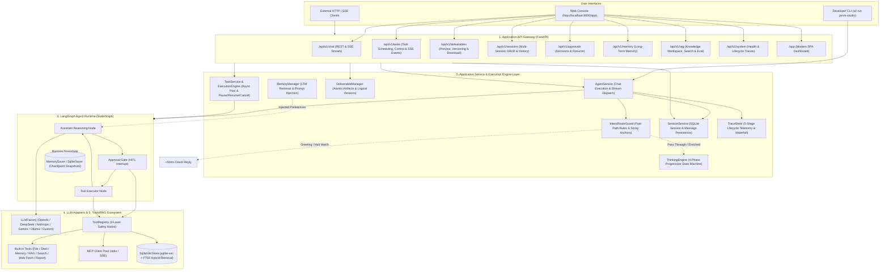
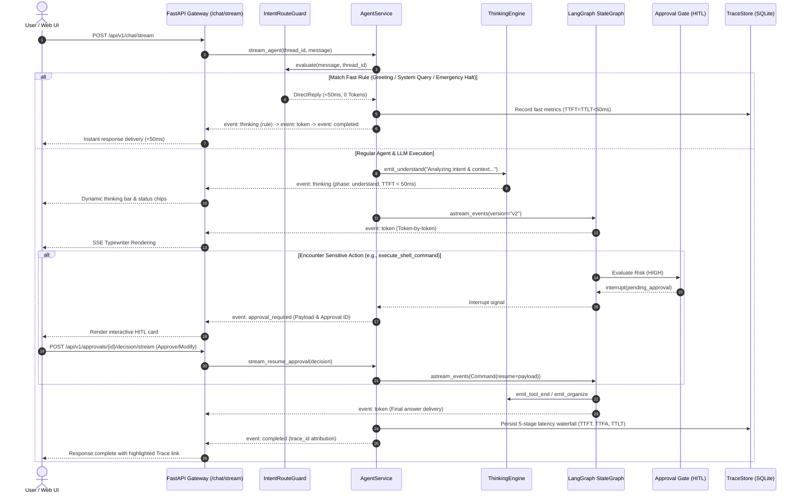

# AgentStudio

> **Personal AI Agent Workspace & Production Runtime System (formerly Jarvis Studio)**  
> *Create · Orchestrate · Execute · Deliver. Powered by LangGraph, Model Context Protocol (MCP), sqlite-vec, and Durable Checkpointing.*

[](https://www.python.org/downloads/)
[](https://github.com/langchain-ai/langgraph)
[](https://github.com/langchain-ai/langchain)
[](https://fastapi.tiangolo.com/)
[](https://modelcontextprotocol.io/)
[](https://github.com/asg017/sqlite-vec)
[](https://github.com/astral-sh/uv)
[](https://github.com/astral-sh/ruff)
[](tests/)
[](LICENSE)

[ 简体中文 ](README.md) | [ English ](README.en.md)

---

## 1. Overview

### What is AgentStudio?
**AgentStudio** (formerly Jarvis Studio) is a **Personal AI Agent Workspace** and production-grade runtime system built for individual developers, technical researchers, and knowledge workers. It runs interactively in developer terminals or as a continuous background daemon. Powered by modular tools, the [Model Context Protocol (MCP)](https://modelcontextprotocol.io/) external ecosystem, `sqlite-vec` + `FTS5` local hybrid retrieval, a durable task execution engine, and a deliverable management center, it turns natural language goals into observable, controllable, and verifiable execution.

> **Renaming Notice**: This project has officially been renamed from `Jarvis Studio` to **AgentStudio**. For backward compatibility, the Python package (`jarvis_studio`), CLI entrypoint (`jarvis-studio`), and default SQLite database filenames (`data/jarvis_studio.db`, `data/jarvis_vec.db`) currently retain their original identifiers while brand surfaces and documentation are progressively migrated.

### Why does it exist?
AgentStudio represents the engineering evolution from experimental agent prototypes into a reliable daily AI workspace:

| Project | Underlying Tech | Purpose | Status |
| :--- | :--- | :--- | :--- |
| **AgentCore** (formerly Jarvis Agent) | In-house Python Runtime | Deep exploration of ReAct and loop internals | Archived |
| **AgentFlow** (formerly Jarvis Agent Plus) | LangChain Core | Framework abstraction & tool binding study | Separate Project |
| **AgentGraph** (formerly Jarvis Agent Pro) | LangGraph Primitives | Graph-based state machine orchestration | Separate Project |
| **AgentStudio** (formerly Jarvis Studio) | **LangGraph + MCP + sqlite-vec + FTS5** | **Personal AI Agent Workspace for daily work** | **Active Project** |

> **Core Philosophy**: Do not reinvent the agent runtime. Leverage mature, battle-tested production frameworks (**LangGraph**, **LangChain**, and **MCP**) to focus engineering efforts on real-world workflows, durable Task/Run scheduling, deliverable provenance, safety boundaries, human-in-the-loop controls, and long-term maintainability.

---

## 2. Implemented Features

> **Current Status**: Core engineering milestones **Sprint 1C–3C** and **MVP 1.0 Sprint 1–2 (Tasks Workbench & Deliverables Center)** are implemented and verified (`290 passed, 12 skipped` in Layer A offline regression).

- **Durable Task/Run & Async ExecutionEngine**: Built on SQLite Schema V6 managing `agent_tasks`, `agent_runs`, `agent_events`, and `agent_deliverables`. Provides an async worker pool (`execute`), cooperative `pause` / `resume` / `cancel`, multi-run `append-instruction`, Checkpoint GC (`purge`), and persistent replayable Task SSE streams (`/api/v1/tasks/{task_id}/events/stream`) with Live Handoff.
- **Deliverables Center & Provenance Verification**: `DeliverableManager` and `publish_research_report` support atomic writes, SHA-256 checksums, logical versioning across runs (`run_id`-scoped), workspace security boundaries, and Run-scoped provenance verification (`verify_report_provenance`). Web UI and APIs (`/api/v1/deliverables*`) provide global listing, Markdown preview, and file download.
- **Hybrid Knowledge Workspace & Task KnowledgeScope**: Zero-dependency local hybrid retrieval combining `sqlite-vec` vector search, SQLite `FTS5` full-text search, and RRF fusion with score explainability (`vector` / `fts` / `rrf`). Supports multi-format ingestion (Markdown, TXT, PDF, DOCX, code), RAG evaluation (`/api/v1/rag/eval`), and server-side enforced `KnowledgeScope` (including explicit empty deny-all isolation).
- **Web Research & SSRF-Hardened Fetch**: Pluggable web search (`search_web`: `auto`, `tavily`, `duckduckgo`, `local_kb`) and SSRF-hardened `fetch_web_page` with prompt-injection isolation boundaries.
- **Fail-Closed High-Risk Tool Handling (Option B Outcome)**: Separates authorization state (`ApprovalStatus`) from physical execution side effects (`ExecutionOutcomeStatus`). When cancelled or disconnected in-flight, active runs are safely marked `UNKNOWN` and protected by shielded background cancellation workers.
- **Session Busy Guard & Cascade Deletion**: Blocks session deletion during active task or approval states (`RUNNING`, `WAITING_APPROVAL`, `EXECUTING_TOOL`, `CREATED`, `PENDING`) with HTTP 409 Conflict, and performs atomic `BEGIN IMMEDIATE` cascade deletion leaving zero orphaned rows.
- **Lock-Gated Startup Recovery**: Uses `RuntimeInstanceLock` to prevent split-brain across processes and reconciles stale in-flight tasks/runs from crashed instances to `INTERRUPTED` or `UNKNOWN` on startup.
- **Multi-Session Management**: SQLite-backed (`chat_sessions` & `chat_messages`) automatic title generation, real-time search, instant history recovery, renaming, and deletion.
- **Progressive Pseudo-Thinking Stream & Intent Route Guard**: 4-phase thinking state machine (`understand` → `tool` → `organize` → `completed`) with **<50ms** TTFT, keepalive heartbeats, sub-50ms 0-Token fast-path replies, sticky entity context write-through, and emergency safety halts.
- **5-Stage Lifecycle Observability (Traces)**: Captures `Input`, `Guard`, `Preload`, `Thinking & Tools Waterfall`, and `Output Delivery` with millisecond TTFT, TTFA, and TTLT metrics stored in `agent_conversation_traces` (with automatic retention pruning).
- **Strict Decoupled Architecture & Hot-Swappable LLMs (`LLMFactory`)**: Zero hardcoding across OpenAI, DeepSeek, Anthropic, Google Gemini, local Ollama, and custom OpenAI-compatible endpoints.
- **Stateless HITL & Tool Safety Matrix**: High-risk actions (`execute_shell_command`, `write_file`) trigger LangGraph native `interrupt()` frozen to SQLite for `approve` / `reject` / `modify`, synthesizing protocol-compliant `ToolMessage` payloads on rejection; `ToolRegistry` enforces `SAFE` / `MEDIUM` / `HIGH` risk levels alongside dynamic MCP (`stdio` / `SSE`) tool bridging.
- **Cross-Session Long-Term Memory (LTM)**: Persists developer preferences and key facts, dynamically injecting them into the system prompt before reasoning.
- **Ready-to-Use Web UI (`/app`) & Dual Interface**: Dark-themed SPA featuring **Chat**, **Tasks Workbench**, **Deliverables Center**, **Approvals**, **Memory**, **Knowledge Workspace (Documents, Playground, Evaluation)**, **Traces**, and **System** views; paired with the developer CLI (`jarvis-studio info`, `serve`, `chat`, `memory`, `rag`, `sessions`, `mcp`), multi-stage `Dockerfile`, `docker-compose.yml`, and daemon scripts.

---

## 3. Architecture

AgentStudio enforces a strictly decoupled, unidirectional topology across all layers:



### Core Execution Flow (Intent Guard + Progressive Thinking + SSE Streaming + HITL Suspension)



---

## 4. Core Concepts

| Core Concept | Definition & Responsibility in AgentStudio |
| :--- | :--- |
| **Task & Run / ExecutionEngine** | Durable task and async execution engine. Manages `agent_tasks`, `agent_runs`, and `agent_events` on SQLite Schema V6; supports async worker pooling, cooperative pause/resume/cancel, append-instruction runs, and replayable SSE event streams. |
| **DeliverableManager & Provenance** | Artifact lifecycle manager and provenance verifier. Handles atomic persistence, SHA-256 checksums, Run-scoped logical versioning, and citation verification via `verify_report_provenance`. |
| **KnowledgeScope & Hybrid RAG** | Task-scoped knowledge isolation and local hybrid retrieval. Combines `sqlite-vec` vector search, SQLite `FTS5`, and RRF fusion with server-side scope enforcement (including explicit empty deny-all) and `RAGEvaluator`. |
| **IntentRouteGuard** | Front-line intent router and fast-path rule guard. Delivers sub-50ms 0-Token direct replies for common greetings/status queries; manages multi-turn sticky entity context anchors and emergency halt triggers. |
| **ThinkingEngine** | Progressive pseudo-thinking engine. Enforces a 4-phase state machine (`understand` → `tool` → `organize` → `completed`), providing sub-50ms first-response feedback, white-box tool translation, and keepalive heartbeats. |
| **Lifecycle Traces** | End-to-end 5-stage lifecycle observability. Segments execution into `Input`, `Guard`, `Preload`, `Thinking & Tools Waterfall`, and `Output Delivery`, tracking millisecond-accurate TTFT, TTFA, and TTLT. |
| **Multi-Session Store** | Full-featured conversational session storage powered by SQLite tables `chat_sessions` and `chat_messages`. |
| **AgentState & Approval Gate** | Strongly typed graph state schema and security audit node triggering LangGraph `interrupt()` for high-risk tool invocations. |
| **ToolRegistry & RiskLevel** | Central tool catalog managing metadata and 3-level safety classifications (`SAFE`, `MEDIUM`, `HIGH`). |
| **MCP Client Manager** | Model Context Protocol coordinator managing stdio child processes and SSE sessions, dynamically mapping JSON Schemas to LangChain tools. |
| **MemoryManager (LTM)** | Cross-session long-term memory system storing user preferences, coding habits, and key facts, injecting them into the prompt before reasoning. |
| **SqliteSaver Checkpoint** | Spatiotemporal state persistence saving conversational context and step snapshots to SQLite, enabling fault tolerance and session resumption. |

---

## 5. Project Structure

```text
JarvisStudio/ (AgentStudio)
├── src/jarvis_studio/           # Core source package (retains jarvis_studio import path for compatibility)
│   ├── api/                     # 1. Application API Gateway (FastAPI 0.115+)
│   │   ├── routes/              # Modular routers (/chat, /tasks, /deliverables, /sessions, /approvals, /memory, /rag, /system)
│   │   ├── schemas/             # Pydantic request and response contract models
│   │   ├── static/              # Modern responsive SPA dashboard (index.html)
│   │   └── app.py               # FastAPI lifecycle, CORS middleware, and static mount factory
│   ├── service/                 # 2. Application Service Layer
│   │   ├── agent_service.py     # Execution coordination, SSE streaming, and HITL resumption
│   │   ├── task_service.py      # Task / Run lifecycle orchestration and event subscriptions
│   │   ├── task_coordinator.py  # Task coordinator export facade
│   │   ├── deliverable_manager.py # Atomic deliverable persistence, SHA-256 & logical versioning
│   │   └── session_service.py   # SQLite multi-session CRUD, auto-titling, and message persistence
│   ├── agent/                   # 3. LangGraph Agent Runtime (StateGraph)
│   │   ├── checkpoints/         # State checkpointer factory and savers (MemorySaver / SqliteSaver)
│   │   ├── hitl/                # HITL interrupt manager and approval state machine
│   │   ├── nodes/               # Pure atomic nodes (assistant, approval_gate, executor, router)
│   │   ├── graph.py             # StateGraph assembly, conditional edge routing, and compilation
│   │   └── state.py             # Strongly typed AgentState schema contract
│   ├── core/                    # 4. Runtime Engine, LLM Adapters & Persistence Infrastructure
│   │   ├── runtime/             # AgentRuntime, ExecutionEngine worker pool, and instance lock
│   │   ├── persistence/         # SQLite Schema V6 migrations, startup recovery, and Checkpoint GC
│   │   ├── tasks/               # TaskCoordinator, EventStore, and state models
│   │   ├── guard/               # IntentRouteGuard fast-path routing, sticky entities, and halts
│   │   ├── thinking/            # ThinkingEngine 4-phase progressive state machine & heartbeats
│   │   ├── llm/                 # LLMFactory (OpenAI, DeepSeek, Anthropic, Gemini, Ollama, Custom)
│   │   ├── observability/       # 5-stage lifecycle telemetry (TraceStore) and structured logging
│   │   └── errors.py            # Unified domain exception definitions
│   ├── tools/                   # 5. Tool Subsystem & MCP Ecosystem
│   │   ├── builtin/             # Built-in file, shell, memory, RAG, search, web fetch & report tools
│   │   ├── mcp/                 # MCPClientManager, stdio process pool, and dynamic adapter
│   │   ├── base.py              # RiskLevel definitions and tool metadata decorators
│   │   └── registry.py          # Central tool registry (ToolRegistry)
│   ├── memory/                  # Long-Term Memory (LTM: Store, Manager, Models)
│   ├── rag/                     # Hybrid RAG (sqlite-vec + FTS5, Parser, Splitter, Provenance, Eval)
│   ├── config/                  # Pydantic Settings tiered configuration loader
│   └── cli/                     # Developer terminal interface (Click + Rich console)
├── config/                      # YAML runtime config & MCP server registry
├── docs/                        # Technical documentation hub (product, architecture, design, ADRs, roadmap)
├── scripts/                     # Daemon scripts (run_daemon.*) & Layer B live E2E script (verify_live_e2e.py)
├── tests/                       # Automated test suite (48 test files; Layer A: 290 passed, 12 skipped)
├── Dockerfile                   # Multi-stage production container build specification
├── docker-compose.yml           # Single-command container deployment template
├── pyproject.toml               # uv / PEP 621 dependency specifications and packaging config
└── main.py                      # CLI entrypoint shortcut
```

---

## 6. Getting Started

### 6.1 Prerequisites
- **Python**: `>= 3.12`
- **Package Manager**: [uv](https://github.com/astral-sh/uv) (recommended for speed and determinism)

### 6.2 Installation
```bash
# 1. Clone the repository
git clone https://github.com/PublicYang/JarvisStudio.git
cd JarvisStudio

# 2. Install all runtime and development dependencies with uv
uv sync --extra dev

# 3. Copy environment configuration template
cp .env.example .env
```

### 6.3 Launch the Web UI Console (Recommended)
```bash
# Start API gateway and integrated Web UI (with auto-reload)
uv run jarvis-studio serve --port 8000 --reload
```
Open your browser and navigate to:
- **Web UI Console**: [http://localhost:8000/app](http://localhost:8000/app)
- **Interactive OpenAPI Docs**: [http://localhost:8000/docs](http://localhost:8000/docs)

### 6.4 Launch Interactive Terminal REPL
```bash
# Inspect system status, active provider, and registered tool safety matrix
uv run jarvis-studio info

# Start multi-turn interactive chat (with terminal HITL prompts)
uv run jarvis-studio chat
```

### 6.5 Long-Term Memory & Local RAG Exploration
```bash
# 1. Record a personal preference into Long-Term Memory (LTM)
uv run jarvis-studio memory add "Always prefer Python 3.12 and uv package manager" --category preference

# 2. Inspect active memories
uv run jarvis-studio memory list

# 3. Index workspace documentation incrementally into the vector database (RAG)
uv run jarvis-studio rag index ./docs

# 4. Perform semantic vector similarity search
uv run jarvis-studio rag search "HITL human approval mechanism" --top-k 3

# 5. List historical conversation sessions stored in SQLite
uv run jarvis-studio sessions
```

### 6.6 Connect Real Large Language Models
Edit your `.env` file to configure your model provider credentials:

```bash
# 1. Using OpenAI
DEFAULT_LLM_PROVIDER=openai
DEFAULT_MODEL_NAME=gpt-4o-mini
OPENAI_API_KEY=your_api_key_here

# 2. Or using DeepSeek (OpenAI-compatible protocol)
# DEFAULT_LLM_PROVIDER=deepseek
# DEEPSEEK_API_KEY=your_deepseek_key

# 3. Or using local offline Ollama
# DEFAULT_LLM_PROVIDER=ollama
# OLLAMA_MODEL_NAME=llama3.1:8b
# OLLAMA_BASE_URL=http://localhost:11434/v1
```

### 6.7 Run Full Automated Test Suite
```bash
# Run Layer A offline unit, integration, and E2E regression tests
uv run --extra dev pytest
```
*Current Layer A result: `290 passed, 12 skipped` (0 failed; skipped tests are explicit opt-in live/external cases).*

To run the isolated Layer B live E2E verification (requires real API keys and network access):
```bash
uv run python scripts/verify_live_e2e.py --confirm-live
```

---

## 7. Configuration

| Environment Variable | Default Value | Description |
| :--- | :--- | :--- |
| `DEFAULT_LLM_PROVIDER` | `openai` | Default LLM provider (`openai`, `deepseek`, `ollama`, `custom`). |
| `DEFAULT_MODEL_NAME` | `gpt-4o-mini` | Default model identifier. |
| `OPENAI_API_KEY` | None | OpenAI API secret key. |
| `DEEPSEEK_API_KEY` | None | DeepSeek API secret key. |
| `OLLAMA_BASE_URL` | `http://localhost:11434/v1` | Local Ollama service base endpoint. |
| `HITL_ENABLED` | `true` | Globally enable/disable human confirmation on dangerous tools. |
| `CHECKPOINT_BACKEND` | `sqlite` | Checkpointer storage backend (`sqlite` or `memory`). |
| `SQLITE_DB_PATH` | `data/jarvis_studio.db` | SQLite checkpoint database file path. |
| `WORKSPACE_ROOT` | `./data/workspace` | Safe filesystem root for file and command execution. |
| `RAG_ENABLED` | `true` | Enable/disable local RAG knowledge base. |
| `EMBEDDING_PROVIDER` | `auto` | Embedding provider (`auto`, `openai`, `local`). |
| `VECTOR_DB_PATH` | `data/jarvis_vec.db` | `sqlite-vec` vector database file path. |
| `MCP_CONFIG_PATH` | `config/mcp_servers.json` | Registry configuration for external MCP servers. |

---

## 8. Development & Quality Gates

This repository adheres to strict automated code quality gates. All checks must pass before merging:

```bash
# Run Ruff linting and code smell detection
uv run ruff check .

# Run automated formatting checks and fixes
uv run ruff check --fix .
uv run ruff format .

# Run the complete Layer A test suite (290 passed, 12 skipped)
uv run --extra dev pytest -v
```

---

## 9. Documentation

Comprehensive product specs, architecture designs, and engineering walkthroughs are organized under [`docs/`](docs/README.md):

```text
docs/
├── MVP_1.0_GAP_ANALYSIS.md           # AgentStudio MVP 1.0 product gap analysis & plan
├── product/                          # Product & UX Specifications
│   ├── AGENTSTUDIO_PRD_V1.md         # Product Requirements Document (PRD v1.0)
│   ├── AGENTSTUDIO_UX_IA.md          # UX & Information Architecture Specification
│   └── PRODUCT_CAPABILITY_AUDIT.md   # Product capability audit & evolution plan
├── architecture/                     # System Architecture & Domain Evolution
│   ├── AGENTSTUDIO_ARCHITECTURE_V1.md    # AgentStudio System Architecture Spec (v1.0)
│   ├── AGENTSTUDIO_DOMAIN_EVOLUTION.md   # Session / Task / Run Domain Evolution
│   ├── AGENTSTUDIO_DELIVERABLE_DESIGN.md # Deliverable System & Security Boundaries
│   ├── AGENTSTUDIO_EVENT_MODEL.md        # Execution Events & Observability Model
│   ├── AGENTSTUDIO_EXECUTION_CONTROL.md  # Task Control, Side Effects & HITL Spec
│   ├── system-architecture.md            # 5-tier decoupled design, module boundaries & topology
│   └── execution-lifecycle.md            # StateGraph runtime execution & state transitions
├── design/                           # Component Specifications
│   ├── hitl-specification.md         # HITL approval state machine, rejection protocol & REST API
│   ├── tool-system-and-safety.md     # RiskLevel matrix, built-in tools & dynamic MCP bridge
│   └── llm-adapter-layer.md          # LLMFactory, provider hot-swapping & fallback strategies
├── development/                      # Developer Guides
│   ├── setup-and-development.md      # Onboarding, testing standards & quality gates
│   └── configuration-reference.md    # Configuration parameters dictionary (.env, settings.yaml)
├── adr/                              # Architectural Decision Records
│   ├── ADR-001-adopt-langgraph-and-mcp.md       # ADR-001: Why LangGraph and MCP
│   ├── ADR-002-decouple-application-and-agent.md # ADR-002: Why 5-tier strict decoupling
│   └── ADR-003-native-interrupt-for-hitl.md     # ADR-003: Why native interrupt for HITL
└── roadmap/                          # Roadmap & Audit Reports
    ├── AGENTSTUDIO_MVP_ROADMAP.md    # AgentStudio MVP Implementation Roadmap
    ├── SPRINT_2B_IMPLEMENTATION_REPORT.md # Sprint 2B Implementation Audit Report
    └── engineering-roadmap.md        # Earlier engineering milestones (M0 ~ M7)
```

---

## 10. Roadmap

AgentStudio's core runtime foundation is complete and currently progressing through **MVP 1.0 productization**:

### Completed
- ✅ **Milestone 0 ~ 6 (Core Architecture, Runtime, MCP, HITL, LTM, Web UI & Experience)**: 5-tier decoupled architecture, `LLMFactory`, `ToolRegistry` + MCP bridge, native `interrupt()` HITL, LTM, `ThinkingEngine` 4-phase stream, `IntentRouteGuard` fast-path, multi-session CRUD, and 5-stage lifecycle traces.
- ✅ **Sprint 1C (Production-Grade Persistence & Recovery)**: SQLite cascade cleanup, Task/Run coordinator, Session Busy Guard, Option B fail-closed semantics, `RuntimeInstanceLock`, and startup recovery.
- ✅ **Sprint 2A / 2B (Task Execution Engine & Control Plane)**: SQLite Schema V5, async `ExecutionEngine` worker pool, cooperative `Pause` / `Resume` / `Cancel` / `Append Instruction`, persistent replayable Task SSE streaming, and Checkpoint GC.
- ✅ **Sprint 3A / 3B / 3C (Hybrid Knowledge Workspace, Research Loop & E2E Verification)**: Multi-format document ingestion, SQLite `FTS5` + `sqlite-vec` hybrid retrieval with RRF explainability, Schema V6 server-side `KnowledgeScope` (with deny-all isolation), RAG evaluation, SSRF-hardened web fetch, `verify_report_provenance`, and Layer A/B E2E verification.
- ✅ **MVP 1.0 Sprint 1 & Sprint 2 (Tasks Workbench & Deliverables Center)**: Web UI integration for `/api/v1/tasks*` (live SSE, Run switcher, inline HITL, Scope binding) and `/api/v1/deliverables*` (logical versioning, security boundaries, Markdown preview & download).

### In Progress / Upcoming
- 🚧 **MVP 1.0 Sprint 3 ~ 4 (Agent Profiles, Settings Onboarding & Full Brand Migration)**: Lightweight Agent Profile management, first-run diagnostics & onboarding, Chat-to-Task conversion, and full **AgentStudio** branding across UI/CLI.
- [ ] **Cross-Platform Native Desktop Packaging**: Package the Web console into a lightweight native desktop app using Tauri or Electron.
- [ ] **Distributed Checkpoints & Scheduled Automation**: PostgresSaver support for multi-node clusters and scheduled autonomous workflows.

---

## 11. License

This project is open-source and distributed under the [MIT License](LICENSE).
