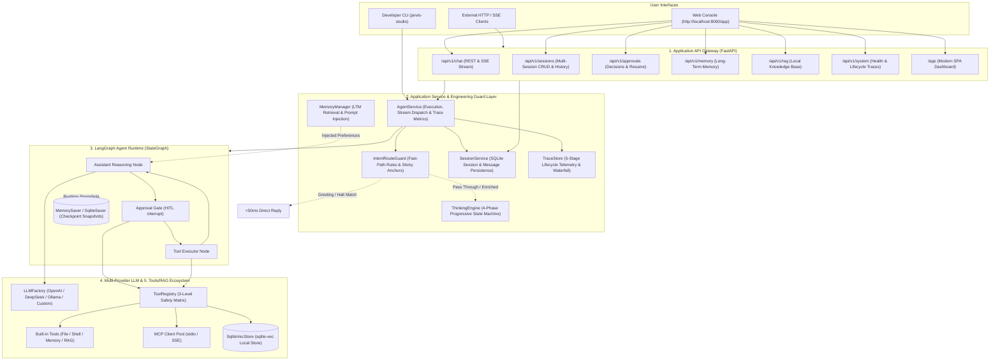
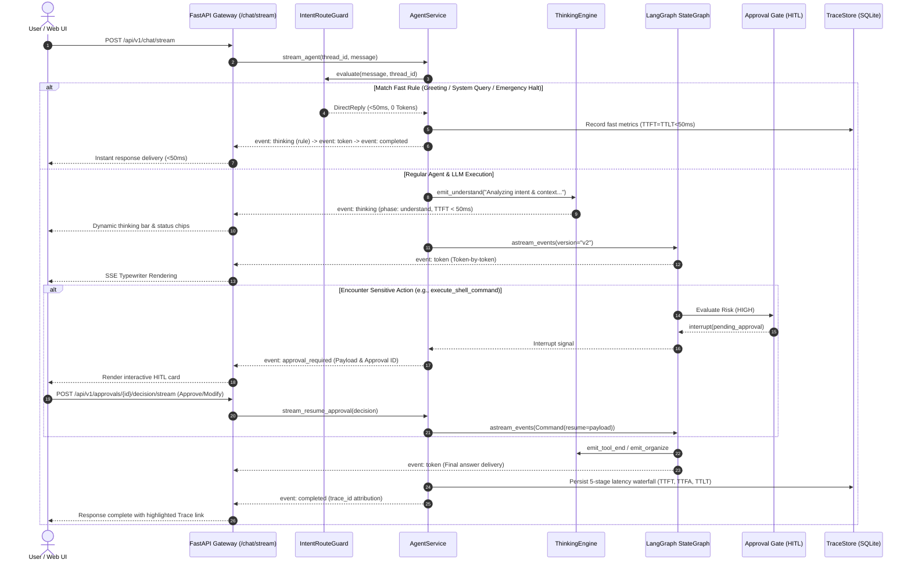

# Jarvis Studio

> **A Personal Production AI Operating Assistant with LangGraph, Model Context Protocol (MCP), and Durable Checkpoints.**  
> *Engineered with a 5-tier decoupled architecture, stateless HITL interrupts, sqlite-vec RAG, and real-time SSE streaming.*

[](https://www.python.org/downloads/)
[](https://github.com/langchain-ai/langgraph)
[](https://github.com/langchain-ai/langchain)
[](https://fastapi.tiangolo.com/)
[](https://modelcontextprotocol.io/)
[](https://github.com/asg017/sqlite-vec)
[](https://github.com/astral-sh/uv)
[](https://github.com/astral-sh/ruff)
[](tests/)
[](LICENSE)

[ 简体中文 ](README.md) | [ English ](README.en.md)

---

## 1. Overview

### What is Jarvis Studio?
**Jarvis Studio** is a personal, production-grade AI Operating Assistant and runtime system engineered for daily software development, local file operations, system task automation, and knowledge retrieval. It runs interactively in developer terminals or as a continuous background operating daemon. Powered by modular tools, the [Model Context Protocol (MCP)](https://modelcontextprotocol.io/) external ecosystem, `sqlite-vec` zero-dependency local vector retrieval, and persistent cross-session memory, it translates natural language instructions into safe, predictable, and verifiable execution.

### Why does it exist?
Jarvis Studio represents the engineering evolution from experimental agent prototypes into a reliable daily production system:

| Project | Underlying Tech | Purpose | Status |
| :--- | :--- | :--- | :--- |
| **Jarvis Agent** | In-house Python Runtime | Deep exploration of ReAct and loop internals | Archived |
| **Jarvis Agent Plus** | LangChain Core | Framework abstraction & tool binding study | Separate Project |
| **Jarvis Agent Pro** | LangGraph Primitives | Graph-based state machine orchestration | Separate Project |
| **Jarvis Studio** | **LangGraph + MCP + sqlite-vec** | **Reliable, personal AI assistant for daily work** | **Active Project** |

> **Core Philosophy**: Do not reinvent the agent runtime. Leverage mature, battle-tested production frameworks (**LangGraph**, **LangChain**, and **MCP**) to focus engineering efforts on real-world use cases, safety boundaries, swappable models, human-in-the-loop controls, and long-term maintainability.

---

## 2. Implemented Features

> **Current Status**: All core engineering milestones are **100% completed**, verified by 43 unit and integration tests (100% PASS).

- **Full Multi-Session Management (Multi-Session CRUD)**: SQLite-backed (`chat_sessions` & `chat_messages`) automatic title generation, real-time search, instant history recovery, session renaming, and deletion with a collapsible sidebar UI.
- **Progressive Pseudo-Thinking Stream**: Implements a 4-phase thinking state machine (`understand` → `tool` → `organize` → `completed`), reducing Time To First Token (TTFT) to **<50ms** with keepalive heartbeats and white-box tool translation to eliminate LLM waiting anxiety.
- **Intent Route Guard & Fast-Path Reply**: Sub-50ms 0-Token direct replies for common greetings and system queries; provides sticky context anchors across turns and emergency safety halts.
- **5-Stage Lifecycle Observability & Waterfall Traces**: Detailed telemetry across Input, Guard, Preload, Progressive Thinking & Tool Waterfall, and Output delivery, capturing millisecond-accurate TTFT, TTFA, and TTLT metrics.
- **Strict 5-Tier Decoupled Architecture**: Thorough layer isolation across API Gateway, Application Service, Agent Runtime, Tools/MCP, and Core Infrastructure—zero direct coupling between UI/API and internal state graphs.
- **Hot-Swappable LLM Adapters (LLMFactory)**: Zero hardcoding. Dynamically switch between OpenAI, DeepSeek, local offline Ollama, and custom OpenAI-compatible endpoints via configuration without altering graph logic.
- **Stateless Human-in-the-Loop (HITL)**: High-risk actions (`execute_shell_command`, `write_file`) automatically trigger LangGraph native `interrupt()`, snapshotting and freezing state to SQLite for human review (`approve`, `reject`, `modify`).
- **Protocol-Compliant Rejection Handling**: User rejections automatically synthesize valid `ToolMessage` payloads, adhering to LLM tool-calling API contracts and enabling the model to replan gracefully without raising exceptions.
- **Tool Subsystem & Safety Matrix**: Central `ToolRegistry` enforcing a 3-tier risk classification (`SAFE` read-only, `MEDIUM` non-destructive, `HIGH` destructive/terminal).
- **Dynamic MCP Tool Ecosystem Bridge**: Dynamically inspects and compiles external MCP Server JSON Schemas into strongly typed LangChain Pydantic tools at runtime, supporting stdio sub-processes and SSE transports.
- **Cross-Session Long-Term Memory (LTM)**: Persistent storage for developer preferences, environment profiles, and critical facts, dynamically injected into the system prompt prior to agent reasoning.
- **Local Private RAG Knowledge Base**: High-performance vector storage powered by `sqlite-vec` (zero external service dependencies), with semantic document splitting, SHA-256 incremental hash scanning, and KNN similarity search.
- **Durable Checkpointing & Crash Resilience**: Runtime in-memory execution snapshots combined with persistent SQLite conversation tables provide seamless recovery across restarts.
- **Server-Sent Events (SSE) Streaming**: Gateway supports real-time token-by-token typewriter generation, progressive thinking state machine events, tool execution lifecycle events, and interrupt suspension events (`/api/v1/chat/stream`).
- **Ready-to-Use Web UI Console (`/app`)**: Built-in responsive dark-themed dashboard featuring multi-session management, collapsible thinking process widgets, a dedicated **Traces Observability console**, interactive HITL approval editors, LTM manager, local RAG workbench, and tool registry inspection.
- **Dual Interface Modes**: Full-featured developer CLI (`jarvis-studio info`, `serve`, `chat`, `memory`, `rag`, `sessions`, `mcp`) and standardized FastAPI REST/SSE endpoints.
- **Production Containerization & Daemons**: Includes multi-stage cached `Dockerfile`, `docker-compose.yml`, and system background daemon scripts for Windows, Linux, and macOS.

---

## 3. Architecture

Jarvis Studio enforces a strictly decoupled, unidirectional topology across all layers:



### Core Execution Flow (Intent Guard + Progressive Thinking + SSE Streaming + HITL Suspension)



---

## 4. Core Concepts

| Core Concept | Definition & Responsibility in Jarvis Studio |
| :--- | :--- |
| **IntentRouteGuard** | Front-line intent router and fast-path rule guard. Delivers sub-50ms 0-Token direct replies for common greetings/status queries; manages multi-turn sticky entity context anchors and emergency halt triggers. |
| **ThinkingEngine** | Progressive pseudo-thinking engine. Enforces a 4-phase state machine (`understand` → `tool` → `organize` → `completed`), providing sub-50ms first-response feedback, white-box tool translation, and keepalive heartbeats. |
| **Lifecycle Traces** | End-to-end 5-stage lifecycle observability. Accurately segments execution into `Input`, `Guard`, `Preload`, `Thinking & Tools Waterfall`, and `Output Delivery`, tracking millisecond-accurate TTFT, TTFA, and TTLT. |
| **Multi-Session Store** | Full-featured conversational session storage. Powered by SQLite tables `chat_sessions` and `chat_messages` for automated title generation, real-time search, renaming, clearing, and instant restoration. |
| **AgentState** | Single Source of Truth for the graph. A strongly typed state schema accumulating messages atomically using the `add_messages` reducer. |
| **Approval Gate** | Security audit node inspecting tool invocations against the safety matrix; triggers LangGraph `interrupt()` to prevent unauthorized execution. |
| **ToolRegistry & RiskLevel** | Central tool catalog managing metadata and 3-level safety classifications (`SAFE`, `MEDIUM`, `HIGH`). |
| **MCP Client Manager** | Model Context Protocol coordinator managing stdio child processes and SSE sessions, dynamically mapping JSON Schemas to LangChain tools. |
| **MemoryManager (LTM)** | Cross-session long-term memory system storing user preferences, coding habits, and key facts, injecting them into the prompt before reasoning. |
| **SqliteVecStore** | Lightweight vector store powered by `sqlite-vec` virtual tables, paired with `DocumentSplitter` and `WorkspaceIndexer` for zero-dependency semantic code/doc search. |
| **SSE Streaming** | Gateway streaming protocol unifying token generation, thinking state machine events, tool lifecycle steps, and interrupt suspension events over standard HTTP event streams. |
| **SqliteSaver Checkpoint** | Spatiotemporal state persistence saving conversational context and step snapshots to SQLite, enabling fault tolerance and session resumption. |

---

## 5. Project Structure

```text
JarvisStudio/
├── src/jarvis_studio/
│   ├── api/                     # 1. Application API Gateway (FastAPI 0.115+)
│   │   ├── routes/              # Modular routers (/chat, /sessions, /approvals, /memory, /rag, /system)
│   │   ├── schemas/             # Pydantic request and response contract models
│   │   ├── static/              # Modern responsive SPA dashboard (index.html)
│   │   └── app.py               # FastAPI lifecycle, CORS middleware, and static mount factory
│   ├── service/                 # 2. Application Service Layer
│   │   ├── agent_service.py     # Execution coordination, SSE streaming, and HITL resumption
│   │   └── session_service.py   # SQLite multi-session CRUD, auto-titling, and message persistence
│   ├── agent/                   # 3. LangGraph Agent Runtime (StateGraph)
│   │   ├── checkpoints/         # State checkpointer factory and savers (MemorySaver / SqliteSaver)
│   │   ├── hitl/                # HITL interrupt manager and approval state machine
│   │   ├── nodes/               # Pure atomic nodes (assistant, approval_gate, executor, router)
│   │   ├── graph.py             # StateGraph assembly, conditional edge routing, and compilation
│   │   └── state.py             # Strongly typed AgentState schema contract
│   ├── core/                    # 4. Multi-Provider LLM & Engineering Guard Infrastructure
│   │   ├── guard/               # IntentRouteGuard fast-path routing, sticky entities, and halts
│   │   ├── thinking/            # ThinkingEngine 4-phase progressive state machine & heartbeats
│   │   ├── llm/                 # LLMFactory (OpenAI, DeepSeek, Ollama, custom endpoints)
│   │   ├── observability/       # 5-stage lifecycle telemetry (TraceStore) and structured logging
│   │   └── errors.py            # Unified domain exception definitions
│   ├── tools/                   # 5. Tool Subsystem & MCP Ecosystem
│   │   ├── builtin/             # Built-in filesystem, shell, memory, and RAG tools
│   │   ├── mcp/                 # MCPClientManager, stdio process pool, and dynamic adapter
│   │   ├── base.py              # RiskLevel definitions and tool metadata decorators
│   │   └── registry.py          # Central tool registry (ToolRegistry)
│   ├── memory/                  # Long-Term Memory (LTM: Store, Manager, Models)
│   ├── rag/                     # Local RAG (sqlite-vec Store, Embeddings, Indexer, Splitter)
│   ├── config/                  # Pydantic Settings tiered configuration loader
│   └── cli/                     # Developer terminal interface (Click + Rich console)
├── config/                      # YAML runtime config & MCP server registry
├── docs/                        # Complete technical documentation hub (architecture, design, ADRs)
├── scripts/                     # Service management daemon scripts (run_daemon.ps1, run_daemon.sh)
├── tests/                       # Automated test suite (43 unit and integration tests, 100% PASS)
├── Dockerfile                   # Multi-stage production container build specification
├── docker-compose.yml           # Single-command container deployment template
├── pyproject.toml               # uv / PEP 621 dependency specifications and packaging config
└── main.py                      # CLI entrypoint shortcut
```

---

## 6. Getting Started

### 6.1 Prerequisites
- **Python**: `>= 3.12`
- **Package Manager**: [uv](https://github.com/astral-sh/uv) (recommended for speed and determinism)

### 6.2 Installation
```bash
# 1. Clone the repository
git clone https://github.com/PublicYang/JarvisStudio.git
cd JarvisStudio

# 2. Install all runtime and development dependencies with uv
uv sync --extra dev

# 3. Copy environment configuration template
cp .env.example .env
```

### 6.3 Launch the Web UI Console (Recommended)
```bash
# Start API gateway and integrated Web UI (with auto-reload)
uv run jarvis-studio serve --port 8000 --reload
```
Open your browser and navigate to:
- **Web UI Console**: [http://localhost:8000/app](http://localhost:8000/app)
- **Interactive OpenAPI Docs**: [http://localhost:8000/docs](http://localhost:8000/docs)

### 6.4 Launch Interactive Terminal REPL
```bash
# Inspect system status, active provider, and registered tool safety matrix
uv run jarvis-studio info

# Start multi-turn interactive chat (with terminal HITL prompts)
uv run jarvis-studio chat
```

### 6.5 Long-Term Memory & Local RAG Exploration
```bash
# 1. Record a personal preference into Long-Term Memory (LTM)
uv run jarvis-studio memory add "Always prefer Python 3.12 and uv package manager" --category preference

# 2. Inspect active memories
uv run jarvis-studio memory list

# 3. Index workspace documentation incrementally into the vector database (RAG)
uv run jarvis-studio rag index ./docs

# 4. Perform semantic vector similarity search
uv run jarvis-studio rag search "HITL human approval mechanism" --top-k 3

# 5. List historical conversation sessions stored in SQLite
uv run jarvis-studio sessions
```

### 6.6 Connect Real Large Language Models
Edit your `.env` file to configure your model provider credentials:

```bash
# 1. Using OpenAI
DEFAULT_LLM_PROVIDER=openai
DEFAULT_MODEL_NAME=gpt-4o-mini
OPENAI_API_KEY=your_api_key_here

# 2. Or using DeepSeek (OpenAI-compatible protocol)
# DEFAULT_LLM_PROVIDER=deepseek
# DEEPSEEK_API_KEY=your_deepseek_key

# 3. Or using local offline Ollama
# DEFAULT_LLM_PROVIDER=ollama
# OLLAMA_MODEL_NAME=llama3.1:8b
# OLLAMA_BASE_URL=http://localhost:11434/v1
```

### 6.7 Run Full Automated Test Suite
```bash
uv run --extra dev pytest
```
*All 43 unit and integration tests should pass within 12 seconds.*

---

## 7. Configuration

| Environment Variable | Default Value | Description |
| :--- | :--- | :--- |
| `DEFAULT_LLM_PROVIDER` | `openai` | Default LLM provider (`openai`, `deepseek`, `ollama`, `custom`). |
| `DEFAULT_MODEL_NAME` | `gpt-4o-mini` | Default model identifier. |
| `OPENAI_API_KEY` | None | OpenAI API secret key. |
| `DEEPSEEK_API_KEY` | None | DeepSeek API secret key. |
| `OLLAMA_BASE_URL` | `http://localhost:11434/v1` | Local Ollama service base endpoint. |
| `HITL_ENABLED` | `true` | Globally enable/disable human confirmation on dangerous tools. |
| `CHECKPOINT_BACKEND` | `sqlite` | Checkpointer storage backend (`sqlite` or `memory`). |
| `SQLITE_DB_PATH` | `data/jarvis_studio.db` | SQLite checkpoint database file path. |
| `WORKSPACE_ROOT` | `./data/workspace` | Safe filesystem root for file and command execution. |
| `RAG_ENABLED` | `true` | Enable/disable local RAG knowledge base. |
| `EMBEDDING_PROVIDER` | `auto` | Embedding provider (`auto`, `openai`, `local`). |
| `VECTOR_DB_PATH` | `data/jarvis_vec.db` | `sqlite-vec` vector database file path. |
| `MCP_CONFIG_PATH` | `config/mcp_servers.json` | Registry configuration for external MCP servers. |

---

## 8. Development & Quality Gates

This repository adheres to strict automated code quality gates. All checks must pass before merging:

```bash
# Run Ruff linting and code smell detection
uv run ruff check .

# Run automated formatting checks and fixes
uv run ruff check --fix .
uv run ruff format .

# Run the complete test suite (43 tests)
uv run --extra dev pytest -v
```

---

## 9. Documentation

Comprehensive technical specifications and architectural walkthroughs are organized under [`docs/`](docs/README.md):

```text
docs/
├── architecture/                     # System Architecture
│   ├── system-architecture.md        # 5-tier decoupled design, module boundaries & topology
│   └── execution-lifecycle.md        # StateGraph runtime execution, checkpoint snapshots & states
├── design/                           # Component Specifications
│   ├── hitl-specification.md         # HITL approval state machine, rejection protocol & REST API
│   ├── tool-system-and-safety.md     # RiskLevel matrix, built-in tools & dynamic MCP bridge
│   └── llm-adapter-layer.md          # LLMFactory, provider hot-swapping & fallback strategies
├── development/                      # Developer Guides
│   ├── setup-and-development.md      # Onboarding, testing standards & quality gates
│   └── configuration-reference.md    # Configuration parameters dictionary (.env, settings.yaml)
├── adr/                              # Architectural Decision Records
│   ├── ADR-001-adopt-langgraph-and-mcp.md       # ADR-001: Why LangGraph and MCP
│   ├── ADR-002-decouple-application-and-agent.md # ADR-002: Why 5-tier strict decoupling
│   └── ADR-003-native-interrupt-for-hitl.md     # ADR-003: Why native interrupt for HITL
└── roadmap/                          # Roadmap
    └── engineering-roadmap.md        # Core milestone schedule and delivery records (M0 ~ M6)
```

---

## 10. Roadmap

All core milestones of Jarvis Studio are **fully implemented and verified**:

### Completed
- ✅ **Milestone 0: Architecture Baseline & Scaffolding**: 5-tier architecture blueprint, Python 3.12 + `uv` dependencies, automated Pytest foundation.
- ✅ **Milestone 1: Core Agent Runtime & Multi-Provider Engine**: Unified `LLMFactory` (OpenAI, DeepSeek, Ollama), `AgentState` schema, basic ReAct reasoning loop.
- ✅ **Milestone 2: Tool Subsystem & MCP Client Integration**: `ToolRegistry` 3-level safety matrix, built-in filesystem and shell tools, dynamic MCP JSON-to-Pydantic bridge, stdio/SSE client pool.
- ✅ **Milestone 3: Human-in-the-Loop & Execution Checkpoints**: Native stateless `interrupt()` sensitive action interception, SQLite checkpointing, protocol-compliant `ToolMessage` rejection handling, REST API contracts, and terminal resolution prompts.
- ✅ **Milestone 4: Personal Memory & Local Knowledge Base**: Cross-session Long-Term Memory (LTM: `MemoryStore` + `MemoryManager`), dynamic prompt preference injection, zero-dependency `sqlite-vec` local vector store (`SqliteVecStore`), workspace SHA-256 incremental file indexer (`WorkspaceIndexer`).
- ✅ **Milestone 5: Application Gateway, Streaming & User Interface**: Server-Sent Events (SSE) token and step streaming (`/api/v1/chat/stream`), modern responsive Web UI console (`/app`), production multi-stage `Dockerfile`, `docker-compose.yml`, and cross-platform background daemon scripts (`run_daemon.ps1`, `run_daemon.sh`).
- ✅ **Milestone 6: Experience Optimization & AI Engineering Skills Upgrade**:
  - **Progressive Pseudo-Thinking Stream**: 4-phase state machine (`understand` → `tool` → `organize` → `completed`), reducing TTFT to **<50ms** with keepalive heartbeats and white-box tool translation.
  - **Intent Route Guard & Fast-Path Reply**: Sub-50ms 0-Token direct replies for common greetings/status queries, multi-turn sticky entity context tracking, and emergency halts.
  - **Multi-Session CRUD & History**: SQLite tables `chat_sessions` and `chat_messages` driving automated titling, real-time filtering, renaming, and sub-second history restoration.
  - **5-Stage Lifecycle Observability (Traces)**: End-to-end millisecond TTFT / TTFA / TTLT metrics profiling and visual waterfall execution inspector.

### Future & Extension Outlook
- [ ] **Cross-Platform Native Desktop Packaging**: Package the Web console into a lightweight native desktop app using Tauri or Electron.
- [ ] **Distributed Checkpoint & Storage Backends**: Add PostgresSaver checkpointer and cloud object storage adapters for cloud-native multi-node clusters.
- [ ] **Scheduled Autonomous Workflows**: Scheduled background automation and daily briefing jobs.

---

## 11. License

This project is open-source and distributed under the [MIT License](LICENSE).
