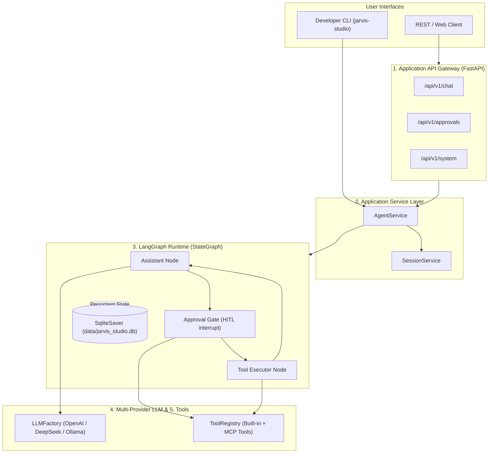

# Jarvis Studio

<div align="center">

**Personal Production AI Operating Assistant**

[](https://www.python.org/downloads/)
[](https://github.com/langchain-ai/langgraph)
[](https://github.com/langchain-ai/langchain)
[](https://fastapi.tiangolo.com/)
[](https://modelcontextprotocol.io/)
[]()
[](LICENSE)

<p align="center">
  <a href="README.md">简体中文</a> | <b>English</b>
</p>

</div>

---

## 1. Overview

### What is Jarvis Studio?
**Jarvis Studio** is a personal AI Operating Assistant designed for daily engineering, file management, system automation, and knowledge retrieval. 

It runs locally or as a personal background service, executing instructions through modular tools, connected [Model Context Protocol (MCP)](https://modelcontextprotocol.io/) servers, and swappable language models.

### Why does it exist?
Jarvis Studio represents the evolution from educational prototypes to a reliable production assistant:

| Project | Foundation | Purpose | Status |
| :--- | :--- | :--- | :--- |
| **Jarvis Agent** | Custom Python Runtime | Deep exploration of ReAct and loop internals | Archived |
| **Jarvis Agent Plus** | LangChain Core | Framework abstraction study | Separate Project |
| **Jarvis Agent Pro** | LangGraph | Graph-based state machine orchestration | Separate Project |
| **Jarvis Studio** | **LangGraph + LangChain + MCP** | **Reliable, personal AI assistant for daily work** | **Active Project** |

> **Design Tenet**: Do not reinvent the agent runtime. Leverage mature, battle-tested frameworks (**LangGraph**, **LangChain**, and **MCP**) to focus on real utility, safety, and personal extensibility.

---

## 2. Core Capabilities (Implemented)

- **Decoupled 5-Tier Architecture**: Clean separation across API Gateway, Application Service, Agent Runtime, Tools/MCP, and LLM Adapters.
- **Swappable LLM Adapters**: Zero vendor lock-in. Switch between OpenAI, DeepSeek, local Ollama, and custom endpoints via configuration without altering graph code.
- **Human-in-the-Loop (HITL) Safety**: Dangerous tools (`execute_shell_command`, `write_file`) automatically trigger LangGraph `interrupt()`, snapshotting state to SQLite for human review (`approve`, `reject`, `modify`).
- **Resilient Rejection Protocol**: User rejections generate valid `ToolMessage` payloads, allowing the LLM to replan gracefully without breaking API schema contracts.
- **Tool System & Safety Matrix**: Central `ToolRegistry` enforces `RiskLevel` boundaries (`SAFE`, `MEDIUM`, `HIGH`).
- **Dynamic MCP Bridge**: Converts external MCP tool JSON Schemas dynamically into strongly-typed LangChain `BaseTool` models at runtime.
- **Durable Checkpointing**: Powered by `langgraph-checkpoint-sqlite` for state serialization and crash-resilient session resumption.
- **End-to-End Tracing**: Contextual `session_id` and `run_id` correlation, execution latency measurement (`timed_step`), and structured logging with Loguru.
- **Dual Interfaces**: Native developer CLI (`jarvis-studio info`, `serve`, `chat`) and FastAPI REST gateway (`/chat`, `/approvals`, `/system`).

---

## 3. Architecture Snapshot



---

## 4. Project Structure

```text
JarvisStudio/
├── docs/                        # Complete technical documentation hub
│   ├── architecture/            # System blueprints and execution lifecycle
│   ├── design/                  # HITL, Tool system, and LLM adapter specs
│   ├── development/             # Setup, testing, and configuration guide
│   ├── adr/                     # Architecture Decision Records (ADRs)
│   └── roadmap/                 # Phase-by-phase engineering milestones
├── config/                      # YAML runtime settings and MCP definitions
├── src/jarvis_studio/
│   ├── api/                     # FastAPI app, routers (/chat, /approvals), schemas
│   ├── service/                 # AgentService and SessionService (Decoupled orchestration)
│   ├── agent/                   # LangGraph StateGraph, nodes, HITL manager, checkpointers
│   ├── tools/                   # ToolRegistry, built-in tools (file, shell), MCP adapter
│   ├── core/                    # LLMFactory, observability (Loguru, tracer), errors
│   ├── config/                  # Pydantic Settings and environment validation
│   └── cli/                     # Click-based developer CLI
├── tests/                       # Automated pytest suite (13 integration & unit tests)
├── .env.example                 # Comprehensive environment variable template
└── pyproject.toml               # uv / PEP 621 build configuration
```

---

## 5. Quickstart

### Prerequisites
- Python `3.12+`
- [`uv`](https://docs.astral.sh/uv/) package manager

### 1. Installation
```bash
# Clone repository
git clone <repo-url>
cd JarvisStudio

# Install all dependencies into virtual environment
uv sync --extra dev

# Copy environment configuration
cp .env.example .env
```

### 2. Configure Credentials
Edit `.env` to configure your preferred LLM provider:
```bash
DEFAULT_LLM_PROVIDER=openai
OPENAI_API_KEY=your_api_key_here

# Or use DeepSeek
# DEFAULT_LLM_PROVIDER=deepseek
# DEEPSEEK_API_KEY=your_deepseek_key

# Or use local Ollama
# DEFAULT_LLM_PROVIDER=ollama
# OLLAMA_MODEL_NAME=llama3.1:8b
```

### 3. Verify Setup
Run the automated test suite:
```bash
uv run pytest
```

### 4. Run the Project
```bash
# View active status and registered tools
uv run jarvis-studio info

# Start the FastAPI REST Gateway (Swagger docs at http://localhost:8000/docs)
uv run jarvis-studio serve --port 8000 --reload

# Start an interactive terminal chat session
uv run jarvis-studio chat
```

---

## 6. Documentation Hub

Detailed specifications and architectural guides are organized in the [`docs/`](docs/README.md) directory:

| Document | Purpose |
| :--- | :--- |
| **[System Architecture](docs/architecture/system-architecture.md)** | 5-tier decoupled architecture, component boundaries, and data flow |
| **[Execution Lifecycle](docs/architecture/execution-lifecycle.md)** | StateGraph runtime flow, checkpoint persistence, and resume mechanics |
| **[HITL Specification](docs/design/hitl-specification.md)** | Human-in-the-loop state machine, interrupt protocol, and REST API |
| **[Tool System & Safety](docs/design/tool-system-and-safety.md)** | `RiskLevel` matrix, built-in tools catalog, and MCP schema bridge |
| **[LLM Adapter Layer](docs/design/llm-adapter-layer.md)** | `LLMFactory`, provider configurations, and protocol neutrality |
| **[Configuration Reference](docs/development/configuration-reference.md)** | Full catalog of `.env` variables and YAML configuration keys |
| **[Setup & Development](docs/development/setup-and-development.md)** | Development environment, testing, and contribution standards |
| **[Architecture Decisions (ADRs)](docs/adr/)** | Accepted architectural decisions (LangGraph, Decoupling, HITL) |
| **[Engineering Roadmap](docs/roadmap/engineering-roadmap.md)** | Milestone schedule from M0 (Scaffolding) to M5 (Production UI) |

---

## 7. Engineering Roadmap Summary

- **Milestone 0: Architecture Baseline & Scaffolding** `[Completed]`  
  5-tier decoupled architecture, Python 3.12 + `uv` environment, automated test scaffold.
- **Milestone 1: Core LangGraph Agent & Multi-Provider Engine** `[In Progress]`  
  `LLMFactory` (OpenAI, DeepSeek, Ollama), `AgentState` schema, basic reasoning loop `[Done]`; live Anthropic/Gemini key tests `[In Progress]`.
- **Milestone 2: Tool Subsystem & MCP Client Integration** `[In Progress]`  
  `ToolRegistry`, built-in file/shell tools, dynamic MCP schema converter `[Done]`; live stdio/SSE sub-process manager `[In Progress]`.
- **Milestone 3: Human-in-the-Loop & Execution Checkpoints** `[In Progress]`  
  LangGraph `interrupt()`, SQLite checkpointing, approval REST API `[Done]`; approval timeout policies `[Planned]`.
- **Milestone 4: Personal Memory & Local Knowledge Base (RAG)** `[Planned]`  
  Long-Term Memory (LTM), semantic user profile, local vector store with `sqlite-vec`.
- **Milestone 5: Application Gateway, Streaming & User Interface** `[Planned]`  
  Server-Sent Events (SSE) token streaming, Web UI frontend (Chat + HITL Review Center), containerization.

---

## 8. License

This project is licensed under the [MIT License](LICENSE).
