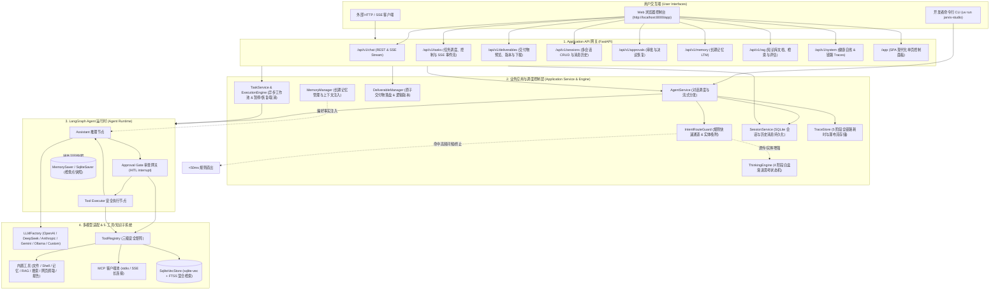
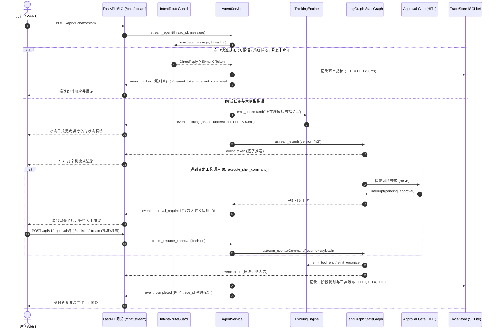

# AgentStudio

> **个人 AI Agent 工作空间与生产级运行时系统**  
> *Personal AI Agent Workspace — Create · Orchestrate · Execute · Deliver. Powered by LangGraph, Model Context Protocol (MCP), sqlite-vec, and Durable Checkpointing.*

[](https://www.python.org/downloads/)
[](https://github.com/langchain-ai/langgraph)
[](https://github.com/langchain-ai/langchain)
[](https://fastapi.tiangolo.com/)
[](https://modelcontextprotocol.io/)
[](https://github.com/asg017/sqlite-vec)
[](https://github.com/astral-sh/uv)
[](https://github.com/astral-sh/ruff)
[](tests/)
[](LICENSE)

[ 简体中文 ](README.md) | [ English ](README.en.md)

---

## 1. Overview (项目概览)

### What is AgentStudio?
**AgentStudio**（原名 Jarvis Studio）是面向个人开发者、技术研究员与知识工作者的 **个人 AI Agent 工作空间（Personal AI Agent Workspace）** 与生产级运行时系统。项目既可以在本地开发者终端中交互运行，也可以作为常驻后台服务运行。通过模块化工具、[Model Context Protocol (MCP)](https://modelcontextprotocol.io/) 外部生态、`sqlite-vec` + `FTS5` 本地混合向量检索、持久化任务执行引擎与交付物管理体系，将自然语言目标转化为可观测、可控制、可追溯交付的实际执行。

> **命名迁移说明**：本项目已正式从 `Jarvis Studio` 更名为 **AgentStudio**。为保持向后兼容，当前 Python 包名（`jarvis_studio`）、CLI 命令入口（`jarvis-studio`）及默认数据库文件名（`data/jarvis_studio.db`、`data/jarvis_vec.db`）暂保留原有标识，相关品牌展示与文档正逐步同步迁移。

### Why does it exist?
AgentStudio 代表了自主智能体从“学习型原型”到“生产级实用工作空间”的工程范式演进：

| 项目代号 | 底层技术 | 项目目标 | 当前状态 |
| :--- | :--- | :--- | :--- |
| **AgentCore** | 自研 Python 运行时 | 深度探究 ReAct 循环与 Agent 底层机制 | 独立项目 |
| **AgentFlow** | LangChain Core | 学习 Framework 抽象与工具绑定体系 | 独立项目 |
| **AgentGraph** | LangGraph 原语 | 学习基于图的状态机编排与循环流转 | 独立项目 |
| **AgentStudio** | **LangGraph + MCP + sqlite-vec + FTS5** | **构建可长期使用的个人 AI Agent 工作空间** | **活跃主开发项目** |

> **核心哲学**：不为了学习而重复造 Runtime。直接采用成熟框架（**LangGraph**、**LangChain** 与 **MCP**），将工程精力聚焦于真实业务场景、Task/Run 持久化调度、交付物溯源、安全边界控制、人机协同安全性与长久可扩展性。

---

## 2. Implemented Features (已实现核心能力)

> **当前状态**: 本项目已完成 **Sprint 1C–3C 核心后端与工程底座** 以及 **MVP 1.0 Sprint 1–2（Tasks 工作台与 Deliverables 交付物中心）** 的核心开发与自动化回归验证。

- **持久化任务与异步执行引擎 (Durable Task/Run & ExecutionEngine)**: 基于 SQLite Schema V6 严格管理 `agent_tasks`、`agent_runs`、`agent_events` 与 `agent_deliverables`；支持异步工作池执行（`execute`）、协作式暂停/恢复（`pause` / `resume`）、安全取消（`cancel`）、多 Run 追加指令（`append-instruction`）、Checkpoint GC 清理（`purge`），以及持久化可回放的 Task SSE 事件流（`/api/v1/tasks/{task_id}/events/stream`，支持历史重放与 Live Handoff）。
- **交付物中心与来源溯源 (Deliverables Center & Provenance)**: 提供 `DeliverableManager` 与 `publish_research_report` 工具，支持原子落盘、SHA-256 校验、多 Run 逻辑版本管理（不覆盖历史产物）、工作区安全边界校验以及 Run 级来源核验（`verify_report_provenance`）。前端与 API（`/api/v1/deliverables*`）支持全局列表、Markdown 在线预览与原文件下载。
- **混合检索知识库与任务作用域 (Knowledge Workspace & Task KnowledgeScope)**: 基于 `sqlite-vec` + SQLite `FTS5` 与 RRF 融合算法实现零外部服务依赖的本地混合检索；支持 Markdown / TXT / PDF / DOCX / 代码等多格式增量解析入库、检索可解释性得分（vector / fts / rrf）、RAG 评估器（`/api/v1/rag/eval`），以及服务端强制执行的 `KnowledgeScope`（支持按 Collection / Document 范围限定，含显式空范围 deny-all 隔离）。
- **网络研究与安全抓取工具 (Research & Web Fetch)**: 内置可插拔网页搜索（`search_web`，支持 `auto` / `tavily` / `duckduckgo` / `local_kb`）与带 SSRF 防护、Prompt 注入隔离边界的网页抓取工具（`fetch_web_page`）。
- **高危操作在途阻断与结果语义分离 (Option B & Execution Outcome)**: 严格区分审批授权状态（`ApprovalStatus`）与物理副作用状态（`ExecutionOutcomeStatus`）；在客户端取消或进程退出时，若物理工具在途执行则将 Run 标记为 `UNKNOWN`（Fail-Closed 原则），结合 `_execute_cancellation_cleanup_shielded` 异步屏蔽，杜绝二次重放风险。
- **会话繁忙守卫与事务级联删除 (Session Busy Guard & Cascade Delete)**: 严格拦截处于活跃或等待人工审批状态（`RUNNING`、`WAITING_APPROVAL`、`EXECUTING_TOOL`、`CREATED`、`PENDING`）的会话删除并返回 HTTP 409 Conflict；会话删除在 `BEGIN IMMEDIATE` 排他事务中按外键依赖倒序级联清理关联表，杜绝孤儿数据残留。
- **单实例排他锁与故障启动恢复 (Lock-Gated Startup Recovery)**: 基于 `RuntimeInstanceLock` 提供多进程防脑裂保护；实例重启时在锁保护下执行 `reconcile_on_startup`，自动将死进程残留的在途任务收敛为 `INTERRUPTED` 或 `UNKNOWN`。
- **完整多会话管理与即时切换 (Multi-Session Management)**: 基于 SQLite `chat_sessions` 与 `chat_messages` 实现会话自动命名、新建、搜索过滤、历史消息秒级恢复、重命名与安全删除，支持前端可折叠侧边栏交互。
- **白盒化渐进式思考流 (Pseudo-Thinking Stream)**: 4 阶段状态演进（`understand` 意图分析 → `tool` 工具执行 → `organize` 答案整理 → `completed` 完成交付），首字响应耗时（TTFT）压降至 **<50ms**；集成工具白盒化翻译与心跳保活循环。
- **意图守卫与极速通道 (Conversation State Guard)**: 针对日常问候、系统查询等高频场景实现 **<50ms / 0 Token 消耗直出**；具备多轮对话实体吸附（Sticky Context Anchor，实时写穿至 `chat_sessions.metadata`）与紧急制动安全熔断（Halt）。
- **端到端全生命周期可观测性 (5-Stage Lifecycle Traces)**: 覆盖输入规整、规则守卫、上下文预热、思考/工具瀑布流到流式交付完整 5 阶段，全链路自动打标 TTFT、TTFA、TTLT 毫秒级性能指标并持久化至 `agent_conversation_traces`（自动修剪超期与超量记录）。
- **严格分层解耦架构 & 多模型热插拔 (LLMFactory)**: API Gateway、Application Service、Agent Runtime、Tools/MCP、Core Infrastructure 彻底分层；零硬编码无缝切换 OpenAI、DeepSeek、Anthropic、Google Gemini、本地 Ollama 及自定义 OpenAI 兼容端点。
- **无状态人机协同 (Stateless HITL) 与工具安全矩阵**: 遇到高危操作（`execute_shell_command`、`write_file`）时自动触发 LangGraph 原生 `interrupt()` 协议冻结状态至 SQLite，支持 `approve` / `reject` / `modify`，拒绝时自动合成合法 `ToolMessage`；`ToolRegistry` 实施 `SAFE` / `MEDIUM` / `HIGH` 三级风险管控，并支持运行时动态桥接外部 MCP Server（stdio / SSE）。
- **跨会话长期个人记忆系统 (LTM)**: 存储开发者个人偏好、技术栈与关键事实，并在 Agent 推理前动态注入系统提示词上下文。
- **Web UI 控制台 (`/app`) 与双端交互**: 原生集成深色模式单页控制台，涵盖 **💬 对话**、**📋 任务 (Tasks)**、**📄 交付物 (Deliverables)**、**🛡️ 审批**、**🧠 记忆**、**📚 知识库 (文档工作区 / 检索实验台 / 评估)**、**⚡ 追踪** 与 **⚙️ 系统** 视图；同时提供本地终端 CLI（`jarvis-studio info`、`serve`、`chat`、`memory`、`rag`、`sessions`、`mcp`）及多阶段 `Dockerfile`、`docker-compose.yml` 与守护进程脚本。

---

## 3. Architecture (系统架构)

AgentStudio 采用严格的分层解耦拓扑架构，各层之间单向依赖、职责分明：



### 核心流转时序 (意图守卫 + 渐进思考流 + SSE 流式 + HITL 挂起)



---

## 4. Core Concepts (核心概念)

| 核心概念 | 定义与在 AgentStudio 中的职责 |
| :--- | :--- |
| **Task & Run / ExecutionEngine** | 持久化任务与异步执行引擎。基于 SQLite Schema V6 管理 `agent_tasks`、`agent_runs`、`agent_events`；支持异步 worker 池、协作式暂停/恢复/取消、追加指令生成新 Run 以及可回放 SSE 事件流。 |
| **DeliverableManager & Provenance** | 交付物管理器与来源溯源核验。支持原子落盘、SHA-256 校验、Run 级多版本保留以及基于 `verify_report_provenance` 的报告引用来源验证。 |
| **KnowledgeScope & Hybrid RAG** | 任务级知识作用域与本地混合检索。结合 `sqlite-vec` 向量检索、`FTS5` 全文检索与 RRF 融合排序，支持服务端强制 Scope 隔离（含空范围 deny-all）与检索评估（`RAGEvaluator`）。 |
| **IntentRouteGuard** | 意图规则守卫与快速通道。为日常问候、系统功能自查等高频场景提供 <50ms 零 Token 直出响应；负责跨轮次实体吸附（Sticky Context Anchor）与紧急制动安全熔断。 |
| **ThinkingEngine** | 白盒化渐进思考流引擎。落地 4 阶段状态演进（`understand` → `tool` → `organize` → `completed`），提供首字 <50ms 极速反馈、工具语义白盒化翻译与心跳保活循环。 |
| **Lifecycle Traces** | 端到端 5 阶段全生命周期可观测性。精准切片 `输入规整` → `规则守卫` → `上下文预热` → `思考与工具瀑布` → `流式交付`，持久化记录毫秒级 TTFT、TTFA、TTLT 指标。 |
| **Multi-Session Store** | 多会话与消息持久化存储。基于 SQLite `chat_sessions` 与 `chat_messages` 原生表，支撑自动标题生成、全文检索、会话重命名、清空与秒级切换恢复。 |
| **AgentState & Approval Gate** | 图的单一可信数据源与安全审计网关。根据三级风险矩阵识别高危操作，触发 LangGraph `interrupt()` 协议阻断执行，防止未经审查的系统修改。 |
| **ToolRegistry & RiskLevel** | 工具注册中心与三级安全分类矩阵（`SAFE` 安全只读、`MEDIUM` 可逆操作、`HIGH` 高危执行）。 |
| **MCP Client Manager** | Model Context Protocol 统一客户端。动态加载外部服务配置，管理 stdio 长连接子进程与 SSE 会话，动态将 JSON Schema 转换为 LangChain 工具。 |
| **MemoryManager (LTM)** | 长期个人记忆系统。跨会话持久化用户的技术栈偏好、指令习惯与关键事实，并在 Agent 推理前动态拼接至 Prompt。 |
| **SqliteSaver Checkpoint** | 状态检查点持久化存储。将每个超步的对话上下文与执行断点持久化落盘至 SQLite，提供故障自愈能力与跨会话状态恢复。 |

---

## 5. Project Structure (关键目录结构)

```text
JarvisStudio/ (AgentStudio)
├── src/jarvis_studio/           # 核心源码包 (保留 jarvis_studio 包名以兼容导入)
│   ├── api/                     # 1. Application API 网关 (FastAPI 0.115+)
│   │   ├── routes/              # 分组路由 (/chat, /tasks, /deliverables, /sessions, /approvals, /memory, /rag, /system)
│   │   ├── schemas/             # 请求与响应 Pydantic 模型契约
│   │   ├── static/              # 现代化单页 Web UI 控制台 (index.html)
│   │   └── app.py               # FastAPI 生命周期、中间件与静态挂载工厂
│   ├── service/                 # 2. 业务应用服务层 (Application Service)
│   │   ├── agent_service.py     # 统一调度智能体调用、流式生成与 HITL 恢复
│   │   ├── task_service.py      # Task / Run 生命周期编排与事件订阅服务
│   │   ├── task_coordinator.py  # 任务协调器导出入口
│   │   ├── deliverable_manager.py # 交付物原子落盘、SHA-256 与逻辑版本管理
│   │   └── session_service.py   # SQLite 多会话管理、自动标题与消息历史持久化
│   ├── agent/                   # 3. LangGraph Agent 运行时 (StateGraph)
│   │   ├── checkpoints/         # 状态检查点工厂与 Saver (MemorySaver / SqliteSaver)
│   │   ├── hitl/                # 人机协同中断管理与审批状态机
│   │   ├── nodes/               # 原子节点 (assistant, approval_gate, executor, router)
│   │   ├── graph.py             # 状态图组装、条件路由连接与编译
│   │   └── state.py             # AgentState 强类型状态模式契约
│   ├── core/                    # 4. 运行时引擎、LLM 适配与持久化基础设施
│   │   ├── runtime/             # AgentRuntime、ExecutionEngine 异步执行池与实例锁
│   │   ├── persistence/         # SQLite Schema V6 迁移、启动恢复与 Checkpoint GC
│   │   ├── tasks/               # TaskCoordinator、EventStore 与状态模型
│   │   ├── guard/               # IntentRouteGuard 意图规则守卫与快速通道直出
│   │   ├── thinking/            # ThinkingEngine 4 阶段白盒渐进思考状态机与心跳
│   │   ├── llm/                 # LLMFactory (OpenAI, DeepSeek, Anthropic, Gemini, Ollama, Custom)
│   │   ├── observability/       # 5 阶段全生命周期追踪 (TraceStore) 与结构化日志
│   │   └── errors.py            # 全局领域异常定义体系
│   ├── tools/                   # 5. 工具系统与 MCP 外部生态
│   │   ├── builtin/             # 内置文件、Shell、记忆、RAG、搜索、网页抓取与研究报告工具
│   │   ├── mcp/                 # MCPClientManager、长连接子进程池与动态工具适配器
│   │   ├── base.py              # RiskLevel 三级安全分级与工具元数据装饰器
│   │   └── registry.py          # 统一工具注册中心 (ToolRegistry)
│   ├── memory/                  # 长期个人记忆系统 (LTM: Store, Manager, Models)
│   ├── rag/                     # 本地混合 RAG (sqlite-vec + FTS5, Parser, Splitter, Provenance, Eval)
│   ├── config/                  # Pydantic Settings 分级配置管理加载器
│   └── cli/                     # 终端命令行交互入口 (Click + Rich 终端)
├── config/                      # YAML 运行时配置与 MCP 外部服务注册表
├── docs/                        # 标准化工程技术文档中心 (架构、产品、设计、开发规范、ADR、路线图)
├── scripts/                     # 运维守护脚本 (run_daemon.*) 与 Layer B 实测脚本 (verify_live_e2e.py)
├── tests/                       # 自动化测试套件 (48 个测试文件，Layer A 290 passed, 12 skipped)
├── Dockerfile                   # 多阶段轻量生产容器镜像构建规范
├── docker-compose.yml           # 容器一键挂载编排模板
├── pyproject.toml               # uv / PEP 621 依赖配置与构建规范
└── main.py                      # 命令行快捷执行入口
```

---

## 6. Getting Started (快速开始)

### 6.1 环境要求
- **Python**: `>= 3.12`
- **包管理工具**: 推荐使用 [uv](https://github.com/astral-sh/uv)（极速且确定性）

### 6.2 安装与同步依赖
```bash
# 1. 克隆代码仓库
git clone https://github.com/PublicYang/JarvisStudio.git
cd JarvisStudio

# 2. 使用 uv 一键安装全部运行时与开发依赖
uv sync --extra dev

# 3. 复制环境变量配置文件
cp .env.example .env
```

### 6.3 启动 Web UI 可视化控制台 (推荐)
```bash
# 启动 API 网关与内置 Web UI (开发热重载模式)
uv run jarvis-studio serve --port 8000 --reload
```
启动后打开浏览器访问：
- **Web UI 可视化控制台**: [http://localhost:8000/app](http://localhost:8000/app)
- **OpenAPI 交互式接口文档**: [http://localhost:8000/docs](http://localhost:8000/docs)

### 6.4 启动交互式终端 REPL
```bash
# 查看系统状态、当前活跃模型与已注册工具安全矩阵
uv run jarvis-studio info

# 启动终端命令行多轮对话 (支持 HITL 交互拦截与审批)
uv run jarvis-studio chat
```

### 6.5 长期记忆与本地 RAG 快速体验
```bash
# 1. 记录开发者偏好至长期记忆库 (LTM)
uv run jarvis-studio memory add "优先使用 Python 3.12 与 uv 依赖管理工具" --category preference

# 2. 查看已存储的长期偏好
uv run jarvis-studio memory list

# 3. 一键对项目文档目录进行增量向量索引 (RAG)
uv run jarvis-studio rag index ./docs

# 4. 执行本地向量相似度语义检索
uv run jarvis-studio rag search "HITL 人机协同审批机制" --top-k 3

# 5. 查看保存在 SQLite 中的历史会话快照清单
uv run jarvis-studio sessions
```

### 6.6 连接真实大语言模型
编辑 `.env` 文件，配置你的大模型提供商凭证：

```bash
# 1. 使用 OpenAI
DEFAULT_LLM_PROVIDER=openai
DEFAULT_MODEL_NAME=gpt-4o-mini
OPENAI_API_KEY=your_api_key_here

# 2. 或者使用 DeepSeek (基于 OpenAI 兼容协议)
# DEFAULT_LLM_PROVIDER=deepseek
# DEEPSEEK_API_KEY=your_deepseek_key

# 3. 或者使用本地离线 Ollama
# DEFAULT_LLM_PROVIDER=ollama
# OLLAMA_MODEL_NAME=llama3.1:8b
# OLLAMA_BASE_URL=http://localhost:11434/v1
```

### 6.7 运行全量自动化测试
```bash
# 运行 Layer A 离线单元、集成与端到端回归测试
uv run --extra dev pytest
```
*当前 Layer A 全量测试结果：`290 passed, 12 skipped`（0 failed；skipped 为显式 opt-in 的外网/真实模型用例）。*

如需运行隔离的 Layer B 真实环境端到端验证（需真实 API Key 与外网）：
```bash
uv run python scripts/verify_live_e2e.py --confirm-live
```

---

## 7. Configuration (环境配置说明)

| 环境变量 | 默认值 | 说明 |
| :--- | :--- | :--- |
| `DEFAULT_LLM_PROVIDER` | `openai` | 默认模型提供商（`openai`、`deepseek`、`ollama`、`custom`）。 |
| `DEFAULT_MODEL_NAME` | `gpt-4o-mini` | 默认大语言模型名称。 |
| `OPENAI_API_KEY` | 无 | OpenAI API 访问密钥。 |
| `DEEPSEEK_API_KEY` | 无 | DeepSeek API 访问密钥。 |
| `OLLAMA_BASE_URL` | `http://localhost:11434/v1` | 本地 Ollama 兼容端点服务地址。 |
| `HITL_ENABLED` | `true` | 是否全局开启敏感高危工具的人机确认防护。 |
| `CHECKPOINT_BACKEND` | `sqlite` | 检查点存储后端（`sqlite` 或 `memory`）。 |
| `SQLITE_DB_PATH` | `data/jarvis_studio.db` | 状态机检查点与会话持久化 SQLite 文件路径。 |
| `WORKSPACE_ROOT` | `./data/workspace` | 文件与命令操作的安全工作区根路径。 |
| `RAG_ENABLED` | `true` | 是否启用本地向量知识库。 |
| `EMBEDDING_PROVIDER` | `auto` | 嵌入模型提供商（`auto`、`openai`、`local`）。 |
| `VECTOR_DB_PATH` | `data/jarvis_vec.db` | `sqlite-vec` 向量数据库持久化文件路径。 |
| `MCP_CONFIG_PATH` | `config/mcp_servers.json` | 外部 Model Context Protocol 服务的注册清单路径。 |

---

## 8. Development & Quality Gates (工程开发与质量门禁)

本项目严格遵循代码质量门禁纪律，所有功能合并前必须保证门禁全绿：

```bash
# 运行 Ruff 代码规范与代码异味检查
uv run ruff check .

# 运行排版格式化校验与自动修复
uv run ruff check --fix .
uv run ruff format .

# 运行全套 Layer A 单元、集成与 E2E 测试 (290 passed, 12 skipped)
uv run --extra dev pytest -v
```

---

## 9. Documentation (技术文档导航)

完整的设计规范、产品规划与架构决策已标准化整理至 `docs/` 目录：

```text
docs/
├── MVP_1.0_GAP_ANALYSIS.md           # AgentStudio MVP 1.0 产品差距盘点与实施规划
├── product/                          # 产品与体验规范
│   ├── AGENTSTUDIO_PRD_V1.md         # AgentStudio 产品需求文档 (PRD v1.0)
│   ├── AGENTSTUDIO_UX_IA.md          # 用户体验与信息架构设计规范
│   └── PRODUCT_CAPABILITY_AUDIT.md   # 产品能力盘点与演进评估
├── architecture/                     # 架构体系与领域演进
│   ├── AGENTSTUDIO_ARCHITECTURE_V1.md    # AgentStudio 系统架构演进规范 (v1.0)
│   ├── AGENTSTUDIO_DOMAIN_EVOLUTION.md   # Session / Task / Run 领域模型演进
│   ├── AGENTSTUDIO_DELIVERABLE_DESIGN.md # 交付物系统架构与安全边界设计
│   ├── AGENTSTUDIO_EVENT_MODEL.md        # 执行事件与可观测性体系规范
│   ├── AGENTSTUDIO_EXECUTION_CONTROL.md  # 任务控制、外部副作用与 HITL 规范
│   ├── system-architecture.md            # 5 层解耦架构、模块职责边界与数据流拓扑
│   └── execution-lifecycle.md            # StateGraph 运行时推演与状态流转
├── design/                           # 核心组件专项设计
│   ├── hitl-specification.md         # HITL 人工审批状态机、安全拒绝协议与 REST 契约
│   ├── tool-system-and-safety.md     # RiskLevel 三级风险矩阵与 MCP 动态转换原理
│   └── llm-adapter-layer.md          # LLMFactory 工厂实现与厂商无感知热插拔
├── development/                      # 开发者指引
│   ├── setup-and-development.md      # 开发者初始化、Pytest 测试规范与开发约束
│   └── configuration-reference.md    # 配置全参数参考字典 (.env, settings.yaml, MCP)
├── adr/                              # 架构决策记录
│   ├── ADR-001-adopt-langgraph-and-mcp.md       # ADR-001: 为什么选用 LangGraph 与 MCP
│   ├── ADR-002-decouple-application-and-agent.md # ADR-002: 为什么实施 5 层彻底解耦
│   └── ADR-003-native-interrupt-for-hitl.md     # ADR-003: 为什么坚持使用原生 interrupt 挂起
└── roadmap/                          # 演进路线图与审计报告
    ├── AGENTSTUDIO_MVP_ROADMAP.md    # AgentStudio MVP 实施路线图
    ├── SPRINT_2B_IMPLEMENTATION_REPORT.md # Sprint 2B 交付审计报告
    └── engineering-roadmap.md        # 早期工程里程碑 (M0~M7) 交付记录
```

---

## 10. Roadmap (演进路线图)

AgentStudio 核心底座已全面就绪，当前正处于 **MVP 1.0 产品化冲刺** 阶段：

### Completed (已完成)
- ✅ **Milestone 0 ~ 6 (基础架构、Agent 运行时、MCP、HITL、LTM、Web UI 与体验优化)**: 5 层解耦架构、`LLMFactory`、`ToolRegistry` + MCP 桥接、原生 `interrupt()` HITL、长期记忆、`ThinkingEngine` 4 阶段思考流、`IntentRouteGuard` 快速通道、多会话 CRUD 与 5 阶段生命周期追踪。
- ✅ **Sprint 1C (生产级持久化与调度自愈基准)**: SQLite 事务级联清理、Task/Run 协调器、Session Busy Guard、Option B Fail-Closed 语义、单实例排他锁与 Startup Recovery。
- ✅ **Sprint 2A / 2B (Task 执行引擎与控制面)**: SQLite Schema V5、异步 `ExecutionEngine` Worker 池、协作式 `Pause` / `Resume` / `Cancel` / `Append Instruction`、持久化可回放 Task SSE 流与 Checkpoint GC。
- ✅ **Sprint 3A / 3B / 3C (混合检索知识库、研究闭环与端到端验证)**: 多格式文档解析、SQLite `FTS5` + `sqlite-vec` 混合检索与 RRF 可解释性、Schema V6 服务端强制 `KnowledgeScope`（含 deny-all）、RAG 评估器、SSRF 防护网页抓取、`verify_report_provenance` 来源核验与 Layer A/B 端到端验证。
- ✅ **MVP 1.0 Sprint 1 & Sprint 2 (Tasks 工作台与 Deliverables 交付物中心)**: Web UI 接入 `/api/v1/tasks*`（SSE 实时流、Run 切换、HITL 内联审批、Scope 绑定）与 `/api/v1/deliverables*`（逻辑版本、安全边界、Markdown 预览与下载）。

### In Progress / Upcoming (MVP 1.0 进行中与后续规划)
- 🚧 **MVP 1.0 Sprint 3 ~ 4 (Agent Profile、Settings 引导与全面品牌迁移)**: 轻量 Agent Profile 配置、首次使用与连通性诊断引导、Chat 一键转 Task、UI/CLI 全面同步为 **AgentStudio** 品牌展示。
- [ ] **原生跨平台桌面应用包装**: 基于 Tauri / Electron 将 Web 控制台打包为轻量级跨平台个人桌面端。
- [ ] **分布式检查点与定时自动化**: 针对多节点集群的 PostgresSaver 支持与定时自动化任务调度。

---

## 11. License (开源协议)

本项目基于 [MIT License](LICENSE) 开源协议分发与使用。
