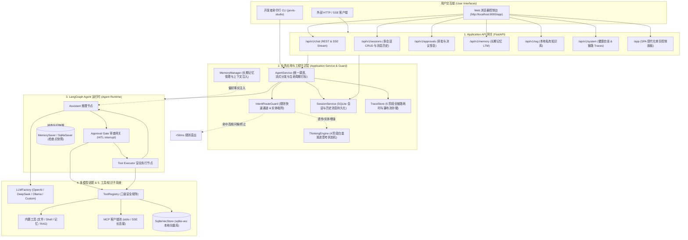
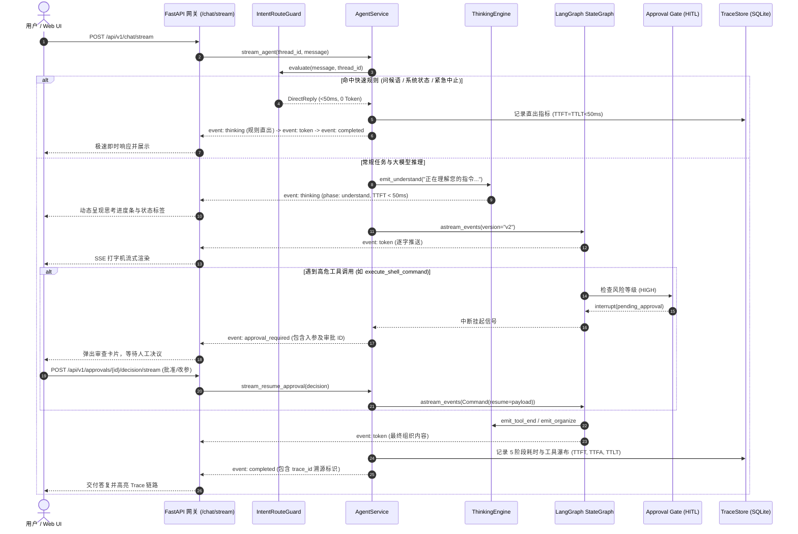

# Jarvis Studio

> **基于 LangGraph 与 MCP 的个人生产级 AI 操作系统助理工程参考与运行时系统**  
> *A Personal Production AI Operating Assistant with LangGraph, Model Context Protocol (MCP), sqlite-vec, and Durable Checkpointing.*

[](https://www.python.org/downloads/)
[](https://github.com/langchain-ai/langgraph)
[](https://github.com/langchain-ai/langchain)
[](https://fastapi.tiangolo.com/)
[](https://modelcontextprotocol.io/)
[](https://github.com/asg017/sqlite-vec)
[](https://github.com/astral-sh/uv)
[](https://github.com/astral-sh/ruff)
[](tests/)
[](LICENSE)

[ 简体中文 ](README.md) | [ English ](README.en.md)

---

## 1. Overview (项目概览)

### What is Jarvis Studio?
**Jarvis Studio** 是一个专为日常工程开发、本地文件处理、系统任务自动化与知识检索而构建的**个人生产级 AI 操作系统助理**与运行时系统。项目既可以在本地开发者终端中交互运行，也可以作为个人常驻后台服务运行。通过模块化工具、[Model Context Protocol (MCP)](https://modelcontextprotocol.io/) 外部生态、`sqlite-vec` 轻量本地向量检索与跨会话长期记忆体系，将自然语言指令转化为高可靠、高可控的实际执行。

### Why does it exist?
Jarvis Studio 代表了自主智能体从“学习型原型”到“生产级实用系统”的工程范式演进：

| 项目代号 | 底层技术 | 项目目标 | 当前状态 |
| :--- | :--- | :--- | :--- |
| **Jarvis Agent** | 自研 Python 运行时 | 深度探究 ReAct 循环与 Agent 底层机制 | 已归档 (完成探索) |
| **Jarvis Agent Plus** | LangChain Core | 学习 Framework 抽象与工具绑定体系 | 独立项目 |
| **Jarvis Agent Pro** | LangGraph 原语 | 学习基于图的状态机编排与循环流转 | 独立项目 |
| **Jarvis Studio** | **LangGraph + MCP + sqlite-vec** | **构建真正可长期使用的个人生产力助理应用** | **活跃主开发项目** |

> **核心哲学**：不为了学习而重复造 Runtime。直接采用成熟框架（**LangGraph**、**LangChain** 与 **MCP**），将工程精力聚焦于真实业务场景、安全边界控制、动态模型适配、人机协同安全性与长久可扩展性。

---

## 2. Implemented Features (已实现核心能力)

> **当前状态**: 本项目全套核心工程里程碑已**全部开发完成**，并通过 43 项单元与集成测试验证（100% PASS）。

- **完整多会话管理与即时切换 (Multi-Session Management)**: 基于 SQLite `chat_sessions` 与 `chat_messages` 实现会话的自动命名、新建、搜索过滤、历史消息秒级恢复、重命名与安全删除，支持前端可折叠侧边栏交互。
- **白盒化渐进式思考流 (Pseudo-Thinking Stream)**: 遵循 AI 技能规范设计 4 阶段状态演进（`understand` 意图分析 → `tool` 工具执行 → `organize` 答案整理 → `completed` 完成交付），首字响应耗时（TTFT）压降至 **<50ms**；集成工具白盒化翻译与心跳保活循环，彻底消除大模型等待焦虑。
- **意图守卫与极速通道 (Conversation State Guard)**: 针对日常问候、系统查询等高频场景实现 **<50ms / 0 Token 消耗直出**；具备多轮对话实体吸附（Sticky Context Anchor）与紧急制动安全熔断（Halt）。
- **端到端全生命周期可观测性 (5-Stage Lifecycle Traces)**: 覆盖输入规整、规则守卫、上下文预热、思考/工具瀑布流到流式交付完整 5 阶段，全链路自动打标 TTFT、TTFA、TTLT 毫秒级性能指标并持久化存储。
- **严格 5 层解耦架构**: API Gateway、Application Service、Agent Runtime、Tools/MCP、Core Infrastructure 彻底分层，UI 与 API 零接触底图。
- **可热插拔多模型适配器 (LLMFactory)**: 零硬编码。通过配置无缝切换 OpenAI、DeepSeek、本地 Ollama 以及任何兼容 OpenAI 协议的自定义端点，无需修改图代码。
- **无状态人机协同 (Stateless HITL)**: 遇到高危操作（`execute_shell_command`、`write_file`）时自动触发 LangGraph 原生 `interrupt()` 协议，将状态挂起冻结至 SQLite，支持人工审查（`approve` 批准、`reject` 拒绝、`modify` 就地修改入参）。
- **协议合规的安全拒绝处理**: 用户拒绝执行时自动合成合法 `ToolMessage`，保证大模型上下文符合 API 协议规范，避免接口抛错并支持模型自主重新规划。
- **工具子系统与安全分类矩阵**: 内置统一 `ToolRegistry`，对工具实施三级风险标记（`SAFE` 安全只读、`MEDIUM` 中度可逆、`HIGH` 高危操作）。
- **动态 MCP 工具生态桥接**: 运行时动态解析外部 MCP Server 的 JSON Schema，自动映射为强类型 LangChain Pydantic 工具，支持 stdio 长连接与 SSE 传输。
- **跨会话长期个人记忆系统 (LTM)**: 存储开发者个人偏好、编码习惯与关键事实，并在 Agent 推理前动态注入系统提示词上下文。
- **本地私有 RAG 知识库系统**: 基于 `sqlite-vec` 向量虚拟表无额外外部服务依赖，支持工作区代码/文档语义分块、SHA-256 增量哈希扫描与快速 KNN 语义检索。
- **状态持久化与断点续存**: 状态机运行内存快照结合 SQLite 会话持久化，具备故障自愈与跨会话恢复能力。
- **Server-Sent Events (SSE) 流式传输**: 网关原生支持逐 Token 实时打字机输出、思考状态机演进、心跳保活、工具调用起止步骤时序事件与中断挂起事件流（`/api/v1/chat/stream`）。
- **开箱即用 Web UI 可视化控制台 (`/app`)**: 原生集成的深色模式现代化控制面板，涵盖多会话侧边栏、对话思考折叠流、全链路追踪（Traces）查看器、HITL 审批入参编辑器、长期记忆管理器、本地知识库检索实验台与系统工具监控。
- **双端交互支持**: 既有本地终端开发者 CLI（`jarvis-studio info`、`serve`、`chat`、`memory`、`rag`、`sessions`、`mcp`），也有标准化 FastAPI REST/SSE 网关。
- **生产级容器化与守护进程**: 包含多阶段极简构建 `Dockerfile`、`docker-compose.yml` 与跨平台系统开机常驻守护进程脚本。

---

## 3. Architecture (系统架构)

Jarvis Studio 采用严格的分层解耦拓扑架构，各层之间单向依赖、职责分明：



### 核心流转时序 (意图守卫 + 渐进思考流 + SSE 流式 + HITL 挂起)



---

## 4. Core Concepts (核心概念)

| 核心概念 | 定义与在 Jarvis Studio 中的职责 |
| :--- | :--- |
| **IntentRouteGuard** | 意图规则守卫与快速通道。为日常问候、系统功能自查等高频场景提供 <50ms 零 Token 直出响应；负责跨轮次实体吸附（Sticky Context Anchor）与紧急制动安全熔断。 |
| **ThinkingEngine** | 白盒化渐进思考流引擎。规范落地 4 阶段状态演进（`understand` → `tool` → `organize` → `completed`），提供首字 <50ms 极速反馈、工具语义白盒化翻译与心跳保活循环，消除大模型等待焦虑。 |
| **Lifecycle Traces** | 端到端 5 阶段全生命周期可观测性。精准切片 `输入规整` → `规则守卫` → `上下文预热` → `思考与工具瀑布` → `流式交付`，持久化记录毫秒级 TTFT、TTFA、TTLT 指标。 |
| **Multi-Session Store** | 多会话与消息持久化存储。基于 SQLite `chat_sessions` 与 `chat_messages` 原生表，支撑自动标题生成、全文检索、会话重命名、清空与秒级切换恢复。 |
| **AgentState** | 图的单一可信数据源（Single Source of Truth）。强类型定义，节点间传递数据的唯一介质，通过 `add_messages` 归约器安全追加消息。 |
| **Approval Gate** | 安全审计网关节点。根据三级风险矩阵识别高危操作，触发 LangGraph `interrupt()` 协议阻断执行，防止未经审查的系统修改。 |
| **ToolRegistry & RiskLevel** | 工具注册中心与三级安全分类矩阵（`SAFE` 安全只读、`MEDIUM` 可逆操作、`HIGH` 高危执行）。 |
| **MCP Client Manager** | Model Context Protocol 统一客户端。动态加载外部服务配置，管理 stdio 长连接子进程与 SSE 会话，动态将 JSON Schema 转换为 LangChain 工具。 |
| **MemoryManager (LTM)** | 长期个人记忆系统。跨会话持久化用户的技术栈偏好、指令习惯与关键事实，并在 Agent 推理前动态拼接至 Prompt。 |
| **SqliteVecStore** | 本地轻量向量库。利用 `sqlite-vec` 虚拟表存储向量索引，结合 `DocumentSplitter` 与 `WorkspaceIndexer` 实现零外部服务依赖的代码/文档语义检索。 |
| **SSE Streaming** | 基于 Server-Sent Events 协议的流式网关。统一调度逐 Token 文本流、思考状态机推进、工具执行起止步骤事件与审批中断事件。 |
| **SqliteSaver Checkpoint** | 状态检查点持久化存储。将每个超步的对话上下文与执行断点持久化落盘至 SQLite，提供故障自愈能力与跨会话状态恢复。 |

---

## 5. Project Structure (关键目录结构)

```text
JarvisStudio/
├── src/jarvis_studio/
│   ├── api/                     # 1. Application API 网关 (FastAPI 0.115+)
│   │   ├── routes/              # 分组路由 (/chat, /sessions, /approvals, /memory, /rag, /system)
│   │   ├── schemas/             # 请求与响应 Pydantic 模型契约
│   │   ├── static/              # 现代化单页 Web UI 控制台 (index.html)
│   │   └── app.py               # FastAPI 生命周期、中间件与静态挂载工厂
│   ├── service/                 # 2. 业务应用服务层 (Application Service)
│   │   ├── agent_service.py     # 统一调度智能体调用、流式生成与 HITL 恢复
│   │   └── session_service.py   # SQLite 多会话管理、自动标题与消息历史持久化
│   ├── agent/                   # 3. LangGraph Agent 运行时 (StateGraph)
│   │   ├── checkpoints/         # 状态检查点工厂与 Saver (MemorySaver / SqliteSaver)
│   │   ├── hitl/                # 人机协同中断管理与审批状态机
│   │   ├── nodes/               # 原子节点 (assistant, approval_gate, executor, router)
│   │   ├── graph.py             # 状态图组装、条件路由连接与编译
│   │   └── state.py             # AgentState 强类型状态模式契约
│   ├── core/                    # 4. LLM 多模型适配层与工程守卫基础设施
│   │   ├── guard/               # IntentRouteGuard 意图规则守卫与快速通道直出
│   │   ├── thinking/            # ThinkingEngine 4 阶段白盒渐进思考状态机与心跳
│   │   ├── llm/                 # LLMFactory (OpenAI, DeepSeek, Ollama, Custom 端点)
│   │   ├── observability/       # 5 阶段全生命周期追踪 (TraceStore) 与结构化日志
│   │   └── errors.py            # 全局领域异常定义体系
│   ├── tools/                   # 5. 工具系统与 MCP 外部生态
│   │   ├── builtin/             # 内置安全文件、Shell 终端、记忆、RAG 工具
│   │   ├── mcp/                 # MCPClientManager、长连接子进程池与动态工具适配器
│   │   ├── base.py              # RiskLevel 三级安全分级与工具元数据装饰器
│   │   └── registry.py          # 统一工具注册中心 (ToolRegistry)
│   ├── memory/                  # 长期个人记忆系统 (LTM: Store, Manager, Models)
│   ├── rag/                     # 本地轻量 RAG (sqlite-vec Store, Embeddings, Indexer, Splitter)
│   ├── config/                  # Pydantic Settings 分级配置管理加载器
│   └── cli/                     # 终端命令行交互入口 (Click + Rich 终端)
├── config/                      # YAML 运行时配置与 MCP 外部服务注册表
├── docs/                        # 标准化工程技术文档中心 (架构、设计、开发规范、ADR、路线图)
├── scripts/                     # 运维常驻与守护进程脚本 (run_daemon.ps1, run_daemon.sh)
├── tests/                       # 自动化测试套件 (43 项单元与集成测试，覆盖率 100% PASS)
├── Dockerfile                   # 多阶段轻量生产容器镜像构建规范
├── docker-compose.yml           # 容器一键挂载编排模板
├── pyproject.toml               # uv / PEP 621 依赖配置与构建规范
└── main.py                      # 命令行快捷执行入口
```

---

## 6. Getting Started (快速开始)

### 6.1 环境要求
- **Python**: `>= 3.12`
- **包管理工具**: 推荐使用 [uv](https://github.com/astral-sh/uv)（极速且确定性）

### 6.2 安装与同步依赖
```bash
# 1. 克隆代码仓库
git clone https://github.com/PublicYang/JarvisStudio.git
cd JarvisStudio

# 2. 使用 uv 一键安装全部运行时与开发依赖
uv sync --extra dev

# 3. 复制环境变量配置文件
cp .env.example .env
```

### 6.3 启动 Web UI 可视化控制台 (推荐)
```bash
# 启动 API 网关与内置 Web UI (开发热重载模式)
uv run jarvis-studio serve --port 8000 --reload
```
启动后打开浏览器访问：
- **Web UI 可视化控制台**: [http://localhost:8000/app](http://localhost:8000/app)
- **OpenAPI 交互式接口文档**: [http://localhost:8000/docs](http://localhost:8000/docs)

### 6.4 启动交互式终端 REPL
```bash
# 查看系统状态、当前活跃模型与已注册工具安全矩阵
uv run jarvis-studio info

# 启动终端命令行多轮对话 (支持 HITL 交互拦截与审批)
uv run jarvis-studio chat
```

### 6.5 长期记忆与本地 RAG 快速体验
```bash
# 1. 记录开发者偏好至长期记忆库 (LTM)
uv run jarvis-studio memory add "优先使用 Python 3.12 与 uv 依赖管理工具" --category preference

# 2. 查看已存储的长期偏好
uv run jarvis-studio memory list

# 3. 一键对项目文档目录进行增量向量索引 (RAG)
uv run jarvis-studio rag index ./docs

# 4. 执行本地向量相似度语义检索
uv run jarvis-studio rag search "HITL 人机协同审批机制" --top-k 3

# 5. 查看保存在 SQLite 中的历史会话快照清单
uv run jarvis-studio sessions
```

### 6.6 连接真实大语言模型
编辑 `.env` 文件，配置你的大模型提供商凭证：

```bash
# 1. 使用 OpenAI
DEFAULT_LLM_PROVIDER=openai
DEFAULT_MODEL_NAME=gpt-4o-mini
OPENAI_API_KEY=your_api_key_here

# 2. 或者使用 DeepSeek (基于 OpenAI 兼容协议)
# DEFAULT_LLM_PROVIDER=deepseek
# DEEPSEEK_API_KEY=your_deepseek_key

# 3. 或者使用本地离线 Ollama
# DEFAULT_LLM_PROVIDER=ollama
# OLLAMA_MODEL_NAME=llama3.1:8b
# OLLAMA_BASE_URL=http://localhost:11434/v1
```

### 6.7 运行全量自动化测试
```bash
uv run --extra dev pytest
```
*当前全量 43 项单元与集成测试用例全部通过（PASS）。*

---

## 7. Configuration (环境配置说明)

| 环境变量 | 默认值 | 说明 |
| :--- | :--- | :--- |
| `DEFAULT_LLM_PROVIDER` | `openai` | 默认模型提供商（`openai`、`deepseek`、`ollama`、`custom`）。 |
| `DEFAULT_MODEL_NAME` | `gpt-4o-mini` | 默认大语言模型名称。 |
| `OPENAI_API_KEY` | 无 | OpenAI API 访问密钥。 |
| `DEEPSEEK_API_KEY` | 无 | DeepSeek API 访问密钥。 |
| `OLLAMA_BASE_URL` | `http://localhost:11434/v1` | 本地 Ollama 兼容端点服务地址。 |
| `HITL_ENABLED` | `true` | 是否全局开启敏感高危工具的人机确认防护。 |
| `CHECKPOINT_BACKEND` | `sqlite` | 检查点存储后端（`sqlite` 或 `memory`）。 |
| `SQLITE_DB_PATH` | `data/jarvis_studio.db` | 状态机检查点与会话持久化 SQLite 文件路径。 |
| `WORKSPACE_ROOT` | `./data/workspace` | 文件与命令操作的安全工作区根路径。 |
| `RAG_ENABLED` | `true` | 是否启用本地向量知识库。 |
| `EMBEDDING_PROVIDER` | `auto` | 嵌入模型提供商（`auto`、`openai`、`local`）。 |
| `VECTOR_DB_PATH` | `data/jarvis_vec.db` | `sqlite-vec` 向量数据库持久化文件路径。 |
| `MCP_CONFIG_PATH` | `config/mcp_servers.json` | 外部 Model Context Protocol 服务的注册清单路径。 |

---

## 8. Development & Quality Gates (工程开发与质量门禁)

本项目严格遵循代码质量门禁纪律，所有功能合并前必须保证门禁全绿：

```bash
# 运行 Ruff 代码规范与代码异味检查
uv run ruff check .

# 运行排版格式化校验与自动修复
uv run ruff check --fix .
uv run ruff format .

# 运行全套单元与集成测试 (43 项测试)
uv run --extra dev pytest -v
```

---

## 9. Documentation (技术文档导航)

完整的设计、架构深度推演与设计决策已标准化整理至 `docs/` 目录：

```text
docs/
├── architecture/                     # 架构体系
│   ├── system-architecture.md        # 5 层解耦架构、模块职责边界与数据流拓扑
│   └── execution-lifecycle.md        # StateGraph 运行时推演、断点快照时序与状态流转
├── design/                           # 核心组件专项设计
│   ├── hitl-specification.md         # HITL 人工审批状态机、安全拒绝协议与 REST 契约
│   ├── tool-system-and-safety.md     # RiskLevel 三级风险矩阵与 MCP 动态转换原理
│   └── llm-adapter-layer.md          # LLMFactory 工厂实现、厂商无感知热插拔与回退机制
├── development/                      # 开发者指引
│   ├── setup-and-development.md      # 开发者初始化、Pytest 测试规范与开发约束
│   └── configuration-reference.md    # 配置全参数参考字典 (.env, settings.yaml, MCP)
├── adr/                              # 架构决策记录
│   ├── ADR-001-adopt-langgraph-and-mcp.md       # ADR-001: 为什么选用 LangGraph 与 MCP
│   ├── ADR-002-decouple-application-and-agent.md # ADR-002: 为什么实施 5 层彻底解耦
│   └── ADR-003-native-interrupt-for-hitl.md     # ADR-003: 为什么坚持使用原生 interrupt 挂起
└── roadmap/                          # 演进路线图
    └── engineering-roadmap.md        # 核心里程碑 (M0~M6) 的演进目标与交付记录
```

---

## 10. Roadmap (演进路线图)

Jarvis Studio 全部核心工程里程碑已**全部开发完成并验证通过**：

### Completed (全部完成)
- ✅ **Milestone 0: 架构基线与脚手架**: 5 层解耦架构蓝图、Python 3.12 + `uv` 依赖治理、自动化测试套件基准。
- ✅ **Milestone 1: 核心 Agent 与模型底座**: `LLMFactory` 多模型统一工厂 (OpenAI, DeepSeek, Ollama)、`AgentState` 强类型状态模式、基础 ReAct 循环闭环。
- ✅ **Milestone 2: 工具子系统与 MCP**: `ToolRegistry` 三级安全分类矩阵、内置安全文件与终端 Shell 工具、动态 MCP JSON-to-Pydantic 转换器、stdio/SSE 长连接客户端池。
- ✅ **Milestone 3: HITL 与持久化检查点**: 原生无状态 `interrupt()` 敏感操作阻断、SQLite 检查点持久化、合法 `ToolMessage` 安全拒绝协议、审批 REST API 契约与终端交互式决议。
- ✅ **Milestone 4: 长期记忆与本地知识库**: 跨会话长期记忆系统 (LTM: `MemoryStore` + `MemoryManager`)、动态 Prompt 偏好注入、基于 `sqlite-vec` 的本地无额外服务依赖轻量向量库 (`SqliteVecStore`)、工作区 SHA-256 增量文件扫描入库索引器 (`WorkspaceIndexer`)。
- ✅ **Milestone 5: 应用网关流式化与 Web 交互界面**: Server-Sent Events (SSE) 逐 Token 与步骤流式传输 (`/api/v1/chat/stream`)、现代响应式 Web UI 控制面板 (`/app`)、生产级多阶段容器化镜像 (`Dockerfile` + `docker-compose.yml`)、跨平台系统后台常驻守护进程脚本 (`run_daemon.ps1`, `run_daemon.sh`)。
- ✅ **Milestone 6: 体验优化与工程化技能跃迁 (AI Engineering Skills)**:
  - **4 阶段白盒渐进式思考流 (Pseudo-Thinking Stream)**: 意图分析 → 工具调用 → 答案整理 → 完成交付，首字反馈耗时（TTFT）压降至 **<50ms**，彻底消除黑盒等待；
  - **意图规则守卫与快速通道 (Conversation State Guard)**: 针对日常问候、系统查询等高频场景实现 **<50ms / 0 Token 消耗直出**；实现多轮实体吸附与紧急制动；
  - **完整多会话管理 (Multi-Session CRUD)**: SQLite `chat_sessions` 与 `chat_messages` 原生驱动，自动标题、实时检索、快速重命名与历史消息秒级恢复；
  - **端到端 5 阶段生命周期可观测性 (Lifecycle Traces)**: 全链路 TTFT / TTFA / TTLT 毫秒级打标与工具瀑布流白盒分析控制台。

### Future & Extension Outlook (后续展望与生态扩展)
- [ ] **原生跨平台桌面应用包装**: 基于 Tauri / Electron 将 Web 控制台打包为轻量级跨平台个人桌面端。
- [ ] **分布式检查点与存储后端**: 针对私有云集群引入 PostgresSaver 检查点与分布式对象存储支持。
- [ ] **智能自动化定时任务 (Scheduled Automation)**: 增加定时触发的智能工作流与每日晨报生成后台 Job。

---

## 11. License (开源协议)

本项目基于 [MIT License](LICENSE) 开源协议分发与使用。
