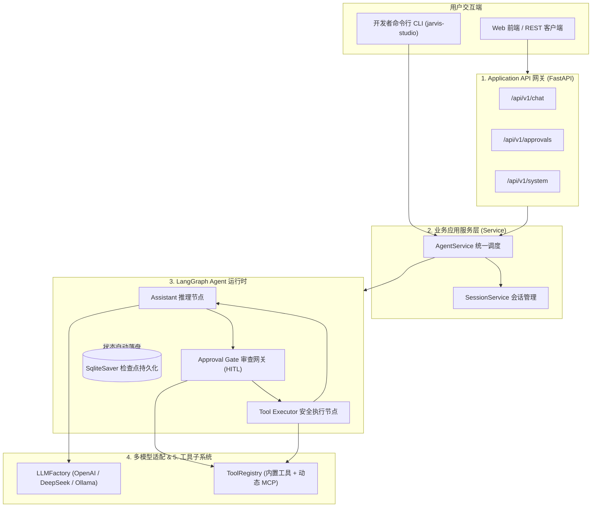

# Jarvis Studio

<div align="center">

**个人生产级 AI 操作系统助理 (Personal Production AI Operating Assistant)**

[](https://www.python.org/downloads/)
[](https://github.com/langchain-ai/langgraph)
[](https://github.com/langchain-ai/langchain)
[](https://fastapi.tiangolo.com/)
[](https://modelcontextprotocol.io/)
[]()
[](LICENSE)

<p align="center">
  <a href="README.md">English</a> | <b>简体中文</b>
</p>

</div>

---

## 1. 项目简介 (Overview)

### 什么是 Jarvis Studio？
**Jarvis Studio** 是一个专为日常工程开发、本地文件处理、系统任务自动化与知识检索而构建的**个人生产级 AI 操作系统助理**。

它既可以在本地终端交互运行，也可以作为个人常驻后台服务运行。通过模块化工具、[Model Context Protocol (MCP)](https://modelcontextprotocol.io/) 外部生态与可热插拔的语言模型体系，将自然语言指令转化为安全可靠的实际执行。

### 为什么要做这个项目？
Jarvis Studio 代表了从“学习型原型”到“生产级实用工具”的范式演进：

| 项目 | 底层技术 | 项目目标 | 当前状态 |
| :--- | :--- | :--- | :--- |
| **Jarvis Agent** | 自研 Python Runtime | 深度探究 ReAct 循环与 Agent 底层原理 | 已归档 (完成学习) |
| **Jarvis Agent Plus** | LangChain Core | 学习 Framework 抽象与工具绑定机制 | 独立项目 |
| **Jarvis Agent Pro** | LangGraph | 学习基于图的状态机编排与循环流转 | 独立项目 |
| **Jarvis Studio** | **LangGraph + LangChain + MCP** | **构建真正可长期使用的个人生产力助理应用** | **活跃主开发项目** |

> **核心原则**：不为了学习而重复造 Runtime。直接采用成熟框架（**LangGraph**、**LangChain** 与 **MCP**），将工程精力聚焦于真实业务场景、安全边界控制、动态模型适配与长久可扩展性。

---

## 2. 核心能力 (Core Capabilities - 已实现)

- **严格 5 层解耦架构**：API Gateway、Application Service、Agent Runtime、Tools/MCP、Core Infrastructure 彻底分层，UI/API 零接触底图。
- **可热插拔 LLM 适配器**：零硬编码。通过配置无缝切换 OpenAI、DeepSeek、本地 Ollama 以及任何兼容 OpenAI 协议的自定义端点，无需修改图代码。
- **Human-in-the-Loop (HITL) 安全确认**：高危工具（`execute_shell_command`、`write_file`）自动触发 LangGraph 原生 `interrupt()`，持久化断点至 SQLite，支持人工审查（`approve` 批准、`reject` 拒绝、`modify` 修改参数）。
- **安全的拒绝处理协议**：用户拒绝时自动合成合法 `ToolMessage`，保证大模型上下文符合 API 协议规范，避免接口抛错。
- **工具子系统与安全分类矩阵**：内置统一 `ToolRegistry`，对工具实施三级风险标记（`SAFE` 安全、`MEDIUM` 中度、`HIGH` 高危）。
- **动态 MCP 工具桥接**：运行时动态解析外部 MCP Server 的 JSON Schema，自动映射为强类型 LangChain Pydantic 工具。
- **状态持久化与断点续存**：采用 `langgraph-checkpoint-sqlite`，会话与执行状态全量落盘 SQLite，具备故障自愈与跨进程恢复能力。
- **全链路追踪与可观察性**：ContextVars 注入 `session_id` 与 `run_id`，`timed_step` 上下文精准统计毫秒级耗时，搭配 Loguru 彩色及滚动日志。
- **双端交互支持**：既有本地终端开发者 CLI（`jarvis-studio info`、`serve`、`chat`），也有标准化 FastAPI REST 网关（`/chat`、`/approvals`、`/system`）。

---

## 3. 架构全景图 (Architecture Snapshot)



---

## 4. 关键项目目录 (Project Structure)

```text
JarvisStudio/
├── docs/                        # 完整标准化技术文档中心
│   ├── architecture/            # 系统分层架构与生命周期执行推演
│   ├── design/                  # HITL 规范、工具安全矩阵与 LLM 适配器设计
│   ├── development/             # 环境搭建、测试规范与配置参数大全
│   ├── adr/                     # 重大架构决策记录 (ADR-001 ~ ADR-003)
│   └── roadmap/                 # 工程演进路线图 (M0 到 M5)
├── config/                      # YAML 运行时配置与 MCP 外部服务注册表
├── src/jarvis_studio/
│   ├── api/                     # FastAPI 应用、路由分组与 Schema
│   ├── service/                 # AgentService 与 SessionService 业务中介
│   ├── agent/                   # LangGraph StateGraph、节点实现、HITL 与检查点
│   ├── tools/                   # ToolRegistry、内置文件/Shell 工具、MCP 适配器
│   ├── core/                    # LLMFactory、Loguru 结构化日志、追踪与异常
│   ├── config/                  # Pydantic Settings 配置加载器与模型
│   └── cli/                     # Click 命令行终端交互入口
├── tests/                       # 自动化测试套件 (13 项集成与单元测试)
├── .env.example                 # 环境变量配置模板
└── pyproject.toml               # uv / PEP 621 依赖与构建配置
```

---

## 5. 快速上手 (Quickstart)

### 环境依赖
- Python `3.12+`
- [`uv`](https://docs.astral.sh/uv/) 现代 Python 包管理器

### 1. 安装项目
```bash
# 克隆代码仓库
git clone <repo-url>
cd JarvisStudio

# 使用 uv 同步安装全部运行时与开发依赖
uv sync --extra dev

# 复制环境变量模板
cp .env.example .env
```

### 2. 配置模型凭证
编辑 `.env` 文件，选择并配置你的大模型 API Key：
```bash
DEFAULT_LLM_PROVIDER=openai
OPENAI_API_KEY=your_api_key_here

# 或者使用 DeepSeek
# DEFAULT_LLM_PROVIDER=deepseek
# DEEPSEEK_API_KEY=your_deepseek_key

# 或者使用本地 Ollama
# DEFAULT_LLM_PROVIDER=ollama
# OLLAMA_MODEL_NAME=llama3.1:8b
```

### 3. 运行自动化测试
```bash
uv run pytest
```

### 4. 启动与使用
```bash
# 查看系统状态与当前已注册工具安全矩阵
uv run jarvis-studio info

# 启动 FastAPI API 网关 (Swagger 文档位于 http://localhost:8000/docs)
uv run jarvis-studio serve --port 8000 --reload

# 启动终端交互式对话 REPL
uv run jarvis-studio chat
```

---

## 6. 技术文档中心 (Documentation Hub)

完整的技术规范与架构设计已全面整理至 [`docs/`](docs/README.md) 目录：

| 文档名称 | 核心内容 |
| :--- | :--- |
| **[系统分层架构](docs/architecture/system-architecture.md)** | 5 层解耦架构设计原则、模块职责边界与数据流拓扑 |
| **[执行生命周期与状态机](docs/architecture/execution-lifecycle.md)** | StateGraph 运行时推演、断点快照时序与状态流转机制 |
| **[HITL 人机协同设计规范](docs/design/hitl-specification.md)** | 危险工具中断逻辑、审批状态机、安全拒绝协议与 REST API 契约 |
| **[工具子系统与安全矩阵](docs/design/tool-system-and-safety.md)** | `RiskLevel` 风险矩阵、内置文件/Shell 工具说明与 MCP 动态转换原理 |
| **[LLM 多模型适配层](docs/design/llm-adapter-layer.md)** | `LLMFactory` 工厂实现、厂商无感知热插拔与回退机制 |
| **[配置全参数参考手册](docs/development/configuration-reference.md)** | `.env` 环境变量、`settings.yaml` 与 `mcp_servers.json` 完整参数字典 |
| **[环境搭建与开发指南](docs/development/setup-and-development.md)** | 开发者初始化、Pytest 测试运行、Ruff 代码规范与开发约束 |
| **[架构决策记录 (ADR)](docs/adr/)** | 为什么选用 LangGraph、为什么实施 5 层解耦、为什么选用原生 interrupt |
| **[工程演进路线图](docs/roadmap/engineering-roadmap.md)** | 从 M0 基础搭建到 M5 生产界面的阶段性演进目标 |

---

## 7. 演进路线图概览 (Roadmap Summary)

- **Milestone 0: 工程脚手架与架构基线** `[已完成]`  
  5 层解耦架构、Python 3.12 + `uv` 环境基线、自动化测试框架搭建。
- **Milestone 1: 多模型引擎与 LangGraph 运行时** `[进行中]`  
  `LLMFactory` (OpenAI, DeepSeek, Ollama)、`AgentState` 消息归约、基础对话与工具循环 `[已完成]`；Anthropic/Gemini 生产密钥验证 `[进行中]`。
- **Milestone 2: 工具子系统与 MCP 客户端集成** `[进行中]`  
  `ToolRegistry`、内置文件与 Shell 工具、动态 MCP JSON-to-Pydantic 转换 `[已完成]`；stdio/SSE 实时长连接子进程管理 `[进行中]`。
- **Milestone 3: Human-in-the-Loop 与持久化断点** `[进行中]`  
  LangGraph `interrupt()`、SQLite 状态持久化、审批 REST API `[已完成]`；超时审批规则 `[计划中]`。
- **Milestone 4: 长期记忆与本地知识库 (RAG)** `[计划中]`  
  长期记忆系统 (LTM)、用户语义画像、基于 `sqlite-vec` 的本地向量知识库。
- **Milestone 5: 应用网关流式化与 Web 交互界面** `[计划中]`  
  SSE (Server-Sent Events) 逐 Token 流式输出、现代 Web UI 前端（聊天 + 任务看板 + HITL 审批弹窗）、Docker 容器化打包。

---

## 8. 开源协议 (License)

本项目基于 [MIT License](LICENSE) 开源协议分发与使用。
