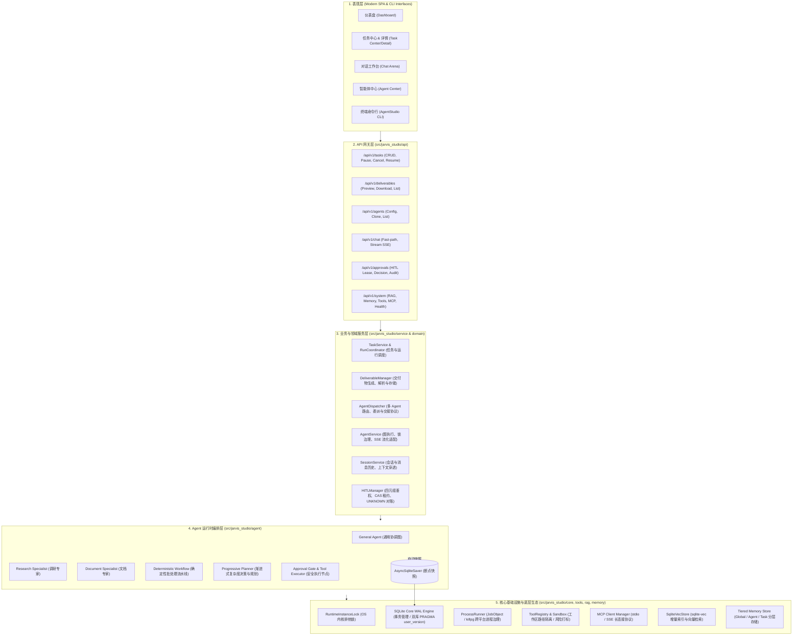
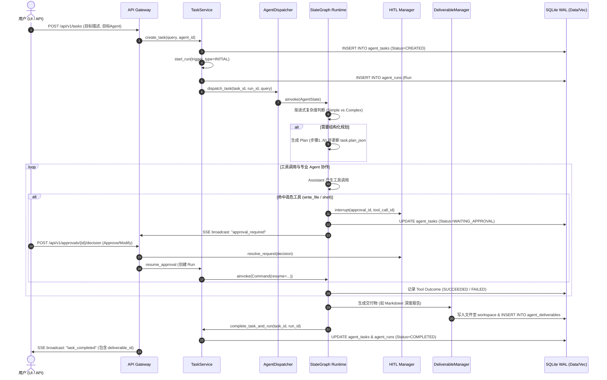
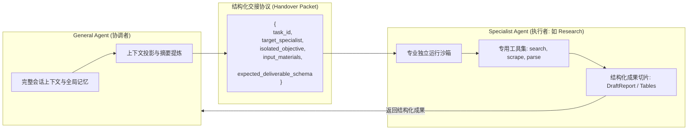

# AgentStudio 系统架构演进设计规范 (Architecture v1.0)
## Personal AI Agent Workspace

> **产品代号**：AgentStudio  
> **文档版本**：v1.0 (Architecture Baseline)  
> **基线继承**：Sprint 1A (Security) · Sprint 1B (Process Engine) · Sprint 1C (Persistence & Lifecycle)  
> **架构哲学**：Modular Monolith (模块化单体) · Bounded Autonomy · Deliverable-Centric · Zero Microservice Overhead  
> **输出路径**：`docs/architecture/AGENTSTUDIO_ARCHITECTURE_V1.md`

---

## 1. 架构演进总则与目标拓扑

### 1.1 核心演进理念
将现有系统从“单会话单智能体（Single-Session ReAct）”升级为“**支持多专业智能体协同、结构化任务生命周期与交付物全生命周期管理的个人工作空间架构**”。

遵循三条不可逾越的架构铁律：
1. **坚决不推翻已验证的可靠性资产**：完整保留 Sprint 1C 沉淀的 OS 内核单活锁、SQLite WAL 事务与连接治理、Checkpointer 事件循环强绑定、HITL CAS 原子租约及启动协调恢复机制。
2. **坚持模块化单体，拒绝微服务过度拆分**：作为面向个人的本地优先（Local-First）桌面级工作空间，保持单一进程守护与 Python 3.12 模块化分层，避免跨进程 IPC 协议开销、网络分区与运维复杂度。
3. **彻底解耦 Chat 与 Task 领域边界**：在业务逻辑与数据模型中，将“漫谈式会话”与“以交付物为终点的持久化任务”解耦，建立清晰的 `Session -> Task (1:N) -> Run (1:N) -> Deliverable (0:M)` 数据流。

---

### 1.2 目标系统架构蓝图 (5 层分层拓扑)



---

## 2. 现有模块资产复用、演进与新增矩阵

| 架构层级 | 组件名称 | 演进定级 | 详细演进策略与技术实现 |
| :--- | :--- | :---: | :--- |
| **基础设施** | `RuntimeInstanceLock` | **直接复用** | 保留单机单活约束，抢占 `.runtime.lock`，防止多进程多开撕裂 SQLite 数据库。 |
| **基础设施** | `SQLite Core & Migrations` | **演进** | 复用 `sync_transaction`、WAL 机制；在 `migrations.py` 中追加 **Schema V4**（引入交付物表与 Agent 配置表）。 |
| **基础设施** | `ProcessRunner` | **直接复用** | 保留 Windows JobObject 进程树与 POSIX `killpg` 治理，保障 Shell 工具终止时不留僵尸进程。 |
| **基础设施** | `File Sandbox` | **直接复用** | 保留 `resolve_safe_path` 严格的 `is_relative_to(workspace)` 校验，筑牢 Bounded Autonomy 防线。 |
| **基础设施** | `sqlite-vec RAG Store` | **直接复用** | 保留 SHA-256 增量文件指纹索引与本地向量检索能力，作为第一阶段 Knowledge 场景基石。 |
| **领域服务** | `TaskCoordinator` | **演进** | 复用 10 态 `TaskStatus` 与 7 态 `RunStatus`；将原先仅在 `agent_service.py` 内部被动调用的逻辑解耦，提升为独立的 `TaskService`。 |
| **领域服务** | **`DeliverableManager`** | **全新新增** | 新增交付物生命周期管理服务：负责结构化报告生成、CSV/JSON 导出、落盘存储以及关联 `task_id` / `run_id`。 |
| **领域服务** | **`AgentDispatcher`** | **全新新增** | 新增智能体调度器：负责专业 Agent 的配置拉取、上下文清洗、结构化任务委托（Handover）与产物收集。 |
| **领域服务** | `HITLManager` | **演进** | 保留 CAS 租约与正交状态机；在接口层区隔“计划确认 (Plan Review)”与“高危操作审批 (Action Approval)”。 |
| **领域服务** | `AgentService` | **深度演进** | 移除会话与任务 1:1 硬编码；移除 `core/thinking/engine.py` 伪思考发生器；改由真实 StateGraph 事件驱动 SSE。 |
| **运行时** | `StateGraph` | **深度演进** | 从简单的单 Agent 3 节点拓扑，演进为包含 `Planner -> General/Specialist Delegate -> Tool Gate -> Deliverable Node` 的复合状态机。 |
| **API 网关** | **Task / Deliverable 路由** | **全新新增** | 新增 `/api/v1/tasks` (CRUD, cancel, pause) 与 `/api/v1/deliverables` (列表、详情、流式下载)。 |
| **表现层** | **Web UI 前端** | **全面重构** | 淘汰原有只包含聊天和追踪的旧单页，重构为包含 Dashboard、Task Center、Task Detail、Chat、Agent Center 的现代化工作空间。 |

---

## 3. 核心领域数据模型演进 (Schema V4 规范)

在现有 App Schema V3（`chat_sessions`, `chat_messages`, `agent_tasks`, `agent_runs`, `hitl_approval_requests`, `tool_execution_outcomes`, `ltm_memories`, `agent_conversation_traces`）基础上，平滑升级至 **App Schema V4**。

```sql
-- 1. 交付物管理表 (Deliverable Entity)
CREATE TABLE IF NOT EXISTS agent_deliverables (
    deliverable_id    TEXT PRIMARY KEY,
    task_id           TEXT NOT NULL,
    run_id            TEXT NOT NULL,
    title             TEXT NOT NULL,
    deliverable_type  TEXT NOT NULL CHECK (deliverable_type IN (
                          'markdown_report', 'code_patch', 'file', 'data_table', 'json'
                      )),
    file_path         TEXT,          -- 工作区相对存储路径 (如 deliverables/task_001/report.md)
    mime_type         TEXT NOT NULL, -- text/markdown, text/html, text/csv, application/json 等
    summary           TEXT,          -- 成果简明提要
    content_preview   TEXT,          -- 前 2000 字符文本预览
    metadata_json     TEXT,          -- 来源引用列表、字数统计、关联Agent等
    created_at        REAL NOT NULL,
    updated_at        REAL NOT NULL,
    FOREIGN KEY (task_id) REFERENCES agent_tasks(task_id) ON DELETE CASCADE,
    FOREIGN KEY (run_id) REFERENCES agent_runs(run_id) ON DELETE CASCADE
);
CREATE INDEX IF NOT EXISTS idx_deliv_task_created ON agent_deliverables(task_id, created_at DESC);
CREATE INDEX IF NOT EXISTS idx_deliv_type ON agent_deliverables(deliverable_type);

-- 2. 智能体配置与元数据表 (Agent Configuration)
CREATE TABLE IF NOT EXISTS agent_configs (
    agent_id          TEXT PRIMARY KEY,
    name              TEXT NOT NULL UNIQUE,
    role_description  TEXT NOT NULL,
    system_prompt     TEXT NOT NULL,
    provider          TEXT NOT NULL,
    model             TEXT NOT NULL,
    temperature       REAL DEFAULT 0.7,
    allowed_tools     TEXT NOT NULL, -- JSON Array: ["read_file", "search_knowledge_base"]
    is_builtin        INTEGER NOT NULL DEFAULT 0 CHECK (is_builtin IN (0, 1)),
    created_at        REAL NOT NULL,
    updated_at        REAL NOT NULL
);

-- 3. 专业智能体记忆表 (Agent-Specific Memory)
CREATE TABLE IF NOT EXISTS agent_memories (
    id                TEXT PRIMARY KEY,
    agent_id          TEXT NOT NULL,
    category          TEXT NOT NULL, -- 'methodology', 'rule', 'domain_fact'
    content           TEXT NOT NULL,
    source_task_id    TEXT,
    created_at        REAL NOT NULL,
    updated_at        REAL NOT NULL,
    FOREIGN KEY (agent_id) REFERENCES agent_configs(agent_id) ON DELETE CASCADE
);
CREATE INDEX IF NOT EXISTS idx_agent_mem ON agent_memories(agent_id, category);

-- 4. 扩展现有 agent_tasks 字段
ALTER TABLE agent_tasks ADD COLUMN assigned_agent_id TEXT DEFAULT 'general_agent';
ALTER TABLE agent_tasks ADD COLUMN plan_json TEXT;
ALTER TABLE agent_tasks ADD COLUMN priority TEXT DEFAULT 'NORMAL';
```

---

## 4. 核心端到端数据流与执行链设计

### 4.1 任务全生命周期执行主链路 (Task-to-Delivery Pipeline)



---

### 4.2 智能体委派与结构化交接协议 (Handover Protocol)

通用智能体（General Agent）与专业智能体（Specialist Agent）协作时，严禁粗暴地拼接历史对话，必须通过微型契约进行上下文投影：



- **上下文清洗 (Context Scoping)**：General Agent 过滤掉与当前子目标无关的历史闲聊，仅将与当前研究目标直接相关的背景、关键约束打包输入；
- **产出隔离**：专业 Agent 在专有局部状态中运行，产出的数据、文献引用和图表整合为局部交付物草稿，回传给 General Agent 进行整体审阅并形成最终交付物。

---

### 4.3 实时事件驱动流管线 (Real-Time SSE Event Pipeline)

彻底淘汰原有的硬编码“伪思考”，前端展示的每一个时间点均由真实的系统生命周期事件驱动：

| SSE Event 名称 | 发生时机 | Payload 核心字段 | 前端 UI 行为响应 |
| :--- | :--- | :--- | :--- |
| `task_status_changed` | 任务或 Run 状态转移 | `task_id`, `run_id`, `old_status`, `new_status` | 顶部状态药丸变色，更新任务列表状态。 |
| `plan_updated` | 规划器完成/调整执行计划 | `task_id`, `steps: [{id, title, status}]` | 任务时间线渲染步骤卡片，显示当前活跃步骤。 |
| `agent_delegated` | General 委派给专业 Agent | `from_agent`, `to_agent`, `reason` | 时间线插入“智能体调度”分支节点。 |
| `tool_start` | 工具开始进入执行边界 | `tool`, `input`, `run_id`, `timestamp` | 时间线动态追加工具调用卡片（带闪烁微光效果）。 |
| `tool_end` | 工具执行完成返回结果 | `tool`, `output_summary`, `duration_ms` | 工具卡片停止闪烁，展示耗时与输出简短折叠块。 |
| `approval_required` | 敏感工具命中 HITL 拦截 | `approval_id`, `tool_name`, `arguments`, `risk` | 弹出全局待办审批栏，任务进入等待状态。 |
| `token` | 语言模型流式输出正文 | `token`, `chunk_index` | 实时打字机效果输出至预览区。 |
| `deliverable_ready` | 交付物生成落盘完毕 | `deliverable_id`, `title`, `type`, `preview` | 成果展台弹出“新交付物已就绪”，渲染 Markdown 报告。 |

---

## 5. 安全性、边界控制与故障隔离 (Security & Reliability)

### 5.1 工作区沙箱底线 (Bounded Autonomy)
所有文件类与代码类工具必须通过 `resolve_safe_path(target, workspace_root)` 强校验：
1. 严禁离开 `settings.storage.workspace_root`，根目录绝对化后使用 `is_relative_to` 判定；
2. 任何包含 `\x00`、非法冒号驱动器、UNC 路径（`\\server\share`）的路径直接拒绝；
3. 符号链接穿透检查：符号链接的目标真实路径若指向工作区外，直接抛出 `PermissionError`。

### 5.2 任务取消与外部副作用防护
当用户触发“取消任务 (Cancel Task)”时：
1. **进程层**：通过 Windows JobObject 终止作业对象内全部子进程，或在 POSIX 发送 `SIGKILL` 清理进程组；
2. **状态层**：若取消发生时已有工具处于 `EXECUTING` 状态且涉及外部写操作，Outcome 状态严格收敛至 **`UNKNOWN`**，禁止系统自行假设成功或失败；
3. **数据一致性**：`agent_tasks` 与 `agent_runs` 标记为 `CANCELLED` 或 `UNKNOWN`，记录 `error_message="User cancelled task execution"`。

---

## 6. 自动化与调度设计 (Scheduling & Automation)

在第一阶段通用自动化（General Task Automation）场景中：
- 采用 **本地轻量级持久化定时器（Persistent Local Cron Runner）**，不引入重型 Celery / Redis。
- 定时任务配置存储在 SQLite 中，由 `AgentRuntime` 的后台调度线程驱动，到期自动创建 `AgentTask` 并分配给 `Automation Specialist` 执行。
- 每次定时触发均遵循完整安全审批规则：若自动化任务包含未预先授权的 HIGH 风险操作，系统转为 `WAITING_APPROVAL` 并向通知托盘报警，杜绝全自动静默破坏。
