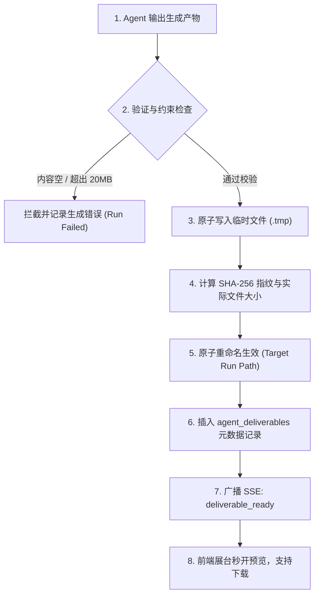
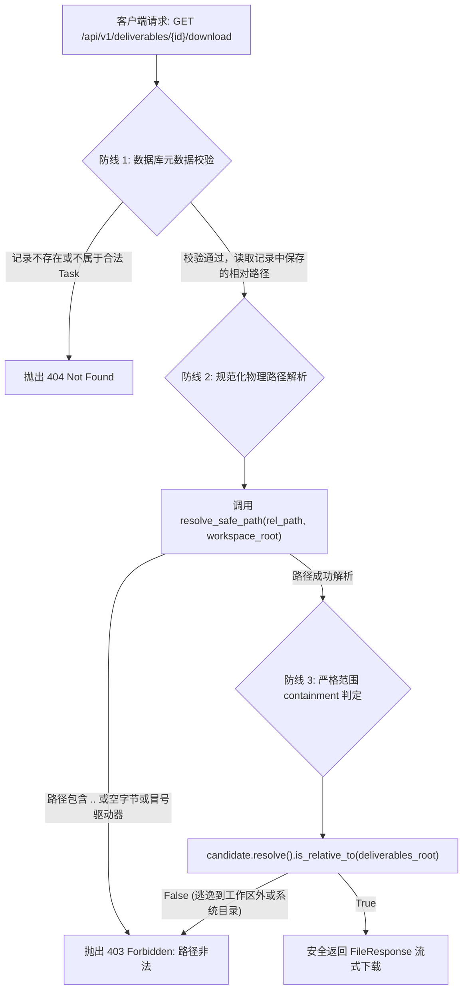

# AgentStudio 交付物系统架构与安全设计规范 (Deliverable Domain)
## Deliverable Lifecycle & Safety Specification

> **文档代号**：`AGENTSTUDIO_DELIVERABLE_DESIGN`  
> **文档版本**：v1.0 (Design Review Baseline)  
> **审查对象**：`agent_deliverables`, `DeliverableManager`, 工作区文件落盘安全, 成果版本化  
> **输出路径**：`docs/architecture/AGENTSTUDIO_DELIVERABLE_DESIGN.md`

---

## 1. 交付物设计哲学与核心定位

### 1.1 为什么必须建立独立的 Deliverable 领域？
在传统的单 Agent 对话系统（如 ChatGPT/Claude 单聊）中，模型的一切劳动成果均直接退化为一段字符串消息（`AIMessage.content`）。这在以下复杂现实任务中暴露出致命缺陷：
1. **成果沉淀与检索极差**：一份 15 页的调研报告被埋没在漫长对话流中，用户后续难以快速提取、归档或一键分享；
2. **缺乏物理版本控制与回溯**：当用户对调研报告提出“请补充对 pgvector 的测试数据”并重新执行（Run #2）时，旧成果直接被覆盖或混乱拼接，无法对比不同 Run 的产物演进；
3. **安全与格式表达受限**：复杂的 CSV 数据表、代码变更补丁包（Git Patch）或结构化 JSON，若全部塞在数据库的单一消息文本字段中，既浪费数据库缓存，又存在格式解析损毁风险。

**AgentStudio 核心原则**：
> **Deliverable is NOT just a message attachment. It is a first-class citizen with durable storage, explicit versioning, strict workspace confinement, and verifiable provenance.**

---

## 2. 交付物领域模型与存储架构 (Deliverable Domain Model)

```
┌────────────────────────────────────────────────────────────────────────┐
│ SQLite 数据库 (元数据层: data/jarvis_studio.db)                          │
│                                                                        │
│ TABLE: agent_deliverables                                              │
│ ├── deliverable_id: "deliv_a1b2c3d4e5f6" (主键)                         │
│ ├── task_id: "task_001" (关联任务)                                     │
│ ├── run_id: "run_002" (明确关联具体的执行轮次，支持版本追溯)             │
│ ├── title: "2026年边缘向量数据库技术选型深度调研报告"                    │
│ ├── deliverable_type: "markdown_report"                                │
│ ├── file_path: "deliverables/task_001/report_v2.md" (工作区相对路径)   │
│ ├── mime_type: "text/markdown; charset=utf-8"                         │
│ ├── file_size_bytes: 14820                                             │
│ ├── sha256_hash: "e3b0c44298fc1c149afbf4c8996fb92427ae41e4649b934..." │
│ ├── summary: "经过对 sqlite-vec 与 Chromadb 实测对比，推荐单机选用..." │
│ ├── content_preview: "# 2026 嵌入式向量数据库选型调研\n## 1. 摘要..."  │
│ ├── metadata_json: "{\"sources\": [...], \"word_count\": 3200}"        │
│ └── created_at / updated_at                                            │
└───────────────────────────────────┬────────────────────────────────────┘
                                    │ 映射工作区物理文件
                                    ▼
┌────────────────────────────────────────────────────────────────────────┐
│ 本地工作区磁盘 (内容层: settings.storage.workspace_root)                 │
│                                                                        │
│ workspace/                                                             │
│ └── deliverables/                                                      │
│     └── {task_id}/                                                     │
│         ├── run_1/                                                     │
│         │   └── report_draft.md                                        │
│         └── run_2/                                                     │
│             ├── report_final.md                                        │
│             └── benchmark_results.csv                                  │
└────────────────────────────────────────────────────────────────────────┘
```

### 2.1 结构化分离设计（严禁“大杂烩字段”）
为保证高性能与高可靠性，坚决禁止将长篇内容、文件路径与元数据混在一个 `content` 字段中：
1. **元数据入库 (Lightweight Index)**：数据库中只记录元数据、哈希值、类型以及**前 2000 字符的快速预览（`content_preview`）**，以便在任务列表和卡片流中无需读取磁盘即可瞬间秒开秒显；
2. **物理文件落盘 (Durable File Storage)**：正式文件以纯文本或原始二进制形态存储在工作区的标准化目录中，由操作系统管理并发读写与文件缓存；
3. **结构化附加元数据 (`metadata_json`)**：以 JSON 格式存储该交付物专有的结构化信息（如参考文献 URL 列表、使用的模型、Token 耗用量、统计字段）。

### 2.2 交付物形态定义 (Deliverable Types)

| 类型代号 | 业务场景 | 物理存储格式 | 前端专用渲染模式 |
| :--- | :--- | :--- | :--- |
| **`markdown_report`** | 技术调研、方案分析、知识整理、长文草案 | `.md` 文本文件 | Markdown 渲染器、代码高亮、Mermaid 图表、一键导出 HTML/PDF。 |
| **`code_patch`** | 代码重构、脚本补丁、Bug 修复 | `.patch` / `.py` 等代码文件 | 语法高亮代码编辑器、Unified Diff 对比视图、一键复制。 |
| **`data_table`** | 性能测试指标、参数比对、信息抓取汇总 | `.csv` / `.json` | 交互式数据表格组件（支持前端分页、列过滤、排序与 CSV 下载）。 |
| **`file`** | 自动化操作产出、日志转储、打包压缩包 | 通用文件形态 | 文件大小/图标展示、SHA-256 校验码展示、直接下载。 |
| **`json_artifact`** | 结构化配置、API 规范、提取出的 Schema | `.json` 文件 | 交互式 JSON 树状折叠查看器、格式化预览。 |

---

## 3. 交付物完整生命周期管线 (End-to-End Pipeline)



### 3.1 步骤 1：产物产出与类型推断
Agent 在执行过程中，可以通过显式工具调用（如 `generate_markdown_report(title, content, sources)`）或在任务终态节点，由 `DeliverableManager` 提取并标准化产物内容。

### 3.2 步骤 2：安全与规格前置校验 (Validation)
1. **大小阈值硬约束**：单个报告类交付物内容最大限制为 **20 MB**（防止因大模型死循环输出填满磁盘）；
2. **内容有效性校验**：检测是否为空白文本；检测编码是否为严格合规的 UTF-8。

### 3.3 步骤 3 & 5：原子安全落盘 (Atomic Write & Partial Cleanup)
- **并发写与断电保护**：严禁直接向目标文件流式写入（避免网络中断或进程崩溃产生半截残损文件）。
- **实施操作**：
  1. 先写入工作区隔离临时目录：`workspace/deliverables/{task_id}/.tmp_{uuid}.tmp`；
  2. 完整写入并执行 `os.fsync(fd)` 刷盘；
  3. 通过 `os.replace` 原子替换为终态目标路径：`workspace/deliverables/{task_id}/run_{run_seq}/{filename}`；
  4. 若写入期间抛出异常，`try...finally` 块强制清理 `.tmp` 临时碎片，保证磁盘绝无垃圾残留。

### 3.4 步骤 4：计算指纹与元数据提取
- 自动计算文件的 `SHA-256` 哈希并记录字节大小；
- 截取正文前 2000 个字符存入 `content_preview`；
- 自动提取前两段摘要存入 `summary`。

---

## 4. 多轮 Run 物理版本化防覆盖设计 (Versioning & Collision Avoidance)

在复杂任务中，用户可能会针对初版交付物提出修改建议（如追加论据、调整对比格式），从而触发多轮 Run。

### 4.1 目录物理分代隔离
```
workspace/deliverables/{task_id}/
├── run_1/
│   └── 2026年边缘向量库调研.md     <-- Run #1 产物 (初稿)
└── run_2/
    ├── 2026年边缘向量库调研.md     <-- Run #2 产物 (终稿，增量补充了测试数据)
    └── benchmark_data.csv          <-- Run #2 追加的辅助交付物
```
- **绝对防覆盖法则**：
  - 每个 Run 的物理交付物严格存放在其对应的 `run_{run_seq}/` 子目录下；
  - **绝不允许 Run #2 静默覆盖 Run #1 的磁盘文件**；
  - 数据库中 `agent_deliverables` 表记录每份交付物的 `run_id`，用户可在 Task Detail 自由切换查看历史 Run 的成果快照。

---

## 5. 严格的文件访问安全与工作区边界防线 (Security Confinement)

Deliverable API 涉及文件读取与二进制下载，必须建立极其严密的路径安全防线，严防任意文件读取漏洞（Arbitrary File Read）。

### 5.1 路径防穿越三道防线 (Three-Tier Confinement)



1. **防线 1（元数据白名单）**：API 绝不接受前端直接传入物理路径参数！前端只能传入 `deliverable_id`，后端从 `agent_deliverables` 表中查出该记录登记的相对路径；
2. **防线 2（复用 `resolve_safe_path`）**：严格校验相对路径中是否包含 `\x00`、UNC 路径、越界符号链接与父目录遍历（`../../`）；
3. **防线 3（强制沙箱锚定）**：目标文件必须严格位于 `settings.storage.workspace_root / "deliverables"` 目录之下，任何试图利用软链接指向 `/etc/passwd` 或 `C:\Windows` 的操作直接阻断并报警。

---

## 6. 简单任务 vs 复杂任务的交付策略 (Progressive Output)

系统绝不强制每一个简单操作都生成实体文件：

| 任务类型 | 示例目标 | 交付策略 (Deliverable Policy) | 呈现形态 |
| :--- | :--- | :--- | :--- |
| **轻量简单任务** | “查看当前目录下的文件”、“解释这个 Python 函数” | **无需生成物理文件**。`agent_deliverables` 无记录。 | 直接以自然语言 `Result Summary` 在任务详情中高亮卡片呈现。 |
| **中等分析任务** | “帮我写一个数据清洗脚本并给出演示用例” | **生成 1 个交付物** (`code_patch` 或 `.py` 文件)。 | 页面展示代码编辑器预览与单文件下载按钮。 |
| **深度研究任务** | “全面调研 2026 本地向量库并输出对比表” | **生成多个复合交付物**（1 份主调研报告 `.md` + 1 份对比数据 `.csv`）。 | 成果展台展示多 Tab 切换，支持整包批量归档。 |

---

## 7. 任务删除时的物理文件治理策略 (Purge Policy)

当用户在任务中心显式删除某个 Task 时：
1. **事务内删除数据库记录**：级联删除 `agent_deliverables`、`agent_runs`、`agent_tasks`；
2. **物理目录安全清理**：
   - 目标路径定位：`deliverables_dir = workspace_root / "deliverables" / task_id`；
   - 严格前置断言：验证 `deliverables_dir.is_relative_to(workspace_root)` 且目录名与 `task_id` 完全一致；
   - 调用 `shutil.rmtree(deliverables_dir, ignore_errors=True)` 彻底回收磁盘空间，绝无孤儿文件残留；
   - 绝不递归向上删除父目录，确保其他 Task 的交付物丝毫无损。
