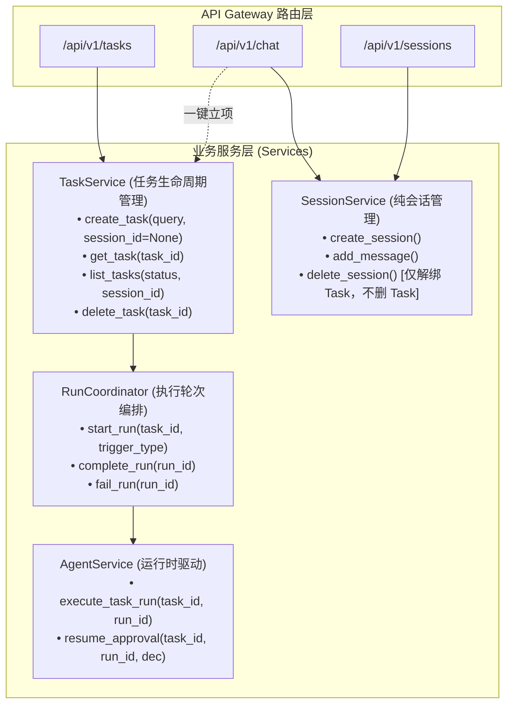
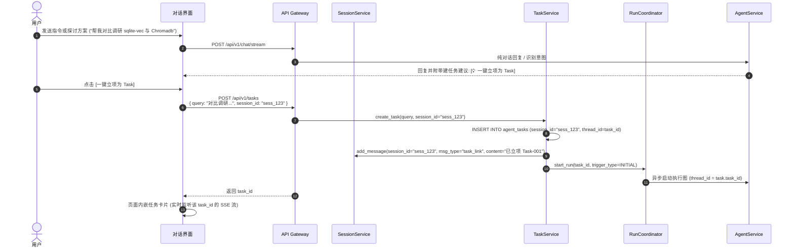

# AgentStudio 领域模型演进规范 (Session / Task / Run)
## Domain Evolution Specification

> **文档代号**：`AGENTSTUDIO_DOMAIN_EVOLUTION`  
> **文档版本**：v1.0 (Design Review Baseline)  
> **审查对象**：`SessionService`, `TaskCoordinator`, `AgentService`, `agent_tasks`, `agent_runs`, LangGraph Checkpoint  
> **输出路径**：`docs/architecture/AGENTSTUDIO_DOMAIN_EVOLUTION.md`

---

## 1. 现状代码隐式耦合深度诊断 (Codebase Reality Audit)

在 Sprint 1C 的历史实现中，为了快速落地 SQLite 持久化验证，系统遗留了数处**严重的会话与任务领域强耦合**。在启动 Sprint 2A 之前，必须对这些代码硬编码进行精准定位与彻底解耦。

### 1.1 隐式耦合点清单

#### 耦合点 1：`agent_tasks.session_id NOT NULL` 与数据库外键级联硬删除
- **源码位置**：`src/jarvis_studio/core/persistence/migrations.py` (L166-L184)
  ```sql
  CREATE TABLE IF NOT EXISTS agent_tasks (
      task_id         TEXT PRIMARY KEY,
      session_id      TEXT NOT NULL,
      thread_id       TEXT NOT NULL,
      ...
      FOREIGN KEY (session_id) REFERENCES chat_sessions(session_id) ON DELETE CASCADE
  )
  ```
- **真实风险**：
  1. **无法独立创建 Task**：由于 `session_id NOT NULL` 且具有外键约束，用户在“任务中心”直接新建任务时，若没有预先存在的 `chat_sessions`，直接报外键约束失败（`FOREIGN KEY constraint failed`）。
  2. **会话删除误杀持久化任务**：当用户在 UI 点击删除一个 Chat 会话时，SQLite 的 `ON DELETE CASCADE` 会瞬间将该会话关联的所有 `agent_tasks`、`agent_runs`、历史记录全部物理粉碎，导致任务资产与成果完全丢失。

#### 耦合点 2：`SessionService.delete_session` 的主动级联清表逻辑
- **源码位置**：`src/jarvis_studio/service/session_service.py` (L387-L403)
  ```python
  # 4. agent_runs
  conn.execute("DELETE FROM agent_runs WHERE task_id IN (SELECT task_id FROM agent_tasks WHERE session_id = ?)", (session_id,))
  # 5. agent_tasks
  conn.execute("DELETE FROM agent_tasks WHERE session_id = ?", (session_id,))
  ```
- **真实风险**：业务代码层显式编写了“删 Session 必删 Task”的逻辑，违背了“Task 拥有独立于 Session 生命周期”的既定架构原则。

#### 耦合点 3：`AgentService._invoke_agent_unlocked` 将会话每轮交互强制 1:1 视为任务
- **源码位置**：`src/jarvis_studio/service/agent_service.py` (L289-L300)
  ```python
  task = self.task_coordinator.create_task(
      session_id=thread_id,
      thread_id=thread_id,
      query=user_message,
      runtime_id=runtime_id,
  )
  run = self.task_coordinator.start_run(
      task_id=task.task_id,
      runtime_id=runtime_id,
      trigger_type=RunTriggerType.INITIAL,
      run_id=effective_run_id,
  )
  ```
- **真实风险**：系统在 Chat 交互中把 `thread_id` 同时当作 `session_id`、`task_id` 的关联键以及 LangGraph 的 checkpoint `thread_id`。这导致：
  1. 用户在 Chat 里每打一句招呼（如“你好”），数据库就会产生一个 `agent_tasks` 记录；
  2. 同一个 Chat 里的多个任务共用同一个 LangGraph checkpoint `thread_id`，导致图状态历史在多个任务之间严重交织与污染；
  3. 无法支持在 Chat 中探讨多轮后才“提炼立项为一个 Task”。

#### 耦合点 4：`hitl_approval_requests` 与 `tool_execution_outcomes` 的复合唯一键依赖
- **源码位置**：`src/jarvis_studio/core/persistence/migrations.py` (L87-L162)
  ```sql
  UNIQUE (thread_id, tool_call_id)
  ```
- **真实风险**：当前系统的防重放唯一约束是基于 `(thread_id, tool_call_id)`。如果 `thread_id` 继续等于会话 ID，则同一会话中的多次执行若发生 `tool_call_id` 碰撞或重试，会触发冲突。

---

## 2. 目标领域模型规范 (Target Domain Model)

为彻底解决上述耦合，确立四层清晰实体层级：

```
┌─────────────────────────────────────────────────────────────┐
│ 1. Session (会话空间, 可选容器)                               │
│    - session_id: 唯一标识 (sess_xxx)                         │
│    - title, created_at, updated_at                          │
│    - 仅负责漫谈交互上下文与消息历史 (chat_messages)               │
└──────────────────────────────┬──────────────────────────────┘
                               │ 0..1 (可选来源)
                               ▼ 0..N
┌─────────────────────────────────────────────────────────────┐
│ 2. Task (业务目标实体, 核心独立生命周期)                        │
│    - task_id: 业务主键 (task_xxx)                           │
│    - session_id: NULLABLE (来源会话，独立任务为 NULL)          │
│    - thread_id: LangGraph 状态机独立隔离线 (= task_id)        │
│    - status: 10 态 TaskStatus                               │
│    - query: 最终目标描述                                     │
│    - plan_json, assigned_agent_id                           │
└──────────────────────────────┬──────────────────────────────┘
                               │ 1
                               ▼ 1..N
┌─────────────────────────────────────────────────────────────┐
│ 3. Run (物理执行轮次)                                         │
│    - run_id: 物理执行主键 (run_xxx)                          │
│    - task_id: 所属任务 (强外键)                              │
│    - run_seq: 1, 2, 3... (单 Task 内部严格单调递增)            │
│    - trigger_type: initial | hitl_resume | retry | amend    │
│    - status: 7 态 RunStatus                                 │
│    - checkpoint_id: 关联的 LangGraph 快照 ID                 │
└──────────────────────────────┬──────────────────────────────┘
                               │ 1
                               ▼ 0..M
┌─────────────────────────────────────────────────────────────┐
│ 4. Deliverable (正式交付物)                                  │
│    - deliverable_id: (deliv_xxx)                            │
│    - task_id, run_id (双重溯源)                              │
│    - deliverable_type, file_path, summary, metadata         │
└─────────────────────────────────────────────────────────────┘
```

### 2.1 实体核心职责与不变量
1. **Session 存在与否不影响 Task**：Task 可以在没有 Session 的情况下被创建、调度、暂停、恢复与交付。
2. **Task 独占 LangGraph `thread_id`**：LangGraph 的检查点隔离边界以 **`Task`** 为单元（即 `thread_id = task.task_id`）。同一个 Task 下的所有 Run 共享该状态线以实现断点续跑；不同 Task 之间的状态绝对物理隔离。
3. **Run 严格依附于 Task**：Run 是 Task 的单次物理执行切片。任何审批恢复（HITL Resume）、参数修改重试或用户追加指令迭代，均**递增 `run_seq` 并生成新的 Run**，严禁覆盖历史 Run。

---

## 3. 数据库 Schema V4 演进与平滑迁移规范

### 3.1 目标 DDL 变更定义

在 `jarvis_studio.db` 中平滑升级为 **Schema V4**：

```sql
-- ========================================================
-- Schema V4 Migration: Decouple Task from Session & Add Deliverables
-- ========================================================

-- 1. 创建全新的 agent_tasks_v4 表 (解除 session_id NOT NULL 限制，外键行为调整为 SET NULL)
CREATE TABLE IF NOT EXISTS agent_tasks_v4 (
    task_id           TEXT PRIMARY KEY,
    session_id        TEXT, -- NULLABLE! 独立任务允许为 NULL
    thread_id         TEXT NOT NULL,
    status            TEXT NOT NULL CHECK (status IN (
                          'CREATED', 'RUNNING', 'WAITING_APPROVAL', 'EXECUTING_TOOL',
                          'COMPLETED', 'FAILED', 'CANCELLED', 'TIMEOUT', 'UNKNOWN', 'INTERRUPTED'
                      )),
    query             TEXT NOT NULL,
    initiator         TEXT NOT NULL DEFAULT 'user',
    assigned_agent_id TEXT NOT NULL DEFAULT 'general_agent',
    current_run_id    TEXT,
    plan_json         TEXT,
    created_at        REAL NOT NULL,
    updated_at        REAL NOT NULL,
    completed_at      REAL,
    runtime_id        TEXT,
    error_message     TEXT,
    FOREIGN KEY (session_id) REFERENCES chat_sessions(session_id) ON DELETE SET NULL
);

-- 2. 数据平滑迁移
INSERT INTO agent_tasks_v4 (
    task_id, session_id, thread_id, status, query, initiator,
    assigned_agent_id, current_run_id, plan_json, created_at,
    updated_at, completed_at, runtime_id, error_message
)
SELECT 
    task_id, session_id, thread_id, status, query, initiator,
    'general_agent' AS assigned_agent_id, current_run_id, NULL AS plan_json,
    created_at, updated_at, completed_at, runtime_id, error_message
FROM agent_tasks;

-- 3. 原子表替换
DROP TABLE agent_tasks;
ALTER TABLE agent_tasks_v4 RENAME TO agent_tasks;

-- 4. 重建索引
CREATE INDEX IF NOT EXISTS idx_tasks_session_created ON agent_tasks(session_id, created_at DESC);
CREATE INDEX IF NOT EXISTS idx_tasks_status_runtime ON agent_tasks(status, runtime_id);
CREATE INDEX IF NOT EXISTS idx_tasks_thread_status ON agent_tasks(thread_id, status);

-- 5. 交付物表定义 (Deliverables)
CREATE TABLE IF NOT EXISTS agent_deliverables (
    deliverable_id    TEXT PRIMARY KEY,
    task_id           TEXT NOT NULL,
    run_id            TEXT NOT NULL,
    title             TEXT NOT NULL,
    deliverable_type  TEXT NOT NULL CHECK (deliverable_type IN (
                          'markdown_report', 'code_patch', 'file', 'data_table', 'json_artifact'
                      )),
    file_path         TEXT,          -- 工作区相对路径
    mime_type         TEXT NOT NULL,
    file_size_bytes   INTEGER DEFAULT 0,
    sha256_hash       TEXT,
    summary           TEXT,
    content_preview   TEXT,          -- 前 2000 字符文本预览
    metadata_json     TEXT,          -- 引用来源、生成参数等
    created_at        REAL NOT NULL,
    updated_at        REAL NOT NULL,
    FOREIGN KEY (task_id) REFERENCES agent_tasks(task_id) ON DELETE CASCADE,
    FOREIGN KEY (run_id) REFERENCES agent_runs(run_id) ON DELETE CASCADE
);
CREATE INDEX IF NOT EXISTS idx_deliv_task ON agent_deliverables(task_id, created_at DESC);
CREATE INDEX IF NOT EXISTS idx_deliv_run ON agent_deliverables(run_id);
```

### 3.2 历史数据迁移与回滚保障机制
1. **迁移前快照验证**：
   - 继承 `migrations.py` 的现有机制，在执行迁移前使用 SQLite Backup API 导出带纳秒级时间戳的备份文件；
   - 对备份库执行 `PRAGMA quick_check(1)` 与 `PRAGMA user_version` 读校验，校验不通过严禁迁移。
2. **幂等性保障**：
   - 使用 `PRAGMA user_version = 4` 判定，若当前版本已达 4，直接安全跳过。
3. **数据一致性验证**：
   - 迁移事务内执行 `SELECT COUNT(*) FROM agent_tasks` 与原记录数一致性对账；若不一致直接 `ROLLBACK` 并抛出 `MigrationError`。

---

## 4. 服务层职责边界与接口演进 (Service Layer Architecture)



### 4.1 各服务职责清晰划分

| 服务名称 | 核心职责 | 绝不越界的禁区 |
| :--- | :--- | :--- |
| **`SessionService`** | 仅管理 `chat_sessions` 和 `chat_messages`；负责前端漫谈历史。 | **绝不允许**操作 `agent_tasks` 或删除任务物理记录。 |
| **`TaskService`** | 负责 Task 的独立创建、查询、更新、删除策略、状态机流转。 | 不负责执行具体的 LangGraph 图；不负责底层网络协议。 |
| **`RunCoordinator`** | 负责 Run 的序列号递增（`run_seq`）、执行耗时计算、状态同步。 | 不感知上层 Session。 |
| **`AgentService`** | 驱动 `AgentRuntime`、获取 `_ThreadLockGuard`、调用 StateGraph、捕获 SSE 流。 | 不再直接将会话 ID 当作 Task 创建，严格接收外部明确的 `task_id`。 |

---

## 5. 三大核心业务交互链路设计

### 5.1 场景 A：从 Chat 对话提炼创建 Task (Chat-to-Task Workflow)



### 5.2 场景 B：独立创建 Task (Standalone Task Workflow)
1. 用户在“任务中心”点击“新建任务”，输入目标，**不携带任何 `session_id`**；
2. API Gateway 收到 `POST /api/v1/tasks`（`session_id: null`）；
3. `TaskService` 在 `agent_tasks` 中插入记录，`session_id` 存为 `NULL`；
4. `thread_id` 赋值为 `task.task_id`，独立分配锁与状态快照，完全不依赖会话表。

### 5.3 场景 C：任务多次 Run 的演进流程 (Multi-Run Lifecycle)
- **初始运行**：`Run #1` (`trigger_type = INITIAL`, `run_seq = 1`)。若遇到高危工具写操作，触发 `approval_gate`，`Run #1` 标为 `INTERRUPTED`，`Task` 标为 `WAITING_APPROVAL`。
- **审批恢复**：用户在 UI 决策修改参数并批准：
  - 调用 `TaskService.resume_task_approval(task_id, decision)`；
  - `RunCoordinator` 启动 **`Run #2`** (`trigger_type = HITL_RESUME`, `run_seq = 2`)；
  - `Task` 状态切回 `RUNNING`，`current_run_id = run_2`；
  - 执行完成，`Run #2` 标为 `COMPLETED`，`Task` 标为 `COMPLETED`。
  - **结果**：任务详情中完整保留 `Run #1` 与 `Run #2` 两次运行记录与各自的工具日志，审计链毫无缺失。

---

## 6. 级联删除与生命周期治理策略 (Cascade & Deletion Policy)

### 6.1 策略 1：删除 Session 时的处理策略 (Soft-Unlink)
- **规则**：**删除 Session 绝对不能删除其关联的 Task**。
- **实施操作**：
  在 `SessionService.delete_session(session_id)` 事务中：
  ```sql
  -- 将关联的任务的 session_id 置为空，解除关联，但保留全部任务与成果
  UPDATE agent_tasks SET session_id = NULL WHERE session_id = ?;
  -- 仅删除该 session 的 chat_messages 与 chat_sessions 记录
  DELETE FROM chat_messages WHERE session_id = ?;
  DELETE FROM chat_sessions WHERE session_id = ?;
  ```
- **用户价值**：即使用户清理聊天历史，所有已立项的工作成果、调研报告和代码 Patch 依旧稳妥保存在“任务中心”内。

### 6.2 策略 2：删除 Task 时的处理策略 (Strict Cascade Cleanup)
- **规则**：当用户在“任务中心”显式删除一个 Task 时，执行原子级联清理：
  1. **关联 Run 清理**：级联删除 `agent_runs WHERE task_id = ?`；
  2. **交付物记录清理**：级联删除 `agent_deliverables WHERE task_id = ?`；
  3. **实体文件清理**：调用 `DeliverableManager.delete_task_deliverables_dir(task_id)`，物理移除工作区内的 `workspace/deliverables/{task_id}/` 目录；
  4. **追踪与审批清理**：清理属于该 task 的 `agent_conversation_traces`、`hitl_approval_requests` 与 `tool_execution_outcomes`；
  5. **Checkpointer 状态清理**：调用 `checkpointer.adelete_thread(thread_id=task.task_id)` 清理 SQLite 中的图快照，杜绝僵尸数据。

---

## 7. 结论与 Sprint 2A 落地要求

本设计彻底解开了 Session 与 Task 的历史死结，确立了以 `Task` 为独立生命周期载体、`thread_id = task.task_id` 的隔离范式，并定义了平滑升级至 Schema V4 的无损迁移方案。
Sprint 2A 将严格按照此规范实现 `agent_tasks_v4` 迁移、`TaskService` 独立服务及 REST API。
