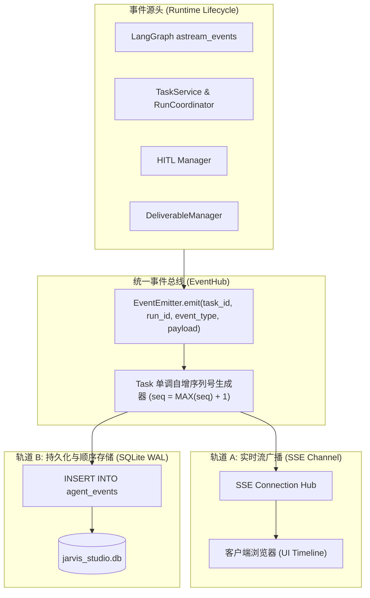

# AgentStudio 执行事件与可观测性体系规范 (Event Model & Observability)
## Execution Event & Real-Time Telemetry Specification

> **文档代号**：`AGENTSTUDIO_EVENT_MODEL`  
> **文档版本**：v1.0 (Design Review Baseline)  
> **审查对象**：`agent_conversation_traces`, SSE 管道, 业务事件流, 状态机流转, 真实可观测性  
> **输出路径**：`docs/architecture/AGENTSTUDIO_EVENT_MODEL.md`

---

## 1. 核心领域实体概念正交区分 (Taxonomy)

为了从根本上消除“日志充当事件”、“思考充当进度”、“追踪充当状态”的混乱现状，必须在概念层严格区隔 5 个正交实体：

```
┌────────────────────────────────────────────────────────────────────────┐
│ 1. Task (目标层)       用户下达的业务目标，拥有独立生命周期 (10 态)           │
├────────────────────────────────────────────────────────────────────────┤
│ 2. Run (执行层)        Task 的单次物理运行切片，拥有独立执行周期 (7 态)        │
├────────────────────────────────────────────────────────────────────────┤
│ 3. Event (事实层)      执行过程中系统在物理世界发生的离散、不可变事实          │
├────────────────────────────────────────────────────────────────────────┤
│ 4. Trace (诊断层)      面向开发者的性能分析、毫秒级延迟打点与原始调用栈        │
├────────────────────────────────────────────────────────────────────────┤
│ 5. Deliverable (成果层) 任务执行完毕后物理落盘沉淀的可用正式交付物           │
└────────────────────────────────────────────────────────────────────────┘
```

### 1.1 实体概念边界与职责矩阵

| 实体 | 关注视角 | 典型生命周期 | 存储载体 | 主要受众 | 典型数据 |
| :--- | :--- | :--- | :--- | :--- | :--- |
| **Task** | 用户目标与状态 | 小时/天/持续 | `agent_tasks` 表 | 终端用户 | `task_id`, `status: WAITING_APPROVAL`, `query` |
| **Run** | 物理执行与重试 | 秒/分钟级 | `agent_runs` 表 | 调度器 / 运维 | `run_id`, `run_seq: 2`, `trigger_type: hitl_resume` |
| **Event** | 真实执行事实流 | 离散微秒时间戳 | `agent_events` 表 + SSE | 前端时间线组件 | `tool_started`, `plan_updated`, `approval_required` |
| **Trace** | 链路耗时与白盒诊断 | 随请求生成 | `agent_conversation_traces` | 核心系统开发者 | `ttft_ms: 85`, `ttfa_ms: 1200`, `raw_payload` |
| **Deliverable** | 最终劳动成果 | 永久沉淀 | `agent_deliverables` + 磁盘 | 最终用户 | `report.md`, `data.csv`, `sha256_hash` |

---

## 2. 统一执行事件模型规范 (Unified Event Schema)

面向前端消费与历史回放，确立强类型的 `ExecutionEvent` 契约：

```sql
CREATE TABLE IF NOT EXISTS agent_events (
    event_id      TEXT PRIMARY KEY,
    task_id       TEXT NOT NULL,
    run_id        TEXT NOT NULL,
    seq           INTEGER NOT NULL,   -- 单 Task 内部严格单调递增整数: 1, 2, 3...
    event_type    TEXT NOT NULL,      -- 标准枚举: TOOL_STARTED, APPROVAL_REQUIRED 等
    timestamp     REAL NOT NULL,      -- UTC 秒级浮点时间戳
    payload_json  TEXT NOT NULL,      -- 强类型业务负载
    FOREIGN KEY (task_id) REFERENCES agent_tasks(task_id) ON DELETE CASCADE,
    FOREIGN KEY (run_id) REFERENCES agent_runs(run_id) ON DELETE CASCADE,
    UNIQUE (task_id, seq)             -- 绝对防止事件乱序或重复插入
);
CREATE INDEX IF NOT EXISTS idx_events_task_seq ON agent_events(task_id, seq ASC);
CREATE INDEX IF NOT EXISTS idx_events_run_id ON agent_events(run_id);
```

### 2.1 标准事件分类全集 (Event Taxonomy)

| 事件类型 (`event_type`) | 触发时机与来源 | 核心 Payload 字段 | UI 响应行为 |
| :--- | :--- | :--- | :--- |
| **`TASK_CREATED`** | 用户立项成功 | `{task_id, query, initiator, agent_id}` | 任务中心新增一条待运行卡片。 |
| **`RUN_STARTED`** | 调度器拉起新的执行轮次 | `{run_id, run_seq, trigger_type}` | 任务时间线插入“第 N 轮执行启动”分割标头。 |
| **`PLAN_UPDATED`** | 规划器生成或调整了执行步骤 | `{steps: [{id, title, status, desc}]}` | 渲染交互式步骤待办清单（Steps Checklist）。 |
| **`AGENT_DELEGATED`** | General 委派专业 Agent | `{from_agent, to_agent, sub_goal}` | 时间线呈现智能体交接分支徽章。 |
| **`TOOL_STARTED`** | 工具开始进入执行边界 | `{tool_name, arguments, tool_call_id}` | 插入工具执行卡片，展示入参，开启执行闪烁动画。 |
| **`TOOL_COMPLETED`** | 工具执行完成返回结果 | `{tool_name, duration_ms, summary, status}` | 工具卡片停止闪烁，展示耗时与输出简短折叠块。 |
| **`APPROVAL_REQUIRED`**| 命中高危操作安全拦截 | `{approval_id, tool_name, arguments, risk}` | 弹出全局审批卡片，阻断时间线，等待人工决策。 |
| **`APPROVAL_RESOLVED`**| 用户完成审批决策 | `{approval_id, decision, reason, modified}` | 标记该审批节点为 APPROVED / REJECTED / MODIFIED。 |
| **`RUN_PAUSED`** | 用户点击暂停并安全落盘快照 | `{checkpoint_id, reason}` | 呈现“任务已安全暂停于检查点”黄色徽标。 |
| **`RUN_RESUMED`** | 用户唤醒暂停任务或提交改参 | `{new_run_id, from_checkpoint}` | 恢复流式输出动画。 |
| **`RUN_FAILED`** | 出现不可控异常或外部错误 | `{error_message, stage, recoverable}` | 标红当前失败步骤，展示错误堆栈摘要与重试按钮。 |
| **`DELIVERABLE_CREATED`**| 成果成功生成并安全落盘 | `{deliverable_id, title, type, preview}` | 成果展台高亮弹出“新成果已就绪”，加载 Markdown。 |
| **`TASK_COMPLETED`** | 整个业务目标正式达成 | `{completed_at, total_duration_ms}` | 顶部状态变为 COMPLETED 绿色徽章，触发成果归档。 |

---

## 3. 双轨事件传输与持久化架构 (Dual-Path Delivery)

为了保证**低延迟交互（<50ms 实时流）**与**可靠历史回放（刷新不丢数据）**，采用“内存广播 + 数据库持久化”双轨管线：



### 3.1 客户端断线重连与事件补偿 (Reconnection & Compensating Protocol)
- **断线感知**：SSE 客户端在本地内存记录已接收到的最新 `last_event_seq`；
- **重连请求**：网络恢复后，客户端发起带头部的重连请求：
  `GET /api/v1/tasks/{task_id}/events?since_seq=14`
- **补偿机制**：后端直接执行 `SELECT * FROM agent_events WHERE task_id = ? AND seq > 14 ORDER BY seq ASC`，优先将断线期间漏掉的事件全量推回客户端，随后无缝接管实时 SSE 广播。
- **杜绝全量轮询**：前端无需定时轮询全表，大幅降低 SQLite 读锁与 CPU 占用。

---

## 4. 彻底消除伪思考：从“编造状态”走向“现场可观测”

### 4.1 现有 `core/thinking/engine.py` 的架构缺陷
现有代码存在如下设计：
```python
# 现状代码: 虚构思考过程
await thinking_engine.emit_understand("正在理解您的指令并分析上下文...")
await asyncio.sleep(0.3)
await thinking_engine.emit_tool_start("正在调用工具...")
```
- **判定**：这种通过硬编码中文和人工 `sleep` 模拟的“思考进度”，欺骗了用户，无法反映真实的系统瓶颈（如是网络慢、工具慢还是模型慢），且严重违背项目“Observable by Design”的核心原则。

### 4.2 真实的“思考与推理”可观测方案
大模型本身的推理过程只通过以下两种真实途径呈现，**绝不人为合成任何假文本**：
1. **原生推理流 (Model Reasoning Streaming)**：
   - 适配 DeepSeek-R1、o1 等具备显式推理字段的模型时，直接透传模型原生的 `reasoning_content`，标记为 `event: reasoning_token`，在前端以专有灰色卡片折叠呈现；
2. **状态机跃迁 (StateGraph Transitions)**：
   - 当图从 `assistant` 节点转入 `router` 或 `approval_gate` 时，以真实的节点流转事件（如 `plan_updated`, `agent_delegated`）展示 Agent 的真实推进轨迹。

---

## 5. Trace (诊断) 与 Event (业务) 的共存与边界

```
┌────────────────────────────────────────────────────────┐
│ UI 用户界面 (Task Center & Detail)                      │
│ └── 仅消费 agent_events                                │
│     (高业务价值、结构轻巧、100% 贴合任务进度时间线)       │
├────────────────────────────────────────────────────────┤
│ Developer Debugger (技术级诊断抽屉)                      │
│ └── 消费 agent_conversation_traces                     │
│     (TTFT/TTFA/TTLT 耗时、原始 Token 账单、底层快照)     │
└────────────────────────────────────────────────────────┘
```

- **数据隔离，防数据膨胀**：
  - `agent_events` 只存储用户关心的结构化事实，平均每事件仅百余字节，永久随 Task 保留；
  - `agent_conversation_traces` 存储庞大的原始输入输出 Payload，继续沿用 **`max_rows_per_session=200` + `max_age_days=30`** 的自动修剪（Prune）策略，避免磁盘膨胀。
