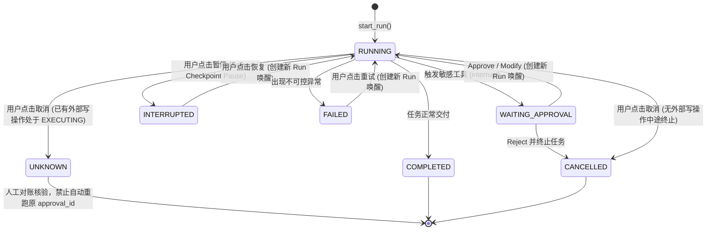
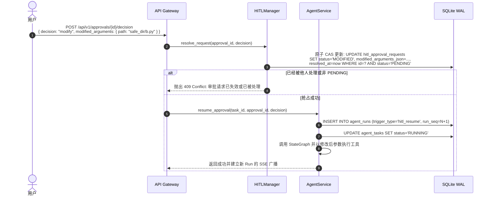

# AgentStudio 任务控制、外部副作用与 HITL 规范 (Execution Control)
## Pause, Cancel, Resume & Side-Effect Reliability Specification

> **文档代号**：`AGENTSTUDIO_EXECUTION_CONTROL`  
> **文档版本**：v1.0 (Design Review Baseline)  
> **审查对象**：`RuntimeInstanceLock`, `ProcessRunner`, `HITLManager`, `AsyncSqliteSaver`, 外部副作用与取消  
> **输出路径**：`docs/architecture/AGENTSTUDIO_EXECUTION_CONTROL.md`

---

## 1. 用户干预控制动作矩阵 (Control Action Taxonomy)

在工业级生产环境中，必须严格界定并区分 7 种用户控制语义，杜绝将“暂停”、“取消”、“等待审批”混为一谈：



### 1.1 7 种干预动作定义与状态转移规则

| 干预动作 | 触发源 | 前置状态 | 目标状态 | 运行时处理机制 |
| :--- | :--- | :---: | :---: | :--- |
| **1. 安全暂停 (Pause)** | 用户主动在 UI 点击“暂停” | `RUNNING` | `INTERRUPTED` | 等待当前不可分割步骤执行到最近的 LangGraph 检查点边界，安全落盘快照后停止事件步进。 |
| **2. 强制取消 (Cancel)** | 用户主动在 UI 点击“取消” | `RUNNING` / `WAITING_APPROVAL` | `CANCELLED` 或 `UNKNOWN` | 立即向对应的 `asyncio.Task` 发送取消信号，杀除底层进程树，根据工具是否有外部副作用收敛终态。 |
| **3. 安全拦截 (Wait Approval)**| 系统安全策略命中高危操作 | `RUNNING` | `WAITING_APPROVAL` | LangGraph 抛出原生 `interrupt()`，持久化审批单，释放当前执行线程锁，等待人工决策。 |
| **4. 审批恢复 (Approval Resume)**| 用户提交 Approve / Modify | `WAITING_APPROVAL`| `RUNNING` | 校验 CAS 租约与入参哈希，生成 **`Run #(N+1)`**，使用 `Command(resume=...)` 唤醒图状态。 |
| **5. 审批拒绝 (Approval Reject)**| 用户提交 Reject 决策 | `WAITING_APPROVAL`| `RUNNING` 或 `CANCELLED` | 将拒绝信号注入图状态，由 Agent 决定调整策略解释原因，或直接终止任务。 |
| **6. 失败恢复 (Retry)** | 任务失败后用户点击重试 | `FAILED` | `RUNNING` | 基于前序成功的 Checkpoint 快照拉起 **`Run #(N+1)`** 重新尝试。 |
| **7. 追加迭代 (Amend)** | 任务完成后用户追加要求 | `COMPLETED` | `RUNNING` | 在保留历史交付物的前提下，递增 `run_seq` 启动新 Run 执行增量迭代。 |

---

## 2. 外部副作用与“UNKNOWN 铁律” (The UNKNOWN Invariant)

在真实的操作系统交互中（如执行 Shell 脚本、修改文件、调用外部 HTTP API），**Python 的 `asyncio.CancelledError` 绝不等于外部物理副作用已被安全回滚**！

### 2.1 真实物理世界的三种不确定性困境
1. **进程已被杀掉，但副作用已生效**：Agent 执行 `python deploy.py`，用户在第 3 秒取消，子进程被 JobObject 终止，但远端服务器的容器可能已经启动并对外暴露；
2. **写文件到一半发生断电或崩溃**：文件系统上留下了一个损坏的半截文件；
3. **MCP 服务是外部独立进程**：杀死本地 AgentRuntime 无法保证网络另一侧的 MCP 远程调用没有产生磁盘变更。

### 2.2 核心安全铁律 (Strict Failure Policies)

```
┌────────────────────────────────────────────────────────────────────────┐
│ 外部副作用处理核心铁律 (Non-Negotiable Policy)                            │
│                                                                        │
│ 1. 任何处于 EXECUTING 期间被取消的写操作，Outcome 严格标记为 UNKNOWN       │
│ 2. 任何旧实例崩溃遗留的 EXECUTING 记录，重启对账一律收敛为 UNKNOWN          │
│ 3. 任何状态为 UNKNOWN 的操作，系统绝对禁止自动重试！                      │
│ 4. 严禁假定本地子进程已杀死就代表远程或磁盘副作用未发生！                  │
│ 5. 人工核验 UNKNOWN 记录后，严禁解锁复用原 approval_id，重试必须重走全新授权流 │
└────────────────────────────────────────────────────────────────────────┘
```

---

## 3. 进程清理与系统资源回收机制 (Resource Governance)

取消操作必须保障操作系统层面的“绝对干净”，防止后台悬挂孤儿进程占用端口、CPU 或磁盘。

### 3.1 跨平台子进程树治理机制 (`ProcessRunner`)
1. **Windows 平台（基于内核 JobObject）**：
   - 每一个由 `ProcessRunner` 拉起的子进程均在创建时绑定到专有操作系统作业对象（JobObject）；
   - 取消触发时，调用 `TerminateJobObject(handle, exit_code=1)`，由 Windows 内核原子销毁该作业对象内的**所有孙子进程、管道句柄与控制台宿主**，杜绝僵尸进程。
2. **POSIX / Linux 平台（基于进程组）**：
   - 使用 `preexec_fn=os.setsid` 将子进程独立为新会话；
   - 取消触发时，先发送 `SIGTERM` 优雅通知，超时 3 秒未退出则发送 `os.killpg(pgid, signal.SIGKILL)` 强杀整组。

---

## 4. 人工干预决策与参数修改协议 (HITL Parameter Modification)

用户在审批时不仅能做“是非题”，更关键的是能做“改参决策”：

### 4.1 改参防竞争与防篡改协议 (CAS Lease & Modify Validation)
当用户选择“修改参数后执行 (Modify)”时，系统按如下严格步骤推进：



- **哈希一致性校验**：系统计算修改后参数的 SHA-256 哈希值，记录到 `tool_execution_outcomes.side_effect_hint` 中，确保审计链中清晰展示“原始模型提议参数”与“用户最终修正参数”的完整 Diff。

---

## 5. UI 状态呈现与行动指引规范 (UI State Guidance)

在前端界面上，必须使用统一的视觉语言引导用户，严禁模棱两可：

| 任务当前状态 | 状态标签与色值 | 界面主提示语 | 用户可用操作区 |
| :--- | :--- | :--- | :--- |
| **`RUNNING`** | 蓝底微光 `[RUNNING]` | “Agent 正在按规划推进中...” | `[ ⏸️ 暂停 ]` `[ 🛑 取消任务 ]` |
| **`WAITING_APPROVAL`** | 橙红底加粗 `[WAITING APPROVAL]` | “敏感操作已拦截，需人工决策” | `[ 批准 ]` `[ 改参执行 ]` `[ 拒绝 ]` |
| **`INTERRUPTED`** | 黄底静态 `[PAUSED]` | “任务已在安全检查点暂停” | `[ 🚀 继续执行 ]` `[ 🛑 取消任务 ]` |
| **`CANCELLED`** | 灰底标签 `[CANCELLED]` | “任务已由用户主动取消” | `[ 🔄 重新执行 (全新Run) ]` |
| **`UNKNOWN`** | 闪烁红底 `[UNKNOWN OUTCOME]` | “部分外部操作结果未知，需人工核验”| `[ 🔍 查看现场日志与对账建议 ]` |
| **`COMPLETED`** | 绿底徽章 `[COMPLETED]` | “目标已达成，交付物已就绪” | `[ 💾 导出交付成果 ]` `[ 💬 追加指令 ]` |
| **`FAILED`** | 红底静态 `[FAILED]` | “执行遇到不可控错误而终止” | `[ 🔄 重试此任务 ]` `[ 诊断原因 ]` |
