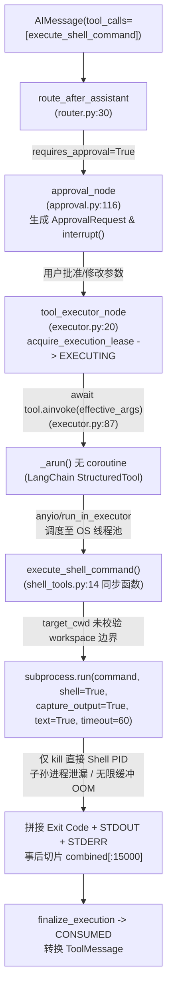
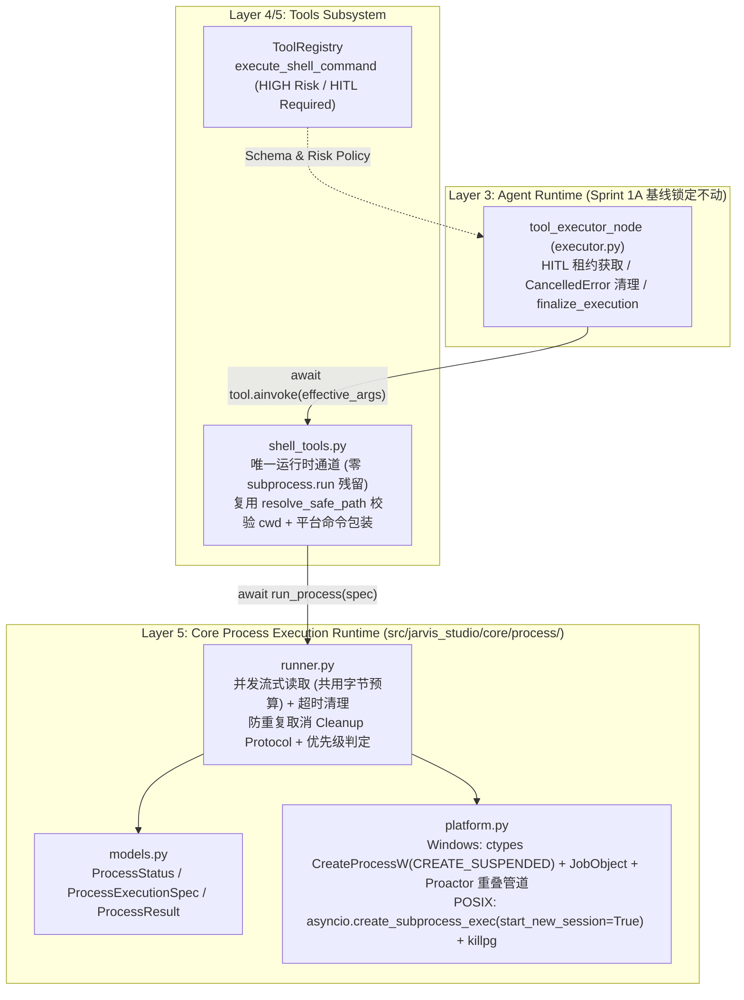
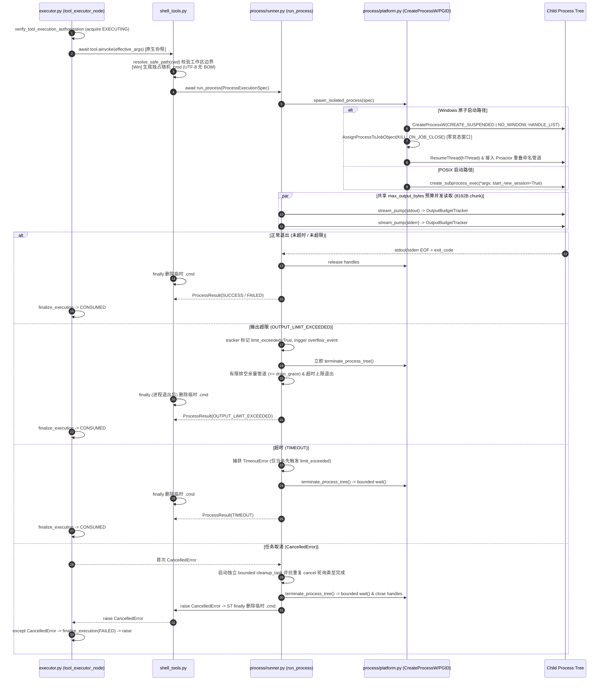

# Jarvis Studio — Sprint 1B: Process Execution Runtime 架构勘察与设计方案

> **版本**：v1.2 (Phase 1 & Phase 2 Implemented)  
> **角色**：Principal Python Runtime Engineer  
> **性质**：Sprint 1B 架构设计规范与分阶段实施状态追踪（当前处于 `feature/v2-sprint-1b-execution-runtime`，尚未进入 Phase 3 `shell_tools.py` 集成）  
> **基准分支**：`main`（Commit `393612f`，已合入 Sprint 1A / 1A.1 / 1A.2 安全基线）  
> **运行平台实测**：`win32` / Python 3.12.14 (AMD64) / `WindowsProactorEventLoopPolicy`（Linux 实机测试尚未执行）  
> **基线测试验证**：`92 passed in 15.36s`（Phase 1 + Phase 2 完成后将同步记录最新实测结果）  
> **日期**：2026-11-10  

---

## 一、 基线与 Sprint 1A 安全基线完整性确认

在设计 Sprint 1B 之前，已完成全仓库现状及测试基线核验：
1. **Git 基线**：当前处于 `main` 分支（与 `origin/main` 同步），工作区干净，Commit `af58d5b` / `2c8b192` / `f9b0def` / `393612f` 已完整合入。
2. **全量自动化测试**：独立运行 `.venv\Scripts\pytest`，**92 项测试全部通过（92 passed in 15.36s）**。
3. **Sprint 1A HITL 安全契约核查**：
   - **Approval Authorization & Execution Lease**：[`executor.py:39-46`](file:///d:/myProject/JarvisStudio/src/jarvis_studio/agent/nodes/executor.py#L39-L46) 强制执行 [`verify_tool_execution_authorization(..., acquire_lease=True)`](file:///d:/myProject/JarvisStudio/src/jarvis_studio/agent/hitl/authorization.py#L47-L360)，缺失或无效 `approval_id` 严格 Fail-Closed。
   - **状态机不可逆流转**：[`manager.py:200-318`](file:///d:/myProject/JarvisStudio/src/jarvis_studio/agent/hitl/manager.py#L200-L318) 原子保护 `APPROVED/MODIFIED -> EXECUTING -> CONSUMED/FAILED`。
   - **`CancelledError` 终结链路**：[`executor.py:92-108`](file:///d:/myProject/JarvisStudio/src/jarvis_studio/agent/nodes/executor.py#L92-L108) 显式捕获 `asyncio.CancelledError`，将租约终结为 `FAILED` 并原样重抛取消信号。
   - **绑定与隔离**：全链路严格绑定 `thread_id` + `tool_call_id` + `arguments_hash` + `approval_id`。
   - **结论**：Sprint 1B 将保持 `agent/hitl/*` 与 `agent/nodes/executor.py` 的授权状态机契约完全不变，通过标准化异步 Tool 接口无缝接入。

---

## 二、 现有进程执行链路勘察与问题诊断

### 2.1 全仓 subprocess / 进程调用盘点

通过全库检索（`subprocess`、`Popen`、`create_subprocess_*`、`os.system`、`os.popen`、`os.spawn`、`os.exec`、`stdio_client`），确认项目内共存在两处子进程启动入口：
1. **内置终端命令工具**：[`execute_shell_command`](file:///d:/myProject/JarvisStudio/src/jarvis_studio/tools/builtin/shell_tools.py#L13-L75) —— 使用同步阻塞 `subprocess.run(..., shell=True)`，是 **Sprint 1B 核心改造目标**。
2. **MCP 客户端 stdio 传输**：[`MCPConnection.connect`](file:///d:/myProject/JarvisStudio/src/jarvis_studio/tools/mcp/client.py#L90-L101) —— 调用 `mcp.client.stdio.stdio_client(...)`。外部 `mcp` SDK 内部已自行实现 Win32 Job Object 与 POSIX `start_new_session` + `killpg` 进程树清理（且架构约束明确 Sprint 1B 不改造 MCP 生命周期）。

### 2.2 当前进程执行链路图



### 2.3 当前实现的具体缺陷清单（源码实证）

| 缺陷编号 | 缺陷描述 | 精确源码位置 | 工程与安全影响 |
| :--- | :--- | :--- | :--- |
| **GAP-1** | **同步 Tool 委托线程池无法真正取消**：`@tool` 装饰同步 `def` 导致 `StructuredTool.coroutine is None`（实测验证），`executor.py` 调用 `await tool.ainvoke(...)` 时退化为线程池运行 `subprocess.run`。发生 `asyncio.CancelledError` 时仅取消外层 Future，工作线程及底层 Shell 子进程继续在后台运行。 | [`shell_tools.py:13-44`](file:///d:/myProject/JarvisStudio/src/jarvis_studio/tools/builtin/shell_tools.py#L13-L44)<br>[`executor.py:86-88`](file:///d:/myProject/JarvisStudio/src/jarvis_studio/agent/nodes/executor.py#L86-L88) | 取消失灵；客户端断连或任务中止后系统继续执行高危副作用命令。 |
| **GAP-2** | **超时仅杀死直接子进程，子孙进程树泄漏**：`subprocess.run(shell=True, timeout=...)` 在 Windows 上只向直接父进程 `cmd.exe` 发送 `TerminateProcess`，在 Linux 上仅向 Shell PID 信号，无 Job Object / Process Group，孙进程沦为后台孤儿并占用管道句柄。 | [`shell_tools.py:36-44, 63`](file:///d:/myProject/JarvisStudio/src/jarvis_studio/tools/builtin/shell_tools.py#L36-L44) | 后台孤儿进程残留、端口与文件锁占用。 |
| **GAP-3** | **无界内存缓冲 + 事后截断（OOM 风险）**：`capture_output=True` 会在进程退出前把全部 `stdout`/`stderr` 持续缓存到内存，`max_output_chars` 仅在进程结束后第 55 行切片。 | [`shell_tools.py:41, 55-59`](file:///d:/myProject/JarvisStudio/src/jarvis_studio/tools/builtin/shell_tools.py#L41-L59) | 持续大输出进程在超时前耗尽服务内存。 |
| **GAP-4** | **Windows Shell 解析与配置语义错位**：第 34 行赋值 `shell_executable = "powershell"`，第 39 行却传 `executable=shell_executable if sys.platform != "win32" else None`，实际运行的是 `cmd.exe`；且 `text=True` 依赖本地代码页（如中文 Windows GBK/CP936）易抛出解码错误或乱码。 | [`shell_tools.py:34-42`](file:///d:/myProject/JarvisStudio/src/jarvis_studio/tools/builtin/shell_tools.py#L34-L42) | 跨编码乱码、`UnicodeDecodeError`、Shell 环境错位。 |
| **GAP-5** | **`cwd` 参数缺少 Workspace 越界防护**：与 `file_tools.py` 不同，`shell_tools.py` 对绝对或 `../../` 传入的 `cwd` 直接放行并在工作区外执行 `target_cwd.mkdir(parents=True, exist_ok=True)`。 | [`shell_tools.py:22-30`](file:///d:/myProject/JarvisStudio/src/jarvis_studio/tools/builtin/shell_tools.py#L22-L30) | 模型可通过 `cwd` 参数在工作区外创建目录并启动命令。 |
| **GAP-6** | **缺乏结构化 `ExecutionResult` 状态语义**：仅以文本前缀返回，无法区分 `TIMEOUT`、`CANCELLED`、`OUTPUT_LIMIT_EXCEEDED` 与非零退出 `FAILED`。 | [`shell_tools.py:48-66`](file:///d:/myProject/JarvisStudio/src/jarvis_studio/tools/builtin/shell_tools.py#L48-L66) | 无法精准归因与可观测性度量。 |

---

## 三、 目标架构设计与模块划分

### 3.1 架构分层定位

遵循现有五层单向依赖架构（API → Service → Agent → Tools → Core），将 **Process Execution Runtime** 置于 **第 5 层基础能力 `src/jarvis_studio/core/process/`** 中，仅依赖 Python 标准库与 Pydantic / Logger，**零新增第三方包依赖**。



### 3.2 模块划分（极简低耦合，无过度抽象）

在 `src/jarvis_studio/core/process/` 下设立 3 个内聚模块（无复杂抽象工厂）：
1. **`__init__.py`**：导出 `ProcessStatus`、`ProcessExecutionSpec`、`ProcessResult`、`run_process`。
2. **`models.py`**：强类型数据模型（`ProcessStatus`、`ProcessExecutionSpec`、`ProcessResult`）。
3. **`platform.py`**：跨平台进程原子创建与进程树强杀原语（Windows `CreateProcessW` + `CREATE_SUSPENDED` + Job Object + `taskkill /T /F` 降级兜底 + `ProactorEventLoop` 管道接入；POSIX `create_subprocess_exec(start_new_session=True)` + `os.killpg`）。
4. **`runner.py`**：异步进程编排引擎（并发 `StreamReader`、共享字节预算 tracker、流截断与终止协调、超时清理、抗二次取消清理协议、`OUTPUT_LIMIT_EXCEEDED` vs `TIMEOUT` 严格优先级状态机）。

---

## 四、 目标执行时序图



---

## 五、 统一执行结果模型 (`Execution Result`)

### 5.1 状态枚举与优先级规则

```python
class ProcessStatus(str, Enum):
    SUCCESS = "SUCCESS"                             # exit_code == 0，无超时/超限/取消
    FAILED = "FAILED"                               # 启动失败 (OSError) 或 exit_code != 0
    TIMEOUT = "TIMEOUT"                             # 超出 timeout_seconds 并已完成进程树清理
    CANCELLED = "CANCELLED"                         # 由显式软取消令牌中止（内部模型完备态）
    OUTPUT_LIMIT_EXCEEDED = "OUTPUT_LIMIT_EXCEEDED" # 共用字节流超出 max_output_bytes，已终止进程树
```

**严格状态优先级（当多故障重叠时由根因锁判定，绝不歧义）**：
$$\text{CancelledError (异常上抛)} > \text{OUTPUT\_LIMIT\_EXCEEDED} > \text{TIMEOUT} > \text{FAILED} > \text{SUCCESS}$$
- 若持续输出进程在触发 `OUTPUT_LIMIT_EXCEEDED` 后、强杀清理尚未结束前外层 `timeout_seconds` 到期，因为强杀是由 `limit_exceeded` 率先触发且记录在案，最终结果严格判定为 **`OUTPUT_LIMIT_EXCEEDED`** 而非 `TIMEOUT`。

### 5.2 输入与结果模型

```python
class ProcessExecutionSpec(BaseModel):
    argv: list[str]                                   # 非空命令参数列表
    cwd: Path | None = None                           # 经 resolve_safe_path 验证后的工作目录
    env: dict[str, str] | None = None
    timeout_seconds: float = Field(default=60.0, gt=0)
    max_output_bytes: int = Field(default=262_144, gt=0) # stdout 与 stderr 共用原始字节上限
    drain_grace_seconds: float = 0.2                  # 强杀后有限度处理已刷新管道数据的宽限期
    graceful_termination_timeout: float = 2.0         # POSIX SIGTERM -> SIGKILL 宽限期
    reap_timeout: float = 2.0                         # wait() 与管道结束上限
    cleanup_max_seconds: float = 5.0                  # 单次清理阶段最大总壁钟等待时间

class ProcessResult(BaseModel):
    status: ProcessStatus
    exit_code: int | None = None
    stdout: str = ""
    stderr: str = ""
    duration_ms: float = 0.0
    pid: int | None = None
    timed_out: bool = False
    cancelled: bool = False
    output_truncated: bool = False
    stdout_bytes_total: int = 0
    stderr_bytes_total: int = 0
    stdout_bytes_retained: int = 0
    stderr_bytes_retained: int = 0
    error_message: str | None = None
```

---

## 六、 核心技术细节设计（评审修订重点）

### 6.1 Windows Job Object 进程纳管竞态与零竞态实现方案

#### 6.1.1 为什么标准 `asyncio.create_subprocess_exec` + 后置 `AssignProcessToJobObject` 存在竞态？
通过直接审计 Python 3.12.14 标准库 `subprocess.Popen._execute_child` 与 `asyncio.windows_utils.Popen` 源码证实：
1. `asyncio.create_subprocess_exec` 调用 `_winapi.CreateProcess(...)` 后，在 `_execute_child` 末尾**立即执行 `_winapi.CloseHandle(ht)` 关闭主线程句柄且未保留 `tid`**。
2. 若**不传** `CREATE_SUSPENDED`：目标进程在 `CreateProcess` 返回瞬间已被 Windows 内核调度运行，直到 Python 代码后续调用 `AssignProcessToJobObject(job, hp)` 之间存在真实时间差（微秒至毫秒级）。快速子进程可在此空窗期内 `CreateProcess` 派生子孙进程或自身退出，导致提前生成的子孙进程**永久脱离该 Job Object**。
3. 若仅通过 `creationflags=subprocess.CREATE_SUSPENDED` 调用 `asyncio.create_subprocess_exec`：因 `ht` 已被 stdlib 立即关闭且无 `tid`，无法安全恢复主线程执行。
- **工程红线结论**：先 `asyncio.create_subprocess_exec` 后 `AssignProcessToJobObject` **存在不可消除的 Spawn-to-Assign 竞态，绝不能声称 100% 可靠纳管进程树**。

#### 6.1.2 零竞态原子纳管方案：自定义 `CreateProcessW (CREATE_SUSPENDED)` 启动器
由于标准库 `asyncio.create_subprocess_exec` 无法暴露暂停态主线程句柄，Sprint 1B 在 `src/jarvis_studio/core/process/platform.py` 中实现**轻量级自定义 Win32 启动器（纯标准库 `ctypes` + `_winapi` + `asyncio.windows_utils`，零新依赖）**：

1. **创建重叠异步管道与 `HANDLE_LIST` 约束**：
   - 使用 `asyncio.windows_utils.pipe(overlapped=(True, False))` 分别为 `stdout` 和 `stderr` 创建支持 IOCP `ProactorEventLoop` 的异步命名管道；`stdin` 打开 `os.devnull`（或空读取句柄）。
   - 通过 `InitializeProcThreadAttributeList` / `UpdateProcThreadAttribute(PROC_THREAD_ATTRIBUTE_HANDLE_LIST)` + `STARTUPINFOEXW` 仅将 `stdin/stdout/stderr` 三个句柄列入允许继承名单，防止主机进程其它文件/Socket 句柄泄露至子进程，随后关闭父进程侧写入端句柄。
2. **创建 Job Object（禁止 Breakaway）**：
   - 调用 `CreateJobObjectW` -> `SetInformationJobObject(JobObjectExtendedLimitInformation)` 设置 `JOB_OBJECT_LIMIT_KILL_ON_JOB_CLOSE`。
   - **明确禁止设置** `JOB_OBJECT_LIMIT_BREAKAWAY_OK` 与 `JOB_OBJECT_LIMIT_SILENT_BREAKAWAY_OK`，防止子进程主动通过 `CREATE_BREAKAWAY_FROM_JOB` 逃逸。
3. **原子启动、绑定与恢复序列**：
   - 调用 `ctypes.windll.kernel32.CreateProcessW` 传入 `creationflags = CREATE_SUSPENDED | CREATE_NEW_PROCESS_GROUP | CREATE_NO_WINDOW | EXTENDED_STARTUPINFO_PRESENT`。
   - **此时子进程处于完全挂起态，用户代码与 CRT 尚未执行哪怕 1 条指令**！
   - 在恢复前执行 `AssignProcessToJobObject(job_handle, hProcess)`；
   - 紧接着调用 `ResumeThread(hThread)` 唤醒进程执行，并立即关闭 `hThread`。
4. **接入 `ProactorEventLoop` 异步流**：
   - 利用 `loop.connect_read_pipe(..., PipeHandle(stdout_rh))` 与 `PipeHandle(stderr_rh)` 取得标准 `asyncio.StreamReader`；
   - 通过 `loop._proactor.wait_for_handle(int(hProcess))` 异步等待进程退出并通过 `GetExitCodeProcess` 读取退出码。对上层 `runner.py` 暴露与 POSIX `asyncio.subprocess.Process` 统一的操作封装，从而同时满足 Windows **零竞态进程树纳管** 与 POSIX **`asyncio.create_subprocess_exec(start_new_session=True)`**。

#### 6.1.3 Job Object 失败 Fail-Closed 策略与 `taskkill /T /F` 禁用说明
- **Fail-Closed 实施修订（Phase 1 授权最终准则）**：为消除无 Job Object 约束下的进程树逃逸风险，实现阶段采用严格 **Fail-Closed** 策略（不再静默降级至非原子 `taskkill /T /F`）：
  1. 若 `CreateJobObjectW` / `QueryInformationJobObject` / `SetInformationJobObject` 失败：拒绝调用 `CreateProcessW`，直接释放已分配句柄并抛出 `ProcessIsolationError`；
  2. 若 `CreateProcessW(CREATE_SUSPENDED)` 后 `AssignProcessToJobObject` 失败：立即 `TerminateProcess` 杀死仍处于挂起态（0 条指令运行）的子进程、关闭所有句柄并抛出 `ProcessIsolationError`；
  3. 若 `ResumeThread` 失败：立即 `TerminateJobObject` + `TerminateProcess`、释放句柄并抛出 `ProcessLaunchError`。
- **关于 `taskkill /T /F` 局限性说明（不作为静默降级通道）**：`taskkill /T` 依赖瞬间进程快照的父子 PID 链遍历（非原子操作），若中间父进程已提前退出（父链断裂）或强杀途中子节点瞬间创建新孙进程，`taskkill /T` 无法覆盖，因此 Sprint 1B 不保留无 Job 纳管的 `taskkill` 降级执行路径。

#### 6.1.4 进程树回收能力真实边界声明
- **可保证回收的进程**：根 Shell 进程及其直接、间接派生的全部常规子进程与孙进程树（即便中间父进程先行退出，Windows Job 成员标签和 POSIX `pgid` 仍向下保留覆盖）。
- **明确不在保证范围内的进程**：
  - Windows：通过 `schtasks` / Windows Service Control (`sc`) / DCOM / `svchost` 间接委托系统守护进程拉起的进程；或宿主环境禁止 Job 且带 Breakaway 逃逸的进程。
  - POSIX：在子进程内部显式调用 `setsid()` / `setpgid()` 创建脱离原组长会话的守护化（Daemonize）进程；以及无对应特权信号权限的 setuid 提权进程。

---

### 6.2 Windows CMD 临时文件机制与安全边界

为了解决 Python `CreateProcess` / `list2cmdline` 向 `cmd.exe /c` 传递含引号/特殊符号命令字符串时的反斜杠转义损坏（已在第 2/7 节实测证实），Windows 下 Shell 字符串执行采用受控临时 `.cmd` 脚本：

1. **独占创建与随机命名**：
   - 使用 `tempfile.mkstemp(prefix="jarvis_cmd_", suffix=".cmd", dir=os_runtime_tmp)`（内部强制 `os.O_CREAT | os.O_EXCL | os.O_RDWR` / Win32 `CREATE_NEW` 独占创建与 CSPRNG 随机名），绝不在 `workspace_root` 目录内落盘，防止污染工作区文件树、Git 状态或被用户命令误删除。
2. **编码与 BOM 策略**：
   - **严格采用 `utf-8`（无 BOM），严禁使用 `utf-8-sig` BOM**（已在本机 `cmd.exe` 验证 UTF-8 BOM `0xEF 0xBB 0xBF` 会被解析为非法首行字符导致命令崩溃）。
   - 统一使用 Windows **`\r\n` (CRLF)** 换行符。
3. **脚本写入规则**：
   ```bat
   @echo off
   @chcp 65001 >nul 2>&1
   <command 字符串末尾确保带 \r\n>
   ```
   - 写入完毕后**立即通过 `with os.fdopen(fd, "wb") as f:` 关闭文件句柄**，彻底释放文件写锁后再调用 `cmd.exe /d /c <temp_cmd_path>`（避免 Windows 共享冲突 `PermissionError`）。
   - **已知批处理语法提示**：`.cmd` 脚本内单个 `%1` 等字符受批处理变量替换规则影响；且脚本输出在后台管道无控制台下虽主要由 `chcp 65001` 切换为 UTF-8，部分系统原生工具仍可能输出本地代码页（如 CP936），读取解码采用“优先 UTF-8 严解码 -> 失败回退系统首选项编码 (`locale.getpreferredencoding(False)`) -> `errors="replace"`”策略。
4. **完整生命周期与清理顺序**：
   - 临时文件仅在进程启动前创建，进程存活期间保留。
   - **清理顺序红线**：无论是 **正常成功、非零失败、TIMEOUT、OUTPUT_LIMIT_EXCEEDED 还是 `CancelledError`**，临时文件的 `os.unlink(temp_cmd_path)` **必须严格排在 `terminate_process_tree()` 与 `wait()` 完成之后执行**（否则正在运行的 `cmd.exe` 仍占用该 `.cmd` 句柄会导致删除报 `PermissionError`）。
5. **清理失败诊断**：
   - 若因杀毒软件扫描或句柄延迟导致删除失败（可在极短暂重删 retry 一次后仍失败），打印包含 `temp_cmd_path`、`pid`、`winerror` 的 `WARNING` 日志，**绝不覆盖主返回结果，更绝不吞掉 `CancelledError`**。
6. **明确非沙箱声明**：
   - 临时 `.cmd` 文件**仅解决**跨引号参数传递失真与命令启动问题，**不提供**命令注入防御与文件系统 Sandbox 隔离；高危命令安全性仍由前置 HITL 人工确认机制与未来 Sprint 4 沙箱承载。

---

### 6.3 并发输出流与严格 Byte Budget (`Output Budget`)

**严禁先收集全量输出再事后切片**，全程实施基于原始字节的实时背压截断控制：

1. **共用预算与原始字节计数**：
   - `stdout` 与 `stderr` **共同分享同一份 `max_output_bytes`** 预算，计数单位严格为 `len(raw_chunk)` **原始字节**。
2. **双路并发读取（防死锁 & 防长行崩溃）**：
   - 两个独立的 `asyncio.Task` 分别循环调用 `await stream.read(8192)`（**禁止 `readline()`**，避免无换行单行超过 64KB 引发 `LimitOverrunError`）。
   - 两个阅读器通过轻量单事件循环共享状态 `OutputBudget` 协调：
     ```python
     # 伪代码语义说明（全在单一 Event Loop 线程内无锁原子步进）
     remaining = spec.max_output_bytes - budget.buffered_bytes
     if remaining > 0:
         keep = chunk[:remaining]
         target_chunks.append(keep)
         budget.buffered_bytes += len(keep)
     if len(chunk) > remaining or budget.buffered_bytes >= spec.max_output_bytes and more_data_arrives:
         budget.limit_exceeded = True
         overflow_event.set()
     ```
     注：只有当**实际接收到超出 `max_output_bytes` 的第 `max_output_bytes + 1` 个字节**时才触发 `limit_exceeded = True`（正好输出 `== max_output_bytes` 字节而结束的进程正常判定 `SUCCESS`！）。
3. **超限后立即终止与有限排空收尾**：
   - 一旦 `overflow_event.set()` 被触发，主协调器立刻终止进程树（`terminate_process_tree()`）。
   - 在停止读取前给予最多 **`drain_grace_seconds`（0.2s）** 有限等待以排空管道已入队但未超过字节缓冲的余留信号与进程退出状态，总清理时长严格封顶于 **`cleanup_max_seconds`（默认 5.0s）**。超时未结束的 Reader Task 直接 `cancel()` 并屏蔽异常收口，防止挂死。
4. **UTF-8 解码与多字节截断边界安全**：
   - 在原始字节切片点 `chunk[:remaining]` 上，可能将一个 2~4 字节 UTF-8 字符（如中文 `3 bytes`）从中间切断。
   - **处理方案**：将全部保留的原始字节拼接为 `raw_bytes = b"".join(chunks)` 后再统一执行解码：
     - 优先尝试 `raw_bytes.decode("utf-8")`；若末尾存在 1~3 个不完整 UTF-8 续字节或混杂 OS 本地编码，在非系统编码分支安全剥离/使用 `codecs` / `errors="replace"`（针对 Windows 本地错误消息回退 `cp936` 再最终兜底 `utf-8 errors="replace"`）。保证无论字节被截断在何处，**永远产出合法可序列化 UTF-8 字符串，绝不抛 `UnicodeDecodeError`**。

---

### 6.4 可抵抗重复取消的清理协议 (`Cancellation Cleanup Protocol`)

**关键陷阱认知**：单纯写 `await asyncio.shield(cleanup())` **无法抵抗外层连续两次 `task.cancel()`**！若外部 Task 在 `await asyncio.shield(...)` 等待过程中再次被 `.cancel()`，外层等待方仍会在该 `await` 点立刻再次收到 `CancelledError` 并跳出清理流程，导致孤儿进程或临时文件遗漏！

**抗重复取消清理协议（核心设计）**：

```python
async def _run_cancel_resilient_cleanup(
    cleanup_coro: Coroutine[Any, Any, None],
    max_wait_seconds: float,
) -> None:
    """保证即便外层 Task 被连续多次 cancel()，有界清理仍执行到终点后再重抛 CancelledError。"""
    async def _bounded_cleanup() -> None:
        try:
            async with asyncio.timeout(max_wait_seconds):
                await cleanup_coro
        except TimeoutError:
            logger.error(f"Process cleanup timed out after {max_wait_seconds}s; abandoning unresponsive handles")
        except Exception as exc:
            logger.error(f"Process cleanup failed unexpectedly: {exc}")

    cleanup_task = asyncio.create_task(_bounded_cleanup())
    while not cleanup_task.done():
        try:
            await asyncio.shield(cleanup_task)
        except asyncio.CancelledError:
            # 捕获二次/多次外部 cancel 信号，继续守护等待 bounded cleanup_task 完成
            continue
```

**全流程语义验证**：
1. 首次 `asyncio.CancelledError` 被 `run_process` 捕获后，创建独立的后台 `cleanup_task`（内部受 `asyncio.timeout(cleanup_max_seconds)` 强制封顶，绝不会无限死循环）。
2. 循环执行 `await asyncio.shield(cleanup_task)`：若清理窗口期外层 Task（如 FastAPI SSE 断连重触发取消）再次被 `cancel()`，内部 `except asyncio.CancelledError: continue` 吸收多余取消中断信号，保证杀死进程树、有限 `wait()`、取消 Reader Task 及最终释放 Job Handle 与 `.cmd` 文件**全步执行完成**。
3. 若进程回收本身在 `cleanup_task` 内报错或超时，记录带 `pid`/`pgid` 的 `ERROR` 日志，绝不吞掉外层取消语义。
4. `while` 循环退出后（`cleanup_task.done() == True`），`run_process` **无条件执行 `raise` 重新向上抛出原始 `asyncio.CancelledError`**，精准对接 Sprint 1A [`executor.py:92`](file:///d:/myProject/JarvisStudio/src/jarvis_studio/agent/nodes/executor.py#L92) 将 HITL 租约终结为 `FAILED`。

---

### 6.5 Shell 工具双通道一致性（彻底淘汰 `subprocess.run`）

**硬性禁止项落实**：在 `shell_tools.py` 中**彻底删除所有 `subprocess.run` 调用路径**，严禁保留没有进程树回收和字节限额的同步老路径。

1. **现状影响勘察（已实证全仓调用）**：
   - 通过 `git grep` 确认全仓生产调用链路（[`executor.py:86-88`](file:///d:/myProject/JarvisStudio/src/jarvis_studio/agent/nodes/executor.py#L86-L88)）以及全部 HITL 集成测试均通过 `await tool.ainvoke(...)` 执行。没有任何测试或路由直接调用同步 `.invoke()`。
2. **推荐落地模型（Async Native + Thin Sync Bridge over Same Runtime）**：
   - 将 `StructuredTool` 的核心执行实现定义为原生异步函数 `async def _execute_shell_command_async(command, cwd, timeout_seconds, max_output_chars) -> str`，直接调用 `await run_process(...)`。
   - 对同步 `func` 入口有两种清晰策略评估：
     - **方案 1（推荐 — 仅保留轻量同步桥接，共享同一运行时）**：保留 `def _execute_shell_command_sync(...)` 作为 `StructuredTool(func=_execute_shell_command_sync, coroutine=_execute_shell_command_async)` 的同步包装：内部无运行事件循环时直接 `asyncio.run(_execute_shell_command_async(...))`，已有运行循环时起单线程隔离 `ThreadPoolExecutor(1)` 执行 `asyncio.run(...)`。**两条接口执行完全相同的 `run_process`、Job Object / PGID 回收与 Byte Budget 限流，实现 100% 语义一致性**。
     - **方案 2（纯异步 `@tool async def`）**：省略同步 `func`，若任何外部测试代码同步调用 `.invoke()` 将直接抛出 `NotImplementedError`。虽不影响现有 92 项全量测试，但保留方案 1 的 10 行同步桥接能做到外部 API 零破坏且零安全降级。
   - **工具返回约定一致**：无论同步桥接还是异步协程调用，`max_output_chars` 字符展示裁切都在 `run_process` 完成字节截断并解码之后，按统一文本格式（`Exit Code:` / `timed out` / `Output exceeded limit`）输出给 `ToolMessage`。

---

### 6.6 工作区 `cwd` 边界校验语义（复用 `resolve_safe_path`）

[`shell_tools.py`](file:///d:/myProject/JarvisStudio/src/jarvis_studio/tools/builtin/shell_tools.py) 直接调用 [`tools/builtin/file_tools.py:resolve_safe_path`](file:///d:/myProject/JarvisStudio/src/jarvis_studio/tools/builtin/file_tools.py#L12-L121) 对 `cwd` 入参实施与文件工具完全同级的静态隔离（校验通过后再执行 `mkdir`）：

| `cwd` 输入情形 | `resolve_safe_path(cwd, workspace_root)` 实际校验行为 |
| :--- | :--- |
| **1. 默认 `"."`** | 解析为规范化的 `workspace_root` 真实路径；若工作区根目录尚不存在则允许安全创建后进入执行。 |
| **2. 合法/越界相对路径** | `"subdir/pkg"` 解析并经 `is_relative_to(ws)` 通过；`""`/`"   "` 抛 `ValueError`；`"../../outside"` 抛 `PermissionError` 阻断，不在外部建目录。 |
| **3. 合法/越界绝对路径** | 指向 `workspace_root` 内部的绝对路径通过校验；指向 `C:\Windows` 或 `/etc` 等外部绝对路径立即抛 `PermissionError` 阻断。 |
| **4. 不存在的目录** | 先校验解析后的目标在 `ws` 内且向上回溯至**最近已存在祖先目录**执行 `os.path.realpath` 确认祖先未指向外部 Symlink 后（`file_tools.py:106-119`），方允许 `target_cwd.mkdir(parents=True, exist_ok=True)`，杜绝借不存在路径穿过父级符号链接建目录逃逸。 |
| **5. Symlink / 循环链接** | 任意目标或中间祖先指向外部真实路径或触发递归符号链接环，立即抛 `PermissionError`。 |
| **6. Windows 跨盘符 / UNC / 特殊字符** | `C:` vs `D:` 不同驱动器抛出 `ValueError` 被捕获转为 `PermissionError`；`\\server\share` 与 `//server/share` UNC 路径抛 `PermissionError`；空字节 `\x00` 与非法冒号抛 `ValueError`。 |

> **关键安全边界声明**：`cwd` 路径校验**不是文件系统沙箱（Not a Filesystem Sandbox）**！它仅约束 Shell 进程的初始工作目录必须落在工作区，无法拦截用户在被 HITL 审批放行的命令参数内直接访问工作区外路径（例如 `type C:\secret.txt` 或 `cat /etc/passwd`）。真正的 OS/文件系统物理沙箱将在 **Sprint 4 (`DockerSandboxExecutor`)** 完成。

---

## 七、 跨平台能力保证矩阵

| 能力维度 | Windows (`win32` / `ProactorEventLoop`) | Linux / POSIX (`linux` / `darwin`) |
| :--- | :--- | :--- |
| **事件循环阻塞消除** | 100% 异步 IOCP 管道 + 非阻塞进程句柄等待 | 100% 异步 `asyncio.create_subprocess_exec` 非阻塞 |
| **零竞态进程树创建** | 自定义 `ctypes CreateProcessW(CREATE_SUSPENDED)` → `AssignProcessToJobObject` → `ResumeThread` | 原生 `asyncio.create_subprocess_exec(..., start_new_session=True)` 即 `setsid()` |
| **子孙进程树强制清理** | `TerminateJobObject` + `CloseHandle(KILL_ON_JOB_CLOSE)`（禁止 Breakaway） | `os.killpg(pgid, SIGTERM)` → 宽限期 → `os.killpg(pgid, SIGKILL)` |
| **受限容器/权限异常降级** | 记告警后启用 `taskkill /PID <pid> /T /F` + `TerminateProcess` 兜底 | 捕捉 `PermissionError` 后逐项按能力宽限等待并 `SIGKILL` |
| **并发读写防死锁** | 双 IOCP 命名管道协程并发 8KB 读，共享 `max_output_bytes` | 双 POSIX Pipe 协程并发 8KB 读，共享 `max_output_bytes` |
| **超时 & 重复取消保护** | 先杀树收口并删 `.cmd`，后返 `TIMEOUT` / 重抛 `CancelledError` | 先杀组收口再返 `TIMEOUT` / 重抛 `CancelledError` |
| **参数传递完整性** | 直接 `argv` 无转义；String 命令经独占无 BOM UTF-8 `.cmd` 执行 | 直接 `argv` 与 `["/bin/bash", "-c", cmd]` 经 `execve` 原生传递，零转义失真 |

---

## 八、 最终模块修改清单

### 本次 Sprint 1B 改动文件清单与当前状态
| 阶段 | 状态 | 文件路径 | 说明 |
| :---: | :---: | :--- | :--- |
| **Phase 1** | 已完成并获批 | `src/jarvis_studio/core/process/__init__.py` | 导出运行时公开模型、平台原语与执行引擎 |
| **Phase 1/2** | 已完成并实测 | `src/jarvis_studio/core/process/models.py` | `ProcessStatus`、`ProcessExecutionSpec`、`ProcessResult`（含 `stdout_bytes_retained`/`stderr_bytes_retained`）与错误类型 |
| **Phase 1** | 已完成并获批 | `src/jarvis_studio/core/process/platform.py` | Win32 `ctypes CreateProcessW(CREATE_SUSPENDED)` + Job Object (Fail-Closed) + Proactor 重叠管道；POSIX `setsid/killpg` |
| **Phase 1** | 已完成并实测 | `tests/test_process_platform.py` | Phase 1 真实 Win32 进程与 Fail-Closed 测试 + POSIX mock 单测（10 项 PASS） |
| **Phase 2** | 已完成待评审 | `src/jarvis_studio/core/process/runner.py` | `AsyncProcessRunner` / `run_process`（共享字节预算、有限块读取、UTF-8 安全截断、超时清理、抗重复取消清理、EOF 延迟收口） |
| **Phase 2** | 已完成待评审 | `tests/test_process_runner.py` | Phase 2 真实 OS 进程并发/超时/取消/截断/EOF延迟/心跳测试（PASS） |
| **Phase 3** | 待授权实施 | `src/jarvis_studio/tools/builtin/shell_tools.py` | 接入 `core/process`（尚未修改） |

### 显式严禁修改范围
- `src/jarvis_studio/agent/hitl/*`、`src/jarvis_studio/agent/nodes/*`（Sprint 1A 基线保持冻结）
- `src/jarvis_studio/api/*`、`src/jarvis_studio/service/*`（Task 生命周期 / SQLite 持久化 / SSE 断连留待后续 Sprint）
- `src/jarvis_studio/tools/mcp/*`、`src/jarvis_studio/rag/*`、`src/jarvis_studio/memory/*`

---

## 九、 测试与验收清单 (Acceptance Checklist)

Sprint 1B 实施完成合入前，必须通过以下全部真实子进程自动化验收（禁止使用空 Shell Mock 替代真实进程行为）：

1. **[x] 非阻塞并发验证（Phase 2 `test_process_runner.py` 已实测）**：执行睡眠型真实子进程期间，同事件循环另一并发心跳协程计时延迟无阻塞。
2. **[x] 零竞态 Windows 进程树与子孙清理（Phase 1 & 2 已实测）**：
   - 在 Windows 上由父进程派生独立/分离孙进程并触发 `timeout_seconds` 超时与外部取消；
   - 验证返回 `TIMEOUT` / 重抛 `CancelledError`，且校验父 PID 与孙 PID 在 OS 中**均已彻底终止**。
3. **[x] Job Object Fail-Closed 策略验证（Phase 1 & 2 已实测，替代原降级设计）**：模拟 `CreateJobObjectW` 与 `AssignProcessToJobObject` 失败，验证不静默降级、不执行未纳管进程、释放全部句柄并抛出 `ProcessIsolationError`；模拟 `ResumeThread` 失败验证终止 Job/进程、释放句柄并抛出 `ProcessLaunchError`。
4. **[ ] 抗重复取消 + HITL 状态闭环验证**：Phase 2 已实测 `AsyncProcessRunner` 连续多次 `Task.cancel()` 下清理完整、Reader/Cleanup Task 零残留且重抛 `CancelledError`；结合 `shell_tools.py` + `tool_executor_node` + `HITLManager` 的端到端闭环留待 **Phase 3** 实施。
5. **[ ] Windows 独占 `.cmd` 临时文件与生命周期验证**：留待 **Phase 3**（`shell_tools.py`）实施。
6. **[x] 共用 Byte Budget + `OUTPUT_LIMIT_EXCEEDED` 与优先级测试（Phase 2 `test_process_runner.py` 已实测）**：
   - 验证 `stdout` 与 `stderr` 同时并发大量输出（>120KB）以及 >150KB 无换行单行均不死锁、不抛 `LimitOverrunError`；
   - 验证超出共用 `max_output_bytes` 时立即强杀持续输出进程，返回 `OUTPUT_LIMIT_EXCEEDED`，保留有效多字节边界安全截断后的 UTF-8 字符串且记录读取/保留字节数；
   - 验证超限清理期触发超时时仍确定返回 `OUTPUT_LIMIT_EXCEEDED`，而触发 `Task.cancel()` 时在完成清理后确定重抛 `CancelledError`。
7. **[ ] `shell_tools` 双通道一致性与无旧代码检查**：留待 **Phase 3** 实施。
8. **[ ] 工作区 `cwd` 越界防护测试**：留待 **Phase 3** 实施。
9. **[x] 基线零回归 + 静态规范（Phase 1 & 2 范围）**：原有 **92 项基线测试 + Phase 1 & 2 新增测试全部 PASS**；Ruff Format & Check **All checks passed**。

---

## 十、 潜在风险与回滚方案

1. **风险**：Windows `CREATE_NO_WINDOW` 下无控制台句柄时，少数依赖传统 Win32 Console API 的 CLI 可能产生异常编码，且 `.cmd` 脚本对 `%` 展开存在批处理差异。缓解：明确文档约束并在运行时字符串解码加入 UTF-8 -> 本地代码页安全回退。
2. **平台实测边界说明**：当前所有真实 OS 集成测试均在 `win32`（Windows 11 / Python 3.12.14）完成实机执行；POSIX 分支（`setsid`/`os.killpg`）当前仅通过 unit/mock 测试验证了逻辑，**Linux 实机测试尚未运行**。
3. **回滚**：所有运行态封装均隔离于 `src/jarvis_studio/core/process/`，尚未修改 `shell_tools.py`；Phase 3 接入后如需回滚也仅需单文件还原 `shell_tools.py`，不影响 Agent 图结构、HITL 授权链及数据库状态。

---

## 十一、 修订记录 (Revision History)

| 版本 | 日期 | 修订人 | 核心修订摘要 |
| :--- | :--- | :--- | :--- |
| **v1.0** | 2026-11-10 | Principal Python Runtime Engineer | 完成 `main` 基线与 Sprint 1A 安全审计核查、现状执行链路追踪及 Sprint 1B 初步运行时框架设计。 |
| **v1.1** | 2026-11-10 | Principal Python Runtime Engineer | 依据设计评审意见深度增补 Win32 原子启动器、`.cmd` 策略、共享 Byte Budget、抗重复取消协议与 6 类 `cwd` 防护。 |
| **v1.2** | 2026-11-10 | Principal Python Runtime Engineer | 记录 Phase 1（`models.py` / `platform.py`，Strict Fail-Closed Job Object 授权规则）与 Phase 2（`runner.py` / `AsyncProcessRunner`、保留字节计数字段、`Timeout/Overflow/Cancel` 竞争矩阵及实测状态）实施进度，标注 Phase 3 待授权及 Linux 实机未测边界。 |
