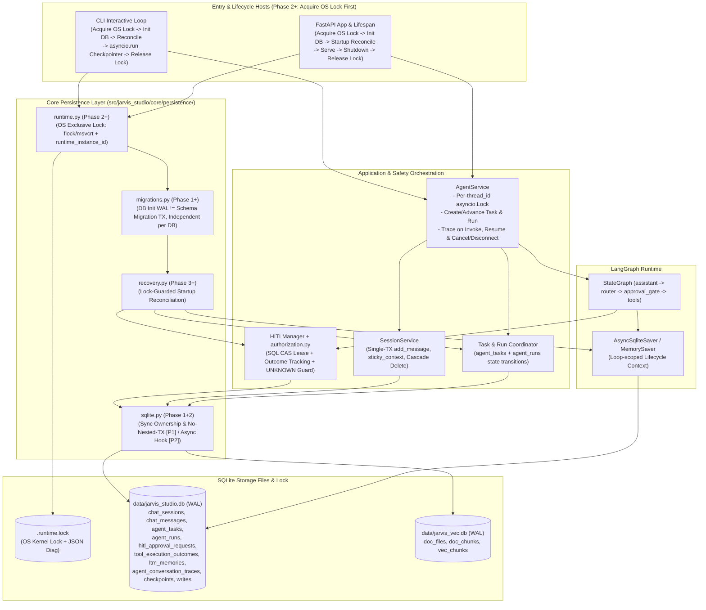
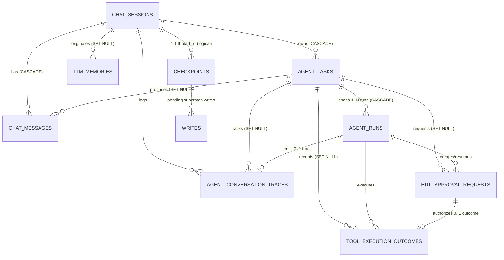
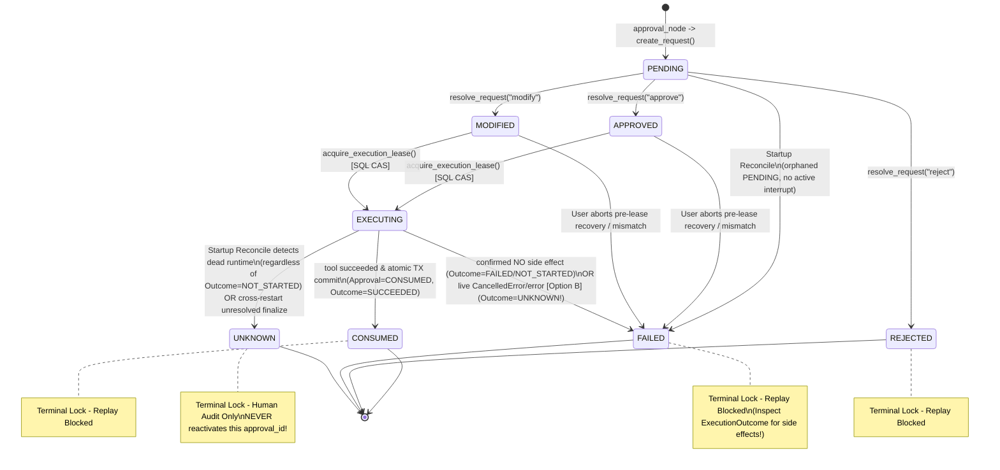
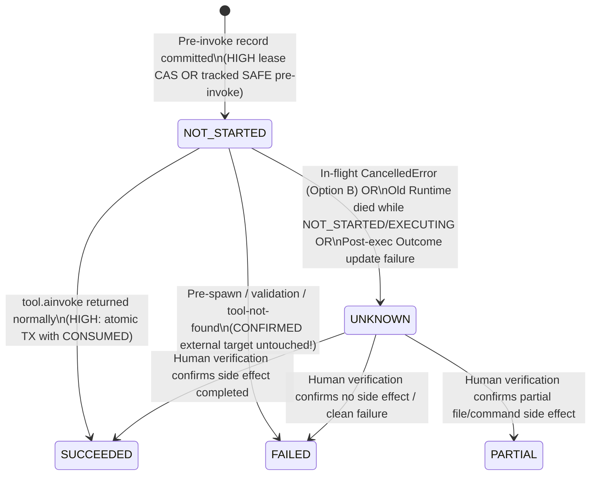
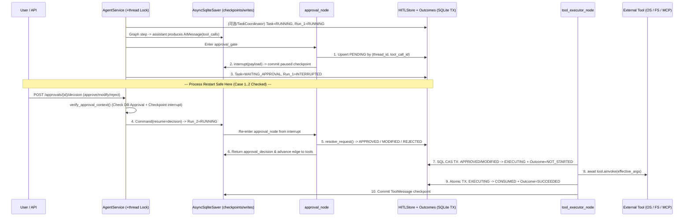
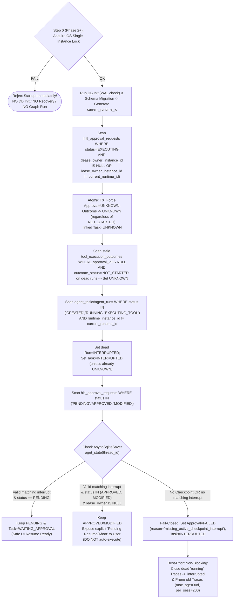

# Sprint 1C — Persistence Technical Design (Design Freeze)

> **文档状态**：**Final Design Freeze（最终一致性审计定稿版本）**（只读架构设计输出，等待 Phase 1 实施授权）  
> **仓库基线**：Branch `main` @ `a8a32ed4cd3cdfad9da883fa1ac751a80ca43e86` (`a8a32ed`)  
> **前置基线**：Sprint 1A (Security) 已冻结；Sprint 1B (Process Execution Runtime) 已冻结；[勘察报告](file:///d:/myProject/JarvisStudio/docs/architecture/SPRINT_1C_PERSISTENCE_RECONNAISSANCE.md) 已完成  
> **目标范围**：面向单机单用户生产工作站的可靠持久化运行时（Checkpointer、HITL、Task/Run、Outcome、Session、Trace、LTM、Single Instance Guard 与 SQLite 连接治理）

---

## 1. Executive Summary

本设计文档将 [《Sprint 1C 架构勘察报告》](file:///d:/myProject/JarvisStudio/docs/architecture/SPRINT_1C_PERSISTENCE_RECONNAISSANCE.md) 中识别出的问题与最终架构一致性审计结论收敛为正式冻结（Final Design Freeze）的工程契约。

核心架构结论如下：

1. **OS 级单活约束（Single Active Runtime Instance，Phase 2 引入）+ 双库独立演进**：单机单活是强制运行时约束。从 Phase 2 起，所有访问同一磁盘库的入口（FastAPI 与 CLI）必须在任何 DB Init、Migration、Checkpointer 或 Startup Recovery 之前抢占由 OS 内核管理的排他锁（`.runtime.lock`，只开关 `fd` 不删文件防 inode 竞争）。核心事务库 `data/jarvis_studio.db` 与可重建向量库 `data/jarvis_vec.db` 独立维护 `PRAGMA user_version` 与各自迁移入口。
2. **正交双状态机 + 正式采纳 `CancelledError` 方案 B**：彻底解耦 **Approval Status（授权执行流程状态）** 与 **Tool Execution Outcome（外部副作用结果状态）**。
   - **运行中 `CancelledError`（方案 B）**：当工具已进入执行边界后被取消，**`ApprovalStatus` 保持 `FAILED`**（授权终止且阻断重放，100% 兼容 Sprint 1A/1B 既有断言），同时 **`ExecutionOutcomeStatus` 标为 `UNKNOWN`**（`Task` 收敛为 `UNKNOWN`），严格区分“授权流结束”与“外部副作用不确定”。
   - **老 Runtime 崩溃遗留 `EXECUTING`**：无论 Outcome 当前是 `NOT_STARTED` 还是他态，重启对账一律收敛至 `Approval=UNKNOWN` + `Outcome=UNKNOWN` + `Task=UNKNOWN`。
   - **禁止**：`NOT_STARTED` 不证明无外部副作用；任何 `UNKNOWN` 禁止自动重跑、禁止人工核验后复活原 `approval_id`。
3. **Checkpoint 与 HITL 非原子协调协议**：`AsyncSqliteSaver` 与控制表分属不同连接边界，通过写入顺序、`UNIQUE (thread_id, tool_call_id)` 幂等键、SQL CAS 抢占与持锁 Startup Recovery 关闭全部 6 类非原子窗口。
4. **明确 `Session -> Task (1:N) -> Run (1:N)` 边界与单写者并发实情**：引入 `agent_tasks` 与 `agent_runs`；进程内同 `thread_id` 用 `asyncio.Lock` 互斥，跨进程靠 OS Runtime Lock 互斥；明确 SQLite 在 WAL 下仍是**单写者模型**。
5. **最小化冻结 Phase 1**：仅落地同步连接治理与生命周期边界（`open_sync_connection`、严格禁止隐式嵌套事务的 `sync_transaction`、`Store.close()`、DB Init vs Migration 解耦、双库独立初始化）、修复 `MemoryStore` 连接泄漏、`sqlite-vec` 动态扩展最小授权，以及在 `pyproject.toml` 仅新增真正用到的 **`sqlite-vec>=0.1.9`**（**`aiosqlite` 随 `AsyncSqliteSaver` 延后至 Phase 2；Phase 1 不引入 Runtime Lock、Checkpointer 变更、HITL 持久化或 Task 表**）。

### 本轮最终一致性审计关键收敛摘要（Design Freeze Closure）

| 序号 | 审计议题 | 最终冻结结论 |
| :---: | :--- | :--- |
| **1** | Runtime Instance Lock 完整生命周期（10 要素） | 明确基于规范化库路径派生唯一 `.runtime.lock`；CLI 与 API 同协议；允许不同 DB 路径多开；**绝不删除锁文件以防 inode 竞态**；崩溃由 OS 自动释锁、退出最后 `os.close(fd)`；抢锁失败严禁 DB Init / Migration / Recovery；明确与 `_thread_locks` 正交分工。 |
| **2** | `sync_transaction` 嵌套事务语义 | **严禁隐式嵌套事务**（不加入外层、不建 SAVEPOINT、不私自 COMMIT/ROLLBACK 外层）；发现 `conn.in_transaction` 为真直接抛 `NestedTransactionError`；磁盘库与 `:memory:` 连接关闭责任清晰分离，并与现有 4 个 Store 逐一核对确认无冲突。 |
| **3** | SAFE 工具 Outcome 生命周期（7 要素） | **SAFE ≠ 无副作用**（`save_personal_memory` / `index_workspace_directory` / 默认 SAFE 的 MCP 工具均可能变更状态）；追踪态执行前必先写入 `NOT_STARTED`，持久化失败则 **Fail-Closed 阻断执行**；成功写失败保留提醒与锁单；运行中取消入 `UNKNOWN`；通过 `UNIQUE (thread_id, tool_call_id)` 防重放；无 `thread_id` 纯单测跳过落盘并诚实标明限制。 |
| **4** | Phase 1 依赖范围收敛 | Phase 1 无 `aiosqlite` 调用方，**将 `aiosqlite` 显式依赖与异步连接函数延后至 Phase 2**；Phase 1 仅在 `pyproject.toml` 补齐 **`sqlite-vec>=0.1.9`**（依据：`uv.lock` `0.1.9` 与 `rag/store.py` 直接导入）。 |
| **5** | `CancelledError` 最终决策：**正式采用方案 B** | 实时执行中取消：`ApprovalStatus=FAILED`（完全兼容 Sprint 1A/1B 冻结断言）+ `ExecutionOutcomeStatus=UNKNOWN` + `Task=UNKNOWN`；预启动确认未触靶点取消才允许 `Outcome=FAILED/NOT_STARTED`；旧实例崩溃 `EXECUTING` 重启转 `Approval=UNKNOWN, Outcome=UNKNOWN`。 |
| **6** | 遗留 P2 问题全量闭环（5.1–5.6） | 统一 Trace 保留为 **`max_rows_per_session=200` + `max_age_days=30`**（消除 1000 冲突）且非关键路径失败不阻断；完整列出删 Session 全 9 项实体清理与忙碌拒删守卫；完整定义 Task/Run 状态责任矩阵；确立双库独立 `user_version` 与迁移；冻结备份校验规则与 SQLite 单写者语义。 |

---

## 2. Design Principles & Invariants

### 2.1 架构定位与演进边界

- **运行模型（强制约束）**：**Single User / Single Active Agent Runtime Instance**（单机单用户、同一时间针对同一数据库仅允许一个活跃 Agent Runtime 进程）。从 Phase 2 起通过操作系统内核排他锁强制执行，未持锁禁止执行数据库初始化、启动恢复与图运行。
- **设计哲学**：KISS / YAGNI。充分复用标准库 `sqlite3`、已有 `langgraph-checkpoint-sqlite` (`aiosqlite`) 和既有 Pydantic 模型，拒绝一次性重构成重型 Repository/ORM 框架。
- **Phase 1–4 范围约束**：不实现多用户认证、多机分布式调度、Sprint 1D 后台任务队列与主动取消 HTTP API、Sprint 2 混合检索或 Sprint 4 Docker 沙箱。

### 2.2 必须严守的全局不变量（Non-Negotiable Invariants）

1. **Sprint 1A 安全边界不可破坏**：
   - `thread_id` 必须为非空字符串且严禁等于保留值 `"default"`（Fail-Closed）。
   - 执行授权校验强绑定四元组：`thread_id + tool_call_id + arguments_hash + approval_id`。
   - 多工具并行调用继续严格使用 `decisions_by_call_id` 逐项映射，严禁跨工具借道。
   - 审批记录的授权有效性与一次性消费语义，**绝对不能**因为上层 `Task`、`Run` 或 `Session` 状态被修改/重置而绕过。
2. **Sprint 1B 进程清理边界不可退化**：
   - 取消或异常退出必须先完成进程树终止与释放（Windows JobObject / POSIX killpg），然后才能记录 `Outcome` 与 `Approval` 终态。
3. **一次性租约与 `UNKNOWN` 铁律（含 `NOT_STARTED` 不证明无副作用）**：
   - 只有 `APPROVED` 或 `MODIFIED` 才能通过 SQL 条件更新原子抢占为 `EXECUTING`。
   - **`NOT_STARTED` 只表示数据库当前没有记录工具执行已启动的事实，绝不构成工具未产生外部副作用的证明。**
   - 任何旧 Runtime 崩溃遗留的 `EXECUTING`（无论其对应 Outcome 当前是 `NOT_STARTED` 还是其他非终态），只要无法在数据库内证实其已安全终结，在启动恢复时**必须一律收敛至 `Approval=UNKNOWN` 与 `Outcome=UNKNOWN`**。
   - **严禁**：因 Outcome 为 `NOT_STARTED` 就自动重试；因出现 `asyncio.CancelledError` 就假定外部副作用已被回滚；因本地子进程已被杀死就认定远程 MCP 或网络/磁盘副作用未发生；也不得将旧 `EXECUTING` 重置为 `APPROVED` / `MODIFIED` / `PENDING` / `FAILED` 以诱导自动重跑。
   - **运行中取消的方案 B 分工**：已触及执行期被 `CancelledError` 取消时，实时调用栈维持 **`ApprovalStatus = FAILED`**（标定本轮授权流终结并锁死不可重放）+ **`ExecutionOutcomeStatus = UNKNOWN`**（真实表达外部结果未知）+ **`TaskStatus = UNKNOWN`**。
   - 人工对账核验 `UNKNOWN` 记录后，**严禁解锁复用原 `approval_id`**；需要重试时，模型或用户必须产生新的工具调用请求并走完全新授权链。
4. **单活锁、单写者与事务所有权约束**：
   - 在多实例/CLI 与 API 并存冲突时，由 OS 内核排他锁裁决；**只有持有有效 Single Instance Lock 的 Runtime 实例才能执行 DB Init、Migration 与 Startup Recovery**，且不得删除锁文件释放锁（防 inode 竞争）。
   - `AsyncSqliteSaver` 实例强绑定创建它的 `asyncio` 事件循环，**禁止**作为模块级同步单例跨事件循环缓存或复用（该异步机制随 `aiosqlite` 依赖在 **Phase 2** 引入）。
   - **禁止隐式嵌套事务**：`sync_transaction` 检测到 `conn.in_transaction == True` 时立即抛出明确异常，禁止静默合流或自建 SAVEPOINT。
   - Checkpoint 与 HITL 数据库写入之间**不存在跨组件 ACID 事务**，恢复正确性完全依赖有序状态机、唯一键幂等约束与启动协调协议。
   - **SQLite 单写者事实**：`WAL + busy_timeout` 仅允许“多读 + 单写”并缓解短时写竞争，**不代表多写者并行提交，也不提供跨进程 Agent 逻辑互斥，更不保证永远不会出现 `SQLITE_BUSY`**。

---

## 3. Target Architecture

### 3.1 目标分层架构图



### 3.2 关键架构取舍（Architecture Trade-Offs）

| 决策项 | 选择方案 | 替代方案与放弃原因 |
| :--- | :--- | :--- |
| **数据库拓扑** | 保留 `jarvis_studio.db`（核心运行与事务态） + `jarvis_vec.db`（RAG 向量与扩展索引）双库分离 | 放弃单库合库：避免 `sqlite-vec` 动态扩展加载与 Sprint 2 大批量文本/AST 切块写入拖慢或锁阻塞主事务库。<br>放弃微服务分库（Session/Task/HITL 各一库）：避免产生多库无法联表外键约束及多余分布式协调开销。 |
| **持久化访问风格** | 统一 `core/persistence/sqlite.py` 连接/事务原语，保留现有 `*Store` / `SessionService` 轻封装与同步兼容接口 | 放弃引入 SQLAlchemy / Tortoise ORM 或重写全部 Store 为异步 Repository：现有 Sprint 1A 多线程 `Barrier` 测试及工具函数大量直接同步调用 `HITLManager` 与 `MemoryStore`；过度抽象既违反 KISS，又极易破坏既有测试契约。 |
| **Checkpointer 连接模型** | 由异步生命周期上下文（FastAPI `lifespan` / CLI `_chat_loop`）创建并持有 `AsyncSqliteSaver`，支持按配置降级 `MemorySaver` | 放弃全局延迟单例 `get_checkpointer()` 缓存 `AsyncSqliteSaver`：实测 `AsyncSqliteSaver` 内部保存创建时的 `asyncio.get_running_loop()` 与 `asyncio.Lock`，全局单例在 CLI/Pytest 切换循环时必然引发绑定错误与资源泄漏。 |
| **Approval 与 Outcome** | 分表设计（`hitl_approval_requests` 与 `tool_execution_outcomes`）并在同一 SQLite 事务内协同终态更新 | 放弃全挤进审批单表：安全工具（无审批）同样需要追踪外部副作用状态；且分表可以清晰表达“授权已被锁定为 `UNKNOWN`，后续人工核验将 `Outcome` 标定为 `SUCCEEDED`”的正交语义。 |

---

## 4. Entity Relationship Diagram

### 4.1 八大核心实体职责与边界

1. **`Session` (`chat_sessions`)**：用户长期对话视图与锚定上下文容器。`session_id` 在路由层作为 `thread_id` 使用，但生命周期横跨多个独立 `Task`。
2. **`Task` (`agent_tasks`)**：代表**一次完整用户交互意图/任务目标**（从用户输入进入图执行，经历 0~N 次 HITL 挂起与恢复，直到最终 `COMPLETED` / `FAILED` / `CANCELLED` / `TIMEOUT` / `UNKNOWN` / `INTERRUPTED`）。**`Session` ≠ `Task`**（1 个 Session 有 `0..N` 个 Task）。
3. **`Run` (`agent_runs`)**：代表对引擎的一次实际异步调度周期（如首次提问是 `run_1`，批准恢复执行是 `run_2`，重启恢复继续执行是 `run_3`）。每次调度生成独立 `run_id`。**`Task` ≠ `Run`**（1 个 Task 可跨 `1..N` 个 Run）。
4. **`LangGraph Thread / Checkpoint` (`checkpoints` / `writes`)**：`AsyncSqliteSaver` 托管的图内部超步（Superstep）快照链，关联于 `thread_id`（即 `session_id`）及 `checkpoint_ns`，记录对话 `messages`、`run_context` 与 `interrupt` 断点。
5. **`Approval` (`hitl_approval_requests`)**：高危工具调用的人工授权凭证与一次性执行租约（`thread_id + tool_call_id + arguments_hash`）。精确绑定 **1 个具体 `ToolCall`**，生命周期受 Sprint 1A 密码学哈希与状态机严格保护。
6. **`Tool Execution Outcome` (`tool_execution_outcomes`)**：工具物理执行阶段的过程与客观结果事实表（涵盖通过审批的高危工具与安全工具），记录 `NOT_STARTED` / `SUCCEEDED` / `FAILED` / `PARTIAL` / `UNKNOWN` 及执行现场线索（PID/ExitCode/路径摘要）。
7. **`Conversation Message` (`chat_messages`)**：面向用户展示的会话消息流水（含用户输入、最终回答、工具摘要、HITL 中断占位提示及错误反馈），通过可空 `task_id` / `run_id` 追踪归属来源。
8. **`Trace` (`agent_conversation_traces`)**：白盒 5 阶段观测明细（`understand -> tool -> organize -> output` 及 3D 流式时延 TTFT/TTFA/TTLT），每条 `Run` 可对应独立 `Trace` 并关联回所属 `Task` 与 `Session`。

### 4.2 实体关系图（Mermaid ERD）



---

## 5. SQLite Schema Proposal

### 5.1 PRAGMA 分层规范（Database-Level vs Connection-Level）

严禁将不同作用作用域的 PRAGMA 混为一谈，必须按以下三类区别管理：

| 级别与设置时机 | PRAGMA 项 | 目标配置 (`jarvis_studio.db`) | 目标配置 (`jarvis_vec.db`) | `:memory:` 测试库 | 核心原因 |
| :--- | :--- | :--- | :--- | :--- | :--- |
| **数据库级（持久化于库头）**<br>*仅在 Database Initialization 无活动事务阶段核查与切换* | `PRAGMA journal_mode` | `WAL` | `WAL` | **不设置**（保持 `memory`） | `WAL` 会写入 DB 文件头并持久化；必须在无活动事务下切换，并校验返回值为 `'wal'`。 |
| **连接级（持久化性能与完整性）**<br>*每条适用连接打开时初始化* | `PRAGMA busy_timeout` | `5000`（**首条执行**） | `5000`（**首条执行**） | `5000` | 只对当前连接生效，必须在其他操作（包括 WAL 切换）前设定。 |
| **连接级（持久化性能）**<br>*每条磁盘连接打开时初始化* | `PRAGMA synchronous` | `NORMAL` | `NORMAL` | **跳过** | 连接级设置；WAL 模式下 `NORMAL` 兼具高并发吞吐与断电安全。 |
| **连接级（关系完整性）**<br>*仅业务连接打开时初始化* | `PRAGMA foreign_keys` | `ON` | `OFF`（无跨表 FK，按需） | `ON`（应用 Store） | 连接级设置，SQLite 默认 `OFF`；`AsyncSqliteSaver` 内部表不开启以免干扰其内部删除行为。 |

**`sqlite-vec` 扩展加载安全约束**：
- **最小兼容依赖版本统一锁定为 `sqlite-vec>=0.1.9`**（对齐 `uv.lock` 实测版本，严禁混用其他下限标准）。
- 对需要向量功能的连接（仅 `jarvis_vec.db` / `SqliteVecStore`），禁止长期开启 `enable_load_extension(True)`，且避免同一私有内存连接重复加载：
  ```python
  if not already_loaded:
      conn.enable_load_extension(True)
      try:
          sqlite_vec.load(conn)
      finally:
          conn.enable_load_extension(False)
  ```
  无论 `sqlite_vec.load(conn)` 成功或抛出异常，`finally` 必定立即关闭动态扩展加载权限。

### 5.2 核心业务与控制面 DDL（`data/jarvis_studio.db`）

#### (1) `chat_sessions`（沿用既有表结构）
```sql
CREATE TABLE IF NOT EXISTS chat_sessions (
    session_id TEXT PRIMARY KEY,
    title      TEXT NOT NULL,
    created_at REAL NOT NULL,
    updated_at REAL NOT NULL,
    metadata   TEXT  -- NULLable JSON; 存放 sticky_context 等扩展元数据
);
```
- **兼容性**：保留已有 8 行历史记录。修正 [`create_session()`](file:///d:/myProject/JarvisStudio/src/jarvis_studio/service/session_service.py#L96-L125) 不再使用 `INSERT OR REPLACE` 静默覆盖已有行，改用 `INSERT INTO ... ON CONFLICT(session_id) DO NOTHING` 或仅在明确新建时插入。

#### (2) `agent_tasks`（新增核心表）
```sql
CREATE TABLE IF NOT EXISTS agent_tasks (
    task_id             TEXT PRIMARY KEY,
    session_id          TEXT NOT NULL,
    thread_id           TEXT NOT NULL,
    active_run_id       TEXT,                 -- NULLable: 当前或最近一次关联的 run_id
    status              TEXT NOT NULL CHECK (status IN (
                            'CREATED', 'RUNNING', 'WAITING_APPROVAL',
                            'EXECUTING_TOOL', 'COMPLETED', 'FAILED',
                            'CANCELLED', 'TIMEOUT', 'UNKNOWN', 'INTERRUPTED'
                        )),
    user_message        TEXT NOT NULL,
    runtime_instance_id TEXT,                 -- NULLable: 最近持有执行权的进程实例 ID
    last_checkpoint_id  TEXT,                 -- NULLable: 已知最新关联 checkpoint_id
    error_message       TEXT,                 -- NULLable
    created_at          REAL NOT NULL,
    updated_at          REAL NOT NULL,
    started_at          REAL,                 -- NULLable
    completed_at        REAL,                 -- NULLable
    FOREIGN KEY (session_id) REFERENCES chat_sessions(session_id) ON DELETE CASCADE
);

CREATE INDEX IF NOT EXISTS idx_tasks_session_created
    ON agent_tasks(session_id, created_at DESC);
CREATE INDEX IF NOT EXISTS idx_tasks_status_runtime
    ON agent_tasks(status, runtime_instance_id);
CREATE INDEX IF NOT EXISTS idx_tasks_thread_status
    ON agent_tasks(thread_id, status);
```

#### (3) `agent_runs`（新增核心表）
```sql
CREATE TABLE IF NOT EXISTS agent_runs (
    run_id               TEXT PRIMARY KEY,
    task_id              TEXT NOT NULL,
    thread_id            TEXT NOT NULL,
    run_seq              INTEGER NOT NULL,     -- 任务内递增序号 1, 2, 3...
    trigger_type         TEXT NOT NULL CHECK (trigger_type IN (
                             'initial', 'hitl_resume', 'recovery_resume'
                         )),
    status               TEXT NOT NULL CHECK (status IN (
                             'RUNNING', 'INTERRUPTED', 'COMPLETED',
                             'FAILED', 'CANCELLED', 'TIMEOUT', 'UNKNOWN'
                         )),
    runtime_instance_id  TEXT NOT NULL,
    input_checkpoint_id  TEXT,                 -- NULLable
    output_checkpoint_id TEXT,                 -- NULLable
    error_message        TEXT,                 -- NULLable
    started_at           REAL NOT NULL,
    completed_at         REAL,                 -- NULLable
    FOREIGN KEY (task_id) REFERENCES agent_tasks(task_id) ON DELETE CASCADE,
    UNIQUE (task_id, run_seq)
);

CREATE INDEX IF NOT EXISTS idx_runs_task_seq
    ON agent_runs(task_id, run_seq DESC);
CREATE INDEX IF NOT EXISTS idx_runs_runtime_status
    ON agent_runs(runtime_instance_id, status);
```

#### (4) `hitl_approval_requests`（新增持久化审批表）
```sql
CREATE TABLE IF NOT EXISTS hitl_approval_requests (
    id                      TEXT PRIMARY KEY,          -- 'appr_<8hex>'
    thread_id               TEXT NOT NULL CHECK (
                                length(trim(thread_id)) > 0
                                AND lower(trim(thread_id)) != 'default'
                            ),                         -- 严禁空串、纯空白及 'default'
    task_id                 TEXT,                      -- NULLable: 兼容独立单测直接调用 HITLManager
    run_id                  TEXT NOT NULL CHECK (length(trim(run_id)) > 0),
    checkpoint_id           TEXT,                      -- NULLable: 创建时可捕获的 checkpoint_id
    tool_call_id            TEXT NOT NULL CHECK (length(trim(tool_call_id)) > 0),
    tool_name               TEXT NOT NULL CHECK (length(trim(tool_name)) > 0),
    arguments_json          TEXT NOT NULL,
    arguments_hash          TEXT NOT NULL CHECK (length(trim(arguments_hash)) > 0),
    risk_level              TEXT NOT NULL,
    status                  TEXT NOT NULL CHECK (status IN (
                                'PENDING', 'APPROVED', 'MODIFIED', 'REJECTED',
                                'EXECUTING', 'CONSUMED', 'FAILED', 'UNKNOWN'
                            )),
    decision                TEXT,                      -- NULLable: 'approve' | 'reject' | 'modify'
    description             TEXT NOT NULL,
    modified_arguments_json TEXT,                      -- NULLable
    resolution_reason       TEXT,                      -- NULLable
    lease_owner_instance_id TEXT,                      -- NULLable: 获得 EXECUTING 租约的进程 ID
    lease_acquired_run_id   TEXT,                      -- NULLable: 执行该工具时的 run_id
    execution_error         TEXT,                      -- NULLable
    audit_note              TEXT,                      -- NULLable: UNKNOWN 人工核验审计备注
    audit_actor             TEXT,                      -- NULLable: 人工核验确认人（如 'local_user'）
    audited_at              REAL,                      -- NULLable
    created_at              REAL NOT NULL,
    resolved_at             REAL,                      -- NULLable
    executed_at             REAL,                      -- NULLable
    completed_at            REAL,                      -- NULLable
    FOREIGN KEY (task_id) REFERENCES agent_tasks(task_id) ON DELETE SET NULL,
    UNIQUE (thread_id, tool_call_id)                   -- 严格禁止同一 thread+call 产生多条授权记录
);

CREATE INDEX IF NOT EXISTS idx_hitl_thread_status
    ON hitl_approval_requests(thread_id, status, created_at DESC);
CREATE INDEX IF NOT EXISTS idx_hitl_status_lease_owner
    ON hitl_approval_requests(status, lease_owner_instance_id);
CREATE INDEX IF NOT EXISTS idx_hitl_task_id
    ON hitl_approval_requests(task_id);
```
> **关键设计细节**：
> 1. **校验与测试核实**：经源码核验，既有 [`approval_node`](file:///d:/myProject/JarvisStudio/src/jarvis_studio/agent/nodes/approval.py#L137-L173) 及全部现存 Sprint 1A/1B 测试对 `create_request()` 的调用均提供非空 `tool_call_id` 与合法 `thread_id`；Phase 3 同步在 [`HITLManager.create_request()`](file:///d:/myProject/JarvisStudio/src/jarvis_studio/agent/hitl/manager.py#L81-L109) Python 层对空串/`"default"` 抛出 `ValueError`，与 SQL `CHECK` 双向一致。
> 2. **`task_id` 与 `checkpoint_id` 允许为 `NULL`**：确保独立单元测试直接调用 `HITLManager.create_request(thread_id=..., run_id=..., tool_call_id=...)`（无需先建 `chat_sessions`/`agent_tasks`）依然兼容运行。

#### (5) `tool_execution_outcomes`（新增工具真实执行结果表）
```sql
CREATE TABLE IF NOT EXISTS tool_execution_outcomes (
    outcome_id       TEXT PRIMARY KEY,               -- 'out_<12hex>'
    thread_id        TEXT NOT NULL CHECK (
                         length(trim(thread_id)) > 0
                         AND lower(trim(thread_id)) != 'default'
                     ),                              -- 拒绝空串、纯空白及 'default'
    task_id          TEXT,                           -- NULLable
    run_id           TEXT NOT NULL CHECK (length(trim(run_id)) > 0),
    tool_call_id     TEXT NOT NULL CHECK (length(trim(tool_call_id)) > 0),
    approval_id      TEXT,                           -- NULLable: SAFE 工具为 NULL；HIGH 工具绑定 appr_id
    tool_name        TEXT NOT NULL CHECK (length(trim(tool_name)) > 0),
    is_high_risk     INTEGER NOT NULL DEFAULT 0 CHECK (is_high_risk IN (0, 1)),
    outcome_status   TEXT NOT NULL CHECK (outcome_status IN (
                         'NOT_STARTED', 'SUCCEEDED', 'FAILED', 'PARTIAL', 'UNKNOWN'
                     )),
    side_effect_hint TEXT,                           -- NULLable JSON: {cwd, target_path, pid, exit_code}
    result_summary   TEXT,                           -- NULLable: 截断后输出摘要
    error_message    TEXT,                           -- NULLable
    reconciled_by    TEXT,                           -- NULLable: 人工核验人
    reconciled_note  TEXT,                           -- NULLable
    reconciled_at    REAL,                           -- NULLable
    started_at       REAL NOT NULL,
    finished_at      REAL,                           -- NULLable
    updated_at       REAL NOT NULL,
    FOREIGN KEY (task_id) REFERENCES agent_tasks(task_id) ON DELETE SET NULL,
    FOREIGN KEY (approval_id) REFERENCES hitl_approval_requests(id) ON DELETE SET NULL,
    UNIQUE (thread_id, tool_call_id)                 -- 同 thread + tool_call_id 全局唯一一条 Outcome！
);

CREATE UNIQUE INDEX IF NOT EXISTS uq_outcome_approval
    ON tool_execution_outcomes(approval_id)
    WHERE approval_id IS NOT NULL;
CREATE INDEX IF NOT EXISTS idx_outcome_task_status
    ON tool_execution_outcomes(task_id, outcome_status);
```
> **唯一性约束决策**：`tool_execution_outcomes` 通过 **`UNIQUE (thread_id, tool_call_id)`** 从库层面禁止同一 `(thread_id, tool_call_id)` 重复插入多条结果记录；如果未来（如 Sprint 3 重试/恢复）确实需要记录同一调用的多次尝试，**必须新建独立实体表 `tool_execution_attempts`（以 `attempt_seq` 关联）**，绝不允许放宽或破坏 `Outcome` 的唯一性约束。

#### (6) `chat_messages`（扩展既有表，严格兼容历史行）
```sql
-- 目标完整结构（对存量库通过迁移补充列）
ALTER TABLE chat_messages ADD COLUMN task_id TEXT;         -- NULLable 兼容 24 条历史消息
ALTER TABLE chat_messages ADD COLUMN run_id TEXT;          -- NULLable
ALTER TABLE chat_messages ADD COLUMN msg_type TEXT NOT NULL DEFAULT 'text';
ALTER TABLE chat_messages ADD COLUMN tool_call_id TEXT;    -- NULLable
-- 新增索引
CREATE INDEX IF NOT EXISTS idx_chat_msg_task ON chat_messages(task_id, created_at);
```
- **外键约束迁移说明**：SQLite 不支持 `ALTER TABLE ... ADD CONSTRAINT FOREIGN KEY`。对既有 `chat_messages`（已探明盘面 0 条孤儿消息），在需要强制数据库级外键时，可在 Phase 4 迁移采用标准 SQLite `CREATE TABLE chat_messages_new (...) -> INSERT INTO SELECT ... -> DROP/RENAME` 无损重建表结构并加回 `FOREIGN KEY (session_id) REFERENCES chat_sessions(session_id) ON DELETE CASCADE`；若存量异常出现孤儿消息，迁移先为缺失会话补占位 `chat_sessions` 记录后再建外键，保证绝对不破坏已有用户数据。

#### (7) `agent_conversation_traces` & `ltm_memories`（增量兼容列）
```sql
-- agent_conversation_traces 增量列（兼容 149 条历史 Trace）
ALTER TABLE agent_conversation_traces ADD COLUMN task_id TEXT;
ALTER TABLE agent_conversation_traces ADD COLUMN updated_at REAL;
CREATE INDEX IF NOT EXISTS idx_traces_task_id ON agent_conversation_traces(task_id);
CREATE INDEX IF NOT EXISTS idx_traces_run_id  ON agent_conversation_traces(run_id);

-- ltm_memories 增量列（兼容 1 条历史记忆）
ALTER TABLE ltm_memories ADD COLUMN source_session_id TEXT;
ALTER TABLE ltm_memories ADD COLUMN source_task_id TEXT;
CREATE INDEX IF NOT EXISTS idx_ltm_source_session ON ltm_memories(source_session_id);
```

#### (8) `checkpoints` & `writes`（由 `AsyncSqliteSaver.setup()` 托管）
保持与 `langgraph-checkpoint-sqlite==3.1.1` 完全一致的 DDL，禁止应用程序手工改表结构，避免与 LangGraph 版本升级冲突。

---

## 6. Approval State Machine

### 6.1 状态定义与转换图

包含全部 8 个必需状态：`PENDING`、`APPROVED`、`MODIFIED`、`REJECTED`、`EXECUTING`、`CONSUMED`、`FAILED`、`UNKNOWN`。



### 6.2 核心安全约束与 `CancelledError` 最终决策（正式采纳方案 B）

1. **原子执行租约获取（SQL Conditional UPDATE / CAS）**：  
   [`acquire_execution_lease()`](file:///d:/myProject/JarvisStudio/src/jarvis_studio/agent/hitl/manager.py#L200-L282) 在进程内 `self._lock` 保护下进一步由 SQLite 事务内原子条件更新背书：
   ```sql
   UPDATE hitl_approval_requests
   SET status = 'EXECUTING',
       executed_at = ?,
       lease_owner_instance_id = ?,
       lease_acquired_run_id = ?
   WHERE id = ?
     AND thread_id = ?
     AND tool_call_id = ?
     AND arguments_hash = ?
     AND status IN ('APPROVED', 'MODIFIED');
   ```
   - 若 `cursor.rowcount == 1`：租约独占授予成功，同时在**同一 SQLite 事务**内初始化一条 `tool_execution_outcomes(outcome_status='NOT_STARTED')` 记录（先写“即将执行但未启动”的基线记录）。
   - 若 `cursor.rowcount == 0`：立即查询该记录原因并按 Sprint 1A 合约返回精确阻塞原因（不匹配、`EXECUTING`、`CONSUMED`、`FAILED`、`REJECTED`、`PENDING` 或 `UNKNOWN`）。
2. **正式采纳方案 B：Approval 与 Execution Outcome 分别表达状态（区分预启动与执行中取消）**：
   - **情况 1 — 确认外部执行靶点尚未触达（Pre-Execution Cancel / Error）**：例如工具未在注册表找到（[`executor.py:64-70`](file:///d:/myProject/JarvisStudio/src/jarvis_studio/agent/nodes/executor.py#L64-L70)）、入参预校验失败、或 `ProcessLaunchError` / spawn 前即确认未拉起外部动作时取消/失败：
     -> **`ApprovalStatus = FAILED`**，且 **`ExecutionOutcomeStatus = FAILED`（或保持 `NOT_STARTED`）**；外层 `Task = FAILED / CANCELLED`。
   - **情况 2 — 外部工具已进入执行边界后被取消（In-Flight `asyncio.CancelledError` / Run Error）**：当已经进入 `await tool.ainvoke()`（子进程已启动、文件可能写入、或远程 MCP 已调用）时发生取消或运行异常：
     - **先执行 Sprint 1B 进程树全量清理与句柄释放**；
     - **`ApprovalStatus` 严格保持 `FAILED`**（通过既有 `finalize_execution(approval_id, success=False, error=...)` 终结授权流并永久锁死不可重放，**100% 兼容 Sprint 1A/1B 既有冻结测试断言**）；
     - **同时将 `ExecutionOutcomeStatus` 标定为 `UNKNOWN`**（绝不因为 `CancelledError` 默认副作用已回滚，也不因杀掉本地子进程就认为远端 MCP/网络副作用未发生），并将 **`TaskStatus` 收敛为 `UNKNOWN`**。
   - **情况 3 — 老 Runtime 崩溃/掉电跨重启遗留 `EXECUTING`（Dead Runtime Startup Recovery）**：
     - 无论对应的 Outcome 当前停在 `NOT_STARTED` 还是他态，持锁新 Runtime 启动对账**一律将 `ApprovalStatus -> UNKNOWN`、`ExecutionOutcomeStatus -> UNKNOWN`、`TaskStatus -> UNKNOWN`**，禁止自动恢复或重试。
   - **情况 4 — 工具已成功返回但 `finalize_execution(success=True)` 失败（CW-5 / `test_f5_01`）**：
     - 保留 `[AUTHORIZATION_FINALIZATION_ERROR]` 提示及 `Approval` 停在阻塞态（重启后对账转 `UNKNOWN`），Outcome 未完成提交则同样受 `NOT_STARTED -> UNKNOWN` 保护，严禁重放。
3. **`UNKNOWN` 的人工核验与审计（Human Audit without Re-activation）**：
   - 人类用户可通过后续人工核验流程写回审计信息：`audit_note`、`audit_actor`、`audited_at`（并在 `tool_execution_outcomes` 更新确认后的真实结果 `SUCCEEDED` / `FAILED` / `PARTIAL`）。
   - **绝对禁止**：人工核验**不得**修改 `hitl_approval_requests.status`（无论 `FAILED` 还是 `UNKNOWN`）回到 `APPROVED`/`PENDING`，**不得**复活原 `approval_id` 的执行租约。若业务确实需要再次运行该操作，必须让 Agent（或用户）产生**新的 `AIMessage`（全新 `tool_call_id`）**，从而创建独立的新 `ApprovalRequest`。

---

## 7. Execution Outcome State Machine

### 7.1 `ExecutionOutcomeStatus` 状态机与 `NOT_STARTED` 不变量

定义 5 个状态：`NOT_STARTED`、`SUCCEEDED`、`FAILED`、`PARTIAL`、`UNKNOWN`。

> **强制不变量**：**`NOT_STARTED` 只表示数据库当前没有记录工具执行已启动的事实，绝不构成工具未产生外部副作用的证明。** 任何旧 Runtime 留下的未终结执行（无论 Outcome 当前停在 `NOT_STARTED` 还是其他非终态），在重启对账时一律转为 **`UNKNOWN`**，禁止自动重试。



### 7.2 SAFE 工具的 Outcome 持久化与执行失败策略（7 大关键问题精确裁决）

经源码审计确认，Jarvis Studio 中标记为 `RiskLevel.SAFE` 或 `requires_approval=False` 的工具**并不保证无外部副作用**：
- [`save_personal_memory`](file:///d:/myProject/JarvisStudio/src/jarvis_studio/tools/builtin/memory_tools.py#L31-L46)（`SAFE`, `requires_approval=False`）会直接写入 SQLite `ltm_memories`；
- [`index_workspace_directory`](file:///d:/myProject/JarvisStudio/src/jarvis_studio/tools/builtin/rag_tools.py#L72-L86)（`MEDIUM`, `requires_approval=False`）会修改 `jarvis_vec.db`；
- [`convert_mcp_tool_to_langchain`](file:///d:/myProject/JarvisStudio/src/jarvis_studio/tools/mcp/adapter.py#L100-L137) 默认将外部 MCP 工具全部标记为 `RiskLevel.SAFE`（除非手动覆写配置），完全可能触发外部 API/网络写操作。

针对 SAFE 工具（`is_high_risk = 0, approval_id = NULL`）的 7 项设计决策如下：

1. **是否必须在执行前创建 `NOT_STARTED` Outcome？**  
   **是（对所有具备持久化 `thread_id` 的运行强制执行）。** 当 `tool_executor_node` 通过 [`extract_valid_thread_id(state)`](file:///d:/myProject/JarvisStudio/src/jarvis_studio/agent/hitl/authorization.py#L28-L44) 获取有效 `thread_id` 且拥有非空 `tool_call_id` 时，必须在调用 `await tool.ainvoke(...)` **之前**插入并提交 `tool_execution_outcomes(..., outcome_status='NOT_STARTED')`。
2. **如果执行前 Outcome 持久化失败，是否允许继续执行工具？**  
   **绝对不允许静默继续执行！** 若执行前 `NOT_STARTED` 写入失败（包括 DB 锁死/IO 异常），`tool_executor_node` 必须 **Fail-Closed 中止调用该工具**，返回明确错误 `ToolMessage`（拒绝产生不可审计、不可追踪的外部副作用）。
3. **如果工具执行成功，但 Outcome 更新为 `SUCCEEDED` 失败，如何处理？**  
   - **严禁重试调用工具**！记录 `ERROR` 级别日志；在返回的 `ToolMessage` 中保留工具实际输出但追加 `[OUTCOME_FINALIZATION_ERROR]` 与 `additional_kwargs={"tool_succeeded": True, "outcome_finalization_error": ...}`；
   - 数据库中该 `(thread_id, tool_call_id)` 仍停在 `NOT_STARTED`（受 `UNIQUE (thread_id, tool_call_id)` 约束保护可阻断任何重复派发），并在下一次重启对账时自动转为 `UNKNOWN`。
4. **如果 SAFE 工具执行期间被取消（`CancelledError`），如何表示不确定性？**  
   - 仅当明确未触达外部靶点时（如注册表查无此工具或入参 Schema 预检拒绝）才允许 `Outcome = FAILED`；
   - 若已进入 `await tool.ainvoke()` 执行期间被取消，**必须收敛至 `Outcome = UNKNOWN`**（`error_message="cancelled_in_flight"`）及 **`Task = UNKNOWN`**，禁止自动重跑（即使写入 `UNKNOWN` 时进程再被杀，死后 `NOT_STARTED` 也会在启动恢复时转为 `UNKNOWN`）。
5. **SAFE 工具是否一定没有外部副作用？**  
   **绝对不是。** `requires_approval=False` 仅代表无须人工弹窗确认，完全包含写本地库、构建索引和外部 MCP 网络变更等副作用。
6. **无 `thread_id` 的纯单元测试如何兼容（及架构限制声明）？**  
   - [`tests/test_security_hardening_1a2.py:693-717`](file:///d:/myProject/JarvisStudio/tests/test_security_hardening_1a2.py#L693-L717)（`test_f4_02`）明确验证无 `session_id`（`run_context={}`）下运行安全工具 `read_file` 允许通过。
   - **兼容规则**：当 `extract_valid_thread_id(state)` 返回 `None` 或 `tool_call_id` 为空时，判定为**无状态临时调用（Ephemeral Stateless Execution）**，跳过写入 `tool_execution_outcomes`（因数据库层禁止空/`'default'` `thread_id` 与空 `tool_call_id`）。
   - **明确架构限制**：无 `thread_id` 的临时测试运行**不享有崩溃恢复、Outcome 持久化与防重放保护**；真实业务路由（API / CLI）会强制注入合法 `session_id` 与非空 `tool_call_id`。
7. **如何防止 Graph Replay、重复调度和并发造成同一个 ToolCall 重复执行？**  
   - **并发层**：`AgentService._thread_locks[thread_id]` 保证同线程不发生两路同时入图。
   - **数据库唯一门控**：对持久化追踪的 ToolCall，执行前 `INSERT INTO tool_execution_outcomes (..., outcome_status='NOT_STARTED')` 受 **`UNIQUE (thread_id, tool_call_id)`** 硬约束：
     - 若命中唯一约束冲突（`sqlite3.IntegrityError`），说明该 `(thread_id, tool_call_id)` 在历史或先前半截执行中已注册过（处于 `NOT_STARTED` / `SUCCEEDED` / `FAILED` / `PARTIAL` / `UNKNOWN`）！
     - **`tool_executor_node` 立即硬拦截本次执行（Fail-Closed）**，读取已有 Outcome 并返回防重放提示（**绝不再次调用 `tool.ainvoke()`**）。
   - **客观能力边界声明**：该门控保证针对同一 `(thread_id, tool_call_id)` 的本地调用做到 **At-Most-Once（最多触发一次）**；由于外部网络/MCP 服务器通常不共享本地 SQLite 事务，如果在网络请求发出中途断电，系统依靠 `UNKNOWN` 阻断自动重复调用，但**无法单靠本地 SQLite 为外部远端接口保证强一致性 Exactly-Once**。

### 7.3 HIGH vs SAFE Outcome 生命周期与状态映射汇总

| 阶段 | HIGH 风险工具 (`is_high_risk = 1`) | SAFE / Non-HITL 工具 (`is_high_risk = 0`) |
| :--- | :--- | :--- |
| **执行前记录** | `acquire_execution_lease()` 同一 TX 置 `Approval=EXECUTING` + 插入 `Outcome=NOT_STARTED` (`approval_id=appr_id`) | 具备合法 `thread_id` + 非空 `tool_call_id` 时，先插 `Outcome=NOT_STARTED` (`approval_id=NULL`)；插失败则阻断执行 |
| **重放/并发门控** | `hitl_approval_requests` SQL CAS (`WHERE status IN ('APPROVED','MODIFIED')`) + `UNIQUE (thread_id, tool_call_id)` | `_thread_locks[thread_id]` + `tool_execution_outcomes` 唯一插入 `UNIQUE (thread_id, tool_call_id)` 遇冲突硬拦截 |
| **正常返回** | 同一 TX 提交 `Approval=CONSUMED` + `Outcome=SUCCEEDED` | 更新 `Outcome=SUCCEEDED`（更新失败保留警告且锁 `NOT_STARTED` 防重放） |
| **明确未触达靶点失败** | `Approval=FAILED` + `Outcome=FAILED`（或 `NOT_STARTED`） | `Outcome=FAILED` |
| **执行期 `CancelledError`** | **方案 B**：`Approval=FAILED`（兼容 1A/1B） + **`Outcome=UNKNOWN`** + `Task=UNKNOWN` | **`Outcome=UNKNOWN`** + `Task=UNKNOWN` |
| **旧实例崩溃遗留** | 启动对账转 **`Approval=UNKNOWN` + `Outcome=UNKNOWN` + `Task=UNKNOWN`** | 启动对账转 **`Outcome=UNKNOWN` + `Task=UNKNOWN`** |

| `ApprovalStatus` | 典型配对 `ExecutionOutcomeStatus` | 真实系统含义 | 是否可再次执行原 `approval_id` |
| :--- | :--- | :--- | :---: |
| `PENDING` | *(尚无 Outcome 记录)* | 等待人工决定 | 否 |
| `APPROVED` / `MODIFIED` | *(尚无 Outcome 记录)* | 已授权，等待唯一一次租约 | 仅允许抢占 1 次租约 |
| `REJECTED` | *(尚无 Outcome 记录)* | 用户明确拒绝 | **永久禁止** |
| `EXECUTING` | `NOT_STARTED` | 当前活跃进程正在执行工具 | **永久禁止并发重入** |
| `CONSUMED` | `SUCCEEDED` | 授权与执行双双成功闭环 | **永久禁止** |
| `FAILED` | `FAILED` / `NOT_STARTED` *(未起)*<br>**`UNKNOWN`** *(方案 B：执行中取消)* | **授权执行流已终止**：若配 `FAILED`/`NOT_STARTED` 为确认未生效失败；若配 `UNKNOWN` 则表示取消前可能已产生外部副作用 | **永久禁止** |
| **`UNKNOWN`** | `UNKNOWN` *(机判)*<br>审计后可变为 `SUCCEEDED` / `FAILED` / `PARTIAL` | 旧 Runtime 崩溃时租约仍为 `EXECUTING`，或未确认完结即宕机。即使人工将 Outcome 核为 `FAILED`，仍禁止复用原 `approval_id` | **永久禁止** |

---

## 8. Task Lifecycle State Machine

### 8.1 `TaskStatus` 10 态完整定义与归属职责

```mermaid
stateDiagram-v2
    [*] --> CREATED: AgentService creates Task before graph invoke

    CREATED --> RUNNING: Run started (initial run_1)
    CREATED --> COMPLETED: Guard fast-path direct reply
    CREATED --> INTERRUPTED: Guard emergency halt or startup dead cleanup

    RUNNING --> WAITING_APPROVAL: Graph hit interrupt(approval_gate)
    RUNNING --> EXECUTING_TOOL: Entering high-risk/safe tool execution
    RUNNING --> COMPLETED: Graph finished & output committed
    RUNNING --> FAILED: Unrecoverable non-cancelled exception
    RUNNING --> CANCELLED: Cancelled before any tool lease / external execution
    RUNNING --> TIMEOUT: Execution wall-clock budget exceeded
    RUNNING --> INTERRUPTED: Process crash recovery (no EXECUTING lease)

    WAITING_APPROVAL --> RUNNING: resume_approval starts run_2..N
    WAITING_APPROVAL --> CANCELLED: User rejects / aborts wait
    WAITING_APPROVAL --> INTERRUPTED: Startup finds orphaned interrupt checkpoint

    EXECUTING_TOOL --> RUNNING: Tool finished (safe/CONSUMED/REJECTED), back to assistant
    EXECUTING_TOOL --> COMPLETED: Final completion
    EXECUTING_TOOL --> FAILED: Confirmed pre-spawn/no-side-effect failure
    EXECUTING_TOOL --> TIMEOUT: Tool runtime timed out (ONLY if confirmed untouched, else UNKNOWN)
    EXECUTING_TOOL --> UNKNOWN: Startup finds dead EXECUTING/NOT_STARTED OR\nin-flight tool cancel (Option B Outcome=UNKNOWN) OR finalize error

    note right of UNKNOWN: Requires human review notice;\ndoes not auto-resume or retry tool!
```

### 8.2 Task 与 Run 的协调规则

1. **Task 创建时机**：每次用户通过 `AgentService.invoke_agent()` 或 `AgentService.stream_agent()` 发起一条新指令时（含 Fast-Path 守卫命中与常规 ReAct 执行），立即创建唯一 `task_id`（`task_<12hex>`），初始态 `CREATED`，随后启动 `agent_runs` 第一条记录 `run_seq = 1, trigger_type = 'initial'`，将 `Task` 推进为 `RUNNING`。
2. **首次执行与审批恢复串联同一个 Task**：
   - 当图触发 `interrupt()` 时，`agent_runs[run_1]` 记为 `INTERRUPTED`，`agent_tasks` 记为 `WAITING_APPROVAL`（保留 `last_checkpoint_id` 与引用），**`Task` 未结束**。
   - 用户随后调用 `resume_approval()` / `stream_resume_approval()`：系统查询该 `thread_id` 下对应处于 `WAITING_APPROVAL`（或关联该 `approval_id`）的 `Task`，为本次恢复创建**新 `Run`**（`run_seq = 2, trigger_type = 'hitl_resume'`, 新生成 `run_id`），并将同一个 `Task` 的 `active_run_id` 切换为新 `run_id`、状态推进回 `RUNNING`。
   - 一次 `Task` 如触发多次串行人工审批（多步危险操作），则会按 `run_seq = 1, 2, 3...` 共享同一个 `task_id`，直到图抵达 `END` 进入 `COMPLETED`。
3. **状态更新失败的容错保护**：
   - 状态写盘若因临时异常失败：记录 `ERROR` 级别日志；若发生在工具成功后（如 `CONSUMED` 提交异常），保留防线与错误摘要标记，**绝不因为外围状态写库失败而吞掉关键异常或解锁重放**；若更新 `COMPLETED` 失败，保留 Checkpoint 为最新态并在下次启动对账或下次查询时自动基于终端 Checkpoint/Run 对齐修复（注意：**对存在 `Outcome=UNKNOWN` 的运行严禁覆盖标成 `COMPLETED`**）。
4. **Sprint 1C 与 Sprint 1D 明确边界**：
   - 本期**只交付** `agent_tasks` 与 `agent_runs` 的持久模型、同步生命周期记录及启动恢复收口；**禁止**在本阶段提前开发后台异步任务工作队列、`/tasks/{id}/cancel` 控制端点和前端任务控制面板（留到 Sprint 1D 基于同一组表直接扩展）。

### 8.3 Task & Run 状态收敛责任矩阵与启动恢复规则

| 目标状态 | 负责推进组件 | 触发的生命周期阶段 | 旧 Runtime 启动恢复（Startup Recovery）处理规则 |
| :--- | :--- | :--- | :--- |
| **`RUNNING`** | `AgentService` / `TaskCoordinator` | `invoke`/`stream` 或 `resume` 进入 Graph 前，及工具安全返回后回 `assistant` 阶段 | **旧实例遗留 `RUNNING`**：若关联存在旧 `EXECUTING` 审批或旧 `NOT_STARTED` Outcome，**升格收敛为 `UNKNOWN`**；否则无活跃工具边界，收敛为 **`INTERRUPTED`**（**绝不猜测外部副作用成功或失败**）。 |
| **`INTERRUPTED`** | `AgentService`（Run 遇 `interrupt` 或急停） / `recovery.py` | 1. 单次 `Run` 暂停等待人工审批（对应 `Task=WAITING_APPROVAL`）；<br>2. 旧实例崩溃但明确未触及工具边界的死 Task | **旧实例历史 `INTERRUPTED`**：属于已稳定收口/中止状态，Startup Recovery **保持原态不动**；若该 Task 挂着 `WAITING_APPROVAL`，仅对其关联的 `PENDING`/`APPROVED` 做 Checkpoint 互证检查，绝不私自推断外部结果。 |
| **`COMPLETED`** | `AgentService` / `TaskCoordinator` | Graph 正常抵达 `END`、无未解 `UNKNOWN` Outcome、且最终回复提交完毕 | 终态只读，启动跳过不修改。 |
| **`FAILED`** | `AgentService` / `tool_executor_node` | 未被取消且确定性异常退出（或确认未触达外部靶点的工具预检/找不到工具失败） | 终态只读，启动跳过不修改。 |
| **`CANCELLED`** | `AgentService` / `executor` | 在**确定尚未触发任何工具执行（无 `NOT_STARTED`/`EXECUTING` 或确认 pre-spawn）**的前提下发生取消 | 若旧运行存在已标 `CANCELLED` 的记录保持只读；启动对账绝不把带有活跃或死锁 `UNKNOWN` Outcome 的任务伪标成 `CANCELLED`。 |
| **`UNKNOWN`** | `tool_executor_node` + `HITLStore`（方案 B 实时执行期取消） / `recovery.py`（启动对账） | 1. 方案 B：工具执行期中段发生 `CancelledError` 或 Outcome 提交失败；<br>2. 启动对账发现死实例遗留 `EXECUTING` 租约或死实例遗留 `NOT_STARTED` Outcome | **锁定告警态**：需由人类现场核验并写明 `Outcome` 审计结论，**绝对禁止 Startup Recovery 自动将其推进为 `COMPLETED`/`FAILED`/`RUNNING`**。 |

---

## 9. Checkpoint–HITL Consistency Protocol

由于 LangGraph `AsyncSqliteSaver` 自持 `aiosqlite` 连接写入 `checkpoints`/`writes`，而 `HITLStore` 写入 `hitl_approval_requests`，两者**不处于同一个 SQLite ACID 事务内**。本协议通过**严格写入次序 + 幂等唯一键 + 双向校验 + 保守启动对账**彻底消除 6 大崩溃窗口的重复执行与状态损坏风险。

### 9.1 正常有序写入时序图



### 9.2 六大非原子冲突场景逐一协议矩阵

| 场景 | 触发位置与故障瞬间 | (1) 持久化真实事实 | (2) 启动恢复如何识别 | (3) 允许自动恢复? | (4) 需要人工介入? | (5) 如何绝对防止重复执行 |
| :--- | :--- | :--- | :--- | :---: | :---: | :--- |
| **场景 A**<br>Approval 写入成功，但 `interrupt` Checkpoint 未提交 | `approval_node` 完成步骤 1（`PENDING` 落盘），在步骤 2 `interrupt()` 写入 Checkpoint 完成前崩溃 | `hitl_approval_requests` 有 `PENDING` 记录；但 `checkpoints` 中最新快照仍停在 `assistant` 或无有效 `interrupt`。 | `verify_approval_context()` 与启动对账调用 `aget_state(thread_id)`，发现数据库存在 `PENDING` 但 `state.next` 无匹配 `approval_id` 的激活中断。 | **是（自动清理孤儿）**：启动对账将该孤儿 `PENDING` 收敛为 `FAILED` (`missing_active_checkpoint_interrupt`)，对应 `Task` 设为 `INTERRUPTED`。 | 否（用户可重新发送指令即可） | 因 Checkpoint 未到达工具节点且 Approval 被标为 `FAILED`，原 `approval_id` 永不能拿到租约；新交互会生成新的 `tool_call_id`。 |
| **场景 B**<br>Checkpoint `interrupt` 提交成功，但 Approval 写入失败 | 若因极端故障导致 Checkpoint 已记录 `interrupt`，但 `hitl_approval_requests` 缺失对应行（当前顺序下步骤 1 在步骤 2 前，若步骤 1 失败会直接中断抛出不达步骤 2；但仍需防御这种异常盘面） | `checkpoints` 含 `approval_gate` 挂起态与 `interrupt(payload)`；`hitl_approval_requests` 无此 `approval_id`。 | 启动对账或 `verify_approval_context()` 检查 Checkpoint 存在中断但审批表中无对应持久化记录（Fail-Closed）。 | **禁止**：严禁从 Checkpoint BLOB 自动反写创建 `ApprovalRequest`！仅把 `Task` 设为 `INTERRUPTED`（带故障说明）。 | **是 / 重新发起**：提示前端审批记录丢失，需用户开启新指令或重试提问。 | 缺失持久化授权行，[`verify_approval_context()`](file:///d:/myProject/JarvisStudio/src/jarvis_studio/service/agent_service.py#L451) 与 [`acquire_execution_lease()`](file:///d:/myProject/JarvisStudio/src/jarvis_studio/agent/hitl/manager.py#L218) 双重直接拦截拒绝。 |
| **场景 C**<br>用户已批准（`APPROVED`/`MODIFIED` 落盘），`Command(resume)` 尚未执行 | 步骤 5（若在 `Command` 前外置 resolve 或步骤 5 提交后步骤 6 未完前）进程崩溃 | `hitl_approval_requests` 为 `APPROVED`/`MODIFIED`；`checkpoints` 仍停在 `approval_gate` 中断态，未步入 `tools`。 | 启动探测：审批为 `APPROVED`/`MODIFIED`、**从未创建过 `NOT_STARTED/EXECUTING` 租约记录**（`lease_owner_instance_id IS NULL`），且 Checkpoint 仍有匹配此 `approval_id` 的 `interrupt`。 | **否（禁止重启瞬间后台静默自动跑高危命令）**；但支持显式恢复推进。 | **是（轻量确认恢复）**：前端展示“上次批准未及执行即重启”，用户点击“继续执行”再次下发 `Command(resume)` 即可（也可选择放弃取消）；**不允许覆盖修改已落盘决定**。 | `uq_hitl_thread_call` 阻止重建 `PENDING`；`approval_node` 恢复重入时检查 `req.status != PENDING` 直接跳过重新解析，直接进入租约抢占；若用户选放弃，标 `FAILED` 彻底作废。 |
| **场景 D**<br>`Command(resume)` 已执行进入 `approval_node` 并退出，但新 Checkpoint 未提交 | 步骤 5 已将库置为 `APPROVED`/`MODIFIED`，但步骤 6 提交 `tools` 入口 Checkpoint 前宕机，或刚落盘 `EXECUTING` 前中断 | 审批状态为 `APPROVED`/`MODIFIED`（未获租约），Checkpoint 仍在上一个中断断点。 | 同**场景 C**：由于未进入 `EXECUTING` 租约阶段，Checkpoint 中断仍然激活，且无 Outcome 执行痕迹。 | **同场景 C**（不后台自动执行，允许用户在前端显式继续推进该次已批准请求）。 | **同场景 C**（显式点一次继续/放弃）。 | 如果此前已进到了 `tools` 但未夺得租约，无外部副作用发生；一旦获取租约即转为 `EXECUTING` 并遵循场景 E 保护。 |
| **场景 E**<br>执行租约已提交（`EXECUTING`），工具尚未启动即崩溃 | 完成步骤 7（`Approval=EXECUTING`, `Outcome=NOT_STARTED`），在步骤 8 `tool.ainvoke()` 真正执行前挂掉 | `hitl_approval_requests` 为 `EXECUTING`（带旧 `runtime_instance_id`）；`tool_execution_outcomes` 为 `NOT_STARTED`。 | 启动对账扫描所有 `lease_owner_instance_id != current_runtime_id` 且 `status='EXECUTING'` 的记录。 | **严禁自动恢复执行！** 启动统一将 `Approval` 转为 **`UNKNOWN`**，`Outcome` 转为 **`UNKNOWN`**，`Task` 转为 **`UNKNOWN`**。 | **必须人工介入**：即使崩溃碰巧发生在工具未启动瞬间，系统无法百分百证明未跨过 OS/网络边界，因此一律交由人工检查并审计确认。 | **SQL CAS 唯一条件**：`WHERE status IN ('APPROVED','MODIFIED')`。转为 `UNKNOWN` 后该 `approval_id` 在数据库级别被永久锁定，无法二次执行。 |
| **场景 F**<br>工具已产生外部副作用，但 `CONSUMED` 未及提交 | 步骤 8 外部副作用已产生，但在步骤 9 原子提交 `CONSUMED + SUCCEEDED` 前崩溃 / 强杀 / 写库异常 | 若进程被杀：库内停在 `EXECUTING`（旧 `instance_id`）+ `NOT_STARTED`；若写库异常（`executor.py:142`）：返回警告消息并保留 `EXECUTING`。 | 运行中写库失败直接捕获记录；跨重启时启动对账发现死进程遗留 `EXECUTING`。 | **严禁自动重试或退回 `FAILED`/`APPROVED`！** 启动收敛为 **`Approval=UNKNOWN`, `Outcome=UNKNOWN`**（或若此前写入过明确成功线索，保留供人工对账）。 | **必须人工介入**：人工核实磁盘文件/终端状态后，补充 `audit_note` 将 `Outcome` 标定为 `SUCCEEDED` / `PARTIAL` / `FAILED`。 | `approval_id` 永久锁定在 `UNKNOWN`（若步骤 9 已提交成功则为 `CONSUMED`），即使 Checkpoint 回放到了多工具节点循环前半段（CW-7），`verify_tool_execution_authorization` 遇到 `CONSUMED`/`UNKNOWN` 必会硬性拦截！ |

---

## 10. Startup Recovery & Reconciliation

**前置安全门控（Lock-Gated Precondition）**：从 Phase 2 启用 `Single Instance Guard` 起，**只有成功抢占 OS 级排他运行锁（`RuntimeInstanceLock`）的新 Runtime 实例，才允许进入数据库初始化、迁移以及 Startup Recovery & Reconciliation**。如果任何次级进程抢锁失败，必须直接拒绝并快速失败退出，严禁越权扫描或修改数据库遗留态！

在持锁完成数据库初始化与迁移之后、`lifespan` `yield`（或 CLI `_chat_loop` 接管交互）之前，同步执行幂等对账函数 `reconcile_on_startup(current_runtime_id)`。

### 10.1 启动恢复决策流程图



### 10.2 启动清理覆盖范围边界

- **Single Instance Lock 排他主权**：仅持锁主实例生成唯一 `current_runtime_id` 并享有对账权；锁获取失败的进程禁止 DB Init、Migration、Checkpointer 与 Recovery。
- **绝不在恢复函数中自动调用 `graph.ainvoke(Command(resume=...))`**：重启后的任何恢复推进必须由用户从 API / CLI 显式触发。
- **不因 Outcome=`NOT_STARTED` 免除 `UNKNOWN` 转换**：只要关联租赁记录在旧实例崩溃前仍留在 `EXECUTING`（或 SAFE 工具在死亡 Run 中留有 `NOT_STARTED` 未闭环记录），对账流程必须无条件转 `UNKNOWN`；对历史上已稳定落盘的 `INTERRUPTED` Task/Run 则保持原态不篡改，绝不凭数据库状态臆测外部副作用。
- **孤儿 Trace 清理**：所有 `agent_conversation_traces` 若仍停留在 `status='running'` 且对应 `run_id` 已属于死亡旧实例，启动对账将其修正为 `status='interrupted', error='runtime_restarted'`。

---

## 11. Transaction Boundaries

| 操作单元 | 事务边界归属 | 原子性级别 | 失败语义 |
| :--- | :--- | :---: | :--- |
| **`SessionService.add_message`** | 单条 SQLite TX：`INSERT OR IGNORE chat_sessions` + `INSERT chat_messages` + `UPDATE chat_sessions` | **强原子 (ACID)** | 全回滚，不允许再发生先建会话再漏插消息。 |
| **`TaskCoordinator` 创建 Task & Run** | 单条 SQLite TX：`INSERT agent_tasks` + `INSERT agent_runs` + 更新 `active_run_id` | **强原子 (ACID)** | 全回滚，不会产生无 Run 的孤儿创建或重复序号。 |
| **`HITLStore.acquire_execution_lease`** | 单条 SQLite TX：SQL 条件 `UPDATE hitl_approval_requests` + `INSERT tool_execution_outcomes(NOT_STARTED)` | **强原子 (ACID)** | 条件不满足回滚，绝对保证只有一个调用拿到租约。 |
| **`HITLStore.finalize_execution`（成功分支）** | 单条 SQLite TX：`UPDATE hitl_approval_requests(status='CONSUMED')` + `UPDATE tool_execution_outcomes(status='SUCCEEDED')` +（可选更新 Task 离开 `EXECUTING_TOOL`） | **强原子 (ACID)** | 若失败抛出异常，外层 `executor` 捕获并插入 `[AUTHORIZATION_FINALIZATION_ERROR]`，且重启动机制锁为 `UNKNOWN`。 |
| **`HITLStore.mark_uncertain`（执行期取消/崩溃后）** | 单条 SQLite TX：`UPDATE hitl_approval_requests(status='UNKNOWN')` + `UPDATE tool_execution_outcomes(status='UNKNOWN')` | **强原子 (ACID)** | 确保一旦发生过执行态未知异常，同时封闭授权链与结果表。 |
| **`AsyncSqliteSaver` (`aput`/`aput_writes`)** | LangGraph 内部单条 `aiosqlite` TX | **单组件强原子** | 与业务控制表非原子；由第 9 节协议弥合裂口。 |
| **外部工具实际执行 (`tool.ainvoke`)** | 文件系统、OS 进程、远程 MCP、直接 SQLite LTM 写入 | **无事务（不可回滚）** | 依赖预置 `EXECUTING` 租约与事后人工对账保护。 |
| **`delete_session` / `clear_session_messages`** | 应用表（`chat_messages` / `agent_tasks` / `hitl_approval_requests` / `traces` 等）单条 SQLite TX + 随后异步 `checkpointer.adelete_thread()` | **分段补偿清理** | 即使 `adelete_thread()` 在末尾短暂失败，旧审批已全删，且 `delete_session` 会话不存在导致 `verify_approval_context()` 仍 Fail-Closed 拦截，下回可重试清理。 |

---

## 12. Concurrency & Lifecycle Management

### 12.1 统一 SQLite Persistence Layer 设计（`src/jarvis_studio/core/persistence/`）

#### A. 连接工厂接口与严格禁止隐式嵌套事务的契约

| 接口 | 适用对象 | 连接创建与事务所有权规则 | 关闭责任与异常约束 |
| :--- | :--- | :--- | :--- |
| **`open_sync_connection(db_path, *, enable_foreign_keys=True, enable_sqlite_vec=False) -> sqlite3.Connection`** | 磁盘库 (`db_path != ":memory:"`) | 使用 `isolation_level=None`（显式事务控制）创建**全新独立连接**；确保父目录存在；首设 `PRAGMA busy_timeout=5000`，再设 `PRAGMA synchronous=NORMAL`、按需 `PRAGMA foreign_keys=ON`；若 `enable_sqlite_vec=True` 则用 `try/finally` 瞬时加载后闭锁 `enable_load_extension(False)`。**严禁隐式缓存或共享普通磁盘/:memory:连接。** | **100% 由调用方持有并负责在 `finally` 中 `conn.close()`。** |
| **Store 私有 `:memory:` 连接模型** | `SessionService`, `MemoryStore`, `TraceStore`, `SqliteVecStore`（当 `db_path == ":memory:"`） | 每个 Store 实例各自调用 `open_sync_connection(":memory:", ...)` 创建并持有**独享的 `self._in_memory_conn`**（不同 Store 实例物理隔离、互不串扰、不写磁盘）；单 Store 连续操作共用此私有连接以读回前序写入。 | **仅由 Store 自身释放**：各 Store 提供幂等 `close(self) -> None`（与上下文支持）关闭并置空 `self._in_memory_conn`。 |
| **`sync_transaction(db_path, *, in_memory_conn=None, enable_foreign_keys=True, enable_sqlite_vec=False)`** *(磁盘路径)* | 磁盘库 (`in_memory_conn is None`) | 自己调用 `open_sync_connection()` 创建连接 -> 必为 `not conn.in_transaction` -> `BEGIN IMMEDIATE` -> 正常退出 `COMMIT` / 异常退出 `ROLLBACK`。 | **必须在 `finally` 内关闭自己新建的连接**（包括 `ROLLBACK` 报错路径）。 |
| **`sync_transaction(...)`** *(复用内存连接)* | Store 私有 `:memory:` 连接 (`in_memory_conn is not None`) | **严禁隐式嵌套事务！** 进入后第一动作检查 **`if conn.in_transaction:`**——若为 `True` **立即抛出明确 `NestedTransactionError(RuntimeError)`**（携带 `db_path`、连接标识以定位冲突，**绝不加入外层事务、绝不创建 `SAVEPOINT`、绝不 COMMIT 或 ROLLBACK 外层事务！**）。正常时执行 `BEGIN IMMEDIATE` -> 正常 `COMMIT` / 异常 `ROLLBACK`（注意：外层注入导致的 `NestedTransactionError` 跳过本层 `ROLLBACK`）。 | **绝不关闭调用方持有的 `in_memory_conn`**；连接生命周期仅归 `Store.close()`。 |
| **`configure_async_connection(...)`** *(Phase 2 新增，Phase 1 不包含)* | `AsyncSqliteSaver` 等异步连接（随 `aiosqlite` 在 **Phase 2** 引入） | 为异步连接配置 `busy_timeout=5000`、`synchronous=NORMAL`、按需 `foreign_keys`。 | 由 Checkpointer 异步上下文关闭。 |

#### B. 现有 4 个 Store 业务事务兼容性审计结论

经逐一核验源码，确认现有 4 个 Store 与严格禁止嵌套事务的 `sync_transaction` **完全兼容，不会触发 `NestedTransactionError`**：
1. [`SessionService`](file:///d:/myProject/JarvisStudio/src/jarvis_studio/service/session_service.py)：`_init_db`、`create_session`、`update_session_title`、`delete_session`、`clear_session_messages` 均为单层写；`add_message()`（`L282-L287`）在 Phase 1 保留现有“先调用独立的 `get_or_create_session()` 提交 -> 再进入 `add_message` 自身独立事务”边界，无嵌套（Phase 4 再合并单事务）。`list_sessions`/`get_session`/`get_messages` 只读走短连接不开启写事务。
2. [`MemoryStore`](file:///d:/myProject/JarvisStudio/src/jarvis_studio/memory/store.py)：`add`/`update`/`delete`/`clear` 均单层写；修复 `_init_db` 原缺 `try/finally: conn.close()` 的泄漏确保初始化后 `in_transaction == False`。
3. [`TraceStore`](file:///d:/myProject/JarvisStudio/src/jarvis_studio/core/observability/trace_logger.py)：`_init_db`/`save_trace` 为单层写入；读取走只读短查询，无嵌套。
4. [`SqliteVecStore`](file:///d:/myProject/JarvisStudio/src/jarvis_studio/rag/store.py)：`add_chunks()`（`L107-L153`）调用 `_delete_doc_internal(conn, doc_path)` 属于同一 `conn` 内部 SQL 执行函数（`_delete_doc_internal` 自身不开启/提交事务），只需由 `add_chunks()` 与 `delete_document()` 外层各自持有一层 `sync_transaction`，`search` / `get_file_hash` / `list_indexed_files` 只读不启动写事务。

#### C. Database Initialization 与 Schema Migration 彻底解耦

1. **Database Initialization（`initialize_sqlite_database(db_path, *, enable_wal=True, ...)`）**：
   - `:memory:`：不设置 `WAL`（保持内存模式），不建磁盘文件，仅确认表结构可用。
   - 磁盘路径：以 `isolation_level=None` 打开独立连接 -> **首设连接级 `PRAGMA busy_timeout = 5000;`** -> 确认 `not conn.in_transaction`（**严禁在活动事务中切 `journal_mode`**）-> 查询 `PRAGMA journal_mode`；若需 WAL 且当前非 `'wal'`，执行 `PRAGMA journal_mode = WAL;` 并**校验游标返回行确认为 `'wal'`** -> 关闭初始化连接。
2. **Schema Migration（`run_app_migrations` / `run_vec_migrations`，双库独立）**：
   - 在对应库各自 DB Init 完成之后独立运行，互不交叉依赖（见第 17.1 节双库独立版本管理）。
   - 若为磁盘库且 `0 <= current_version < target_version`：先通过第 17.1 节完成**唯一命名热备份 + 只读完整性校验**。
   - 开启独立 **`BEGIN IMMEDIATE`** -> 执行升级 DDL -> 推进 `PRAGMA user_version` -> `COMMIT`（失败立即 `ROLLBACK`，版本号绝不前进）。

```mermaid
sequenceDiagram
    participant Host as Entry / Store Init
    participant Lock as RuntimeInstanceLock (Phase 2+)
    participant Init as initialize_sqlite_database()
    participant Bak as Verified Backup (File DB)
    participant Mig as Schema Migration TX

    Note over Host,Mig: Phase 1 executes Init -> Mig (v0 -> v1) independently per DB; Phase 2+ executes Lock first
    Host->>Lock: Acquire OS exclusive lock (canonical resolved sqlite_path)
    Lock-->>Host: Granted (else Fail-Fast exit BEFORE DB Init!)
    Host->>Init: Open conn (isolation_level=None) -> busy_timeout=5000
    Init->>Init: Assert not in_transaction -> check/set PRAGMA journal_mode=WAL -> assert 'wal' -> close conn
    Host->>Mig: Open conn -> read PRAGMA user_version
    alt File DB and user_version < TARGET_VERSION
        Mig->>Bak: conn.backup() -> unique .bak.vX_to_vY.<ts>_<pid>.db -> read-only quick_check(1)
    end
    Mig->>Mig: BEGIN IMMEDIATE -> apply DDL -> PRAGMA user_version = TARGET -> COMMIT (or ROLLBACK on error)
```

### 12.2 OS Single Instance Guard 完整生命周期与边界（Phase 2 强制范围）

| 审计要素 | 冻结工程契约（Phase 2 新增 `src/jarvis_studio/core/persistence/runtime.py`） |
| :--- | :--- |
| **1. 固定路径计算规则** | 仅对文件型主运行时启用（`checkpoint_backend == "sqlite"`）；先将主库路径规范化 `db_resolved = Path(settings.storage.sqlite_path).resolve()`，**锁文件路径固定为 `Path(f"{db_resolved}.runtime.lock")`**（严禁使用受当前工作目录变化或 `/tmp` 影响的不固定路径）。 |
| **2. CLI 与 FastAPI 一致性** | FastAPI 服务（`jarvis-studio serve`，[`api/app.py:lifespan`](file:///d:/myProject/JarvisStudio/src/jarvis_studio/api/app.py#L25-L50)）与交互终端（`jarvis-studio chat`，[`cli/main.py:_chat_loop`](file:///d:/myProject/JarvisStudio/src/jarvis_studio/cli/main.py#L468-L563)）读取同一 `sqlite_path`，通过同一 `RuntimeInstanceLock` 锁定同一个 `.runtime.lock` 文件并遵守相同协议。 |
| **3. 多路径与防绕过机制** | 允许针对**不同规范化 DB 路径**启动多套独立实例（如并发单测各自的 `tmp_path/test_x.db` 或隔离环境）；**同一 `db_resolved`** 绝对禁止并存两个活跃 Runtime，不提供跳过生产锁的环境变量或 CLI bypass flag。只读查询类无状态辅助命令不得启动 Agent Runtime 或触发 Startup Recovery。 |
| **4. 锁文件是否长期保留** | **必须长期保留在磁盘上，严禁退出时删除（`unlink`）！** 若退出时删除锁文件，将引发“进程 A 释放后删文件、进程 B/C 各自打开旧/新 inode 分别持锁”的 **inode 竞态失效漏洞**。 |
| **5. 正常退出释放方式** | 通过**先显式解锁再关闭持锁文件描述符（`os.close(fd)`）**释放锁：POSIX 先 `fcntl.flock(fd, fcntl.LOCK_UN)` 再 `os.close(fd)`；Windows 先 `msvcrt.locking(fd, msvcrt.LK_UNLCK, 1)` 再 `os.close(fd)`，**绝不 unlink 文件**。 |
| **6. 崩溃 / 异常退出释放** | 排他锁由 OS 内核打开文件描述符表持有；遇到未捕获异常、`SIGKILL`、`TerminateProcess` 或系统崩溃，操作系统立即自动收回内核锁，下一启动进程无需清理锁文件即可直接合法抢锁。 |
| **7. 防 inode 错锁细节** | 打开方式统一为 `os.open(lock_path, os.O_CREAT | os.O_RDWR, 0o644)`（**禁止 `O_TRUNC` 截断及禁止关闭后删除**）；Windows 先确保文件尺寸 `>= 1` 字节再锁第 0 字节；仅在获锁**之后**才 `seek(0) + truncate + write` 诊断 JSON。 |
| **8. Fail-Fast 绝对门控** | 抢锁失败立即抛出 `RuntimeConflictError` 并中止入口启动：**严禁执行 DB Init、Migration、Checkpointer 初始化、`reconcile_on_startup()` 或任何 Graph 调用**。 |
| **9. Runtime Lock vs Thread Lock** | `RuntimeInstanceLock`（进程级 OS 排他锁）保障**整库同一时刻只有一个活跃进程拥有控制权与对账权**；`AgentService._thread_locks[thread_id]`（进程内 `asyncio.Lock`）保障**同一活跃进程内部对同一 `thread_id` 的并发请求按序进图**。两者正交分层，互不替代。 |
| **10. PID / Runtime ID 定位** | `.runtime.lock` 内的 JSON（`pid`、`runtime_instance_id`、`started_at`、`entry`）**纯粹用于锁冲突时的可读错误诊断提示**；严禁通过“读 PID + 探测存活”判断锁是否可用。 |

- **资源关闭严格顺序（FastAPI `lifespan` & CLI `_chat_loop`）**：
  `1. 停止接收新请求/退出对话 -> 2. 等待/取消在途 Agent Task 并完成 Sprint 1B 进程回收 -> 3. await mcp_mgr.disconnect_all() -> 4. await checkpointer_ctx.aclose() (关闭 aiosqlite) -> 5. 释放 Store 连接 -> 6. 解锁并 os.close(fd) 释放 RuntimeInstanceLock`。

### 12.3 SQLite 并发语义与客观边界（Single-Writer Reality）

1. **同一活跃 Runtime 进程内并发**：
   - 不同 `thread_id` 可并发请求；同一 `thread_id` 由 [`AgentService`](file:///d:/myProject/JarvisStudio/src/jarvis_studio/service/agent_service.py#L54) 的 `_thread_locks[thread_id]` 串行化。
2. **SQLite 真实并发与锁边界（严禁夸大能力）**：
   - **SQLite 永远是单写者数据库（Single-Writer）**；`WAL` 只实现“多 Reader 与 1 个 Writer 并发”，**WAL 绝不意味着多个 Writer 可以真正并行提交**（同一时刻磁盘最多只有 1 个活跃写事务）。
   - **`busy_timeout=5000` 绝不意味着永远不会发生 `SQLITE_BUSY`**：当后台重写入（例如 `SqliteVecStore` 大目录提交）或极端竞争持锁超过 5 秒时，仍可能返回 `sqlite3.OperationalError: database is locked`。
   - **`BEGIN IMMEDIATE` 的真实目的**：在写事务第一条语句立即申请写锁并让 SQLite 遵从 `busy_timeout` 等待，防止 `DEFERRED` 事务在“先读后写升级锁”时因已读旧快照而发生**无视 `busy_timeout` 的立即死锁型 `SQLITE_BUSY`**。
   - **有限重试边界**：仅对**纯幂等只读操作**或**完全处于 SQLite 本地事务边界内的无外部副作用短写入口**，允许对瞬时 `SQLITE_BUSY` 执行有限次数短退避重试（如最多 2 次）；**绝不允许**对包含外部副作用的操作或 `finalize_execution`（遵循 Sprint 1A `test_f5_01` 只调用 1 次原则）做外层盲目重试。
   - **跨进程说明**：`WAL + busy_timeout` **不提供跨进程 Agent 逻辑互斥**，跨进程单活完全依赖第 12.2 节 OS `RuntimeInstanceLock`。
3. **同步 `sqlite3` 与异步 `aiosqlite`（Phase 2+）边界**：
   - `checkpoints` / `writes` 仅由 `AsyncSqliteSaver` (`aiosqlite`) 访问；业务表走 `sqlite.py` 短事务，共库靠 `WAL + busy_timeout=5000` 协调。

---

## 13. Session / Trace / Memory Integration

1. **单事务 `SessionService.add_message` 与完整消息语义**：
   - 在单次 `sync_transaction` 内保证会话行存在、写入消息、刷新 `chat_sessions.updated_at`（及首轮自动命名），不再分两次连接提交。
   - 持久化范围补齐：
     - 用户消息落盘带出当前 `task_id` / `run_id`。
     - 正常回复、`approval_required` 中断（写入 `msg_type='interrupt_notice'` 的可见摘要，防止刷新后变空洞单边提问）、以及执行错误（`msg_type='error'`）和核心 `ToolMessage` 摘要均关联 `task_id`/`run_id` 落盘。
     - 当配置为 `sqlite` 时，[`AgentService`](file:///d:/myProject/JarvisStudio/src/jarvis_studio/service/agent_service.py#L125-L135) 的上下文恢复**优先直接从 `AsyncSqliteSaver` 读取完整 Checkpoint（保留结构化 `tool_calls` 与 `ToolMessage`）**；仅在无 Checkpoint 的全新会话或明确降级场景回退文本历史重建。
2. **`resume_approval` / `stream_resume_approval` 的完整 Trace 闭环**：
   - 为 [`resume_approval()`](file:///d:/myProject/JarvisStudio/src/jarvis_studio/service/agent_service.py#L491-L566) 与 [`stream_resume_approval()`](file:///d:/myProject/JarvisStudio/src/jarvis_studio/service/agent_service.py#L568-L651) 接入与 `invoke_agent`/`stream_agent` 同等级的 `ConversationTrace` 生命周期（写入关联 `task_id` 与新 `run_id`），彻底消除授权后工具执行阶段的白盒观测盲区。
3. **SSE 客户端断连与 `CancelledError` / `GeneratorExit` 处理策略（遵循方案 B）**：
   - `stream_agent` 与 `stream_resume_approval` 使用 `try ... except asyncio.CancelledError ... except GeneratorExit ... finally` 严谨收尾：
     - 在 `finally` 中保证异步安全关闭 [`ThinkingEngine`](file:///d:/myProject/JarvisStudio/src/jarvis_studio/core/thinking/engine.py#L148-L152) 心跳后台任务。
     - 若发生取消或断连：`Trace` 标记 `status='cancelled'` 并完成 `save_trace()`（使用保护性写盘，避免在已取消协程内继续盲目 `await` 长耗时操作而丢失记录）。
     - **关键联动规则（方案 B）**：如果取消瞬间底层处于 `tool_executor_node` 工具执行期（无论 HIGH 租约已占还是 SAFE 已写入 `NOT_STARTED`），进程取消**绝对不意味着外部副作用已回滚**——按第 6/7 节方案 B：`ApprovalStatus=FAILED`（关闭授权流），`ExecutionOutcomeStatus=UNKNOWN` 且 `TaskStatus=UNKNOWN`（除非明确确认尚未触及外部执行靶点）。
4. **Session 删除（`delete_session`）与清空（`clear_session_messages`）的逐表跨域清理契约**：
   - **执行前忙碌守卫（Busy Guard）**：获取 `_thread_locks[session_id]` 后，先检查是否存在关联 `agent_tasks` 处于 `RUNNING` / `EXECUTING_TOOL`、或 `hitl_approval_requests` 处于 `EXECUTING`、或 `tool_execution_outcomes` 处于运行期活跃 `NOT_STARTED`；**若有，严禁直接删除（抛出 `SessionBusyError` / API 返 `409 Conflict`）**，禁止留下脱管继续跑的外部工具或失去归属的审批现场！
   - **`delete_session(session_id)` 精确清理顺序**：
     - **应用库单事务删除/更新（按 FK 依赖序）**：
       1. `agent_conversation_traces`：`DELETE WHERE session_id = ?`
       2. `tool_execution_outcomes`：`DELETE WHERE thread_id = ?`
       3. `hitl_approval_requests`：`DELETE WHERE thread_id = ?`（如含未审计 `UNKNOWN` 记录，可在 API 显式要求确认或保留审计摘要——默认仅当非 `EXECUTING` 且确认删除整会话时连带清理，绝不留下无归属孤儿现场）
       4. `agent_runs`：随 `agent_tasks` `ON DELETE CASCADE`（或显式 `DELETE WHERE thread_id = ?`）全部清除
       5. `agent_tasks`：`DELETE WHERE session_id = ?`
       6. `chat_messages`：`DELETE WHERE session_id = ?`（与 `ON DELETE CASCADE` 一致）
       7. `ltm_memories`：**保留用户跨会话长期记忆内容**，仅置空来源引用：`UPDATE ltm_memories SET source_session_id = NULL, source_task_id = NULL WHERE source_session_id = ?`
       8. `chat_sessions`：`DELETE WHERE session_id = ?`
     - **事务外补偿清理**：销毁 `IntentRouteGuard._sticky_cache` 中对应键，并调用 `await checkpointer.adelete_thread(session_id)` 清理 `checkpoints` 与 `writes`（若此步短暂失败则记录告警日志，因 `chat_sessions` 已消失，`verify_approval_context()` 仍 Fail-Closed 阻断，不留可复用安全缺口）。
   - **`clear_session_messages(session_id)` 清理规范**：保留 `chat_sessions` 元数据（清零 `metadata["sticky_context"]`）与 `ltm_memories`；同样触发忙碌守卫；在单事务内清除 `chat_messages`、已终结历史的 `agent_tasks`/`agent_runs`/`hitl_approval_requests`/`tool_execution_outcomes`/`agent_conversation_traces`，销毁内存 `_sticky_cache`，并强制调用 `await checkpointer.adelete_thread(session_id)`。
5. **LTM (`ltm_memories`) 与 Sticky Cache**：
   - `ltm_memories` 补充可选 `source_session_id` 与 `source_task_id`（调用 `save_personal_memory` 时如能从上下文获取到 `thread_id`/`run_context` 则一并写入；API/CLI 手工添加时允许 `NULL`）。修复 [`MemoryStore._init_db()`](file:///d:/myProject/JarvisStudio/src/jarvis_studio/memory/store.py#L42-L63) 缺 `try/finally: conn.close()` 问题。
   - `IntentRouteGuard` 通过读写穿透（Write-Through / Lazy-Load）将 `sticky_context` 持久化在 `chat_sessions.metadata["sticky_context"]`，无需额外建表即可跨重启保留焦点文件锚定。
6. **Trace 保留策略（唯一统一配额 + 非阻塞失败安全）**：
   - **唯一双维规则**（废除任何冲突配额描述）：
     - **`max_age_days = 30`**：清理 `start_time` 超过 30 天的陈旧 Trace；
     - **`max_rows_per_session = 200`**：每个 `session_id` 下仅保留最新 200 条 Trace，超出按 `start_time ASC` 删除最早记录（按 Session 隔离裁剪，互不挤占）。
   - **执行时机与非关键路径保障**：仅在服务启动对账完成之后通过低频后台异步任务（`asyncio.create_task` / `asyncio.to_thread`）执行 `prune_old_traces()`，**绝不阻塞热路径对话请求，也不阻塞关键启动流程**；若清理期间发生任何 SQLite 错误（含瞬时 `SQLITE_BUSY`），**仅记录 `WARNING` 日志并安全放弃本轮清理，绝不允许导致服务启动失败或对话中断**。

---

## 14. Failure Window Matrix

| 编号 | 故障窗口位置 | 持久化事实 | 恢复后期望系统状态与动作 |
| :---: | :--- | :--- | :--- |
| **FW-01** | `Task=CREATED` 后入图前崩溃 | 仅 `agent_tasks(CREATED)` + 用户消息已落盘 | 启动置为 `Task=INTERRUPTED`；用户可重发，无副作用。 |
| **FW-02** | `approval_node` 写入 `PENDING` 后、Checkpoint `interrupt` 提交前崩溃 | DB 有 `PENDING`，Checkpoint 无激活 `interrupt` | 启动将孤儿 `PENDING` 收敛 `FAILED`，`Task=INTERRUPTED`。 |
| **FW-03** | Checkpoint 已含 `interrupt`，但 `Approval` 写入缺失 | Checkpoint 暂停在中断，审批表空 | Fail-Closed 拦截恢复；`Task=INTERRUPTED` 并告警重提。 |
| **FW-04** | 用户决定 `APPROVED`/`MODIFIED` 已写入，`Command(resume)` 未入执行或 Checkpoint 未跃迁前崩溃 | DB 为 `APPROVED`/`MODIFIED`（`lease_owner IS NULL`），Checkpoint 仍在 `approval_gate` | 保留批准结果并提示用户显式继续或作废；禁止后台无人值守重启即自动开跑。 |
| **FW-05** | `acquire_execution_lease` 成功（`EXECUTING`）后、`tool.ainvoke` 启动前崩溃 | `Approval=EXECUTING`（旧实例），`Outcome=NOT_STARTED` | **转 `Approval=UNKNOWN` + `Outcome=UNKNOWN` + `Task=UNKNOWN`**（`NOT_STARTED` 不证明安全！），永久禁租原 `approval_id`，交人工确认。 |
| **FW-06** | 工具执行中实时 `CancelledError`（方案 B） vs 进程崩溃 `SIGKILL` | 实时取消：`Approval=FAILED` + `Outcome=UNKNOWN` + `Task=UNKNOWN`；硬崩溃：库内残留旧 `EXECUTING` | 实时取消后由 Sprint 1B 杀树后立即按**方案 B** 收敛（无须等重启）；硬崩溃重启对账转 `Approval=UNKNOWN + Outcome=UNKNOWN + Task=UNKNOWN`。两者均阻断重放。 |
| **FW-07** | 工具外部已成功，提交 `CONSUMED + SUCCEEDED` 时库异常或断电 | 若库异常退出：`executor` 返回提示消息但未标 `CONSUMED`；若硬断电：停留在旧 `EXECUTING` | 重启收敛至 `UNKNOWN`，CAS 拦截永不重跑；人工核实后标定 `Outcome=SUCCEEDED`。 |
| **FW-08** | 多工具并行循环中，Tool 1 完成（`CONSUMED`）、Tool 2 执行中（`EXECUTING`）崩溃 | Tool 1 为 `CONSUMED`，Tool 2 为 `EXECUTING`，Checkpoint 尚无 `ToolMessage_1` | 重启 Tool 2 转 `UNKNOWN`；Tool 1 已是 `CONSUMED` 在任何重放路径上均被授权校验硬拦截，不会二次运行。 |
| **FW-09** | 图完成至 `END`，写 `chat_messages` / `Trace` 前崩溃 | `AsyncSqliteSaver` 已存最终 `AIMessage`，`chat_messages` 漏最后回答，`Task` 未闭环 | 启动可检测终态或用户新发问加载时由 Checkpoint 校验补齐，旧 `Run` 标 `INTERRUPTED`/核对。 |
| **FW-10** | SSE 客户端断连（`GeneratorExit` / `CancelledError`） | 若未保护则丢失 `Trace` 且心跳泄漏 | `try/finally` 必关闭 `ThinkingEngine`、保存 `cancelled`/`interrupted` Trace；涉及活跃工具遵循**方案 B**（`Outcome=UNKNOWN`, `Task=UNKNOWN`）。 |

---

## 15. Phase 1–4 Detailed Implementation Plan

### 15.1 Phase 1 — 统一 SQLite 连接治理与基础清理（严格最小冻结范围）

> **强制范围声明（Strict Scope Lock）**：  
> Phase 1 **只解决同步连接治理、严格禁止隐式嵌套事务、DB Init 与 Migration 分离、连接所有权与 `Store.close()` 释放、`sqlite-vec` 动态扩展最小授权，以及 Phase 1 真正必需的显式依赖补充**。  
> **严禁**引入 `aiosqlite`（延后至 Phase 2）、**严禁**引入 `Single Instance Guard`（属 Phase 2）、**严禁**开启 `AsyncSqliteSaver`、**严禁**修改 HITL 状态机、**严禁**新增 `agent_tasks` / `agent_runs` / 审批表、**严禁**提前重构 `SessionService` / `TraceStore` 业务逻辑！

- **目标**：建立 `src/jarvis_studio/core/persistence/` 同步连接与版本模块，让现有 4 个 Store 统一遵守明确的事务与连接所有权、PRAGMA 分层、双库独立初始化与 `Store.close()`。
- **精确文件白名单（Phase 1 Allowlist）**：
  - **允许新增**：
    - `src/jarvis_studio/core/persistence/__init__.py`
    - `src/jarvis_studio/core/persistence/sqlite.py`（仅实现同步工具：`open_sync_connection`、`sync_transaction`、`NestedTransactionError`、`initialize_sqlite_database`、`load_sqlite_vec`；**不引入异步与 `aiosqlite`**）
    - `src/jarvis_studio/core/persistence/migrations.py`（双库独立迁移入口 `run_app_migrations` / `run_vec_migrations`、`PRAGMA user_version` `v0 -> v1`、唯一热备份与只读完整性校验）
    - `tests/test_persistence_sqlite.py`
  - **允许修改**：
    - [`src/jarvis_studio/service/session_service.py`](file:///d:/myProject/JarvisStudio/src/jarvis_studio/service/session_service.py)（委托建连与事务，增加 `close()` 释放私有 `:memory:` 连接）
    - [`src/jarvis_studio/memory/store.py`](file:///d:/myProject/JarvisStudio/src/jarvis_studio/memory/store.py)（委托建连与事务，修复 `_init_db()` 缺少 `try/finally: conn.close()` 的资源泄漏，增加 `close()`）
    - [`src/jarvis_studio/core/observability/trace_logger.py`](file:///d:/myProject/JarvisStudio/src/jarvis_studio/core/observability/trace_logger.py)（委托建连与事务，增加 `close()`）
    - [`src/jarvis_studio/rag/store.py`](file:///d:/myProject/JarvisStudio/src/jarvis_studio/rag/store.py)（委托 vec 建连：独立 WAL + `busy_timeout=5000` + `try/finally` 瞬时加载 `sqlite_vec` 后关闭 `enable_load_extension(False)` 且防重复加载，增加 `close()`）
    - [`pyproject.toml`](file:///d:/myProject/JarvisStudio/pyproject.toml#L7-L23)（**仅显式补充 Phase 1 直接使用的 `sqlite-vec>=0.1.9`**——依据为 [`uv.lock`](file:///d:/myProject/JarvisStudio/uv.lock#L1717-L1718) 中 `0.1.9` 与 `rag/store.py` 直接导入；**`aiosqlite` 延后至 Phase 2 声明**）
    - `uv.lock`（如有必要因 `pyproject.toml` 同步，保持 `sqlite-vec==0.1.9` 不变）
- **绝对禁改清单**：`agent/checkpoints/saver.py`、`agent/hitl/*`、`agent/nodes/*`、`service/agent_service.py`、`api/app.py`、`cli/main.py`、以及禁止在 Phase 1 新增 `runtime.py` 或任何 `aiosqlite` 引用。
- **Phase 1 测试与验收标准**：
  1. **DB 初始化与双库独立版本管理验证**：磁盘核心库与向量库各自独立执行 `initialize_sqlite_database`（`busy_timeout=5000`，无事务中切 `WAL` 并校验 `'wal'`）及独立 `user_version` (`v0 -> v1`)；模拟向量库迁移失败回滚不影响核心库。
  2. **连接所有权与禁用嵌套事务测试**：
     - 两个独立 `:memory:` Store 实例互不串扰、同 Store 多次读写可见、不生成磁盘文件、`Store.close()` 彻底释放无 `ResourceWarning`；
     - 在已开启外层事务的 `:memory:` 连接上调用 `sync_transaction(..., in_memory_conn=...)` **必抛出 `NestedTransactionError`**（不建 SAVEPOINT，不 COMMIT/ROLLBACK 外层事务，不关闭连接）；
     - 磁盘库异常回滚后连接必关闭。
  3. **`sqlite-vec` 扩展最小授权与备份校验**：`enable_load_extension` 仅在 `load()` 期间短暂开启，加载成功或异常后均为 `False`；唯一命名备份后通过 `PRAGMA quick_check(1)` 校验；备份损坏报错阻止迁移；迁移失败不前进 `user_version`、不覆盖旧备份。
  4. **并发短写与全量回归**：多线程混合写入测试（带有限短重试边界说明）0 报错；全量既有测试 `pytest -q -W error::ResourceWarning` 100% 通过。
- **回滚方式**：零新业务表、零 Agent 逻辑更改，直接 `git revert` Phase 1 提交即可无损回退。

---

### 15.2 Phase 2 — `aiosqlite`、异步 Checkpointer、Single Instance Guard 与生命周期治理

- **目标**：启用真实跨重启 Checkpoint 恢复，补齐 `aiosqlite` 显式依赖，落地 OS 级 **Single Instance Guard**，消除事件循环单例隐患并落实同 `thread_id` 进程内互斥。
- **主要涉及文件**：`pyproject.toml`（显式补充 Phase 2 直接调用的 **`aiosqlite>=0.22.1`** 或兼容下限，对齐 [`uv.lock:10-11`](file:///d:/myProject/JarvisStudio/uv.lock#L10-L11)）、`uv.lock`（按需）、`core/persistence/runtime.py`（新增：`RuntimeInstanceLock` + `runtime_instance_id`）、`core/persistence/sqlite.py`（补充 `configure_async_connection`）、`agent/checkpoints/saver.py`、`agent/graph.py`、`service/agent_service.py`、`api/app.py`、`cli/main.py`、`tests/conftest.py`。
- **核心改动**：
  - 实现 `RuntimeInstanceLock`（POSIX `fcntl.flock` / Windows `msvcrt.locking`，长期保留 `.runtime.lock` 文件只关 `fd` 不 `unlink`，抢锁失败 Fail-Fast 于 DB Init/Migration/Recovery 之前退出；按严格顺序在 `mcp` 与 `checkpointer` 关闭后最后释放）。
  - 新增 `AsyncSqliteSaver` 异步生命周期上下文并配置 `busy_timeout=5000`，彻底废除全局同步 `_cached_checkpointer`。
  - 在 `AgentService` 新增按 `thread_id` 管理的 `asyncio.Lock`。
- **验收**：跨重启保留 `AgentState`；同数据库同时运行 API + CLI 第二进程被 OS 锁硬拦截；`SIGKILL` 杀停持锁进程后 OS 自动放锁并能立即重启；同 `thread_id` 并发不撕裂状态；`CHECKPOINT_BACKEND=memory` 全量通过。
- **回滚**：通过 `CHECKPOINT_BACKEND=memory` 瞬时降级。

---

### 15.3 Phase 3 — HITL 持久化、`Tool Execution Outcome` 与方案 B 恢复语义

- **目标**：消灭 Checkpoint 持久化与 HITL 纯内存分裂风险，落地 `hitl_approval_requests` 与 `tool_execution_outcomes`，实施 **方案 B** 取消语义与持锁 Startup Recovery。
- **主要涉及文件**：`core/persistence/migrations.py`（`v2` DDL）、`core/persistence/recovery.py`（新）、`agent/hitl/manager.py`、`agent/hitl/store.py`（新）、`agent/hitl/authorization.py`、`agent/nodes/approval.py`、`agent/nodes/executor.py`、`service/agent_service.py`、`api/routes/approvals.py`。
- **核心改动**：
  - 落地 `hitl_approval_requests`（拒绝空/`'default'` `thread_id` 与空 `tool_call_id`、`UNIQUE (thread_id, tool_call_id)`）与 `tool_execution_outcomes`（拒绝空/`'default'` `thread_id` 与空 `tool_call_id`、`UNIQUE (thread_id, tool_call_id)`），同步在 `create_request()` Python 层强校验。
  - 严格落地 SAFE 与 HIGH Outcome 生命周期（HIGH 原子随租约创建/原子 `CONSUMED + SUCCEEDED`；SAFE 具持久 `thread_id` 时先写 `NOT_STARTED` 失败即 Fail-Closed 阻断，无 `thread_id` 单测跳过；重复 `(thread_id, tool_call_id)` 硬拦截）。
  - 落地 **方案 B**：保持 [`finalize_execution(approval_id, success, error=None)`](file:///d:/myProject/JarvisStudio/src/jarvis_studio/agent/hitl/manager.py#L284-L318) 接口签名向后兼容既有测试 Mock（如 [`test_security_hardening_1a2.py:467, 620`](file:///d:/myProject/JarvisStudio/tests/test_security_hardening_1a2.py#L620)）；运行期工具阶段 `CancelledError` 保持 `Approval=FAILED` + `Outcome=UNKNOWN`；老实例遗留 `EXECUTING` 启动对账转 `Approval=UNKNOWN + Outcome=UNKNOWN`。
  - 提供兼容既有测试 `._requests` 读取（[`test_security_hardening_1a2.py:689, 738`](file:///d:/myProject/JarvisStudio/tests/test_security_hardening_1a2.py#L738)）的只读代理视图或私有 `:memory:` 模式适配。
- **验收**：Sprint 1A / 1B 既有冻结测试 100% 原样绿灯通过；新增跨实例 HITL 重启、方案 B `Outcome=UNKNOWN` 断言、`FI-01`~`FI-10b` 通过。

---

### 15.4 Phase 4 — `agent_tasks` / `agent_runs` 及 Session / Trace / Memory 收口

- **目标**：补全 `Task` / `Run` 状态收敛矩阵、单事务消息写入、`resume` 全链路 Trace、SSE 断连收尾、Session 忙碌守卫与全 9 项级联清理、`prune_old_traces` 与 LTM 溯源列。
- **主要涉及文件**：`core/persistence/migrations.py`（`v3` DDL）、`service/task_coordinator.py`（新）、`service/session_service.py`、`service/agent_service.py`、`core/observability/trace_logger.py`、`core/guard/route_guard.py`、`memory/store.py`、`tools/builtin/memory_tools.py`、`api/app.py`。
- **验收**：`Task`/`Run` 跨多轮 Resume 串联完整；`delete_session`/`clear_session_messages` 遇在途工具拒删、非忙碌时彻底级联干净无孤儿现场；`Trace` 按 `30 天 + 每会话 200 条` 非阻塞清理且失败不影响启动与对话。

---

## 16. Fault Injection Test Matrix

所有测试必须基于文件型 SQLite（`tmp_path / "test.db"`），通过销毁旧服务/连接并重建全新实例模拟真实重启，且全仓统一通过 `pytest -W error::ResourceWarning`：

| 用例编号 | 故障注入场景 | 注入方法与关键断言 |
| :--- | :--- | :--- |
| **`FI-01`** | **HITL `PENDING` 中断后重启恢复** | 实例 A 触发 `interrupt()` 后彻底关闭实例与连接；实例 B 持 OS 锁启动对账后，`PENDING` 与 Checkpoint 互证合法，提交 `approve` 成功执行工具一次并终态为 `CONSUMED` + `SUCCEEDED`。 |
| **`FI-02`** | **用户批准后（`APPROVED`/`MODIFIED`）、`Command(resume)` 前或入 `tools` 前崩溃** | 落盘 `APPROVED` 后中断进程，未进入 `EXECUTING`；实例 B 重启后不会后台自动静默执行高危工具，阻止覆盖审批决定，允许用户显式触发恢复或取消。 |
| **`FI-03`** | **`acquire_execution_lease`（`EXECUTING`）后、外部执行返回前崩溃（`Outcome=NOT_STARTED`）** | 取得租约后数据库 `Approval=EXECUTING`、`Outcome=NOT_STARTED` 即杀停/重建实例；持 OS 锁的新实例执行启动对账，**即使 Outcome 为 `NOT_STARTED` 也绝不视为安全未启动**，必须将 `Approval=UNKNOWN`、`Outcome=UNKNOWN`、`Task=UNKNOWN`。随后任何重放或自动重试均被拒绝。 |
| **`FI-04`** | **工具外部产生真实副作用，提交 `CONSUMED` 失败或崩溃** | 工具向磁盘写入唯一标记文件 1 次后，注入 `sqlite3.OperationalError` 阻止提交 `CONSUMED` 或直接强断重建实例；断言磁盘标记文件仅有 **1 次**写入记录，且后续无法通过重放原 `approval_id` 再次触发工具。 |
| **`FI-05`** | **人工核验后严禁复活原 `approval_id` + Outcome 唯一性与检查约束** | 1. 构造 `Approval=UNKNOWN` 与 `Approval=FAILED + Outcome=UNKNOWN` 记录，人工审计将 `Outcome` 标定为 `FAILED` 或 `SUCCEEDED`；再次试图复用原 `approval_id` 申请租约**必须继续拒绝**，仅新 `tool_call_id` 产生的新 `approval_id` 可走重授。<br>2. 向两表插入空/`"default"` `thread_id`、空 `tool_call_id` 或同一 `(thread_id, tool_call_id)` 重复行，必触发 SQLite `CHECK`/`UNIQUE` 拒绝。 |
| **`FI-06`** | **跨重启参数篡改、错线程、空/default 线程与终态重放** | 重启后分别针对已落盘的 `CONSUMED` / `FAILED` / `REJECTED` / `UNKNOWN` 请求回放执行，以及篡改 `arguments` / 跨 `sess_B` 访问，全部 Fail-Closed 拦截（API 返 404）。 |
| **`FI-07`** | **同一轮多工具并行调用中工具 1 完成而工具 2 崩溃** | 模拟 `[tool_1, tool_2]`：tool_1 提交 `CONSUMED + SUCCEEDED` 后，tool_2 在 `EXECUTING` 中崩溃导致未生成节点返回 Checkpoint；重启后 tool_1 仍呈 `CONSUMED` 硬防二次运行，tool_2 锁定 `UNKNOWN`。 |
| **`FI-08`** | **同 `thread_id` 高并发竞态、SAFE 防重放与双库隔离** | 同一 `thread_id` `asyncio.gather` 连发 2 请求验证按序入图；同一 `(thread_id, tool_call_id)` SAFE 工具二次调度被 `UNIQUE` 门控硬拦截；SAFE 工具执行前写入失败则 **Fail-Closed 不调工具**；并发写入下 `sqlite_vec.load()` 后 `enable_load_extension` 已闭锁恢复 `False`。 |
| **`FI-09`** | **禁用嵌套事务、回滚校验 & `:memory:` Store 隔离** | 在已开启外层事务的连接上调用 `sync_transaction(..., in_memory_conn=...)` **必抛 `NestedTransactionError`** 且外层事务未被破坏或关闭；事务/迁移第 2 步注入异常确认干净回滚、`user_version` 不前移；两个 `:memory:` Store 互不串扰、`Store.close()` 零 `ResourceWarning` 且零磁盘文件。 |
| **`FI-10a`** | **确定未触达外部靶点的取消（Pre-Execution Cancel）** | 在尚未进入外部执行靶点前（找不到工具/预检/明确 `ProcessLaunchError` spawn 前失败）注入异常/取消；断言 **`Approval=FAILED`、`Outcome=NOT_STARTED`（或 `FAILED`）、`Task=CANCELLED`**。 |
| **`FI-10b`** | **工具执行进行中触发 `CancelledError`（方案 B 正式规范）** | 在 `tool.ainvoke` 已经运行（已拉起子进程或调用外部工具）阶段取消外层协程；Sprint 1B 进程树杀净并清理句柄，**断言 `ApprovalStatus=FAILED`（100% 兼容 1A/1B），`ExecutionOutcomeStatus=UNKNOWN`，`TaskStatus=UNKNOWN`**，严禁后续隐式自动重跑！ |
| **`FI-11`** | **SSE 客户端半途断开（`GeneratorExit`）与 `resume` Trace** | 主动 `.aclose()` 中断 `stream_agent` 生成器；验证 `ThinkingEngine` 心跳无遗留挂起、`TraceStore` 成功写入 `cancelled` 追踪；执行 `resume_approval` 流验证完整 Trace 落盘。 |
| **`FI-12`** | **遗留孤儿场景（场景 A / 场景 B）& Session 删除守卫 / 级联清理** | 构造场景 A/B 分别验证清理 `FAILED` 与 Fail-Closed；活跃 `EXECUTING`/`RUNNING` 时 `delete_session` 拒删（`409`/`SessionBusyError`）；完结后 `delete_session` 清理全部 8 张关联表+Checkpoint+Sticky 且保留置空后的 `ltm_memories`。 |
| **`FI-13`** | **Single Instance Guard 锁协议、inode 保留与崩溃释锁（Phase 2+）** | 子进程 A 持锁运行，子进程 B（CLI/FastAPI）启动时在 DB Init / Recovery 前立即被 OS 锁拒止；验证 A 正常关闭时**未删除 `.runtime.lock` 文件**；再重启持锁并 `SIGKILL` 杀停 A，子进程 C 立即抢锁成功并执行 Startup Recovery；同时验证不同 `.db` 路径可共存两个实例。 |

---

## 17. Migration & Rollback Strategy

### 17.1 双数据库独立版本管理与存量迁移策略（`jarvis_studio.db` vs `jarvis_vec.db`）

当前实际盘面实测数据：`data/jarvis_studio.db` 处于 `PRAGMA user_version = 0`（8 sessions, 24 messages, 0 orphan messages, 1 memory, 149 traces, 5 orphan checkpoints, 8 writes）；`data/jarvis_vec.db` 处于 `DELETE` 模式（15 files, 77 chunks）。

1. **双数据库严格独立治理（绝不捆绑同一事务）**：
   - **`jarvis_studio.db`**：独立维护自身的 `PRAGMA user_version`（Phase 1=`1`, Phase 3=`2`, Phase 4=`3`）及独立迁移入口 `run_app_migrations()`；
   - **`jarvis_vec.db`**：独立维护自身的 `PRAGMA user_version`（Phase 1=`1`，后续 Sprint 2 FTS5/AST 按需递增）及独立迁移入口 `run_vec_migrations()`。
   - **故障隔离与版本不一致应对**：两库迁移运行在各自独立的连接与 `BEGIN IMMEDIATE` 事务中。如果 `jarvis_vec.db` 迁移失败，回滚其自身版本号并降级禁用 RAG 向量功能，**绝对不得影响主库 `jarvis_studio.db` 的健康、启动恢复或 HITL 安全状态**；两库允许长期存在不同 `user_version`（因无跨库事务外键，且向量库损坏/陈旧时可由工作区文件随时重建）。
2. **初始化与迁移严格分步（永不在事务内切 WAL，永不自动删用户历史数据）**：
   - `DB Init`：对每个磁盘库先建连设 `busy_timeout=5000`，在无活动事务下校验并切至 `WAL`（验证返回 `'wal'`）；`:memory:` 跳过 WAL 与备份。
   - `v0 -> v1`（Phase 1）：独立 `BEGIN IMMEDIATE` 中核查/补全基础索引并更新 `PRAGMA user_version = 1`，零删除历史数据。
   - `v1 -> v2`（Phase 3）：主库建 `hitl_approval_requests` 与 `tool_execution_outcomes`；盘面 5 行历史 `checkpoints` 因无匹配审批天然受 Fail-Closed 拦截（不主动删除用户历史数据）。
   - `v2 -> v3`（Phase 4）：主库建 `agent_tasks`、`agent_runs` 及消息/Trace/Memory 可空扩展列；为 `chat_messages` 重建级联外键前自动对缺失父行的孤儿消息（若有）补创占位 Session，绝不误删用户记录。
3. **唯一命名迁移快照备份与强制完整性校验（File DB Mandatory Pre-Migration Backup）**：
   - **仅针对磁盘数据库**（`:memory:` 不执行磁盘备份），只要检测到 `0 <= PRAGMA user_version < TARGET_VERSION`，**在进入 `BEGIN IMMEDIATE` 前必须完成备份与验证**：
     - **唯一命名规则**：`<db_stem>.bak.v<from_ver>_to_v<to_ver>.<YYYYMMDDTHHMMSSZ>_<pid>[_<seq>].db`（永不重名覆盖旧备份）；
     - **SQLite Backup API + 完整性校验**：使用 `src_conn.backup(bak_conn)` 复制完整一致性快照并关闭备份写连接 -> 随后用只读 URI（`file:<bak_path>?mode=ro`）打开备份文件，执行 **`PRAGMA quick_check(1)`**（必须返回 `('ok',)`）与 `PRAGMA user_version` 校验；
     - **失败阻断与保护**：备份或完整性校验失败**必须立即中止 Migration**（不得改表结构、不得推进 `user_version`）；迁移 DDL 事务本身异常时 `ROLLBACK` 保持原 `user_version`，**绝不覆盖、删除或修改已有备份**，也**绝不自动删除用户历史数据**。

### 17.2 分阶段回滚开关与触发条件

- **配置级总开关**：保留 `CHECKPOINT_BACKEND="memory"` 能力，一旦生产机环境出现突发异步 SQLite 驱动问题，可立即切回内存运行降级排查。
- **Phase 级代码回滚**：Phase 1~4 每个 Phase 独立对应递增 `user_version` 与向后兼容列。回滚代码后旧版本查询仍可兼容读取可空扩展列，必要时可配合唯一热备份恢复原库文件。

---

## 18. Open Questions / Test Contract Verification / Explicit Non-Goals

### 18.1 Explicit Non-Goals（本设计明确排除范围）

- **排除 Sprint 1D 功能**：不实现后台脱机任务调度队列、`TaskManager` 任务池控制 API（`GET/POST /tasks/{id}/cancel`）及前端任务管理控制台；不在此阶段实现 `request.is_disconnected()` 轮询主动中断图外层 HTTP 托管机制（只做生成器自身的 `CancelledError` / `GeneratorExit` 安全兜底保存 Trace 与方案 B 状态收敛）。
- **排除多租户与分布式基建**：不支持多用户身份权限、跨机器 Worker、Redis / PostgreSQL / Kafka / 消息总线或跨主机分布式锁。
- **排除 Sprint 2 / 3 / 4 主题**：不在此阶段做 `jarvis_vec.db` 的 FTS5 全文表 / AST 切块重构、动态检索 LTM、Plan-and-Execute 状态表及 Docker 沙箱容器。

### 18.2 已冻结决策清单与剩余 Open Questions

**已全部裁决冻结的议题**：
- Runtime Instance Lock：Phase 2 强制落地（OS 内核锁 + 不删文件保 inode + Fail-Fast）。
- `CancelledError` 语义：**正式采用方案 B**（`Approval=FAILED`, `Outcome=UNKNOWN`, `Task=UNKNOWN`）。
- Phase 1 依赖：`pyproject.toml` 仅新增 `sqlite-vec>=0.1.9`，`aiosqlite` 延后至 Phase 2。
- Trace 保留配额：统一为 `max_age_days=30` + `max_rows_per_session=200`（非关键路径执行，失败忽略不阻断）。

**唯一剩余待拍板 / 跨环境核验项**：
1. **历史盘面 5 条 `checkpoints` 孤儿数据处置偏好**：Phase 2 切入 `AsyncSqliteSaver` 时，是保留盘面现有 `v0` 遗留的 5 条 `checkpoints`/`writes`（靠 Fail-Closed 保护安全），还是在用户确认后手工提供清理命令隔离旧历史？
2. **`sqlite-vec>=0.1.9` Linux CI 实机加载验证**：Windows 环境已实测 `sqlite_vec==0.1.9` 加载正常；Linux CI 环境下的预编译 Wheel 与系统 SQLite 动态扩展兼容性必须在 Phase 1/2 CI 中真实跑通验证。

### 18.3 Sprint 1A / 1B 既有测试契约核查结论（Phase 3 兼容性清单）

正式采纳 **方案 B** 后，经逐行核验 Sprint 1A / 1B 既有测试文件，得出以下精确结论：
1. **无需改动、100% 保持原样通过的既有取消/异常断言**：
   - [`tests/test_security_hardening_1a2.py:409`](file:///d:/myProject/JarvisStudio/tests/test_security_hardening_1a2.py#L409)（`test_f2_01_cancelled_error_transitions_executing_to_failed_and_propagates`）：断言 `finalized.status == ApprovalStatus.FAILED` -> **保持通过**。
   - [`tests/test_security_hardening_1a2.py:520`](file:///d:/myProject/JarvisStudio/tests/test_security_hardening_1a2.py#L520)（`test_f2_03_normal_tool_exception_still_transitions_to_failed`）：断言 `updated.status == ApprovalStatus.FAILED` -> **保持通过**。
   - [`tests/test_shell_runtime_integration.py:403`](file:///d:/myProject/JarvisStudio/tests/test_shell_runtime_integration.py#L403)（Windows E2E 双取消）与 [`L582`](file:///d:/myProject/JarvisStudio/tests/test_shell_runtime_integration.py#L582)（POSIX E2E 双取消）：均断言 `updated_req.status == ApprovalStatus.FAILED` -> **保持通过**。
2. **Phase 3 实施时需严格注意的接口与属性兼容点**：
   - [`tests/test_security_hardening_1a2.py:467`](file:///d:/myProject/JarvisStudio/tests/test_security_hardening_1a2.py#L467) 与 [`L620`](file:///d:/myProject/JarvisStudio/tests/test_security_hardening_1a2.py#L620) 使用 `patch.object(hitl, "finalize_execution", side_effect=...)` 并限定签名为 `(approval_id: str, success: bool, error: str | None = None)` -> Phase 3 **不得破坏该 3 参数调用签名**（`tool_execution_outcomes` 更新应由独立 Outcome 写入调用完成或兼容可选内部挂钩）。
   - [`tests/test_security_hardening_1a2.py:689`](file:///d:/myProject/JarvisStudio/tests/test_security_hardening_1a2.py#L689) 与 [`L738`](file:///d:/myProject/JarvisStudio/tests/test_security_hardening_1a2.py#L738) 直接检查 `len(hitl._requests) == 0` -> Phase 3 在持久化 `HITLManager` 中应提供向后兼容的只读 `_requests` 视图（或在单测内提供等价适配）。
   - Phase 3 需新增独立持久化断言测试，验证在上述 `test_f2_01` / E2E 取消场景开启持久化追踪时，`tool_execution_outcomes.outcome_status == UNKNOWN`（区分预启动取消 `FAILED`/`NOT_STARTED`）。

### 18.4 架构客观限制声明（Explicit Architectural Limitations）

1. **外部非幂等接口无本地强 Exactly-Once**：若在发起外部 HTTP/MCP 远端写请求中途主机断电，框架能保证本地不会自动重复重放（`UNKNOWN` 硬锁），但无法消除那唯一一次已发出调用的远端状态未知性，需人类最终审计核实。
2. **纯无状态单元测试路径限制**：未提供有效 `thread_id` / `tool_call_id` 的临时直接构图单测（如 `test_f4_02`）跳过 `tool_execution_outcomes` 写入，不具备断点防重放保护。
3. **POSIX `SIGKILL` 下的脱离会话子进程局限**：虽然 Windows Job Object 会在主进程崩溃时自动全灭进程树，POSIX 下 `start_new_session=True` 的子进程组在主进程遭遇不可捕获 `SIGKILL` 后可能短时遗留 OS 孤儿进程；恢复系统通过将关联审批/Outcome 全部标为 **`UNKNOWN`** 严禁误重跑，但无法仅凭数据库自动代杀已失联的外部 OS 进程组。
4. **极端负载下的 `SQLITE_BUSY` 客观存在性**：SQLite 为单写者引擎，若未来出现极长写事务超出 5000ms 超时窗口仍可能抛 `SQLITE_BUSY`，需通过保持事务极短、并将大体积向量分批/后台化调度控制风险。
