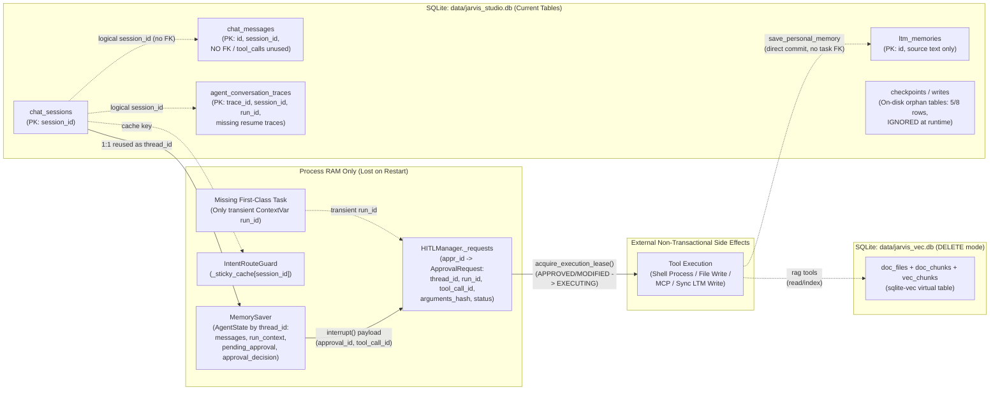

# Sprint 1C — Persistence Architecture Reconnaissance Report

> **任务性质**：只读架构勘察（Read-only Architecture Reconnaissance）  
> **仓库基线**：Branch `main` @ Commit `a8a32ed4cd3cdfad9da883fa1ac751a80ca43e86` (`a8a32ed`，与 `origin/main` 同步，工作区干净)  
> **前置已完成基线**：Sprint 1A (HITL & Path Security) 已合入；Sprint 1B (Isolated Process Execution Runtime) 已合入并完成跨平台验证  
> **报告范围**：Checkpointer、HITL、Session/Message、Task/Run、Long-Term Memory、RAG Vector Store、Observability Trace、Intent Guard Cache 与 SQLite 事务/崩溃恢复边界  

---

## 第 1 节：Executive Summary

### 1.1 核心结论

Jarvis Studio 当前处于典型的**“部分持久化 + 关键执行态纯内存分裂（Split-Brain Persistence）”**状态，且运行时行为与配置声明之间存在实质性偏差：

1. **配置声明 SQLite，运行时强制退化为纯内存（Confirmed Code Fact）**：  
   [`StorageConfig`](file:///d:/myProject/JarvisStudio/src/jarvis_studio/config/models.py#L74-L82) 与 [`config/settings.yaml`](file:///d:/myProject/JarvisStudio/config/settings.yaml#L22-L25) 默认将 `checkpoint_backend` 设为 `"sqlite"`（目标路径 `data/jarvis_studio.db`），但 [`get_checkpointer()`](file:///d:/myProject/JarvisStudio/src/jarvis_studio/agent/checkpoints/saver.py#L11-L25) **完全忽略 `backend` 与 `db_path` 参数**，全局硬编码返回 `MemorySaver()`。  
   代码注释（[`saver.py:19`](file:///d:/myProject/JarvisStudio/src/jarvis_studio/agent/checkpoints/saver.py#L19)）声称 LangGraph `SqliteSaver` 不支持异步 `aget_tuple`，但当前 `.venv` 已安装的 `langgraph-checkpoint-sqlite==3.1.1`（配合 `aiosqlite==0.22.1`）实际上**原生提供 `langgraph.checkpoint.sqlite.aio.AsyncSqliteSaver`**，并完整实现了 `aget_tuple`、`aput`、`aput_writes`、`adelete_thread` 和 `setup`。

2. **HITL 审批状态与租约（Lease）100% 驻留进程内存（Confirmed Code Fact）**：  
   [`HITLManager`](file:///d:/myProject/JarvisStudio/src/jarvis_studio/agent/hitl/manager.py#L74-L79) 使用进程内字典 `self._requests: dict[str, ApprovalRequest]` 与 `threading.Lock()` 存储全部审批与执行租约状态。进程重启、崩溃或热重载会导致所有 `PENDING`、`APPROVED`、`EXECUTING`、`CONSUMED`、`FAILED` 状态瞬时清空。

3. **一旦开启 SQLite Checkpointer 而不同步持久化 HITL，系统将产生致命裂脑（Derived Risk - P0）**：  
   当前因为两者同在内存，重启会“同步归零”；一旦单独把 Checkpointer 切换为 `AsyncSqliteSaver`，重启后 Checkpointer 仍停在 `approval_gate` 中断态，而 `HITLManager._requests` 为空，[`verify_approval_context()`](file:///d:/myProject/JarvisStudio/src/jarvis_studio/service/agent_service.py#L431-L489) 恒返回 `False`，所有挂起审批将**永久孤儿化**；同时，已消费（`CONSUMED`）或正在执行（`EXECUTING`）的防重放记录也会因内存清空而失效。

4. **Task 生命周期实体尚未持久化落盘，且与 Session/Thread 混用（Confirmed Code Fact）**：  
   系统不存在独立的 `Task` 数据表或持久状态机。`run_id` 仅瞬态存在于 [`ContextVar`](file:///d:/myProject/JarvisStudio/src/jarvis_studio/core/observability/tracer.py#L14-L41)、`AgentState["run_context"]` 与内存对象中；`session_id` 被直接复用为 LangGraph `thread_id`，`AgentService` 缺少按 `thread_id` 的异步互斥锁。

5. **四个独立的 SQLite 模块缺少统一连接治理与并发 PRAGMA（Confirmed Code Fact）**：  
   [`SessionService`](file:///d:/myProject/JarvisStudio/src/jarvis_studio/service/session_service.py#L47-L59)、[`MemoryStore`](file:///d:/myProject/JarvisStudio/src/jarvis_studio/memory/store.py#L29-L40)、[`TraceStore`](file:///d:/myProject/JarvisStudio/src/jarvis_studio/core/observability/trace_logger.py#L146-L152) 和 [`SqliteVecStore`](file:///d:/myProject/JarvisStudio/src/jarvis_studio/rag/store.py#L30-L46) 各自在每次操作时新建并关闭裸 `sqlite3.connect(..., check_same_thread=False)`，**没有任何一处**主动设置 `PRAGMA journal_mode=WAL`、`PRAGMA busy_timeout` 或 `PRAGMA foreign_keys=ON`，且全量采用同步阻塞调用直接嵌入 FastAPI 异步协程链。

6. **盘面现实证据印证历史遗留状态（Confirmed Runtime Observation）**：  
   只读检查本地 `data/` 目录发现：`data/jarvis_studio.db` 当前处于 `journal_mode=wal` 且**已存在历史残留的 `checkpoints`（5 行）与 `writes`（8 行）表**，同时包含 `chat_sessions`（8 行）、`chat_messages`（24 行）、`ltm_memories`（1 行）、`agent_conversation_traces`（149 行）；而 `data/jarvis_vec.db` 处于默认 `journal_mode=delete`（15 个文档、77 个分块）。

### 1.2 事实与判断分层

| 类别 | 范围与说明 |
| :--- | :--- |
| **Confirmed Code Facts（已核实源码/运行库事实）** | 所有文件路径、类/函数/字段定义、SQL 表结构、PRAGMA 缺失情况、已安装包版本（`langgraph==1.2.12`、`langgraph-checkpoint-sqlite==3.1.1`、`aiosqlite==0.22.1`、`sqlite-vec==0.1.9`）以及 `data/*.db` 只读检查结果。 |
| **Derived Architectural Risks（基于源码推导的并发与崩溃风险）** | 单独持久化 Checkpointer 导致的 HITL 裂脑、多工具循环崩溃窗口、`EXECUTING` 状态重启恢复陷阱、同步 `sqlite3` 与异步 `aiosqlite` 混写锁竞争、SSE 断连（`GeneratorExit`）绕过 Trace 保存逻辑。 |
| **Architectural Recommendations（Sprint 1C 设计建议）** | 面向单用户本地工作站的“一库双轨 + 轻量状态治理”方案：统一 SQLite 连接工厂与 PRAGMA、`AsyncSqliteSaver` 生命周期解耦、持久化 HITL 状态机与 SQL 原子租约（引入 `UNKNOWN` 人工对账态）、引入 `agent_tasks` 持久模型与启动恢复对账钩子。 |

---

## 第 2 节：仓库基线与勘察范围

### 2.1 Git 与运行环境基线

- **分支与提交**：`main` @ `a8a32ed4cd3cdfad9da883fa1ac751a80ca43e86`（`a8a32ed`）
- **远端同步状态**：与 `origin/main` 一致，工作区干净（`git status --short` 为空）
- **Python / `.venv` 关键依赖实测**：
  - `langgraph`: `1.2.12`（[`pyproject.toml`](file:///d:/myProject/JarvisStudio/pyproject.toml#L12) 要求 `>=0.2.20`）
  - `langgraph-checkpoint`: `4.2.0`
  - `langgraph-checkpoint-sqlite`: `3.1.1`（[`pyproject.toml`](file:///d:/myProject/JarvisStudio/pyproject.toml#L22) 要求 `>=3.1.1`）
  - `aiosqlite`: `0.22.1`（目前仅作传递依赖存在，**未显式声明**在 `pyproject.toml`）
  - `sqlite-vec`: `0.1.9`（运行时必需但**未显式声明**在 `pyproject.toml` `dependencies` 中）

### 2.2 勘察覆盖模块

本次勘察完整审计了所有涉及状态创建、读写、传输、缓存、落盘与恢复的代码与测试基线：

- **Agent 与 Checkpointer**：`agent/checkpoints/saver.py`、`agent/graph.py`、`agent/state.py`、`agent/nodes/assistant.py`、`agent/nodes/router.py`、`agent/nodes/approval.py`、`agent/nodes/executor.py`
- **HITL 安全边界（Sprint 1A 冻结契约）**：`agent/hitl/manager.py`、`agent/hitl/authorization.py`
- **应用服务与入口**：`service/agent_service.py`、`service/session_service.py`、`api/app.py`、`api/routes/*.py`、`cli/main.py`
- **记忆、RAG、观测与守卫**：`memory/models.py`、`memory/store.py`、`memory/manager.py`、`rag/store.py`、`rag/indexer.py`、`core/observability/trace_logger.py`、`core/observability/tracer.py`、`core/guard/route_guard.py`
- **进程运行时（Sprint 1B 冻结契约）**：`tools/builtin/shell_tools.py`、`core/process/platform.py`、`core/process/models.py`、`core/process/runner.py`
- **测试隔离约定**：[`tests/conftest.py`](file:///d:/myProject/JarvisStudio/tests/conftest.py#L6-L9)（`CHECKPOINT_BACKEND="memory"`）、`tests/test_agent_graph.py`、`tests/test_hitl_security.py`

### 2.3 Sprint 1C 必须严守的前置不变量（Invariants from 1A / 1B）

1. **Sprint 1A HITL 授权与防重放不变量**：
   - 严禁允许空白或保留字 `"default"` 作为 `thread_id`（Fail-Closed）。
   - 工具执行必须同时校验：`thread_id` + `tool_call_id` + `arguments_hash` + `approval_id`。
   - 租约一次性语义：`APPROVED | MODIFIED -> EXECUTING -> CONSUMED | FAILED`；**绝不允许** `EXECUTING` 在启动恢复时自动重置为 `FAILED` 或 `APPROVED` 并静默重放执行。
   - 多工具并行审批必须按 `decisions_by_call_id` 精确匹配，互不借道。
2. **Sprint 1B 进程隔离与取消契约**：
   - 异步取消（`asyncio.CancelledError`）时进程树被彻底终止后再进入 HITL 终态更新，无僵尸子进程和句柄泄漏。

---

## 第 3 节：当前持久化架构现状（As-Is Persistence Architecture）

### A. LangGraph Checkpoint 机制

- **工厂实现**：[`get_checkpointer()`](file:///d:/myProject/JarvisStudio/src/jarvis_studio/agent/checkpoints/saver.py#L11-L25) 使用全局单例 `_cached_checkpointer`，忽略所有调用参数并固定返回 `MemorySaver()`。
- **状态结构**：[`AgentState`](file:///d:/myProject/JarvisStudio/src/jarvis_studio/agent/state.py#L11-L24) 包含 4 个通道：`messages`（使用 `add_messages` 累加归约）、`run_context`（字典）、`pending_approval`、`approval_decision`。
- **调用配置**：[`AgentService`](file:///d:/myProject/JarvisStudio/src/jarvis_studio/service/agent_service.py#L120) 所有图执行与状态查询均仅传递 `{"configurable": {"thread_id": thread_id}}`，未显式使用 `checkpoint_ns` 或按 `checkpoint_id` 做历史时间旅行回放。
- **历史补齐（断层回填）机制**：在 [`invoke_agent()`](file:///d:/myProject/JarvisStudio/src/jarvis_studio/service/agent_service.py#L123-L135) 与 [`stream_agent()`](file:///d:/myProject/JarvisStudio/src/jarvis_studio/service/agent_service.py#L273-L285) 中，若检测到 `state_snapshot.values.get("messages")` 为空，系统会从 SQLite `chat_messages` 表回放历史 `user`/`assistant` 文本重新灌入 `HumanMessage` / `AIMessage`。
  - **客观缺陷**：由于 `SessionService` 不保存 `tool_calls`、不保存 `ToolMessage`、不保存 `interrupt` 状态、也不保存 `run_context`，重启后的“历史重建”实际上**完全丢失工具上下文与中断现场**，无法恢复任何挂起中的工具调用。
- **`langgraph-checkpoint-sqlite` 真实能力与事务行为（实测源代码核验）**：
  - 安装版本 `3.1.1`（[`pyproject.toml`](file:///d:/myProject/JarvisStudio/pyproject.toml#L22)）中的 `langgraph.checkpoint.sqlite.aio.AsyncSqliteSaver` 已实现全套异步方法：
    - `__init__(self, conn: aiosqlite.Connection, ...)` 在构造瞬间捕获 `self.loop = asyncio.get_running_loop()` 并创建 `self.lock = asyncio.Lock()`。**重要陷阱**：如果在无运行事件循环的模块导入期或跨不同 `asyncio.run()`（例如 CLI 每次运行或 pytest function-scoped loop）全局缓存同一个 `AsyncSqliteSaver` 单例，后续调用将在错误的事件循环上因 `self.lock` / `aiosqlite` 线程绑定而失败！
    - `setup()` 执行 `executescript("PRAGMA journal_mode=WAL; CREATE TABLE IF NOT EXISTS checkpoints ...; CREATE TABLE IF NOT EXISTS writes ...;")`，**但不设置 `PRAGMA busy_timeout` 和 `PRAGMA synchronous=NORMAL`**。
    - `aget_tuple()`、`aput()`、`aput_writes()`、`adelete_thread()` 均通过 `async with self.lock:` 串行化本实例内操作，并在每次 `aput` / `aput_writes` 后直接 `await self.conn.commit()`。但对**同 DB 文件的其他 `sqlite3` 同步连接**（如 `SessionService`、`TraceStore`）不具有互斥保护。

### B. HITL 状态机与审批生命周期

- **纯内存字典存储**：[`HITLManager`](file:///d:/myProject/JarvisStudio/src/jarvis_studio/agent/hitl/manager.py#L74-L324) 通过 `self._requests: dict[str, ApprovalRequest]` 与 `threading.Lock()` 管理全量审批生命周期，没有任何序列化或数据库写入。
- **完整状态流转**：
  1. `approval_node`（[`approval.py:161-173`](file:///d:/myProject/JarvisStudio/src/jarvis_studio/agent/nodes/approval.py#L161-L173)）在调用 `interrupt(approval_payload)`（`L215`）**之前**创建 `ApprovalRequest(status=PENDING)`。若后续节点再恢复或重放同一 `tool_call_id`，先查 `hitl_mgr.get_by_tool_call_id(tool_call_id, thread_id)`。
  2. 用户决策经由 `POST /approvals/{approval_id}/decision`（[`approvals.py:130-178`](file:///d:/myProject/JarvisStudio/src/jarvis_studio/api/routes/approvals.py#L130-L178)）或 CLI 传入，先调用 `verify_approval_context()`，随后触发 `Command(resume=resume_payload)` 重新进入 `approval_node`，调用 [`_apply_user_response`](file:///d:/myProject/JarvisStudio/src/jarvis_studio/agent/nodes/approval.py#L58-L108) -> `hitl_mgr.resolve_request()`，状态转为 `APPROVED` / `MODIFIED` / `REJECTED`。
  3. 边转向 `tools` 节点，[`tool_executor_node`](file:///d:/myProject/JarvisStudio/src/jarvis_studio/agent/nodes/executor.py#L39-L46) 调用 [`verify_tool_execution_authorization(..., acquire_lease=True)`](file:///d:/myProject/JarvisStudio/src/jarvis_studio/agent/hitl/authorization.py#L47-L360)，核对 `thread_id`、`tool_call_id`、`arguments_hash` 及参数 Schema 后，在锁内原子将状态置为 `EXECUTING`。
  4. 工具执行后调用 `finalize_execution()`：成功转 `CONSUMED`，抛出 `asyncio.CancelledError` 或 `Exception` 转 `FAILED`。若成功执行工具但 `finalize_execution(success=True)` 失败（[`executor.py:142-157`](file:///d:/myProject/JarvisStudio/src/jarvis_studio/agent/nodes/executor.py#L142-L157)），会记录 `[AUTHORIZATION_FINALIZATION_ERROR]` 与 `additional_kwargs={"tool_succeeded": True, ...}`，审批对象留在 `EXECUTING` 以阻止重放。
- **暴露缺陷**：内存持久性缺失；同时在 `verify_approval_context`（[`agent_service.py:451-489`](file:///d:/myProject/JarvisStudio/src/jarvis_studio/service/agent_service.py#L451-L489)）中，同时依赖 `hitl_manager.get_request(...)` 与 `graph.aget_state(...)` 中的 `task.interrupts` 双向互证——只要任何一侧因重启丢失，恢复入口即完全瘫痪。

### C. Session / Conversation / Message 机制

- **存储位置**：[`SessionService`](file:///d:/myProject/JarvisStudio/src/jarvis_studio/service/session_service.py#L39-L385) 操作 `settings.storage.sqlite_path`（默认 `data/jarvis_studio.db`）中的 `chat_sessions` 与 `chat_messages`。
- **消息写入时机不完备**：
  - 用户输入在图执行前立即写入（`agent_service.py:118, 269`）。
  - Fast-Path 守卫回复立即写入用户+助手两条消息（`agent_service.py:102-103, 238-239`）。
  - 正常图执行仅在最后取 `messages` 中倒数第一条非空 `AIMessage.content` 写入 `role="assistant"`（`agent_service.py:183, 406, 551, 639`）。
  - **严重遗漏**：
    1. `chat_messages` 表虽定义了 `tool_calls TEXT` 列（`session_service.py:83`），但 [`agent_service.py`](file:///d:/myProject/JarvisStudio/src/jarvis_studio/service/agent_service.py) **从未向 `add_message()` 传递 `tool_calls`，也从未保存 `role="tool"` 的结果**。
    2. 当执行进入 `interrupted`（等待 HITL 审批）或异常报错（`error`）时，**不向 `chat_messages` 写入任何助手/中断记录**——但用户消息已在前面写入 SQLite！重启或刷新 Session 列表后，历史出现悬空的单边 `user` 消息。
- **级联清理缺失与覆盖隐患**：
  - [`delete_session()`](file:///d:/myProject/JarvisStudio/src/jarvis_studio/service/session_service.py#L260-L272) 仅手工删除 `chat_messages` 和 `chat_sessions`，**不触发** `checkpoints`、`writes`、`agent_conversation_traces`、HITL 审批、`IntentRouteGuard._sticky_cache` 的清理。
  - [`clear_session_messages()`](file:///d:/myProject/JarvisStudio/src/jarvis_studio/service/session_service.py#L374-L385) 只清空 `chat_messages`，**不调用 `checkpointer.adelete_thread(session_id)`**，导致后续图调用继续沿用旧 Checkpoint 中的 `messages`！
  - [`create_session()`](file:///d:/myProject/JarvisStudio/src/jarvis_studio/service/session_service.py#L96-L125) 使用 `INSERT OR REPLACE`，如果以已有 `session_id` 调用将覆盖 `title` 和 `metadata`。

### D. Task / Run / Execution 机制

- `run_id` 由 [`set_trace_context()`](file:///d:/myProject/JarvisStudio/src/jarvis_studio/core/observability/tracer.py#L36-L41) 按每次请求生成一个随机 `run_<12hex>`，仅存放在异步任务局部的 `ContextVar`、State 的 `run_context` 与返回值 [`AgentExecutionResult`](file:///d:/myProject/JarvisStudio/src/jarvis_studio/service/agent_service.py#L24-L51) 中。
- 没有任何数据库表或进程级任务注册表追踪活跃运行状态；快速连发两请求到同一 `thread_id` 无互斥锁；HTTP/SSE 网关（[`chat.py`](file:///d:/myProject/JarvisStudio/src/jarvis_studio/api/routes/chat.py#L57-L73)、[`approvals.py`](file:///d:/myProject/JarvisStudio/src/jarvis_studio/api/routes/approvals.py#L211-L222)）未检测 `request.is_disconnected()`。

### E. Long-Term Memory (LTM)

- [`MemoryStore`](file:///d:/myProject/JarvisStudio/src/jarvis_studio/memory/store.py#L13-L258) 写入 `data/jarvis_studio.db` 中的 `ltm_memories` 表。
- 内置工具 [`save_personal_memory`](file:///d:/myProject/JarvisStudio/src/jarvis_studio/tools/builtin/memory_tools.py#L13-L37) 在工具内部同步调用 `mgr.remember()` 直接提交 SQLite，且未写入来源 `session_id`/`run_id`（`source` 字段传 `None`）。
- 缺陷细节：`_init_db()`（[`memory/store.py:42-63`](file:///d:/myProject/JarvisStudio/src/jarvis_studio/memory/store.py#L42-L63)）未使用 `try/finally` 确保 `conn.close()`；且 [`assistant_node`](file:///d:/myProject/JarvisStudio/src/jarvis_studio/agent/nodes/assistant.py#L37-L38) 仅在消息列表无 `SystemMessage` 时注入 Top-15 记忆，后续轮次与重启回填均受此交互影响。

### F. RAG / Knowledge Base

- [`SqliteVecStore`](file:///d:/myProject/JarvisStudio/src/jarvis_studio/rag/store.py#L16-L291) 独立使用 `settings.rag.vector_db_path`（默认 `data/jarvis_vec.db`）。
- 每次操作通过 `_get_connection()` 新建连接并调用 `conn.enable_load_extension(True); sqlite_vec.load(conn)`。
- `add_chunks()` 在单文件维度具有单连接事务保护（删旧 chunk/vec -> 插新 chunk/vec -> `INSERT OR REPLACE doc_files` -> `commit`），但在 [`WorkspaceIndexer.index_directory()`](file:///d:/myProject/JarvisStudio/src/jarvis_studio/rag/indexer.py#L113-L168) 中**按文件逐个提交**；目录中途崩溃会留下部分已索引文件（依靠 `doc_files.file_hash` 下次重扫可断点增量补齐）。
- 文件级与向量同步操作直接运行在异步 FastAPI 端点与事件循环内，缺少与业务写库的锁错峰。

### G. Trace / Observability 落盘

- [`TraceStore`](file:///d:/myProject/JarvisStudio/src/jarvis_studio/core/observability/trace_logger.py#L135-L273) 在 `data/jarvis_studio.db` 维护 `agent_conversation_traces` 表。
- **严重链路盲区**：
  1. 仅在 `invoke_agent()` / `stream_agent()` 走到 `finish()` + `save_trace()` 时一次性写入（[`agent_service.py:107, 165, 186, 198, 243, 393, 409, 428`](file:///d:/myProject/JarvisStudio/src/jarvis_studio/service/agent_service.py#L107)）；运行中途崩溃无 `running` 状态记录。
  2. **SSE 客户端半途断连**：Python 异步生成器断开时会抛出 `asyncio.CancelledError` 或 `GeneratorExit`（均继承自 `BaseException`，**不继承 `Exception`**！）。`stream_agent()` 仅有 `except Exception as e:`（[`agent_service.py:424`](file:///d:/myProject/JarvisStudio/src/jarvis_studio/service/agent_service.py#L424)），因此取消/断连时 `save_trace()` 彻底跳过且 `thinking_engine.close()` 泄漏！
  3. **恢复执行全盲区**：[`resume_approval()`](file:///d:/myProject/JarvisStudio/src/jarvis_studio/service/agent_service.py#L491-L566) 与 [`stream_resume_approval()`](file:///d:/myProject/JarvisStudio/src/jarvis_studio/service/agent_service.py#L568-L651) **完全没有创建或保存 `ConversationTrace`**！批准恢复后的所有耗时、工具调用与错误全无白盒追踪记录。
  4. 无保留期裁剪或容量上限策略（目前测试库中已有 149 条 `payload TEXT` 记录）。

### H. 进程、路由守卫与缓存

- [`IntentRouteGuard._sticky_cache`](file:///d:/myProject/JarvisStudio/src/jarvis_studio/core/guard/route_guard.py#L93-L94) 纯内存字典无上限、无淘汰、重启丢失。
- [`WindowsSpawnedProcess`](file:///d:/myProject/JarvisStudio/src/jarvis_studio/core/process/platform.py#L440-L476) 绑定了 `JOB_OBJECT_LIMIT_KILL_ON_JOB_CLOSE`（宿主 `SIGKILL`/强退时 OS 自动连带清理子进程树），但 [`_cleanup_win32_temp_cmd()`](file:///d:/myProject/JarvisStudio/src/jarvis_studio/tools/builtin/shell_tools.py#L247) 在宿主 `SIGKILL` 时无法执行（残留 `%TEMP%/jarvis_cmd_*.cmd`）；而在 POSIX 下，[`start_new_session=True`](file:///d:/myProject/JarvisStudio/src/jarvis_studio/core/process/platform.py#L210) 创建独立会话组，宿主进程被 `SIGKILL` 时**不会自动杀死孤立进程组**（除非显式持久化 PGID 或配置父亡信号/启动清扫）。

---

## 第 4 节：数据模型与存储盘点（Data Model & Storage Inventory）

下表汇总当前系统中所有 8 类真实状态域（结合源码 DDL 与本地 SQLite 库只读探查事实）：

| 数据域 | 实体 / 表名 | 真实存储介质 & 位置 | 主键 / 索引 | 关键字段与格式 | 缺失约束 / 当前状态问题 |
| :--- | :--- | :--- | :--- | :--- | :--- |
| **1. Session & Chat** | `chat_sessions`<br>`chat_messages` | SQLite (`data/jarvis_studio.db`) | `session_id` PK<br>`id` PK, `idx_chat_msg_session(session_id, created_at)` | `title`, `created_at`, `updated_at`, `metadata`(JSON)<br>`session_id`, `role`, `content`, `tool_calls`(JSON, **未用**), `created_at` | **无 `FOREIGN KEY` 约束**；`tool_calls` 与 `role="tool"` 未被 `AgentService` 写入；不保存中断/错误轮次。 |
| **2. LangGraph Checkpoint** | 运行期：`MemorySaver` (`_storage`)<br>*盘面残留：`checkpoints`, `writes`* | **运行期纯内存**（[`saver.py:23`](file:///d:/myProject/JarvisStudio/src/jarvis_studio/agent/checkpoints/saver.py#L23)）<br>*历史 DB 中已建表（5 / 8 行）* | `(thread_id, checkpoint_ns, checkpoint_id)` PK<br>`(thread_id, checkpoint_ns, checkpoint_id, task_id, idx)` PK | `parent_checkpoint_id`, `type`, `checkpoint`(BLOB), `metadata`(BLOB)<br>`channel`, `type`, `value`(BLOB) | 配置写 `sqlite` 实际跑 `MemorySaver`；重启后状态清空；若切换为 `AsyncSqliteSaver` 且不改 HITL，必致裂脑。 |
| **3. HITL Approvals** | `ApprovalRequest` (`HITLManager._requests`) | **纯进程内存**（[`manager.py:78`](file:///d:/myProject/JarvisStudio/src/jarvis_studio/agent/hitl/manager.py#L78)） | `id` (`appr_<8hex>`)，内存中无二级索引 | `thread_id`, `run_id`, `tool_name`, `arguments`, `arguments_hash`, `tool_call_id`, `status`, `decision`, `resolved_at`, `executed_at`, `completed_at`, `modified_arguments`, `execution_error` | **零落盘**；重启全部丢失；`status` 枚举缺少重启不确定态（如 `UNKNOWN`）。 |
| **4. Task / Run Lifecycle** | `AgentExecutionResult` / `_RUN_ID_VAR` | **纯进程内存 / `ContextVar`** | 无统一 `task_id` / 无数据表 | 仅零散传递 `run_id` (`run_<12hex>`), `thread_id`, `status` | **实体完全缺失**；无法恢复/取消/查询历史运行；Session 与 Task 混为一谈。 |
| **5. Long-Term Memory** | `ltm_memories` | SQLite (`data/jarvis_studio.db`) | `id` (`uuid[:8]`) PK<br>`idx_ltm_category(category)` | `category`, `content`, `source`(可选文本), `created_at`, `updated_at`, `importance` | 无 `session_id`/`task_id` 外键；`LIKE` 模糊检索；同步直写不参与任务事务边界。 |
| **6. RAG Knowledge Base** | `doc_files`, `doc_chunks`, `vec_chunks` (+ `vec_chunks_*` 影子表) | SQLite + `sqlite-vec` (`data/jarvis_vec.db`) | `doc_path` PK<br>`chunk_id` PK, `idx_chunk_doc(doc_path)`<br>`vec0` virtual table | `file_hash`, `chunk_count`, `updated_at`<br>`chunk_index`, `content`, `metadata`(JSON)<br>`embedding float[1536]` | **处于 `DELETE` 日志模式**（未设 WAL）；无外键关联；跨多文件扫描非整体原子；依赖同步扩展加载。 |
| **7. Observability Traces** | `agent_conversation_traces` | SQLite (`data/jarvis_studio.db`) | `trace_id` PK<br>`idx_traces_session(session_id, start_time DESC)` | `session_id`, `run_id`, `query`, `status`, `start_time`, `total_duration_ms`, `ttft_ms`, `ttfa_ms`, `ttlt_ms`, `steps_count`, `payload`(JSON) | 仅末尾落盘；`resume_approval` 完全无 Trace；`GeneratorExit`/`CancelledError`/崩溃丢数据；无保留淘汰。 |
| **8. Intent Route Guard** | `_sticky_cache` | **纯进程内存**（[`route_guard.py:94`](file:///d:/myProject/JarvisStudio/src/jarvis_studio/core/guard/route_guard.py#L94)） | 内存 Key `session_id` | `{"active_file": ...}` | 重启丢失、永不清理、`delete_session` 不释放。 |

---

## 第 5 节：数据库与事务边界深度分析（SQLite & Transaction Analysis）

### 5.1 连接创建与并发 PRAGMA 审计

| 模块 | 连接生命周期 | `journal_mode` | `busy_timeout` | `foreign_keys` | 异步事件循环阻塞风险 |
| :--- | :--- | :--- | :--- | :--- | :--- |
| `SessionService` | 每次调用 open/close（`:memory:` 复用单连接） | **未设置**（受历史库影响目前 `jarvis_studio.db` 碰巧为 `wal`，新建库默认 `delete`） | **未设置**（仅依赖 Python sqlite3 默认 `timeout=5.0` 秒） | **未设置**（默认 `OFF`） | **中-高**：在 `async def` 端点与 `AgentService` 协程中直接同步读写提交 |
| `MemoryStore` | 每次调用 open/close（`_init_db` 漏写 `try/finally`） | **未设置** | **未设置** | **未设置** | **中**：工具 `save_personal_memory` / `assistant_node` 热路径同步读库 |
| `TraceStore` | 每次调用 open/close | **未设置** | **未设置** | **未设置** | **中**：每次 `save_trace` 序列化大型 `payload` JSON 后同步写盘 |
| `SqliteVecStore` | 每次调用 open/close 并重加载 `sqlite_vec` 扩展 | **未设置**（实测 `jarvis_vec.db` 为 `delete`） | **未设置** | **未设置** | **高**：`index_directory` 在 API 协程中同步切块+Embedding+频繁写入，极易抢占事件循环 |
| `AsyncSqliteSaver` *(3.1.1 库行为)* | 持有单条长期 `aiosqlite.Connection` + `asyncio.Lock` | `setup()` 内置 `PRAGMA journal_mode=WAL` | **未设置**（默认仅 `5.0s`） | **未设置** | `self.loop = get_running_loop()` 强绑定，**严禁跨循环或同步模块启动期单例缓存** |

### 5.2 关键 SQLite 并发与生命周期冲突点

1. **多连接异构写入导致 `database is locked` 风险**：  
   若直接启用 `AsyncSqliteSaver` 写 `data/jarvis_studio.db`，同时保留 `SessionService`、`MemoryStore`、`TraceStore` 在**主事件循环线程**或 `ThreadPoolExecutor` 中不断开关**独立同步 `sqlite3` 连接**且无 `busy_timeout=5000+` 与重试/退避，在“后台 RAG/Memory 写入 + 多会话并发 Checkpoint + 实时写 Trace”叠加场景下会触发 `sqlite3.OperationalError: database is locked`。
2. **`_in_memory_conn` 跨线程与连接生命周期问题**：  
   4 个 Store 均通过 `check_same_thread=False` + `:memory:` 缓存连接应对单元测试，但未统一管理关闭钩子，且异步持久化（`aiosqlite`）若混用内存字符串将产生**各自隔离的不同 `:memory:` 库**（即每个新连接看到空表），必须采用共享 URI（`file:...?mode=memory&cache=shared`）或单连接/临时文件路径注入测试。
3. **`AsyncSqliteSaver` 单例反模式隐患**：  
   当前 [`saver.py:8-24`](file:///d:/myProject/JarvisStudio/src/jarvis_studio/agent/checkpoints/saver.py#L8-L24) 和 [`agent_service.py:653-661`](file:///d:/myProject/JarvisStudio/src/jarvis_studio/service/agent_service.py#L653-L661) 习惯在**同步函数**里懒加载进程级全局单例。由于 `AsyncSqliteSaver.__init__` 调用 `asyncio.get_running_loop()`，若在同步上下文调用直接崩溃（`RuntimeError: no running event loop`）；若在 CLI / Pytest 多次 `asyncio.run()` 之间复用同一全局对象，第二次运行会向已关闭的旧事件循环投递异步锁/Future 并失败。

### 5.3 事务边界分析（单事务 vs 多事务 vs 跨介质外部副作用）

1. **内部裂开的双重连接写入**：  
   [`SessionService.add_message()`](file:///d:/myProject/JarvisStudio/src/jarvis_studio/service/session_service.py#L274-L324) 第 282 行先调 `get_or_create_session(session_id)`（内部打开并提交连接 A），随后第 287 行再开连接 B 插入 `chat_messages` 并更新 `chat_sessions.updated_at`。若中间失败，产生空会话元数据或更新时间不同步；且同样模式导致高频加倍建连开销。
2. **Checkpoint 与 HITL / Task / Session 的非原子分裂**：  
   - **现状**：LangGraph Checkpoint（如后续改用 SQLite）在 Superstep 边界单独提交 `checkpoints` / `writes`；而 `HITLManager` 修改内存字典；`SessionService` 各自独立提交；`TraceStore` 独立提交。
   - **外部不可回滚副作用**：在 [`tool_executor_node`](file:///d:/myProject/JarvisStudio/src/jarvis_studio/agent/nodes/executor.py#L86-L91) 执行 `await tool.ainvoke(effective_args)` 时（Shell 命令、磁盘 `write_file`、MCP 调用、`save_personal_memory`），该副作用**跨越进程与文件系统边界**，不可能纳入 SQLite 事务回滚。
   - **由此推导的必须设计原则**：对于有外部副作用的高危工具执行，只能采用**“预先写意图租约（Pre-execution Lease Commit: `EXECUTING`）-> 执行外部动作 -> 后置确认提交（Post-execution Outcome Commit: `CONSUMED` / `FAILED`）”**的 Outbox/Lease 两段状态记录模式，而不是指望单个 SQLite 事务包住外部工具调用。

---

## 第 6 节：Checkpoint、HITL、Session、Task 关系模型

### 6.1 实体边界与关联关系说明

- **`Session` (`session_id`)**：用户对话容器，长生命周期；当前与 LangGraph `thread_id` **1:1 强绑定**（[`agent_service.py:120, 270`](file:///d:/myProject/JarvisStudio/src/jarvis_studio/service/agent_service.py#L120)）。
- **`Thread` (`thread_id`, `checkpoint_ns`)**：LangGraph 状态演化时间线。每条用户指令或每次 `Command(resume=...)` 在该线尾部推进 `checkpoint_id` 链（`parent_checkpoint_id -> checkpoint_id`）。
- **`Task` (`task_id` - 当前缺失)**：应当代表**单次用户目标或交互指令**（从发起提问 -> 中断审批 -> 恢复执行 -> 完成/失败/取消/超时的完整执行体）。一个 `Session/Thread` 下包含 `1..N` 个顺序推进的 `Task`。一个 `Task` 可跨越 `1..N` 个底层 `run_id`（例如首次运行进入中断是 `run_1`，批准恢复是 `run_2`，当前因此断裂无法串联）。
- **`AIMessage.tool_calls[].id` (`tool_call_id`) & `ApprovalRequest` (`approval_id`)**：`ApprovalRequest` 通过 `(thread_id, tool_call_id, arguments_hash)` 精确锚定到某一轮模型产出中的单个工具调用，并跨 `interrupt()` 与 `Command(resume=...)` 验证执行租约。

### 6.2 实体关联与持久化边界图



### 6.3 Agent 执行与 HITL 状态流转及崩溃窗口图

```mermaid
stateDiagram-v2
    [*] --> InputPersisted: SessionService.add_message(user)
    InputPersisted --> GraphAssistant: ainvoke / astream_events(thread_id)
    GraphAssistant --> ToolSafeOrDirect: route_after_assistant
    GraphAssistant --> ApprovalGate: dangerous tool detected

    state ApprovalGate {
        [*] --> ReqCreated: HITLManager.create_request(PENDING) [RAM]
        ReqCreated --> Interrupted: interrupt(payload) + MemorySaver snapshot [RAM]
        note right of Interrupted: CW1: Crash/Restart loses interrupt & PENDING req\n(or Split-Brain if only Checkpoint persists)
    }

    Interrupted --> DecisionApplied: resume_approval -> _apply_user_response()
    DecisionApplied --> Rejected: REJECTED [RAM]
    DecisionApplied --> ApprovedReady: APPROVED / MODIFIED [RAM]
    note right of ApprovedReady: CW2: Crash before lease leaves APPROVED\nvs unadvanced or advanced checkpoint

    ApprovedReady --> Leasing: acquire_execution_lease() [RAM: -> EXECUTING]
    Leasing --> ToolRunning: await tool.ainvoke(effective_args)
    note right of ToolRunning: CW3/4: Crash mid-tool or post-tool before\nfinalize_execution leaves EXECUTING;\nSide effect state is UNKNOWN!

    ToolRunning --> CancelledOrErr: CancelledError / Exception
    CancelledOrErr --> FinalizedFail: finalize_execution(FAILED) [RAM]
    ToolRunning --> Succeeded: Tool returned output
    Succeeded --> FinalizedOK: finalize_execution(CONSUMED) [RAM]
    Succeeded --> FinalizeErrTag: finalize_execution throws [AUTHORIZATION_FINALIZATION_ERROR]\n(remains EXECUTING)
    note right of FinalizeErrTag: CW5: Tool ran, RAM stayed EXECUTING;\nrestart wipes lock unless persisted as UNKNOWN/CONSUMED

    Rejected --> BlockedMsg: ToolMessage(Operation cancelled)
    FinalizedOK --> AssistantContinue: Assistant next turn / final output
    FinalizedFail --> AssistantContinue
    BlockedMsg --> AssistantContinue
    AssistantContinue --> OutputPersisted: SessionService.add_message(assistant)\n+ TraceStore.save_trace()
    OutputPersisted --> [*]
    note right of OutputPersisted: CW7/8: SSE disconnect or crash loses trace;\nresume_approval never saves trace
```

---

## 第 7 节：崩溃窗口矩阵与故障影响分析（Crash Window Matrix）

下表覆盖所要求分析的 **8 类核心崩溃窗口** 以及代码中发现的 **4 类额外高频状态分裂窗口**：

| 编号 | 崩溃 / 故障场景 | 触发位置（真实代码行） | 崩溃瞬间的持久化真相 | 重启 / 恢复后的实际后果 | 严重度 |
| :--- | :--- | :--- | :--- | :--- | :---: |
| **CW-1** | **HITL `PENDING` 中断期间重启** | [`approval.py:165-215`](file:///d:/myProject/JarvisStudio/src/jarvis_studio/agent/nodes/approval.py#L165-L215) | **现状**：`chat_messages` 只有 `user` 提问；Checkpoint（`MemorySaver`）与 `HITLManager`（`PENDING`）全灭。<br>**若仅启用 SQLite Checkpoint**：Checkpoint 停在 `approval_gate`，`HITLManager` 为空。 | 现状下前端审批卡片永久消失，历史出现孤立 user 消息；若仅启 Checkpoint 则 [`verify_approval_context()`](file:///d:/myProject/JarvisStudio/src/jarvis_studio/service/agent_service.py#L451-L453) 返回 `False`（404），审批被死锁丢弃。 | **P0** |
| **CW-2** | **用户已提交 `approve`/`modify`，租约前崩溃** | [`approval.py:218-248`](file:///d:/myProject/JarvisStudio/src/jarvis_studio/agent/nodes/approval.py#L218-L248) 至 [`executor.py:39`](file:///d:/myProject/JarvisStudio/src/jarvis_studio/agent/nodes/executor.py#L39) | 即使未来持久化 HITL：先在 Node 内将记录置为 `APPROVED/MODIFIED`，但在到达 `tools` 节点提交 Checkpoint 前进程死掉。 | 审批已标 `APPROVED`（禁止重复 `resolve_request`），但 Checkpointer 可能仍在 `approval_gate`（需处理用户恢复指令重入时不会触发 `ValueError: already resolved`，目前 [`_resolve_single_item:44`](file:///d:/myProject/JarvisStudio/src/jarvis_studio/agent/nodes/approval.py#L44) 有跳过逻辑但需防参数篡改与状态一致性对齐）。 | **P1** |
| **CW-3** | **`acquire_execution_lease` 成功（`EXECUTING`）后、启动工具前崩溃** | [`executor.py:39-89`](file:///d:/myProject/JarvisStudio/src/jarvis_studio/agent/nodes/executor.py#L39-L89) | 在内存中已转为 `EXECUTING`（未来为数据库状态），尚未来得及调用 `tool.ainvoke`。 | 磁盘侧尚未产生外部副作用，但恢复器**无法从 `EXECUTING` 区分“未启动”还是“已执行”**。若盲目重置为 `APPROVED` 会破坏后续 `CW-4` 安全性，必须先落盘 `UNKNOWN` 待人工确认或做幂等预检查。 | **P0** |
| **CW-4** | **工具实际执行中进程崩溃 / `SIGKILL`** | [`executor.py:86-90`](file:///d:/myProject/JarvisStudio/src/jarvis_studio/agent/nodes/executor.py#L86-L90), [`shell_tools.py:238-247`](file:///d:/myProject/JarvisStudio/src/jarvis_studio/tools/builtin/shell_tools.py#L238-L247) | 审批状态留在 `EXECUTING`（内存丢失）；文件可能部分写入；Shell 进程树在 Windows 由 JobObject 强杀，**在 POSIX 上可能孤儿化继续在后台跑**；Windows 残留 `.cmd` 临时文件。 | 重启后 `HITLManager` 归零，无记录显示刚刚正执行高危动作；若重新由模型再生成调用或状态错误恢复，存在**重复扣费/重复破坏（Double Execution）**风险。 | **P0** |
| **CW-5** | **工具执行成功，但 `finalize_execution(success=True)` 前崩溃或更新失败** | [`executor.py:126-157`](file:///d:/myProject/JarvisStudio/src/jarvis_studio/agent/nodes/executor.py#L126-L157) | 外部副作用**已真实发生**；若运行中失败，[`executor.py:147-157`](file:///d:/myProject/JarvisStudio/src/jarvis_studio/agent/nodes/executor.py#L147-L157) 仅在 `ToolMessage.additional_kwargs["tool_succeeded"]=True` 记录提示而审批留在 `EXECUTING`；若此时硬崩溃，连此 `ToolMessage` 都未进 Checkpoint。 | 最危险误判窗口！如果后续系统在重启后误把 `EXECUTING` 重置回 `APPROVED` 或 `FAILED`，将导致外部成功动作被再次执行。 | **P0** |
| **CW-6** | **工具执行失败或 `CancelledError` 取消后、`finalize_execution(FAILED)` 前崩溃** | [`executor.py:92-120`](file:///d:/myProject/JarvisStudio/src/jarvis_studio/agent/nodes/executor.py#L92-L120) | 若取消清理过程中再被 `SIGKILL`，`EXECUTING` 来不及转成 `FAILED`，`Task` 与 `Trace` 也未来得及落盘。 | 恢复时同样只能视作 `UNKNOWN`（保守不自动重放），需要人类核验现场状态后再决定是否重发。 | **P1** |
| **CW-7** | **同一轮多工具并行调用时，工具 1 完成而工具 2 执行中崩溃** | [`executor.py:33-168`](file:///d:/myProject/JarvisStudio/src/jarvis_studio/agent/nodes/executor.py#L33-L168) | `tool_executor_node` 是单一节点循环所有 `tool_calls` 并最后统一 `return {"messages": tool_messages}`。工具 1 虽已执行并变成内存 `CONSUMED`，但 `ToolMessage_1` **尚未提交到 LangGraph Checkpoint**。 | 崩溃重启后 Checkpoint 上甚至没有工具 1 的 `ToolMessage`！若重新调度该节点，工具 1 必须靠持久化审批表的 `CONSUMED` 状态**硬拦截重放**并回补提示，工具 2 若停留在 `EXECUTING` 则必须标为 `UNKNOWN`。 | **P0** |
| **CW-8** | **图执行完成，但写 `SessionService` / `TraceStore` 前崩溃** | [`agent_service.py:175-186, 405-409`](file:///d:/myProject/JarvisStudio/src/jarvis_studio/service/agent_service.py#L175-L186) | 若未来用 `AsyncSqliteSaver`，Checkpoint 已含最终 `AIMessage` 回复，但 `chat_messages` 缺失该条 `assistant` 消息、`agent_conversation_traces` 缺失本轮 Trace。 | 重启后 UI 读取 `GET /sessions/{id}`（读 `chat_messages`）看不到最新回答，但 Checkpoint 已有该回答，产生前后端视图不一致。 | **P1** |
| **CW-9** *(新增)* | **SSE 客户端中途断连（`GeneratorExit`）** | [`chat.py:57-72`](file:///d:/myProject/JarvisStudio/src/jarvis_studio/api/routes/chat.py#L57-L72), [`agent_service.py:317-429`](file:///d:/myProject/JarvisStudio/src/jarvis_studio/service/agent_service.py#L317-L429) | `GeneratorExit` / `CancelledError` 不进入 `except Exception`。 | 任务协程在后端被撕裂或孤儿运行，**`TraceStore` 零记录、`thinking_engine` 心跳任务关闭逻辑被绕过**，会话状态静默不完整。 | **P1** |
| **CW-10** *(新增)* | **`resume_approval` / `stream_resume_approval` 全链路** | [`agent_service.py:491-651`](file:///d:/myProject/JarvisStudio/src/jarvis_studio/service/agent_service.py#L491-L651) | **无崩溃即缺失**：这两个恢复函数根本未调用 `ConversationTrace` 与 `trace_store.save_trace()`。 | 所有 HITL 批准后真正执行高危工具的过程与结果，在 `/system/traces` 观测体系中**永久隐身**。 | **P2** |
| **CW-11** *(新增)* | **并发写入同一 `thread_id` 或多模块混写 SQLite** | [`agent_service.py:151, 318`](file:///d:/myProject/JarvisStudio/src/jarvis_studio/service/agent_service.py#L151), `SessionService` / `SqliteVecStore` | 无按 `thread_id` 的异步锁；无全局统一 `WAL` / `busy_timeout`。 | 同线程两请求相互交错写入 `AgentState` 导致消息乱序/状态撕裂；多线程/协程混合写库触发 `database is locked`。 | **P1** |
| **CW-12** *(新增)* | **删除/清空会话残留跨存储脏数据** | [`session_service.py:260-272, 374-385`](file:///d:/myProject/JarvisStudio/src/jarvis_studio/service/session_service.py#L260-L272) | 删除或清空只改 `chat_messages`/`chat_sessions`，不清理 Checkpoints、Approvals、`Traces` 和 `_sticky_cache`。 | `clear_session_messages` 后用户发新消息，Agent 依然带着“被删除的记忆上下文”运行。 | **P2** |

---

## 第 8 节：状态一致性与重启恢复语义分析（Consistency & Recovery Analysis）

### 8.1 核心安全红线：禁止自动将 `EXECUTING` 回退为 `FAILED` 或 `APPROVED`

在引入持久化之后，最容易引入安全漏洞的错误优化是“启动清理时把所有未完结的 `EXECUTING` 标成 `FAILED` 或退回 `APPROVED` 允许用户一键重跑”。**本架构明确禁止此行为**，理由如下：

1. **物理世界不具备 SQLite 回滚特性**：高危工具包括 `execute_shell_command`（如数据库迁移、包安装、删除文件）、`write_file`、`delete_file`、`git_push` 与外部 MCP 操作。从进入 `acquire_execution_lease()` 到 `finalize_execution()` 返回之间的任意毫秒崩溃（**CW-3 / CW-4 / CW-5**），系统无法靠数据库日志判别外部动作是“根本未开始”、“半成品”还是“已成功落盘/远端推送”。
2. **禁止自动重跑（No Blind Auto-Retry）**：如果系统自动将其重置为 `APPROVED` 或静默重新触发，可能对非幂等命令造成二次执行或二次破坏，实质绕过了“单次授权一次性消费（One-time Execution Lease）”的 Sprint 1A 安全契约。
3. **禁止盲目标记 `FAILED`**：若动作实际已成功（CW-5），标为 `FAILED` 会诱导 Agent 在下一步自主规划中重复尝试补跑同一高危步骤。

**正确恢复语义：引入 `UNKNOWN`（不确定 / 需人工对账态）**

- 进程启动初始化（Startup Reconciliation）扫描所有 `runtime_instance_id != current_instance_id` 且状态为 `EXECUTING` 的审批记录与 `RUNNING` 的任务记录：
  - 将仍处于 `EXECUTING` 的审批自动收敛至 **`UNKNOWN`**（记录 `unknown_reason="process_crashed_while_executing"`、`completed_at=now`），**永久锁定禁止再获取执行租约**。
  - 若需向用户恢复对话上下文，向前端与对话历史暴露显式警告与**人工对账动作**（如“确认该命令实际已执行完成”或“确认副作用未生效并重新发起全新审批请求”）。

### 8.2 分状态恢复语义清单

| 持久态类别 | 重启探测条件 | 正确恢复动作 |
| :--- | :--- | :--- |
| **`PENDING` 审批** | 关联 `thread_id` 的 Checkpoint 存在且 `state.next` 仍包含激活 `interrupt`，`approval_id` 匹配 | **合法可恢复**：保持 `PENDING`，在 UI 审批列表重新展示，用户可提交决策继续 `Command(resume=...)` 执行。 |
| **孤儿 `PENDING` 审批** | `approval` 为 `PENDING`，但对应 Checkpoint 不存在、已被人工/新消息覆盖或无匹配 `interrupt` | **Fail-Closed 隔离**：启动清理或 `verify_approval_context()` 检查失败时将其收敛为 `FAILED` / `EXPIRED`（`reason="missing_active_checkpoint_interrupt"`），禁止孤立审批被异常激活。 |
| **`APPROVED` / `MODIFIED`（未获租约）** | `resolved_at` 已落盘，未进入 `EXECUTING`，Checkpoint 仍停在 `approval_gate`（CW-2） | **幂等安全衔接**：禁止重复调用 `resolve_request()` 修改决定；允许显式“重驱动恢复（Resume from persisted decision）”或标为 `FAILED(process_interrupted_before_exec)` 由用户重新确认。*推荐保守策略*：个人开发机直接通过只读安全对账页面呈现已批准决定并由用户点击“继续执行”进入 `Command(resume=...)`，绝不在后台重启瞬间无人值守自动执行高危工具。 |
| **`EXECUTING`** | 旧 `runtime_instance_id` 留下的未终结租约（CW-3/4/5/6/7） | **强制迁移为 `UNKNOWN`**：永久阻断原 `approval_id` 再执行；UI 高亮标注具体 `tool_name`、`arguments`、`executed_at`，提示人工核查。 |
| **`CONSUMED` / `FAILED` / `REJECTED`** | 终态记录 | **永久只读审计态**：严禁再次 `acquire_execution_lease()`，彻底拦截跨重启的重放攻击。 |
| **`Task` (`RUNNING` / `CREATED`)** | 属于死亡旧实例的任务 | 迁移为 `INTERRUPTED` 或 `FAILED`（若关联存在 `UNKNOWN` 审批则标为 `UNKNOWN`），**绝不允许长期停留在 `RUNNING`** 锁死界面。 |
| **Checkpoint 超前 vs `chat_messages` 滞后** | CW-8：Checkpoint 已生成最新 `AIMessage` 回答但 `chat_messages` 无对应末尾记录 | **以 Checkpoint 最终超步为辅助纠偏依据**：启动/加载 Session 时若发现对应最终 Task 已达 `COMPLETED` 且 `chat_messages` 缺失最后一条回复（按 `task_id` / `run_id` 对账），可幂等补全展示。 |

### 8.3 跨库与多实例边界决策

- **为何保留双库（`jarvis_studio.db` vs `jarvis_vec.db`）**：  
  `sqlite-vec` 需要通过 `conn.enable_load_extension(True)` 挂载 C 扩展并生成多张内部影子表（`vec_chunks_chunks`、`vec_chunks_rowids` 等），且未来 Sprint 2 还会引入高频批量写入的 `FTS5` 与 AST `code_symbols`。将纯向量与代码索引库（可随时由源码重算重建）保留在 `jarvis_vec.db`，而将不可重算的核心事务状态（Session、Message、Checkpoint、Approval、Task、Memory、Trace）收敛至单一事务型 `jarvis_studio.db`，可在保持零跨库分布式事务的同时避免索引扫描阻塞对话交互。
- **单机约束声明**：明确将架构目标定位于**单机单用户本地服务（Single Process API Server 或 单次 CLI 进程）**。若用户同时在本地运行常驻 FastAPI `serve` 与一个并发写同库的 `cli chat`，需依靠 `WAL + busy_timeout=5000` 保证库级串行不报错（并发写入序列化由 SQLite 内部锁承担，应用层假设主运行时为单活动服务端）。

---

## 第 9 节：Sprint 1C 目标持久化架构设计建议（Target Architecture Proposal）

遵循**“面向单用户个人生产工作站的最小充分持久化设计（KISS / YAGNI）”**：不引入 PostgreSQL、Redis、RabbitMQ、Celery 或复杂分布式事务框架，全部基于增强后的 SQLite（WAL）+ `langgraph-checkpoint-sqlite` 构建稳健、可测试、可回滚的本地持久化内核。

### 9.1 总体架构分层设计

```
+-------------------------------------------------------------------+
|  API / CLI / Lifespan Layer                                       |
|  - FastAPI Lifespan: init SQLite -> Startup Recovery -> Cleanup   |
|  - CLI async context: open/close loop-scoped Checkpointer & Pool  |
+-------------------------------------------------------------------+
         |                          |                        |
         v                          v                        v
+------------------+    +-----------------------+   +---------------+
| AgentService     |    | SessionService        |   | RAG Indexer   |
| - Thread Lock    |    | - Unified Tx Helper   |   | (jarvis_vec)  |
| - Task Lifecycle |    | - Cascade Delete      |   +---------------+
| - Resume Traces  |    +-----------------------+
+------------------+               |
         |                         |
         v                         v
+-------------------------------------------------------------------+
|  Core Persistence Layer (src/jarvis_studio/core/persistence/)     |
|  - sqlite.py: Unified Engine, PRAGMAs (WAL, busy_timeout=5000,    |
|               foreign_keys=ON, synchronous=NORMAL), Schema Ver    |
|  - runtime_id: Unique boot instance ID for crash detection        |
+-------------------------------------------------------------------+
         |                    |                     |
         v                    v                     v
+------------------+  +---------------+   +-------------------------+
| AsyncSqliteSaver |  | SQLite HITL   |   | SQLite Task / Trace /   |
| (checkpoints,    |  | Store (CAS    |   | LTM / Session Tables    |
|  writes)         |  | Lease +       |   | (agent_tasks,           |
|                  |  | UNKNOWN state)|   |  chat_sessions, ...)    |
+------------------+  +---------------+   +-------------------------+
```

### 9.2 核心组件设计要点

1. **统一 SQLite 治理引擎（`core/persistence/sqlite.py`）**：
   - 统一负责建连与 PRAGMA 初始化（对文件型数据库启用 `WAL`、`busy_timeout=5000`、`foreign_keys=ON`、`synchronous=NORMAL`）；对测试期 `:memory:` 与显式指定 `db_path` 维持完整隔离。
   - 使用 SQLite 内置 `PRAGMA user_version`（或轻量 `schema_migrations` 表）管理前向 DDL 迁移，**严格兼容已有 `data/jarvis_studio.db` 数据**（增量 `CREATE TABLE IF NOT EXISTS` / `ALTER TABLE ADD COLUMN` 检测）。
   - 修复现有存储层同步阻塞问题：非向量库高频读写或长事务逐步通过统一仓储接口或 `asyncio.to_thread`（短事务）/ `aiosqlite` 解耦事件循环。
   - 对 `jarvis_vec.db` 单独应用 `WAL` + `busy_timeout=5000` 治理并补全依赖声明（显式在 `pyproject.toml` 记录 `aiosqlite` 与 `sqlite-vec`）。

2. **真实可用的异步 Checkpointer 生命周期（`agent/checkpoints/saver.py`）**：
   - 修复当前“配置忽略”缺陷：`backend == "sqlite"`（默认）返回基于 `AsyncSqliteSaver` 的持久化实例；`backend == "memory"`（`tests/conftest.py` 默认）返回 `MemorySaver`。
   - **消除事件循环死绑陷阱**：不再把 `AsyncSqliteSaver` 塞入无法关闭、硬绑第一次循环的模块级永生 `_cached_checkpointer` 中！改由异步上下文/生命周期容器管理 `aiosqlite` 连接打开与 `await conn.close()`（确保 Zero `ResourceWarning`！），由 FastAPI `lifespan` 持有应用期间活跃实例，CLI `_chat_loop` 内创建并在退出时关闭。
   - **安全并发保护**：在 `AgentService` 内部维护 `dict[str, asyncio.Lock]`（按 `thread_id` 串行化同一会话的图推进与恢复动作），防止同一 `thread_id` 状态写撕裂。

3. **持久化 HITL 审批存储与 SQL 原子租约（重构 `HITLManager` 底层为 SQLite + 保留接口契约）**：
   - 新增表 **`hitl_approval_requests`**：
     - 字段涵盖现有 `ApprovalRequest` 全字段 + 新增 **`task_id`**（可空关联 `agent_tasks`）、**`lease_owner_instance_id`**（写入获得租约的进程启动 ID，供重启崩溃恢复精准甄别 `UNKNOWN`！）、**`tool_succeeded`** / **`tool_result_digest`**（辅助缓解 **CW-5** 终态落盘失败后的人工/状态对账）。
   - 租约原子抢占：在 `acquire_execution_lease()` 内通过 SQLite 事务内**条件更新（Conditional Update / CAS）**：
     ```sql
     UPDATE hitl_approval_requests
     SET status = 'EXECUTING', executed_at = ?, lease_owner_instance_id = ?
     WHERE id = ? AND thread_id = ? AND tool_call_id = ? AND arguments_hash = ?
       AND status IN ('APPROVED', 'MODIFIED');
     ```
     仅当 `rowcount == 1` 时授予租约，彻底在库级阻止跨重启或并发下的双执行；如果 `rowcount == 0`，再查实际行明确返回精准阻断原因（`EXECUTING` / `CONSUMED` / `FAILED` / `UNKNOWN` / `REJECTED` / `mismatch`）。
   - 状态枚举升级：`ApprovalStatus` 新增 **`UNKNOWN`**（禁止再被消费执行，等待明确人工对账动作，例如记录人工核验审计备注后单独关闭）。

4. **一等公民 `Task` 持久状态机（为 Sprint 1D 奠基）**：
   - 新增表 **`agent_tasks`**：
     - 字段：`task_id` (PK), `session_id` (FK -> `chat_sessions`), `thread_id`, `latest_run_id`, `status` (`CREATED | RUNNING | WAITING_APPROVAL | EXECUTING_TOOL | COMPLETED | FAILED | CANCELLED | TIMEOUT | UNKNOWN`), `user_message`, `error_message`, `runtime_instance_id`, `created_at`, `updated_at`, `started_at`, `completed_at`。
   - **边界清晰**：Sprint 1C 负责 `agent_tasks` 模型持久化、主流程状态跃迁落盘、启动崩溃恢复与 `thread_id` 互斥锁；**不越权提前实现** Sprint 1D 的完整主动任务队列调度、前端取消按钮 API 与超长后台任务取消控制面板（仅保留干净扩展点）。

5. **Session / Message / Trace / Sticky Cache 一致性收口**：
   - **`SessionService`**：将 `add_message` 合并为单事务操作；增补 `task_id` / `run_id` / `status`（或保留兼容性列）以记录中断提示、失败错误与关键工具消息摘要；启用 `ON DELETE CASCADE` 并提供统一的 `delete_thread_artifacts(session_id)`（同步删除 `hitl_approval_requests`、`agent_tasks`、`agent_conversation_traces`、`checkpoints`/`writes` 及清理 `IntentRouteGuard` 缓存）；`clear_session_messages` 同时清理 LangGraph Thread Checkpoint！
   - **`TraceStore`**：支持 `status="running"` 预插入与分阶段更新（或 `try/finally` + 捕获 `asyncio.CancelledError`/`GeneratorExit` 落盘 `cancelled`/`interrupted`）；补齐 `resume_approval` 与 `stream_resume_approval` 缺失的 Trace 记录；增加可配置保留天数/条数淘汰清理接口。
   - **Sticky Context 轻量化落盘**：直接将 `IntentRouteGuard` 锚定信息存入 `chat_sessions.metadata["sticky_context"]`，复用已有字段无需新建表。

---

## 第 10 节：分阶段实施路线图（Phased Implementation Plan for Sprint 1C）

> 本路线图严格控制在 Sprint 1C（Persistence）边界内，每阶段可独立验证提交，禁止提前混入 Sprint 1D/2/3 功能。

| 阶段 | 阶段名称与目标 | 解决的现状痛点 | 涉及核心文件 | 数据模型 / Schema 变更 | 事务、并发与恢复要点 | 测试范围 | 验收标准 | 回滚方式与主要风险 |
| :--- | :--- | :--- | :--- | :--- | :--- | :--- | :--- | :--- |
| **Phase 1** | **SQLite 治理内核与配置/依赖对齐** | 无统一连接治理、无 `WAL`/`busy_timeout`/`foreign_keys`、`MemoryStore._init_db` 漏关连接、向量库非 WAL | `core/persistence/sqlite.py` (新)<br>`service/session_service.py`<br>`memory/store.py`<br>`core/observability/trace_logger.py`<br>`rag/store.py`<br>`pyproject.toml` | 增加 `PRAGMA user_version` 迁移引导；对现有 4 库统一建连工厂；显式声明 `aiosqlite` / `sqlite-vec` 依赖 | 对所有磁盘库强制启用 `WAL`、`busy_timeout=5000`、`synchronous=NORMAL`、`foreign_keys=ON`；保留 `:memory:` 测试隔离 | 原有全部单元测试 + 并发混合读写压测（无 `database is locked`）+ `-W error::ResourceWarning` | 1. 四大 Store 全部走统一连接工厂；<br>2. 双库实测为 `wal` 与 `busy_timeout=5000`；<br>3. 全量回归测试零新增失败与资源警告 | 按文件回退到旧 `_get_connection`；风险：现有测试若对 `:memory:` 假设多实例共享需核验 |
| **Phase 2** | **异步 `AsyncSqliteSaver` Checkpointer 接入与生命周期重构** | `saver.py` 强制 `MemorySaver`、忽略 `sqlite` 配置；`AgentService` 无 `thread_id` 锁 | `agent/checkpoints/saver.py`<br>`agent/graph.py`<br>`service/agent_service.py`<br>`api/app.py`<br>`cli/main.py`<br>`tests/conftest.py` | 启用并托管 `checkpoints` 与 `writes`（复用与兼容现有 `jarvis_studio.db` 已建表结构） | 依据 `checkpoint_backend` 选择 `AsyncSqliteSaver` 或 `MemorySaver`；由 `lifespan`/`CLI` 管理开启与关闭；增加 `AgentService` 按 `thread_id` `asyncio.Lock` | 图断点恢复集成测试（模拟重启新建 `AgentService` 后 `aget_state` 保留消息、工具调用与 `interrupt`）+ 并发同 `thread_id` 测试 | 1. 激活 `sqlite` 时重启能完整读取 `AgentState`；<br>2. `CHECKPOINT_BACKEND=memory` 测试继续极速全过；<br>3. FastAPI 启动/关闭无未关 `aiosqlite` 线程警告 | 可通过配置 `CHECKPOINT_BACKEND=memory` 一键退回内存模式；风险：需仔细处理 CLI 与 pytest 跨循环复用问题 |
| **Phase 3** | **持久化 HITL 审批存储与重启安全恢复语义** | 重启丢失 `HITLManager` 导致裂脑、重放防线归零、缺乏 `EXECUTING -> UNKNOWN` 保护 | `agent/hitl/manager.py`<br>`agent/hitl/store.py` (新)<br>`agent/hitl/authorization.py`<br>`agent/nodes/approval.py`<br>`agent/nodes/executor.py`<br>`service/agent_service.py` | 新建 `hitl_approval_requests` 表及索引；`ApprovalStatus` 增加 `UNKNOWN`；记录 `lease_owner_instance_id` 与 `tool_succeeded` 状态 | SQL 条件 `UPDATE` 实现原子租赁获取；启动对账将跨重启遗留 `EXECUTING` 转为 **`UNKNOWN`** 并永久阻断自动重跑；持久化校验 `PENDING` 与激活 Checkpoint `interrupt` 匹配 | **核心故障注入集**：中断后重启批准、批准后租赁前崩溃、`EXECUTING` 中崩溃转 `UNKNOWN`、终态 `CONSUMED`/`FAILED`/`UNKNOWN` 重放拦截、参数哈希篡改测试 | 1. 重启后可合法恢复 `PENDING` 审批并完成执行；<br>2. 遗留 `EXECUTING` 100% 转 `UNKNOWN` 且绝对拒绝再次执行；<br>3. Sprint 1A 全部安全测试 100% 通过 | 保留 `HITLStore` 接口抽象；主要风险：旧测试直接调用 `HITLManager().clear()` 需对接 `:memory:` 或临时测试库 |
| **Phase 4** | **持久化 `agent_tasks` 基础模型、Session/Trace 收口与启动对账** | 无 `Task` 表、中断/错误历史缺失、`clear_session` 不删 Checkpoint、`resume` 无 Trace、SSE 断连漏 Trace、Sticky Cache 丢失 | `service/task_service.py` (新或合并模型)<br>`service/session_service.py`<br>`service/agent_service.py`<br>`core/observability/trace_logger.py`<br>`core/guard/route_guard.py`<br>`api/app.py` | 新建 `agent_tasks` 表；可选补充 `chat_messages` (`task_id` / `run_id`) 与外键级联清理脚本；`chat_sessions.metadata` 承载 `sticky_context` | `add_message` 合并单事务；`delete_session` 联动清除 Thread/Approval/Task/Trace/Sticky；`clear_session_messages` 联动 `adelete_thread`；捕获 `CancelledError`/`GeneratorExit` 保存 Trace；补全 `resume` Trace | 会话删除/清空一致性测试；`resume_approval` Trace 生成测试；SSE 中断恢复测试；重启启动对账将陈旧 `RUNNING` Task 归档 | 1. 每次对话与恢复都有持久 `Task` 与完整 `Trace`；<br>2. 删会话/清空消息彻底干净无残留上下文；<br>3. 为 Sprint 1D 暴露清晰 `Task` 查询与状态更新接口 | `agent_tasks` 表增量加入，不影响核心图执行；风险：现有 24 条旧消息与 8 条旧会话历史数据需平滑兼容（新字段均设 nullable/default） |

---

## 第 11 节：故障注入测试与验证矩阵（Fault Injection Test Plan）

所有 Sprint 1C 交付测试必须在临时目录（`tmp_path`）文件型 SQLite 上真实跨实例模拟（即：实例 A 写入 -> 关闭实例 A / 不共享内存对象 -> 创建全新实例 B 读取恢复），严禁仅通过 Mock 或同一 `MemorySaver` 假验证。并统一开启 `pytest -W error::ResourceWarning` 验证无泄漏：

| 测试用例编号 | 目标验证的故障 / 安全场景 | 注入方法与测试步骤 | 期望结果与强断言 |
| :--- | :--- | :--- | :--- |
| **FI-01** | **HITL 中断后进程重启恢复执行** | 1. 实例 A 运行敏感工具并触发 `interrupt()`；<br>2. 彻底销毁实例 A（关闭 checkpointer 与 `HITLManager` 引用，模拟重启）；<br>3. 实例 B 挂载同 `.db` 路径并启动恢复对账；<br>4. 调用 `verify_approval_context()` 并提交 `approve`。 | - 实例 B 仍可查到 `PENDING` 请求；<br>- 审批提交后图从 `approval_gate` 顺利推进至 `tools` 执行工具并生成结果；<br>- 审批最终持久落盘为 `CONSUMED`。 |
| **FI-02** | **审批 `APPROVED` 后、抢占租约前崩溃** | 1. 审批提交后通过桩/钩子在到达 `acquire_execution_lease` 前中断执行或销毁实例 A；<br>2. 启动实例 B 检查审批表与图状态。 | - 审批状态不损坏，可追踪关联 `task_id`/`checkpoint_id`；<br>- 无任何未经授权的高危工具执行发生；<br>- 不允许通过重复提交覆盖已有决策（幂等防重交报错）。 |
| **FI-03** | **`acquire_execution_lease`（`EXECUTING`）后工具执行中崩溃** | 1. 获取租约后数据库状态变为 `EXECUTING`（带旧 `instance_id`）；<br>2. Mock/Kill 使工具执行尚未结束即中止进程（绕过 `finalize_execution`）；<br>3. 重启新 `runtime_instance_id` 运行启动对账函数；<br>4. 尝试重新恢复或再度对该 `approval_id` 申请执行租约。 | - **核心断言**：旧 `EXECUTING` 记录被自动标为 **`UNKNOWN`**，**绝不被重置为 `APPROVED` 或 `FAILED`**；<br>- 任何尝试再度获取该 `approval_id` 租约的请求均被拒绝；<br>- 原工具不会发生二次自动重执行。 |
| **FI-04** | **工具真实执行成功，但 `finalize_execution(CONSUMED)` 失败/崩溃** | 1. 在 `tool.ainvoke` 写入标记文件后，注入故障使数据库更新 `CONSUMED` 抛出异常或中断；<br>2. 分别检验当次返回 `ToolMessage` 与重启对账结果。 | - 当次未抛出未捕获异常破坏整轮状态，保留 `AUTHORIZATION_FINALIZATION_ERROR` 标记；<br>- 重启后绝不允许回到可再次执行态，只能留在 `UNKNOWN`（若持久化成功则 `CONSUMED`），标记文件仅被写入 **1 次**。 |
| **FI-05** | **重启后跨线程 / `tool_call_id` / 参数哈希篡改校验** | 1. 实例 A 暂停在线程 `sess_A` 工具参数 `cmd="echo 1"`；<br>2. 重启后用线程 `sess_B`、`"default"`、错误 `tool_call_id` 或篡改后的 `cmd="rm -rf"` 调用恢复或执行授权校验。 | - 统一 Fail-Closed 拦截；API 路由返回安全 404（不泄漏存在性）；<br>- 原 `PENDING` 请求在错误尝试后依然完好保留于 `sess_A`。 |
| **FI-06** | **跨重启对 `CONSUMED` / `FAILED` / `REJECTED` / `UNKNOWN` 审批的重放攻击** | 1. 分别构造上述 4 类终态/锁定态记录并持久化，重建 `AgentService`/`HITLStore`；<br>2. 重新回放相同 `approval_id` 的 `resume_approval` 与 `verify_tool_execution_authorization`。 | - 4 种状态全部 **100% 拒绝执行租约**，返回明确拒绝原因，无任何状态降级。 |
| **FI-07** | **同一 `thread_id` 并发请求竞争** | 1. 使用 `asyncio.gather()` 对同一 `thread_id` 并发发送 2 次慢模型/多步工具请求。 | - 按 `thread_id` 异步锁串行依次进入图执行；<br>- 两条消息与两轮回复在 Checkpoint 和 `chat_messages` 中顺序完整，无异常或交错覆盖。 |
| **FI-08** | **多 Session + RAG 索引 + Memory + Trace 并发写入 SQLite** | 1. 启动 10 个并发会话任务持续写入 Session/Checkpoint/Trace/Memory，同时运行多线程向 `jarvis_vec.db` 批量写入分块。 | - 所有任务全部成功完成，**0 次 `sqlite3.OperationalError: database is locked`**；<br>- WAL 检查与连接清理零残留警告。 |
| **FI-09** | **写事务中途异常回滚（`SessionService` / `HITLStore` / `SqliteVecStore`）** | 1. 在批量写入或双表更新第二条语句注入 `sqlite3.OperationalError`；<br>2. 回查数据库表行数。 | - 整笔事务干净回滚，无“会话未更新但消息孤立入库”或“`doc_chunks` 写入但 `vec_chunks` 缺失”的半截数据。 |
| **FI-10** | **`asyncio.CancelledError` 任务取消恢复** | 1. 在高危 Shell 工具或长运行过程中取消外层 `asyncio.Task`（模拟用户或超时取消）；<br>2. 检查进程树、HITL、Task、Checkpoint 状态。 | - Sprint 1B 子进程树被完全杀死；<br>- `HITL` 转为 `FAILED`（若工具阶段取消已确认未继续执行），`Task` 转为 `CANCELLED`，`Trace` 落盘记录 `cancelled`，Checkpoint 未处于损坏中间态。 |
| **FI-11** | **SSE 流式断连 & `resume` 链路可观测完整性** | 1. 打开 `/chat/stream`（或消费 `stream_agent` 生成器两帧后主动 `.aclose()` 触发 `GeneratorExit`）；<br>2. 执行一次完整中断->审批恢复流 `stream_resume_approval`。 | - 客户端断开后不会产生未捕捉异常破坏连接/泄漏任务，`TraceStore` 保留中断记录；<br>- `resume` 恢复阶段同样生成并持久化完整的 `ConversationTrace`。 |

---

## 第 12 节：未知项、假设与边界限制（Limitations, Assumptions, and Open Questions）

1. **现有历史数据迁移与测试数据库清理问题（Open Question）**：  
   当前本地 `data/jarvis_studio.db` 中已有 5 行历史 `checkpoints`、8 行 `writes` 与 149 条 `agent_conversation_traces`、`24` 条 `chat_messages`。在 Sprint 1C 启动前需决策：是否在迁移脚本中保留并对齐旧表，抑或对无 `task_id` 的历史空状态保留 `NULL` 兼容显示。
2. **Sprint 1C 与 Sprint 1D 的精准交接边界（Architect Decision Needed）**：  
   Sprint 1C 建立持久化的 `agent_tasks` 表、生命周期状态写入、`thread_id` 串行锁与重启后陈旧任务对账；但完整的**“前端 SSE 断连主动 `request.is_disconnected()` 监听取消”、“显式 `/tasks/{id}/cancel` 控制 API”以及“长耗时任务后台托管队列”**按路线图属于 Sprint 1D。建议在评审 Phase 4 时确认 `agent_tasks` 字段清单以完全满足 Sprint 1D 需要而无需二次改表。
3. **POSIX 下宿主被 `SIGKILL` 强杀的子进程对账局限（Known OS Limitation）**：  
   在 Windows 上 `KILL_ON_JOB_CLOSE` 可保证主进程崩溃时自动强杀全部子进程；但在 Linux/macOS 上，由于进程运行在独立 `start_new_session=True` 进程组中，若 Python 主进程遭遇不可捕获的 `SIGKILL`，正在运行的重型 Shell 进程组可能仍短暂存活。虽然 Sprint 1C 可以通过将活跃 `EXECUTING` 标为 `UNKNOWN` 阻止重复调度，但**无法凭数据库自动杀死 OS 孤儿进程**（后续如需要可在 `Task` / `Lease` 中补充记录 `pid`/`pgid` 与 `start_time` 指纹以供启动巡检提示）。
4. **同步内置工具与 RAG 阻塞 I/O 的卸载节奏（Assumption）**：  
   假设在 Sprint 1C 阶段优先通过 `WAL + busy_timeout` 消除锁报错，并将 SQLite 持久化层异步安全化；`WorkspaceIndexer` 的批量 Embedding 异步后台化改造仍按计划归入 Sprint 2。
5. **`pyproject.toml` 隐式依赖缺口（Verified Code Gap）**：  
   `aiosqlite` 与 `sqlite-vec` 当前运行可导入，但尚未写入 [`pyproject.toml`](file:///d:/myProject/JarvisStudio/pyproject.toml#L7-L23) 的 `dependencies` 列表中，Sprint 1C Phase 1 应显式补全版本锁定以免纯净环境安装缺失。

---

## 第 13 节：源码证据索引（Source Code Evidence）

| 核验模块 | 关键文件 | 关键符号 / 行号 | 核验确认的真实行为 |
| :--- | :--- | :--- | :--- |
| **Checkpointer** | `src/jarvis_studio/agent/checkpoints/saver.py` | [`get_checkpointer()`](file:///d:/myProject/JarvisStudio/src/jarvis_studio/agent/checkpoints/saver.py#L11-L25) | 忽略参数并全局缓存 `MemorySaver()`；`L19` 注释与现版本 `langgraph-checkpoint-sqlite==3.1.1` 能力过时不符。 |
| **Agent Config** | `src/jarvis_studio/config/models.py`<br>`config/settings.yaml` | [`StorageConfig`](file:///d:/myProject/JarvisStudio/src/jarvis_studio/config/models.py#L74-L82), [`settings.yaml`](file:///d:/myProject/JarvisStudio/config/settings.yaml#L22-L25) | 默认配置声明 `checkpoint_backend="sqlite"`、`sqlite_path="data/jarvis_studio.db"`、`vector_db_path="data/jarvis_vec.db"`。 |
| **Agent Graph & State** | `src/jarvis_studio/agent/graph.py`<br>`src/jarvis_studio/agent/state.py` | [`build_agent_graph()`](file:///d:/myProject/JarvisStudio/src/jarvis_studio/agent/graph.py#L18-L75), [`AgentState`](file:///d:/myProject/JarvisStudio/src/jarvis_studio/agent/state.py#L11-L24) | 节点 `START -> assistant -> (approval_gate -> tools | tools | END)`，图依赖注入的 `saver`。 |
| **HITL 状态机** | `src/jarvis_studio/agent/hitl/manager.py` | [`ApprovalStatus`](file:///d:/myProject/JarvisStudio/src/jarvis_studio/agent/hitl/manager.py#L29-L38), [`HITLManager`](file:///d:/myProject/JarvisStudio/src/jarvis_studio/agent/hitl/manager.py#L74-L324) | 纯内存 `_requests` 字典 + `threading.Lock()`；实现了 `acquire_execution_lease()`（`L200-L282`）与 `finalize_execution()`（`L284-L318`）。 |
| **HITL 校验与节点** | `src/jarvis_studio/agent/hitl/authorization.py`<br>`src/jarvis_studio/agent/nodes/approval.py`<br>`src/jarvis_studio/agent/nodes/executor.py` | [`verify_tool_execution_authorization()`](file:///d:/myProject/JarvisStudio/src/jarvis_studio/agent/hitl/authorization.py#L47-L360), [`create_approval_node()`](file:///d:/myProject/JarvisStudio/src/jarvis_studio/agent/nodes/approval.py#L111-L250), [`create_tool_executor_node()`](file:///d:/myProject/JarvisStudio/src/jarvis_studio/agent/nodes/executor.py#L16-L176) | 强校验 `thread_id`/`tool_call_id`/`arguments_hash`；`approval_node` 先建请求再 `interrupt()`；`executor` 在 `finalize_execution(True)` 失败时保留 `EXECUTING` 并追加 `[AUTHORIZATION_FINALIZATION_ERROR]`（`L142-L157`）。 |
| **应用服务编排** | `src/jarvis_studio/service/agent_service.py` | [`invoke_agent()`](file:///d:/myProject/JarvisStudio/src/jarvis_studio/service/agent_service.py#L70-L204), [`stream_agent()`](file:///d:/myProject/JarvisStudio/src/jarvis_studio/service/agent_service.py#L206-L429), [`verify_approval_context()`](file:///d:/myProject/JarvisStudio/src/jarvis_studio/service/agent_service.py#L431-L489), [`resume_approval()`](file:///d:/myProject/JarvisStudio/src/jarvis_studio/service/agent_service.py#L491-L566), [`stream_resume_approval()`](file:///d:/myProject/JarvisStudio/src/jarvis_studio/service/agent_service.py#L568-L651) | 将 `session_id` 直接作为 `thread_id`；`L125-134` / `L275-284` 从 `SessionService` 仅回填文本；`stream_agent` 不处理 `CancelledError`/`GeneratorExit` 落盘 Trace；两处 `resume_*` 方法无 Trace、无 `thread_id` 并发锁。 |
| **会话持久层** | `src/jarvis_studio/service/session_service.py` | [`SessionService`](file:///d:/myProject/JarvisStudio/src/jarvis_studio/service/session_service.py#L39-L385) | 每次操作新建裸 `sqlite3` 连接（无 PRAGMA）；`add_message` 分两次建连提交（`L282, L287`）；`delete_session` / `clear_session_messages` 不清理关联表或 Checkpointer。 |
| **API 网关与 CLI** | `src/jarvis_studio/api/app.py`<br>`src/jarvis_studio/api/routes/approvals.py`<br>`src/jarvis_studio/api/routes/chat.py`<br>`src/jarvis_studio/cli/main.py` | [`lifespan()`](file:///d:/myProject/JarvisStudio/src/jarvis_studio/api/app.py#L25-L50), [`approvals.py`](file:///d:/myProject/JarvisStudio/src/jarvis_studio/api/routes/approvals.py#L130-L222), [`chat.py`](file:///d:/myProject/JarvisStudio/src/jarvis_studio/api/routes/chat.py#L57-L73), [`chat()`](file:///d:/myProject/JarvisStudio/src/jarvis_studio/cli/main.py#L367-L563) | SSE 流未使用 `request.is_disconnected()`；FastAPI `lifespan` 当前只管 MCP 连接，不管 DB/Checkpointer 生命周期与恢复对账。 |
| **长期记忆与向量库** | `src/jarvis_studio/memory/store.py`<br>`src/jarvis_studio/rag/store.py`<br>`src/jarvis_studio/rag/indexer.py` | [`MemoryStore`](file:///d:/myProject/JarvisStudio/src/jarvis_studio/memory/store.py#L13-L258), [`SqliteVecStore`](file:///d:/myProject/JarvisStudio/src/jarvis_studio/rag/store.py#L16-L291), [`WorkspaceIndexer`](file:///d:/myProject/JarvisStudio/src/jarvis_studio/rag/indexer.py#L49-L168) | `MemoryStore._init_db()` 缺少 `try/finally: conn.close()`；`SqliteVecStore` 每连必加载扩展且库处于 `DELETE` 模式；多文件索引逐文件 commit。 |
| **观测与路由守卫** | `src/jarvis_studio/core/observability/trace_logger.py`<br>`src/jarvis_studio/core/guard/route_guard.py` | [`TraceStore`](file:///d:/myProject/JarvisStudio/src/jarvis_studio/core/observability/trace_logger.py#L135-L273), [`IntentRouteGuard`](file:///d:/myProject/JarvisStudio/src/jarvis_studio/core/guard/route_guard.py#L90-L148) | `TraceStore` 仅在末尾写库、无保留上限；`IntentRouteGuard._sticky_cache` 驻留内存永不回收。 |
| **外部工具与进程隔离** | `src/jarvis_studio/tools/builtin/shell_tools.py`<br>`src/jarvis_studio/core/process/platform.py` | [`_execute_shell_command_async()`](file:///d:/myProject/JarvisStudio/src/jarvis_studio/tools/builtin/shell_tools.py#L201-L248), [`platform.py`](file:///d:/myProject/JarvisStudio/src/jarvis_studio/core/process/platform.py#L8-L13) | Windows 依赖 `JOB_OBJECT_LIMIT_KILL_ON_JOB_CLOSE`，POSIX 独立会话在宿主 `SIGKILL` 下不自动杀组内孤儿子进程。 |
| **测试隔离配置** | `tests/conftest.py` | [`conftest.py`](file:///d:/myProject/JarvisStudio/tests/conftest.py#L5-L9) | 默认向测试注入 `CHECKPOINT_BACKEND="memory"`，保证不污染工作区文件数据库。 |
