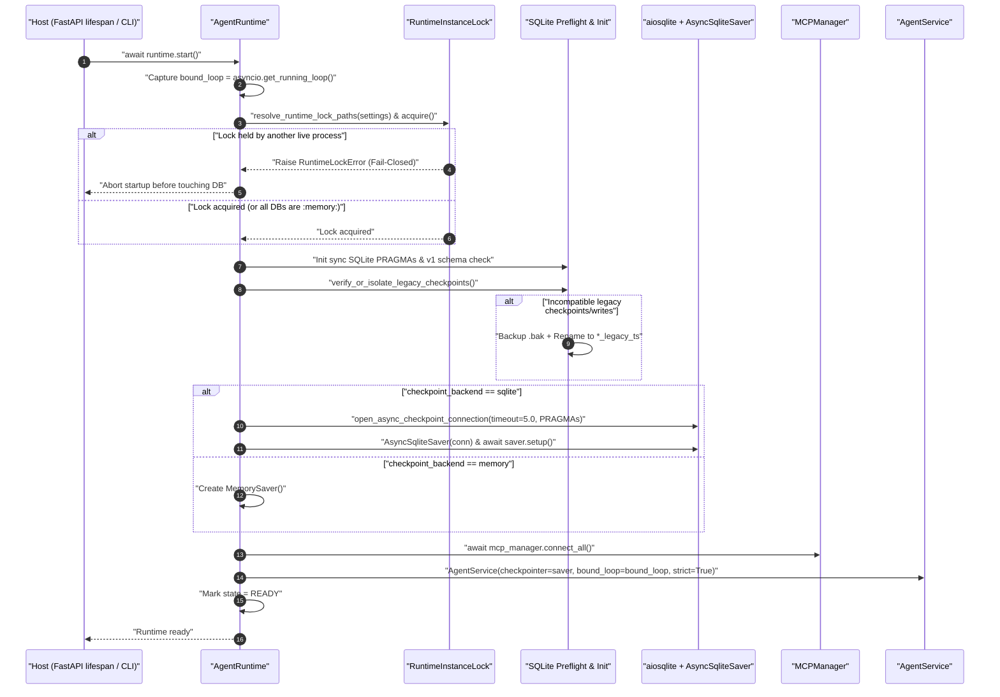
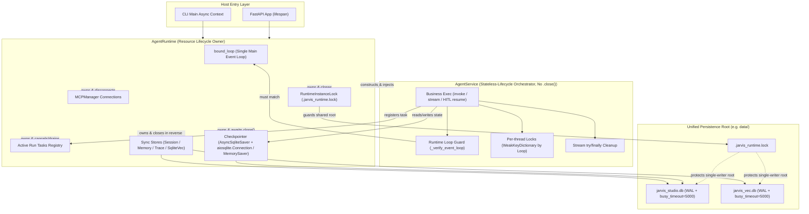
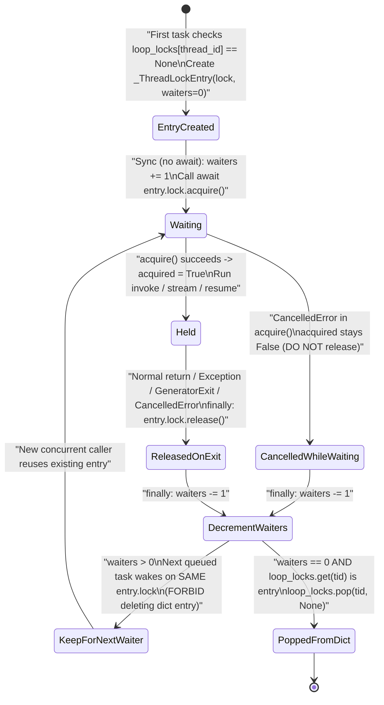
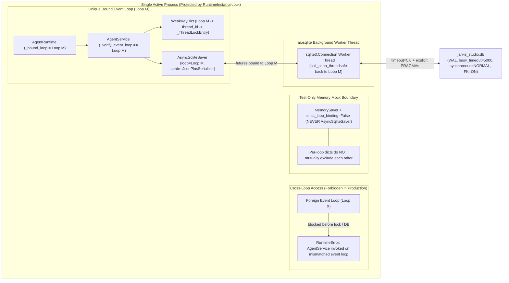

# Jarvis Studio V2 — Sprint 1C Phase 2 Architecture & Design Specification (Revised)

> **文档状态**：Architecture Review Remediation Revision（依据独立架构评审结论 `REVISIONS REQUIRED` 完成 R1–R5 全部修订）  
> **Git 基线**：`main @ f68c31996986c28cc7191b8ec3f70f3d5608359e`（Phase 1 已冻结，工作区仅包含本设计文档）  
> **设计范围**：仅覆盖 Sprint 1C Phase 2（`AsyncSqliteSaver` 持久化 Checkpointer、单活 `RuntimeInstanceLock`、统一 `AgentRuntime` 生命周期治理、Per-thread 异步并发锁、`aiosqlite` 治理、历史 `checkpoints` 兼容性与 Fail-Closed 门禁）。**不包含 Phase 3（SQLite HITL 持久化）与 Phase 4（Task 持久状态机、Session 级联清理、Resume Trace）。**

---

## 第 1 节：修订范围与架构决策摘要（Revision Summary: R1–R5）

| 修订项 | 原设计缺陷 | 修订后核心架构决策 |
| :--- | :--- | :--- |
| **R1 — `RuntimeInstanceLock` 启用条件** | 错误地以 `checkpoint_backend == "sqlite"` 作为加锁前提，`memory` 后端即使指向共享磁盘目录也无锁。 | **只要使用共享持久化资源即强制加锁**（含 `checkpoint_backend="memory"` 但 `sqlite_path` 或 `vector_db_path` 指向磁盘文件）；仅全 `:memory:` 或完全隔离无共享状态临时模式才免锁。锁路径由统一 Persistence Root 推导并覆盖同根全部 DB。 |
| **R2 — Event Loop 与 Per-thread Lock 并发模型** | 对 `WeakKeyDictionary` 按 Loop 隔离误述过轻，缺乏运行期循环强校验与完整的 waiter 引用计数 / 取消交接算法。 | 确立生产铁律：**1 个 `AgentRuntime` 严格绑定唯一 1 个主 Event Loop**；禁止跨 Loop 复用/并发，跨 Loop 不共享 `asyncio.Lock` 互斥；增加 `_verify_event_loop()` 运行期硬校验，区分生产规则与测试纯 `MemorySaver` Mock；给出锁创建/递增/等待取消/持有取消/清零删除完整算法。 |
| **R3 — `aiosqlite` `busy_timeout` 事实纠偏** | 错称 `aiosqlite.connect()` 默认 `busy_timeout = 0`。 | **以实测为准纠偏**：`aiosqlite.connect()` 透传 `**kwargs` 给 `sqlite3.connect()`，后者默认 `timeout=5.0` 秒（对应 `PRAGMA busy_timeout = 5000`）。仍要求显式传 `timeout=5.0` 与 `PRAGMA busy_timeout = 5000`，以统一配置常量并补齐 `AsyncSqliteSaver.setup()` 未设置的 `WAL` 之外 PRAGMA（`synchronous=NORMAL`、`foreign_keys=ON`）。 |
| **R4 — 历史 `checkpoints` 兼容性与 Fail-Closed** | 未定义 `AsyncSqliteSaver.setup()` 对旧表的真实边界、不兼容处置策略及无持久 HITL 记录时的恢复门禁。 | 明确 `setup()` 仅执行 `CREATE TABLE IF NOT EXISTS` 与 `PRAGMA journal_mode=WAL`、**不校验或升级旧列**；设计 Pre-Setup 列结构与可读性预检、先备份后重命名归档策略；在无活跃 HITL 记录时对历史中断执行严格 **Fail-Closed**。同时如实登记实时库 `data/jarvis_studio.db` 待授权实检缺口。 |
| **R5 — Runtime 资源所有权重构** | `AgentService`、FastAPI `lifespan` 与全局单例职责混杂，缺少活跃任务追踪与有序关闭规范。 | 引入统一 **`AgentRuntime`（宿主运行时）** 持有主 Loop、`RuntimeInstanceLock`、Checkpointer、`aiosqlite` 连接、活跃 Run Task、MCP 与持久 Store 关闭钩子；**`AgentService` 专司业务编排与 Per-thread Lock 且不暴露 `.close()`**（严格兼容 Phase 1 `tests/test_persistence_sqlite.py:1103` 契约）。 |

---

## 第 2 节：Phase 1 冻结基础与现有调用链约束

1. **Phase 1 已冻结同步基石（必须严格复用、不得破坏）**：
   - `src/jarvis_studio/core/persistence/sqlite.py`：已定义 `DEFAULT_BUSY_TIMEOUT_MS = 5000`、`open_sync_connection()`、`initialize_sqlite_database()`、`get_path_lock()`、`normalize_db_path()`、`is_memory_db_path()`。
   - `src/jarvis_studio/core/persistence/migrations.py`：已定义独立核心库 `APP_SCHEMA_VERSION = 1`（`chat_sessions`、`chat_messages`、`ltm_memories`、`agent_conversation_traces`）与向量库 `VEC_SCHEMA_VERSION = 1`（`doc_files`、`doc_chunks`）。
   - `tests/conftest.py`：通过 `_isolate_test_databases` 将全量测试的 `SQLITE_DB_PATH` 与 `VECTOR_DB_PATH` 重定向到 session 级临时目录，设置 `CHECKPOINT_BACKEND = "memory"` 与 `WORKSPACE_ROOT = "./data/test_workspace"`；`_reset_runtime_singletons()` 清理模块级运行时单例。
   - `tests/test_persistence_sqlite.py:1103`：存在冻结断言 `assert not hasattr(agent_mod.AgentService, "close")`，**Phase 2 严禁向 `AgentService` 添加 `.close()` 方法**。

2. **现有 Checkpointer 与入口调用链**：
   - `src/jarvis_studio/agent/checkpoints/saver.py` 当前 `get_checkpointer()` 忽略参数并在模块级 `_cached_checkpointer` 缓存单个 `MemorySaver()`。
   - `src/jarvis_studio/agent/graph.py` 的 `build_agent_graph(checkpointer=None)` 在未显式传入 `checkpointer` 时回退调用 `get_checkpointer()`。
   - `src/jarvis_studio/service/agent_service.py` 通过全局延迟函数 `get_agent_service()` 创建默认 `AgentService()`；API 路由 `api/routes/chat.py`、`api/routes/approvals.py` 与 `cli/main.py` 均直接调用 `get_agent_service()`。
   - `src/jarvis_studio/api/app.py` 的 `lifespan` 当前只管 `MCPManager` 建连与断开，不持有数据库、Checkpointer 或运行中任务。

---

## 第 3 节：`RuntimeInstanceLock` 单活保护规范（R1）

### 3.1 为什么不能用 `checkpoint_backend == "sqlite"` 决定是否加锁

即便将配置切换为 `CHECKPOINT_BACKEND=memory`，只要 `sqlite_path`（默认 `data/jarvis_studio.db`）或 `vector_db_path`（默认 `data/jarvis_vec.db`）指向磁盘文件，进程仍会持续写入共享持久化数据库与工作区状态：
- FastAPI 常驻服务与第二个 API 进程或 CLI 进程若同时以 `memory` Checkpointer 连接同一个 `data/` 持久化目录，将导致 `chat_sessions`、`ltm_memories`、`agent_conversation_traces` 与 `jarvis_vec.db` 多写者竞争与语义错乱，并破坏未来 Phase 3/4 对单活跃 Runtime 实例 ID 的前提假设。
- 因此，**`RuntimeInstanceLock` 保护的是整个共享 Persistence Root（所有磁盘持久库及单活 Runtime 写者身份），与 Checkpointer 后端选择正交**。

### 3.2 激活判定规则与例外边界

| 运行模式 / 配置组合 | `checkpoint_backend` | `sqlite_path` / `vector_db_path` | 是否必须获取 `RuntimeInstanceLock` | 说明 |
| :--- | :--- | :--- | :---: | :--- |
| **标准生产模式（默认）** | `"sqlite"` | 磁盘文件（如 `data/jarvis_studio.db`、`data/jarvis_vec.db`） | **是（强制）** | 保护同一持久根目录单活。 |
| **混合磁盘模式（如开发调试 `memory`）** | `"memory"` | 至少一个为磁盘文件（非 `:memory:`） | **是（强制）** | 仍写入磁盘 Session/LTM/Trace/RAG 库，不可豁免。 |
| **独立临时目录隔离模式（如 pytest `tmp_path`）** | `"memory"` 或 `"sqlite"` | 各自独享 `tmp_path` 下的磁盘文件 | **是（自然无冲突）** | 锁挂载在各自 `tmp_path` 内，不与生产目录冲突也不互相阻塞；无需特殊绕行逻辑。 |
| **完全隔离纯无盘模式** | `"memory"` | `sqlite_path == ":memory:"` **且** `vector_db_path == ":memory:"` | **否（唯一豁免）** | 零磁盘持久 DB 共享状态，允许并发多实例存在。 |

> 补充规则：当外部显式调用 `Runtime` 时禁止提供“跳过共享磁盘路径锁”的生产开关；只有当所有持久 DB 路径均归一化为 `":memory:"`（通过 Phase 1 的 `is_memory_db_path()` 判定）时，才允许返回空锁句柄（No-op Lock）。

### 3.3 Persistence Root 推导、锁路径规则与多库覆盖范围

拟新增模块 `src/jarvis_studio/core/persistence/runtime_lock.py`：

1. **Persistence Root 与锁路径推导算法（`resolve_runtime_lock_paths`）**：
   - 将配置中的 `sqlite_path` 与 `vector_db_path` 经 `normalize_db_path()` 检查后，过滤掉所有 `":memory:"` 路径。
   - 若集合为空（全 `:memory:`）：返回空列表 `[]`（豁免加锁）。
   - 若存在至少一个文件型 DB 路径：对每个文件型 DB 路径取规范化父目录 `Path(p).resolve().parent`（即对应持久化目录）。
   - 对父目录去重并按规范化路径字符串**字典序排序**（固定顺序加锁，彻底杜绝跨目录并发配置时的死锁）：
     - 主持久化目录（当 `sqlite_path` 非 `:memory:` 时，即为 `Path(sqlite_path).resolve().parent`，默认即 `data/`）对应主锁文件 `<dir>/.jarvis_runtime.lock`；
     - 默认部署下 `jarvis_studio.db` 与 `jarvis_vec.db` 同处于 `data/`，去重后**仅生成 1 把锁 `data/.jarvis_runtime.lock`**；
     - 若人为将 `vector_db_path` 配置到不同目录，去重排序后对该第二目录同时持有一把 `<vec_dir>/.jarvis_runtime.lock`，确保两库均受单活互斥保护。
2. **多数据库文件保护范围声明**：
   - 同根 `data/.jarvis_runtime.lock` 的保护语义覆盖该目录下的全部运行时持久化资产：
     - `jarvis_studio.db`（`chat_sessions`、`chat_messages`、`ltm_memories`、`agent_conversation_traces`、`checkpoints`、`writes`，以及后续 Phase 3/4 规划的 `hitl_approval_requests`、`agent_tasks`）与 SQLite WAL/SHM sidecar；
     - `jarvis_vec.db`（`doc_files`、`doc_chunks`、`vec_chunks`）及其 sidecar；
     - 同一持久化根关联的活跃后台写者身份（`runtime_instance_id`）。
3. **跨平台内核非阻塞锁语义与不删除锁文件原则**：
   - POSIX 使用 `fcntl.flock(fd, fcntl.LOCK_EX | fcntl.LOCK_NB)`；Windows 使用 `msvcrt.locking(fd, msvcrt.LK_NBLCK, 1)`（锁定第 1 字节）。
   - 获锁后清空并写入只读观测元数据（`pid`、`runtime_instance_id`、`started_at`、`checkpoint_backend`、`persistence_roots`），不释放 fd；失败立即抛出 `RuntimeLockError`（携带当前锁内可见元数据诊断信息，Fail-Closed 拒绝启动）。
   - **严禁在 `release()` 时 `unlink()` 删除 `.jarvis_runtime.lock` 文件**：删除正在竞争的 inode 会造成 A 关闭删除旧文件同时 B 基于新 inode 重建并获锁的双活经典竞态。锁的生命周期完全由 OS 内核句柄维护：正常关闭先 `unlock` 再 `close(fd)`；进程崩溃由内核自动回收句柄锁。

---

## 第 4 节：Event Loop 绑定与 Per-thread Lock 并发模型（R2）

### 4.1 生产环境唯一核心不变量（Production Invariant）

1. **单 Runtime 单主 Loop 不变量**：一个活跃 `AgentRuntime` 实例在生命周期内**严格绑定唯一一个主 Event Loop（`bound_loop`）**。
2. **所有执行入口同环不变量**：所有通过该运行时调度的 `AgentService` 异步方法（`invoke_agent`、`stream_agent`、`resume_approval`、`stream_resume_approval`）在生产环境中**必须且只能在 `bound_loop` 上执行**。
3. **禁止跨 Loop 复用与并发**：
   - `aiosqlite.Connection` 通过内部后台工作线程运行 SQLite，其结果 `Future` 依赖创建或等待时绑定的事件循环通过 `call_soon_threadsafe` 唤醒恢复；`AsyncSqliteSaver.__init__` 亦直接保存了 `self.loop = asyncio.get_running_loop()` 与单循环 `self.lock = asyncio.Lock()`。
   - **因此绝对禁止在生产代码中将同一 `AgentService` 或 `AsyncSqliteSaver` 实例跨多个 Event Loop 复用或并发调用**。

### 4.2 为什么 `WeakKeyDictionary` 不等于“支持跨 Loop 并发”

设计中将 `AgentService._thread_locks` 定义为 `WeakKeyDictionary[asyncio.AbstractEventLoop, dict[str, _ThreadLockEntry]]`：
- **隔离作用域真相**：在 Python 中，一把 `asyncio.Lock` 绑定于单一 Event Loop。用 `WeakKeyDictionary` 按 `loop` 建桶，仅仅是为了：
  1. 防止测试框架先后创建/销毁多个事件循环时，死去旧循环上的字典条目无限泄漏（Loop GC 后桶自动回收）；
  2. 防止不同测试之间旧 Loop 创建的 `asyncio.Lock` 被后续 Loop 误用而触发 `attached to a different loop`。
- **关键警示**：`locks[Loop_A]["thread_1"]` 与 `locks[Loop_B]["thread_1"]` 是**两把完全无关的锁，互不产生任何互斥作用**！若放任生产代码在两个 Loop 上同时执行同一 `thread_id`，`WeakKeyDictionary` **不会阻止状态写撕裂**。生产安全完全建立在“**`AgentRuntime` 强制单 Loop + `RuntimeInstanceLock` 强制同根单实例**”之上。

### 4.3 运行期结构化校验（不依赖文档约定）与测试兼容分层

| 执行模式 | 识别机制（结构化代码控制） | Event Loop 校验策略 | 说明 |
| :--- | :--- | :--- | :--- |
| **生产 / 持久化托管模式** | 通过 `AgentRuntime` 创建，或注入了非内存 Checkpointer（如 `AsyncSqliteSaver`），或未显式开启测试兼容标志 | **强制严格单环门禁（不可关闭）** | 在 `AgentService` 初始化/首次绑定时记录 `_bound_loop`；任一异步入口调用前执行 `_verify_event_loop()`，若 `asyncio.get_running_loop() is not self._bound_loop` **立即抛出 `RuntimeError`**。 |
| **直接单元测试 Mock 模式** | 测试中直接构造 `AgentService(checkpointer=MemorySaver(), ...)` 或 `AgentService(graph=...)` | 默认若只在同一循环（如单个 `TestClient` 或单个 `asyncio.run`）运行则正常通过 | 兼容现有 `tests/test_streaming.py:73` 与 `tests/test_security_hardening_1a2.py:73` 同步/单循环直构用法。 |
| **纯内存多循环串行测试特例** | 若个别历史内存测试确需跨 AnyIO BlockingPortal（`TestClient`）与 pytest-asyncio 循环顺序复用同一纯 `MemorySaver` mock | 仅当**同时满足** `strict_loop_binding=False` **且** `checkpointer` 非 `AsyncSqliteSaver`（纯内存 `MemorySaver`）时允许切换桶 | 严禁任何持久化 Checkpointer 或 `AgentRuntime` 托管实例使用 `strict_loop_binding=False`；生产入口始终 `strict_loop_binding=True`。 |

> **关键补充**：当前 `get_agent_service()` 全局懒加载模式在 Phase 2 应重构为优先解析当前活跃 `AgentRuntime` 所持有的受控 `AgentService`（保证同一 `bound_loop`）；在 FastAPI `lifespan` 启动时就绑定到 ASGI 主 Event Loop，在 CLI 启动时就绑定到 `asyncio.run()` 主 Event Loop，从结构上消除“服务在 Loop 启动前或跨不同 `asyncio.run()` 随意游走”的隐患。

### 4.4 Per-thread Lock 完整并发控制与引用计数清理算法

为解决“高并发排队下提前删除字典项导致为同一 `thread_id` 生成两把 `asyncio.Lock`”及“等待期/持有期 `CancelledError` 状态破坏”问题，设计如下不可分割操作时序：

```python
@dataclass
class _ThreadLockEntry:
    lock: asyncio.Lock
    waiters: int = 0  # 涵盖：所有正在等待锁的协程 + 当前正在持有锁的协程
```

**`_acquire_thread_lock(thread_id: str)` 完整协议（按步骤说明）**：
1. **Loop 强校验**：先调用 `loop = self._verify_event_loop()`，确保当前在唯一合法 Loop 上（严格模式下跨环在此直接抛 `RuntimeError`，不会污染锁字典）。
2. **原子查表与登记等待计数（无 `await`）**：
   - `loop_locks = self._thread_locks.setdefault(loop, {})`
   - `entry = loop_locks.get(thread_id)`；若为 `None`，新建 `_ThreadLockEntry(lock=asyncio.Lock(), waiters=0)` 并写入 `loop_locks[thread_id]`。
   - **立即执行 `entry.waiters += 1`**。由于从查表到 `waiters += 1` 全程无任何 `await` 让出控制权，单事件循环内保证绝对原子性：任何同时在等待或即将进入该 `thread_id` 的协程必定看到同一个 `entry`，且 `waiters` 在进入阻塞等待前即大于等于 1。
3. **阻塞等待拿锁（可被取消窗口）**：
   - 置 `acquired = False`；
   - 执行 `await entry.lock.acquire()`；若成功返回，立即置 `acquired = True`，进入 `yield` 临界区执行图推进与状态落盘。
4. **`finally` 统一状态机收尾**：
   - **若 `acquired` 为 `True`（持锁期正常返回、业务异常、SSE `.aclose()` 触发 `GeneratorExit` 或外层取消触发 `CancelledError`）**：必须先执行 `entry.lock.release()`，唤醒同一 `entry.lock` 队列中的下一位等待者。
   - **若 `acquired` 为 `False`（等待锁期间在 `await entry.lock.acquire()` 处被 `CancelledError` 打断）**：**绝不调用 `entry.lock.release()`**，直接向下进入计数器递减，保持底层 `asyncio.Lock` 的当前真实持有权归属原有协程，不损坏锁队列。
   - **递减与条件回收**：执行 `entry.waiters -= 1`。**只有同时满足 `entry.waiters == 0` 且 `loop_locks.get(thread_id) is entry` 时，才执行 `loop_locks.pop(thread_id, None)`**。

**为什么杜绝并发双锁竞态**：只要队列中仍有后续等待者（哪怕该等待者刚刚被唤醒、尚未执行到 `acquired = True`），`entry.waiters` 必然 `>= 1`，前一个释放者绝不会删除 `loop_locks[thread_id]`；后续新到达协程会精确命中并复用同一 `entry`；只有当当前循环中该 `thread_id` 既无持有者也无任何排队等待者时，才会清理键，防止内存无限增长。

---

## 第 5 节：`aiosqlite`、PRAGMA 与 `AsyncSqliteSaver` 连接治理（R3）

### 5.1 对原设计关于默认 `busy_timeout` 的事实纠偏（实证记录）

原草案第 3.3 节声称“`aiosqlite.connect` 默认 `busy_timeout` 等价于 0”的说法**不准确**，经在当前项目 `.venv`（Python 3.12、`langgraph-checkpoint-sqlite==3.1.1`、`aiosqlite`）实测核验，真实机制如下：
1. `aiosqlite.connect(database, *, iter_chunk_size=64, loop=None, **kwargs)` 直接将 `**kwargs` 原样转发给标准库 `sqlite3.connect(loc, **kwargs)`。
2. 标准库 `sqlite3.connect()` 的内置默认参数为 `timeout=5.0` 秒，Python SQLite 驱动在建连阶段会自动将其转换为 `5000` 毫秒的 SQLite busy handler。
3. `.venv` 实测结果：
   - `sqlite3.connect(p)` -> `PRAGMA busy_timeout` 返回 `(5000,)`；
   - `aiosqlite.connect(p)`（未显式传参）-> `PRAGMA busy_timeout` 返回 `(5000,)`；
   - `aiosqlite.connect(p, timeout=5.0)` + `await conn.execute("PRAGMA busy_timeout = 5000")` -> `PRAGMA busy_timeout` 返回 `(5000,)`；
   - `AsyncSqliteSaver.from_conn_string(p)` -> `PRAGMA busy_timeout` 返回 `(5000,)`，执行 `await saver.setup()` 后 `PRAGMA journal_mode` 返回 `('wal',)`。

### 5.2 仍必须显式封装建连与 PRAGMA 的真实原因

显式构造独立托管的 `aiosqlite.Connection`（而非隐式依赖 `from_conn_string()` 默认行为），原因如下：
1. **消除隐式默认依赖并同源配置**：显式传递 `timeout=DEFAULT_BUSY_TIMEOUT_MS / 1000.0`（即 `5.0`）并执行 `await conn.execute(f"PRAGMA busy_timeout = {DEFAULT_BUSY_TIMEOUT_MS}")`，与 Phase 1 同步层 [`core/persistence/sqlite.py`](file:///d:/myProject/JarvisStudio/src/jarvis_studio/core/persistence/sqlite.py#L24) 的 `DEFAULT_BUSY_TIMEOUT_MS = 5000` 保持单一可配置真源，防止未来外部参数调整时出现同步/异步超时不一致。
2. **补齐 `AsyncSqliteSaver.setup()` 未执行的必需 PRAGMA**：源码核验表明 `AsyncSqliteSaver.setup()` **仅**执行 `PRAGMA journal_mode=WAL;` 与两张表建表语句，**不会**设置 `PRAGMA synchronous = NORMAL` 与 `PRAGMA foreign_keys = ON`。
3. **显式连接所有权可控**：自行通过 `aiosqlite.connect(db_path, timeout=DEFAULT_BUSY_TIMEOUT_MS / 1000.0)` 建连并在连接后立即应用全部 PRAGMA，再传入 `AsyncSqliteSaver(conn)`：
   - 对非 `:memory:` 文件型库依次设置：`PRAGMA journal_mode = WAL`、`PRAGMA busy_timeout = 5000`、`PRAGMA synchronous = NORMAL`、`PRAGMA foreign_keys = ON`（与 Phase 1 同步库 PRAGMA 完全对齐，避免混合模式下写连接参数漂移）；
   - 由 `AgentRuntime` 持有该 `conn` 句柄，关闭时显式 `await conn.close()`，并确保 `conn._thread` 工作线程完整退出，实现 `-W error::ResourceWarning` 零警告。

---

## 第 6 节：历史 `checkpoints` 兼容性与 Fail-Closed 策略（R4）

### 6.1 `AsyncSqliteSaver` 期望 Schema 与 `setup()` 真实行为

实测 `langgraph-checkpoint-sqlite==3.1.1` 的 `AsyncSqliteSaver.setup()` 仅运行以下三条语句：
- `PRAGMA journal_mode=WAL;`
- `CREATE TABLE IF NOT EXISTS checkpoints (thread_id TEXT NOT NULL, checkpoint_ns TEXT NOT NULL DEFAULT '', checkpoint_id TEXT NOT NULL, parent_checkpoint_id TEXT, type TEXT, checkpoint BLOB, metadata BLOB, PRIMARY KEY (thread_id, checkpoint_ns, checkpoint_id));`
- `CREATE TABLE IF NOT EXISTS writes (thread_id TEXT NOT NULL, checkpoint_ns TEXT NOT NULL DEFAULT '', checkpoint_id TEXT NOT NULL, task_id TEXT NOT NULL, idx INTEGER NOT NULL, channel TEXT NOT NULL, type TEXT, value BLOB, PRIMARY KEY (thread_id, checkpoint_ns, checkpoint_id, task_id, idx));`

`AsyncSqliteSaver` 使用 `JsonPlusSerializer`（`pickle_fallback=False`）进行反序列化，支持的 `type` 仅限 `"null"`、`"bytes"`、`"bytearray"`、`"json"`、`"msgpack"`。**`setup()` 本身不会校验旧表是否缺列、不自动执行 `ALTER TABLE`、也不会验证既有行是否能反序列化**：在临时库验证中，当 `checkpoints` 表缺少 `checkpoint_ns`/`parent_checkpoint_id` 时，`setup()` 仍返回成功，直至首次运行 `aget_tuple()` 才抛出 `sqlite3.OperationalError: no such column`。

### 6.2 已知事实与实库未检明缺口（严格不触碰真实 `data/` 库）

- **既有只读勘察文档记录**（见 [`SPRINT_1C_PERSISTENCE_RECONNAISSANCE.md`](file:///d:/myProject/JarvisStudio/docs/architecture/SPRINT_1C_PERSISTENCE_RECONNAISSANCE.md#L162) 与 [`SPRINT_1C_PERSISTENCE_DESIGN.md`](file:///d:/myProject/JarvisStudio/docs/architecture/SPRINT_1C_PERSISTENCE_DESIGN.md#L945)）：`data/jarvis_studio.db` 磁盘上已经存在 `checkpoints`（5 行）和 `writes`（8 行）两张旧表，其主键分别记录为 `(thread_id, checkpoint_ns, checkpoint_id)` 与 `(thread_id, checkpoint_ns, checkpoint_id, task_id, idx)`。
- **尚未验证的实库明细（Open Verification Item）**：遵循本轮设计修订约束（禁止访问或修改真实数据库），本轮**未打开 `data/jarvis_studio.db`**，因此尚待在 Phase 2 实施前置只读核验中确认两项实情：(1) 该既有 `checkpoints`/`writes` 的完整 `PRAGMA table_info` 列清单是否 100% 匹配上述 `3.1.1` DDL；(2) 该 5 行 `checkpoints` 的 `type` 编码与 `checkpoint`/`metadata` BLOB 载荷是否均能被 `JsonPlusSerializer.loads_typed` 无异常读取，以及其中是否残存旧中断状态。

### 6.3 Pre-Setup 兼容性预检与不兼容隔离归档方案

在 Phase 2 运行时初始化阶段、**调用 `await saver.setup()` 之前**，必须执行只读/受控预检（拟实现函数 `verify_or_isolate_legacy_checkpoints()`，不得跳过预检直接对未知历史库盲跑 `setup()`）：

1. **步骤 1 — 存在性与列结构校验**：
   - 通过 `PRAGMA table_info(checkpoints)` 与 `PRAGMA table_info(writes)` 检查表与列集合。
   - 若两表均不存在：直接放行交由 `await saver.setup()` 建新表。
   - 若表已存在：核对必需列（`checkpoints`: `{thread_id, checkpoint_ns, checkpoint_id, parent_checkpoint_id, type, checkpoint, metadata}`；`writes`: `{thread_id, checkpoint_ns, checkpoint_id, task_id, idx, channel, type, value}`）及主键完整性。
2. **步骤 2 — 历史行格式试读校验（不修改原行）**：
   - 在结构校验通过后，针对有限存量旧行检查 `checkpoints.type` 与 `writes.type` 是否全部落入受支持集合 `{None, 'null', 'bytes', 'bytearray', 'json', 'msgpack'}`，并对最新/存量记录使用 `JsonPlusSerializer().loads_typed(...)` 与 `json.loads(...)` 做无副作用试读验证。
3. **步骤 3 — 不兼容处置策略（先备份、再隔离归档、不静默破坏）**：
   - 一旦发生列缺失（如结构来自不兼容旧版本）、半表存在（只有 `checkpoints` 无 `writes` 或反之）、或存量行出现未知 `type` / `loads_typed` 反序列化异常：
     - **先备份**：调用 Phase 1 的一致备份与只读验证机制生成 `.bak` 快照；
     - **再归档隔离（非直接 `DROP`）**：在 `BEGIN IMMEDIATE` 事务内将旧表重命名为时间戳隔离表（例如 `ALTER TABLE checkpoints RENAME TO checkpoints_legacy_<ts>` 与 `ALTER TABLE writes RENAME TO writes_legacy_<ts>`），随后再执行 `await saver.setup()` 生成洁净新表并输出明确 warning 日志（含归档表名与兼容原因），确保历史现场完整可审计、且不会拖垮启动可用性。
   - 若步骤 1 与步骤 2 均完全兼容：直接保留原表并允许 `await saver.setup()` 幂等通过。

### 6.4 历史 Checkpoint 存在但无对应 HITL Approval 时的 Fail-Closed 安全处理

在 Phase 2 阶段，`HITLManager` 仍为纯内存实现（HITL 持久化规划在 Phase 3）；即便在 Phase 3 之后，v0 阶段遗留的 `checkpoints` 行也不存在对应的 `hitl_approval_requests` 数据库记录。为此确立强安全规则：
1. **禁止仅凭 Checkpoint 恢复敏感工具执行**：当任意历史 `thread_id` 的 Checkpoint 存在未完结中断（如节点停留在 `approval_gate`），若 `HITLManager` 中不存在与之 `thread_id`、`approval_id`、`tool_call_id`、`arguments_hash` 完全匹配的活跃 `PENDING` / `APPROVED` 记录：
   - [`verify_approval_context()`](file:///d:/myProject/JarvisStudio/src/jarvis_studio/service/agent_service.py#L431-L489) **必须返回 `False`（API 返回安全 404，不泄漏请求存在性）**；
   - `resume_approval()` / `stream_resume_approval()` **必须 Fail-Closed 拒绝恢复执行**，绝不可在缺失有效审批记录时回补创建新批准状态或跳过授权校验直接执行 `tools`。
2. **新对话轮次不误触发陈旧工具节点**：用户如对包含过期孤儿中断的历史 `thread_id` 发送全新提问，应能显式识别该 `thread_id` 当前存在“无有效审批宿主绑定的历史挂起中断”并安全拒绝对旧 `interrupt` 续跑高危工具（要求清理重置线程断点或开启新会话），绝不出现重启后“无审批记录却静默继续执行历史高危工具”的安全裂口。

---

## 第 7 节：`AgentRuntime` 与 `AgentService` 资源所有权及生命周期架构（R5）

### 7.1 核心所有权边界（严守 Phase 1 `AgentService` 无 `.close()` 契约）

为了既能彻底接管异步连接、文件锁、MCP 与运行期任务关闭，又不违背 Phase 1 冻结测试 [`test_persistence_sqlite.py:1103`](file:///d:/myProject/JarvisStudio/tests/test_persistence_sqlite.py#L1103)（`assert not hasattr(agent_mod.AgentService, "close")`），职责作如下清晰拆分：

| 层次与组件 | 拥有权（Owns）与核心职责 | 明确不负责（Does NOT Own） |
| :--- | :--- | :--- |
| **`AgentRuntime`** *(拟新增：`src/jarvis_studio/core/runtime/agent_runtime.py`)* | 1. **主 Event Loop 绑定**（`bound_loop`）与状态机（`CREATED -> STARTING -> READY -> SHUTTING_DOWN -> CLOSED`）<br>2. **`RuntimeInstanceLock` 持有与释放**<br>3. **DB 前置初始化与历史 Checkpoint 兼容性预检**<br>4. **`aiosqlite.Connection` 与 `AsyncSqliteSaver` 打开、PRAGMA 应用、`setup()` 与关闭**<br>5. **构建并托管唯一绑定 `bound_loop` 的 `AgentService`**<br>6. **活跃 Run Task 追踪注册与关闭期取消排空**<br>7. **`MCPManager` 建连与断开协调**<br>8. **持久 Stores（`SessionService` / `MemoryStore` / `TraceStore` / `SqliteVecStore`）关闭协调与异常收集** | 不直接承担 LLM prompt 拼装、LangGraph 节点路由、HITL 策略判断与 SSE 事件格式编码。 |
| **`AgentService`** *(`src/jarvis_studio/service/agent_service.py`)* | 1. **业务执行编排**：`invoke_agent` / `stream_agent` / 上下文加载 / RouteGuard<br>2. **运行期 Event Loop 强校验**（`_verify_event_loop()`）<br>3. **Per-thread 异步并发锁**（`WeakKeyDictionary` + `_ThreadLockEntry` 引用计数清理）<br>4. **HITL 恢复与校验编排**：`verify_approval_context` / `resume_approval` / `stream_resume_approval`<br>5. **单次流式与生成器退出清理**：`try/finally` 停止心跳任务、关闭局部异步生成资源并上报任务生命周期钩子 | **不拥有** `RuntimeInstanceLock`、`aiosqlite.Connection` 全局寿命、MCP 进程组及 Store 句柄；**不暴露 `.close()` 方法**。 |
| **宿主入口层** *(`api/app.py`、`cli/main.py`)* | 通过 FastAPI `lifespan` 或 CLI 顶层 `async with AgentRuntime.open(...)` 持有并驱动 `AgentRuntime` 启动与关闭，在关闭前禁止新请求接入业务层。 | 不在路由处理函数或子模块内部各自散乱开关数据库与连接。 |

### 7.2 模块全局状态收敛与兼容性

- **FastAPI `lifespan`（`src/jarvis_studio/api/app.py`）**：`lifespan` 进入时创建并 `await runtime.start()`，挂载 `app.state.agent_runtime = runtime` 与进程级活跃 Runtime 指针；退出 `finally` 时无条件执行 `await runtime.shutdown()`。
- **CLI（`src/jarvis_studio/cli/main.py`）**：`chat()` 等异步交互主函数在当前唯一 `asyncio.run()` 主循环内通过 `async with AgentRuntime.open(...)` 启动、运行并退出关闭，避免 CLI 退出时遗留未关闭的 `aiosqlite` 后台线程。
- **`get_agent_service()` 行为约定**：优先返回当前活跃 `AgentRuntime.agent_service`；当没有通过 `AgentRuntime` 启动（例如单元测试直接构图 `AgentService(checkpointer=MemorySaver())` 或 `AgentService(graph=...)`）时保留纯业务构图兼容，但**禁止在无托管容器下隐式创建游离未托管的 `AsyncSqliteSaver` / `aiosqlite.Connection`**（配置为 `sqlite` 时必须经由 `AgentRuntime` 显式启动托管，防止游离连接与后台线程泄漏）。

---

## 第 8 节：核心架构与生命周期视图（5 张强制 Mermaid 图）

### 8.1 图 1：Runtime 启动与初始化时序图



### 8.2 图 2：Runtime 运行与资源所有权图



### 8.3 图 3：Runtime 关闭时序图

```mermaid
sequenceDiagram
    autonumber
    participant Host as "Host (FastAPI lifespan / CLI)"
    participant RT as "AgentRuntime"
    participant Tasks as "Active Run Tasks"
    participant Conn as "aiosqlite.Connection"
    participant MCP as "MCPManager"
    participant Stores as "Session / Memory / Trace / Vec Stores"
    participant Lock as "RuntimeInstanceLock"

    Host->>RT: "await runtime.shutdown()"
    RT->>RT: "Set state = SHUTTING_DOWN (reject new runs Fail-Closed)"

    RT->>Tasks: "Cancel & await active run tasks (with bounded timeout)"
    Note right of Tasks: "Allows AgentService try/finally & ThreadLock release to finish cleanly"

    RT->>Conn: "await aiosqlite_conn.close() (wait worker thread stop)"
    Note right of Conn: "Isolate exceptions into cleanup_errors"

    RT->>MCP: "await mcp_manager.disconnect_all(registry)"
    RT->>Stores: "Close MemoryStore, TraceStore, SessionService, SqliteVecStore"
    Note right of Stores: "Each step wrapped in try/except collector; never mask prior errors"

    RT->>Lock: "release() -> OS unlock & close(fd) (do NOT unlink)"
    RT->>RT: "Set state = CLOSED & clear runtime singleton ref"
    alt "cleanup_errors non-empty"
        RT-->>Host: "Raise single error or BaseExceptionGroup"
    else "All clean"
        RT-->>Host: "Shutdown complete (Zero ResourceWarning)"
    end
```

### 8.4 图 4：Thread Lock 生命周期图



### 8.5 图 5：Checkpointer 与 Event Loop 绑定关系图



---

## 第 9 节：Phase 2 实施文件范围与验收测试矩阵

### 9.1 实施范围（仅 Phase 2，禁止越界进入 Phase 3/4）

- `pyproject.toml` / `uv.lock`（仅若 `aiosqlite` 尚未显式写入 `dependencies` 时按规范补齐锁定声明，不新增多余第三方依赖）。
- `src/jarvis_studio/core/persistence/runtime_lock.py` *(新增)*：`RuntimeInstanceLock`、`RuntimeLockError`、`resolve_runtime_lock_paths()`。
- `src/jarvis_studio/core/persistence/async_sqlite.py` *(新增)*：`open_async_checkpoint_connection()`、`verify_or_isolate_legacy_checkpoints()`。
- `src/jarvis_studio/core/runtime/agent_runtime.py` *(新增)*：`AgentRuntime`（Loop 绑定、锁、Checkpointer、MCP、Store、Run Task 追踪、Graceful Shutdown）。
- `src/jarvis_studio/agent/checkpoints/saver.py` *(重构)*：移除无法关闭且绑死首个循环的全局永生 `_cached_checkpointer` 假逻辑，改为按后端受控构造 Checkpointer 实例。
- `src/jarvis_studio/service/agent_service.py` *(增强)*：增加 `_verify_event_loop()` 强校验与 `WeakKeyDictionary` + `_ThreadLockEntry` 并发控制（覆盖 `invoke_agent`、`stream_agent`、`resume_approval`、`stream_resume_approval`）；保留无 `.close()` 契约。
- `src/jarvis_studio/api/app.py`、`src/jarvis_studio/api/routes/chat.py`、`src/jarvis_studio/api/routes/approvals.py`、`src/jarvis_studio/cli/main.py` *(接入)*：由 `AgentRuntime` 统一托管服务生命周期与活跃 Run 注册。
- `tests/conftest.py`、`tests/test_phase2_checkpointer.py` *(或分模块测试)*：覆盖下表全部 Phase 2 验收用例与现有全量回归测试。

### 9.2 Phase 2 验收测试矩阵（含新增 6 项核心测试）

| 测试 ID | 类别 | 测试目标与强制断言 |
| :--- | :--- | :--- |
| **`P2-LOCK-01`** | 实例锁 | `checkpoint_backend="sqlite"` 启动 `AgentRuntime` 获锁后，同 Persistence Root 启动第二个实例必须立即 Fail-Closed 抛 `RuntimeLockError`。 |
| **`P2-LOCK-02`** | 实例锁 | 实例 1 正常 `shutdown()` 或工作子进程崩溃退出（由内核自动释放文件锁）后，实例 2 可成功继承同一 `.jarvis_runtime.lock` 启动。 |
| **`P2-LOCK-03`** | 实例锁 | 并发同时启动两个指向同一 Persistence Root 的实例，严格保证有且仅有 1 个胜出，另一方 Fail-Closed 拒绝。 |
| **`P2-LOCK-04`** *(新增)* | 实例锁 (R1) | **`checkpoint_backend="memory"` 但共享磁盘 `sqlite_path` / `vector_db_path` 时仍强制加锁并互斥**；仅当 `checkpoint_backend="memory"` 且 `sqlite_path == ":memory:"` 且 `vector_db_path == ":memory:"` 时才允许免锁并存。 |
| **`P2-RT-01`** *(新增)* | Loop 校验 (R2) | 绑定 Loop A 的托管 `AgentService` 若在 Loop B 被调用 `invoke_agent` / `stream_agent` / `resume_approval`，入口立即抛出明确 `RuntimeError`，不触碰底层 `aiosqlite`。 |
| **`P2-RT-02`** *(新增)* | Loop 语义 (R2) | 验证两个测试替身在不同 Loop 上使用 `WeakKeyDictionary` 持有各自独立锁对象（证明不能靠其跨环互斥），并与同目录 `RuntimeInstanceLock` 拒绝第二 Loop 宿主共存形成完整闭环。 |
| **`P2-TH-01`** | 线程锁 | 同一 `thread_id` 并发发起两次图推进/恢复请求，严格串行进入 Checkpointer，消息与状态顺序无交错损坏。 |
| **`P2-TH-02`** | 线程锁 | 两个不同 `thread_id` 并发运行，相互不阻塞（`thread_A` 慢执行期间 `thread_B` 可立即完成）。 |
| **`P2-TH-03`** *(新增)* | 线程锁 (R2) | 同 `thread_id` 下 Task 1 持锁、Task 2 & 3 排队；取消等待中的 Task 2 断言其抛 `CancelledError`、**不误释放 Task 1 的锁、不删空活跃 entry**；Task 1 正常结束后 Task 3 在同一 `Lock` 实例上获锁完成，随后 `_thread_locks` 中该 `thread_id` 条目被安全清除且不泄漏。 |
| **`P2-CP-01`** | 持久化 | `AsyncSqliteSaver` 开启后运行对话 -> 完全关闭 `Runtime` A -> 重启新 `Runtime` B 连接同一 `jarvis_studio.db`，`aget_state` 完整恢复消息与检查点历史。 |
| **`P2-CP-02`** | PRAGMA | 验证托管 `aiosqlite.Connection` 实际运行 PRAGMA 为 `journal_mode=wal`、`busy_timeout=5000`、`synchronous=1 (NORMAL)`、`foreign_keys=1 (ON)`。 |
| **`P2-CP-03`** | 历史兼容 (R4) | 分别构造 (a) 与 `3.1.1` DDL 一致的健康历史表与 (b) 缺列或未知 `type` 坏历史表：前者保留复用，后者先通过 Backup API 创建只读验证 `.bak` 再重命名归档 `*_legacy_<ts>` 后安全建新表，不损坏库、不崩溃。 |
| **`P2-CP-04`** | 安全门禁 (R4) | 存在挂起历史 Checkpoint 中断但内存/持久 HITL 表无匹配审批记录时，调用 `verify_approval_context` 返回拒绝（API 404），`resume_approval` 强制 Fail-Closed 拒绝，绝不自动放行高危工具。 |
| **`P2-SHUT-01`** | 优雅关闭 | FastAPI `lifespan` 与 CLI 上下文打开与关闭后，后台无存活 `aiosqlite` 线程，`pytest -W error::ResourceWarning` 零资源警告；`AgentService` 保持无 `.close()` 属性。 |
| **`P2-SHUT-02`** *(新增)* | 优雅关闭 (R5) | 运行中的阻塞流式/调用任务尚未结束时调用 `AgentRuntime.shutdown()`：先阻塞新请求，取消并等待活跃 Run Task 排空完毕，再按序关闭 `aiosqlite`、MCP、Stores，最后释放 `RuntimeInstanceLock`。 |
| **`P2-SHUT-03`** *(新增)* | 异常收集 (R5) | 向单个 Store 或 MCP 断开步骤注入异常，断言 `shutdown()` 不提前中断、仍坚持关闭 `aiosqlite.Connection` 与其余 Store 并释放 `RuntimeInstanceLock`，对外保留并抛出异常信息，且 Zero `ResourceWarning`。 |

---

## 第 10 节：开放验证项与风险登记（Open Questions）

1. **实时 `data/jarvis_studio.db` 历史 5 行 `checkpoints` / 8 行 `writes` 的列结构与 `loads_typed` 实读校验**：
   - 因本轮严格执行“不访问真实数据库”纪律，该 5 行记录的实际列名集合与 `JsonPlusSerializer` 可读性尚未做实盘探针确认；应在 Phase 2 代码实施获批并创建保护性备份后、首次启动迁移测试前先做一次只读结构检验并记录结果。
2. **`test_f3_02` / `test_f3_03` 在测试夹具下的 Event Loop 边界核验**：
   - Phase 2 实施接入 `_verify_event_loop()` 后，需在测试运行期确认现有 `tests/test_security_hardening_1a2.py` 中 `TestClient` BlockingPortal 与 `async def test_*` 之间对测试专设 `MemorySaver` 实例的实际 Loop 调用路径，若存在跨环顺序调用纯内存 Mock，统一通过“仅测试纯内存 Mock 显式配置边界，持久化及 `AgentRuntime` 路径永久不可绕过严格单 Loop 检查”落地。
