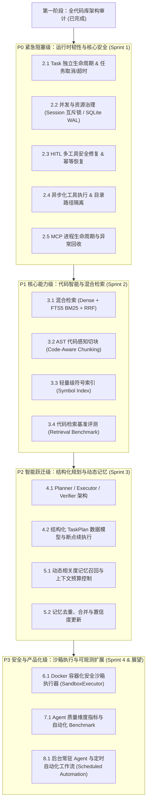

# Jarvis Studio V2 架构演进与工程化路线图 (V2 Evolution Roadmap)

> **制定人**：Jarvis Studio 首席 AI 系统架构师  
> **基线文档**：[`V2_ARCHITECTURE_AUDIT.md`](file:///D:/myProject/JarvisStudio/docs/architecture/V2_ARCHITECTURE_AUDIT.md)  
> **规划目标**：将 Jarvis Studio 从“单 Agent 基础可用”打造成“高可靠、高智能、强安全、全观测”的个人生产级 AI Operating System。  
> **执行纪律**：先解决真实痛点，先可靠性再智能化，小步快跑，每个里程碑具备独立验收闭环与自动化测试覆盖。

---

## 一、 演进矩阵与优先级全景 (Evolution Matrix)



---

## 二、 阶段详细实施规划与验收准则

---

### 第一阶段：全代码库架构审计 (Audit) — 【已完成】
- **实施产出**：输出 [`docs/architecture/V2_ARCHITECTURE_AUDIT.md`](file:///D:/myProject/JarvisStudio/docs/architecture/V2_ARCHITECTURE_AUDIT.md)。
- **核心成果**：清点出 5 项致命缺陷、6 项高危风险、5 项中危设计缺陷，明确技术债务具体发生位置，奠定重构依据。

---

### 第二阶段：运行时可靠性与资源治理 (Runtime Reliability) — 【P0 优先级 / Sprint 1】

#### 2.1 目标与范围
彻底解决服务假死、多工具 HITL 越权、SQLite 数据库锁竞争、客户端断连泄漏、任务无法取消等核心可靠性问题，让 Agent 具备长时间、多轮次、异常可恢复的稳定运行能力。

#### 2.2 具体实施项与技术方案
1. **统一 Task 生命周期抽象**：
   - 建立明确的实体分层：
     - `Session`（对话视图会话，长生命周期）
     - `Thread`（LangGraph 图状态追踪线，包含快照）
     - `Task`（单次任务执行生命周期，从创建到结束）
   - 建立状态机：`CREATED` → `RUNNING` → `WAITING_APPROVAL` → `COMPLETED` / `FAILED` / `CANCELLED` / `TIMEOUT`。
   - 分配唯一 `task_id`，在 `TaskManager` 中维护活跃 `asyncio.Task` 句柄，提供 `cancel_task(task_id)` API。
2. **并发与资源治理**：
   - **Session 级互斥锁**：每个 `thread_id` 维护一把 `asyncio.Lock`，防止同一会话并发执行撕裂图状态。
   - **SQLite 并发加固**：
     - 统一连接工厂，为所有模块连接执行：
       ```sql
       PRAGMA journal_mode = WAL;
       PRAGMA busy_timeout = 5000;
       PRAGMA synchronous = NORMAL;
       ```
     - 消除 `database is locked` 错误。
3. **HITL 安全性修复与幂等恢复**：
   - 修复多工具并行调用时的审批漏洞：当单轮存在多个敏感工具时，一次性生成聚合审批或逐一队列阻断，禁止未授权工具借道执行。
   - 审批提交增加幂等性检查：已被 `APPROVED` / `REJECTED` 的记录禁止二次提交。
   - 审批记录落盘持久化至 SQLite `hitl_approval_requests`，杜绝内存字典重启丢失问题。
4. **异步化工具调用与路径逃逸加固**：
   - 工具执行器改造：对所有同步内置工具（`execute_shell_command`、`read_file`、`write_file`）使用 `asyncio.to_thread` 运行，彻底释放主事件循环，消除对 SSE 流和心跳的阻塞。
   - 路径安全加固：`_resolve_safe_path` 严格执行 `path.resolve().is_relative_to(workspace)` 校验，拒绝一切绝对路径与越界逃逸。
5. **SSE 断连与优雅取消**：
   - 网关层传入 `request: Request`，轮询 `await request.is_disconnected()`。
   - 捕获 `asyncio.CancelledError`，将任务状态打标为 `CANCELLED`，清理 Trace，优雅释放资源。
6. **MCP 进程治理**：
   - 增加子进程退出监听与存活探针；
   - Windows 平台使用 `JobObject` 绑定，Linux 平台绑定死父信号，确保主进程退出时子进程绝对不残留。

#### 2.3 依赖关系
- 依赖基础配置与现存数据表结构，无外部新基础设施依赖。

#### 2.4 验收标准与测试套件 (Acceptance Criteria)
- [ ] **自动化测试 1**：10 个不同 Session 并发发送请求，全量成功，SQLite 无任何 locked 报错。
- [ ] **自动化测试 2**：同一 Session 连续发送 2 条消息，后到者按策略排队或拒收，图状态不损坏。
- [ ] **自动化测试 3**：客户端在生成中途断开 SSE 连接，后台任务与大模型协程在 1 秒内被取消，Trace 记录为 `cancelled`。
- [ ] **自动化测试 4**：模拟多工具并行调用（包含 2 个高危工具），两个高危工具均被拦截提示，无越权静默执行。
- [ ] **自动化测试 5**：耗时 5 秒的 Shell 命令执行期间，其他 API 与心跳能够并发流畅响应（主循环未被阻塞）。
- [ ] **自动化测试 6**：强制 kill 进程后，无残留的 MCP 孤儿子进程。

---

### 第三阶段：代码智能与混合检索 (Hybrid RAG + Code Intelligence) — 【P1 优先级 / Sprint 2】

#### 3.1 目标与范围
在现有 `sqlite-vec` 向量检索基座上，升级为具备代码语法结构感知、关键词精确匹配和符号关联的工业级混合检索（Hybrid RAG）系统。

#### 3.2 具体实施项与技术方案
1. **多路混合检索 (Hybrid Retrieval Pipeline)**：
   - **Dense Path**：保留 `sqlite-vec` 进行语义向量召回；
   - **Sparse Path**：在 `jarvis_vec.db` 中建立 SQLite FTS5 全文检索虚拟表，支持 BM25 关键词匹配（精准命中类名、方法名、异常名、配置变量）；
   - **Symbol Path**：基于符号索引表召回符号定义及关联代码；
   - **RRF 融合**：采用倒数排名融合算法（Reciprocal Rank Fusion, 默认 $k=60$），无缝归一化密集与稀疏分数：
     $$RRF(d) = \sum_{m \in \{dense, sparse, symbol\}} \frac{1}{k + rank_m(d)}$$
2. **代码感知分块 (Code-Aware AST Chunking)**：
   - Python 文件采用内置 `ast` 模块进行语法树解析，按 ClassDefinition、FunctionDef、AsyncFunctionDef 语法块独立切分；
   - 切块保留类层级、函数签名、装饰器、导入依赖与行号范围；
   - Markdown 文本按 Heading (`#`, `##`, `###`) 层级切分；
   - 普通文本维持语义长度切分；
   - 彻底解决“函数被截成两半”导致的语义丢失问题。
3. **轻量代码符号索引 (Lightweight Code Symbol Index)**：
   - 新建 `code_symbols` 表（字段：`symbol_name`, `symbol_type`, `file_path`, `line_start`, `line_end`, `parent_symbol`, `signature`）；
   - 在扫描索引时通过 AST 提取类、函数、接口和模块导入关系，支持“按函数名查实现”、“按类名查关联方法”的毫秒级直接定位。
4. **异步批量 Embedding 扫描**：
   - 将目录索引过程移入后台异步工作线程，采用批处理（Batch Size 32/64）与并发限制，消除对 Web 服务的卡顿。

#### 3.3 依赖关系
- 依赖第二阶段的 SQLite WAL 模式（支持向量库与符号库的高频并发写入）。
- 优先采用 Python 标准库 `ast`，零引入大型外部图数据库。

#### 3.4 验收标准与测试套件
- [ ] **设计文档**：输出 [`docs/rag/HYBRID_RAG_DESIGN.md`](file:///D:/myProject/JarvisStudio/docs/rag/HYBRID_RAG_DESIGN.md)。
- [ ] **精准匹配测试**：对特定代码符号（如 `execute_shell_command` 或特定配置项）查询，Recall@1 达到 100%（纯 Dense 仅约 60%）。
- [ ] **AST 切块测试**：提取的 Python 函数切块保证语法闭合，带完整签名与行号元数据。
- [ ] **综合检索延迟**：单次混合检索（Dense + Sparse + RRF）总耗时控制在 80ms 以内。

---

### 第四阶段：Agent 规划与复杂任务编排 (Structured Planning) — 【P2 优先级 / Sprint 3】

#### 4.1 目标与范围
从单步骤 ReAct 循环演进为具备结构化规划、步骤执行与自我校验能力的 **Plan-and-Execute** 架构，能够独立高质量完成跨文件重构、特性开发与 Bug 修复。

#### 4.2 具体实施项与技术方案
1. **分层规划架构 (Planner / Executor / Verifier)**：
   - **Task Analyzer**：理解意图，识别是否为单步指令或多步工程任务；
   - **Planner**：分解为有限步骤图，生成带依赖关系的步骤清单；
   - **Executor**：依序执行具体步骤，分步交付成果；
   - **Verifier**：步骤执行后自动执行自检（如运行 pytest 或语法检查），判断是否符合预期并决定是否 Replan。
2. **结构化 TaskPlan 数据模型**：
   - 定义强类型 Pydantic 模型 `TaskPlan` 与 `PlanStep`；
   - 支持步骤状态标记（`PENDING`, `IN_PROGRESS`, `SUCCESS`, `FAILED`, `SKIPPED`）；
   - 状态落盘 SQLite，支持任务从失败步骤就地重试与断点续执行；
   - 设置严格的安全上限：最大执行步骤数（默认 10 步）、最大重规划次数（默认 2 次），防止无限循环。

#### 4.3 验收标准
- [ ] 针对“修改某个工具入参并同步修复 2 个测试用例”的任务，Planner 自动生成拆解计划，执行并自运行 pytest 验证，全程无需人工干预步骤。
- [ ] 遭遇步骤失败时，Verifier 能够识别并触发局部重规划（Replan）完成自愈。

---

### 第五阶段：动态长期记忆进化 (Dynamic LTM) — 【P2 优先级 / Sprint 3】

#### 5.1 目标与范围
摒弃“无脑全量堆砌前 15 条记忆到 System Prompt”的粗暴模式，建立分类分级、动态检索、带时间衰减与置信度的智能记忆系统。

#### 5.2 具体实施项与技术方案
1. **记忆分类模型**：
   - `User Profile`（稳定用户身份与偏好）
   - `Project Context`（当前工程技术栈与核心约定）
   - `Episodic Memory`（历史关键调试与决策事件）
   - `Semantic Memory`（通用事实与知识）
2. **动态相关度检索注入**：
   - 记忆进入向量索引或关键词匹配，在模型推理前根据用户当前 Query 动态检索 Top 3~5 最相关偏好；
   - 设立 Token 上限预算（Context Budget，默认 200 Tokens），超过预算按重要度截断。
3. **生命周期治理 (Memory Lifecycle)**：
   - 新增记忆时计算相似度，若存在相似度 >0.85 的已有记忆，执行更新/合并而非盲目新增插入；
   - 引入访问频次与时间衰减因子，过时失效记忆自动淘汰。

#### 5.3 验收标准
- [ ] 在存储 100 条各领域不同偏好的情况下，询问 Python 代码问题，SystemMessage 仅精准注入 Python 偏好，无任何前端或生活偏好污染，Token 占用降低 70% 以上。

---

### 第六阶段：安全沙箱隔离 (Sandbox Execution) — 【P3 优先级 / Sprint 4】

#### 6.1 目标与范围
解决当前高危 Shell 命令与代码在宿主机物理机裸奔的根本隐患，将“HITL 人工审批”与“沙箱物理隔离”两层防线有机结合。

#### 6.2 具体实施项与技术方案
1. **统一 SandboxExecutor 接口契约**：
   - 抽象 `BaseSandboxExecutor`，解耦命令执行环境；
   - 实现 `DockerSandboxExecutor`：
     - 基于轻量 Python 3.12 镜像运行独立临时容器；
     - 限制 CPU (如 2 核)、内存 (如 1GB)、执行时间 (如 60s)；
     - 仅挂载工作区目录，禁止挂载 Docker Socket 与敏感系统路径；
     - 默认无特权用户 (`uid 1000`)，执行完成后自动销毁。
   - 保留 `LocalRestrictedExecutor`（带严格路径校验的受限本地回退模式）。

#### 6.3 验收标准
- [ ] 在沙箱中执行 `rm -rf /` 或尝试读取宿主机 `/etc/passwd`（或 Windows `C:\Windows`），在容器层面被严格隔离，宿主机系统安然无恙。

---

### 第七阶段：质量评估与全景可观测性 (Evaluation & Observability) — 【P3 优先级 / Sprint 4】

#### 7.1 目标与范围
从单纯的“五阶段耗时打标”跃迁为“Agent 运行质量与准确率评测体系”，具备量化指标指导模型选择与 Prompt 调优。

#### 7.2 具体实施项与技术方案
1. **关键质量度量指标 (Agent Quality Metrics)**：
   - 任务成功率 (Task Success Rate)
   - 工具重试率与失败率 (Tool Failure / Retry Rate)
   - 规划准确率 (Planning Accuracy)
   - RAG 召回有效性 (MRR & Recall@K)
   - 任务平均 Token 消耗与成本分析
2. **自动化基准测试集 (Benchmark Suite)**：
   - 建立 8 个标准用例（日常对话、精确工具调用、代码检索、文件重构、多轮修复、HITL 拒绝、断网恢复、长命令超时），支持一键回归并生成量化对比报告。
3. **TraceStore 数据保留策略**：
   - 引入 TTL 滚动清理机制（默认保留 30 天或最多 1000 条），防止数据库体积无上限膨胀。

---

### 第八阶段：产品化与生态扩展 (Product Outlook) — 【暂缓实施，先稳固内核】

- **Scheduled Automation**：后台定时任务、周期性扫描与每日简报生成 Job。
- **Background Agent**：Web 界面关闭后任务在服务端继续可靠执行，完成时系统级通知。
- **IDE Sidecar & Desktop**：VSCode 扩展对接与 Tauri 轻量跨平台桌面封装。

---

## 三、 执行里程碑进度与交付看板 (Timeline & Milestones)

| 阶段 | 周期 | 核心交付成果 | 关键质量门禁 | 状态 |
| :--- | :--- | :--- | :--- | :---: |
| **Stage 1: 架构审计** | Day 1 | `V2_ARCHITECTURE_AUDIT.md` 与 `V2_EVOLUTION_ROADMAP.md` | 证据确凿、无臆测推导 | **DONE** |
| **Stage 2: 运行时韧性** | Sprint 1 (第 1~2 周) | Task 生命周期状态机、Session 互斥锁、SQLite WAL 模式、HITL 多工具修复、异步工具执行、路径加固 | 并发测试全通过、0 死锁、0 阻塞 | **READY** |
| **Stage 3: 混合代码检索** | Sprint 2 (第 3~4 周) | AST 代码切块、FTS5 BM25 全文检索、RRF 排名融合、符号索引表、检索基准测试 | 关键词 Recall@1 提升至 >95% | **PLANNED** |
| **Stage 4: 规划与编排** | Sprint 3 (第 5~6 周) | TaskPlan 结构化模型、Planner/Executor/Verifier、自愈重规划 | 复杂重构用例闭环率 >85% | **PLANNED** |
| **Stage 5: 动态记忆** | Sprint 3 (第 5~6 周) | 动态相关度记忆召回、Token 预算控制、去重合并策略 | 记忆命中精准、Token 压降 70% | **PLANNED** |
| **Stage 6: 沙箱隔离** | Sprint 4 (第 7~8 周) | DockerSandboxExecutor、网络与资源限额、无特权执行 | 宿主机越界攻击 100% 阻断 | **PLANNED** |
| **Stage 7: 质量评估** | Sprint 4 (第 7~8 周) | 8 大标准 Benchmark 测试集、Trace 自动滚动归档 | 指标看板量化指导决策 | **PLANNED** |
| **Stage 8: 产品化** | 长期演进 | 后台调度、IDE Sidecar、Tauri 桌面端 | 核心 Runtime 达到 99.9% 稳定度后启动 | **DEFERRED** |
