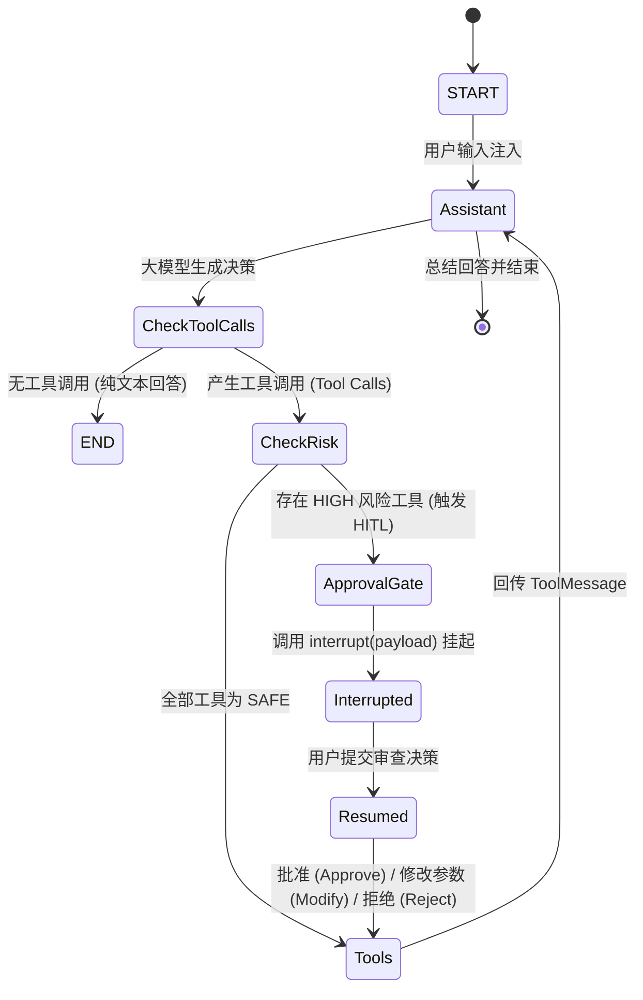

# 执行生命周期与状态机 (Execution Lifecycle & State Machine)

本文档详细描述了 Jarvis Studio 在处理外部请求时的内部生命周期与状态机转移逻辑，包括 API 网关调用、LangGraph 节点流转、SQLite 检查点快照，以及 Human-in-the-Loop (HITL) 中断恢复时序。

---

## 1. 运行时状态机 (Runtime State Machine)

核心执行图依托 LangGraph 的 `StateGraph` 构建，状态模式基于 `AgentState` 规范：

---

## 2. 三大核心执行场景剖析

### 场景一：纯对话交互 (Pure Conversational Query)
1. **请求到达**：用户通过 `POST /api/v1/chat` 或 CLI 发送 `"你好，你是谁？能帮我做什么？"`。
2. **服务调用**：`AgentService.invoke_agent()` 根据 `session_id` 绑定 `thread_id`，调用 `graph.ainvoke()`。
3. **推理节点**：`assistant` 节点注入系统 Prompt 与历史消息，大模型返回仅包含文本内容的 `AIMessage`，`tool_calls` 为空。
4. **路由判定**：`route_after_assistant()` 发现无工具调用，直接返回 `END`。
5. **持久化**：图运行结束，当前执行状态最终写入 SQLite Checkpointer。
6. **响应返回**：API 层返回 `ChatResponse(status="completed", output_text=...)`。

---

### 场景二：安全工具自主执行 (Autonomous Safe Tool Execution)
1. **请求到达**：用户发送 `"请列出当前工作区目录下的所有文件"`。
2. **推理节点**：大模型生成包含 `list_directory(directory_path=".")` 的工具调用请求。
3. **路由判定**：`route_after_assistant()` 检索 `ToolRegistry`，确认 `list_directory` 的风险等级为 `RiskLevel.SAFE`，且 `requires_approval=False`。
4. **工具节点**：图自动跳转至 `tools` 节点，`create_tool_executor_node` 在 `timed_step` 监控下执行并获取输出。
5. **结果封装**：执行结果被封装为合规的 `ToolMessage` 追加进 `messages` 列表。
6. **回环推理**：图自动流转回 `assistant` 节点，大模型根据读取到的目录内容生成人性化总结回复，最终经 Router 结束并返回。

---

### 场景三：高危操作人机协同审查 (Human-in-the-Loop Interruption)
1. **请求到达**：用户发送 `"在工作区运行 git status 查看改动"`。
2. **推理节点**：大模型生成调用 `execute_shell_command(command="git status")`。
3. **安全拦截**：`route_after_assistant()` 检测到 `execute_shell_command` 标记为 `RiskLevel.HIGH` 且 `requires_approval=True`，将图分流至 `approval_gate` 节点。
4. **中断冻结**：
   - `approval_gate` 生成 `ApprovalRequest` 记录（包含 `approval_id`、命令参数与风险描述）。
   - 节点直接调用 LangGraph 原生 `interrupt(approval_payload)`。
   - LangGraph 引擎在此处**自动挂起当前协程**，并将当前全量图状态快照保存至 SQLite。
5. **挂起响应**：`AgentService` 捕获到图的中断状态，立即向客户端返回 `ChatResponse(status="interrupted", pending_approval=...)`。
6. **人工审查与决策提交**：
   - 用户调用 `GET /api/v1/approvals` 审查拦截详情。
   - 用户调用 `POST /api/v1/approvals/{approval_id}/decision` 提交审查结果（例如 `decision="approve"` 或 `decision="reject"`）。
7. **无缝恢复执行**：
   - `AgentService.resume_approval()` 构造 `Command(resume=decision_payload)` 唤醒图执行。
   - SQLite 自动恢复中断点的内存上下文，`interrupt()` 返回用户的决策。
8. **安全执行与协议兼容**：
   - 若用户选择 **批准 (Approve)**：执行 Shell 命令并回传结果。
   - 若用户选择 **拒绝 (Reject)**：**不执行命令**，但自动构造包含拒绝原因的 `ToolMessage` 回传给大模型，避免大模型接口因缺少对应的 `tool_call_id` 而产生 400 协议错误。
   - 若用户选择 **修改 (Modify)**：采用用户修改后的参数执行并回传。
9. **完成任务**：流程流转回 `assistant` 节点生成最终回答。

---

## 3. 检查点机制与持久化

Jarvis Studio 的状态管理具备工业级韧性：
- **默认后端**：`SqliteSaver`，默认数据库路径为 `data/jarvis_studio.db`。
- **单元测试隔离**：`MemorySaver`，保证测试用例独立运行不污染磁盘。
- **线程级隔离**：所有状态通过 `thread_id`（由 `session_id` 派生）物理隔离，互不干扰。
- **故障自愈**：若服务在等待用户审批期间意外重启或宕机，挂起的执行状态安全保留在 SQLite 中，服务重启后依然可以通过 API 恢复执行。
