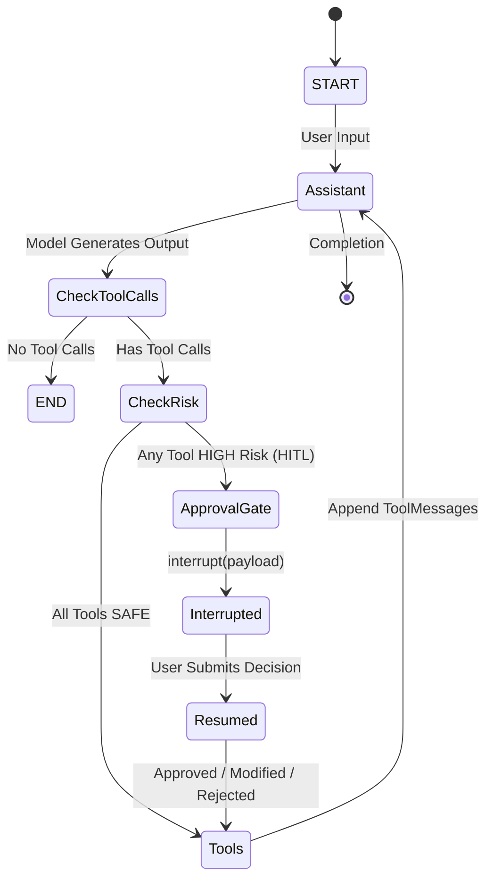

# Execution Lifecycle & State Machine

This document details the runtime lifecycle of requests inside Jarvis Studio, tracing execution from the API boundary through the LangGraph state machine, checkpoints, tool execution, and the Human-in-the-Loop (HITL) interrupt loop.

---

## 1. Runtime State Machine

The core execution graph is built on LangGraph's `StateGraph` using the `AgentState` schema:

---

## 2. Request Scenarios

### Scenario A: Pure Conversational Query (No Tools)
1. **Request**: The user sends `"Hello, what can you do?"` via `POST /api/v1/chat` or the CLI.
2. **Gateway**: `AgentService.invoke_agent()` loads the conversation thread via `thread_id` and executes `graph.ainvoke()`.
3. **Assistant Node**: The LLM processes the message history and system prompt, generating an `AIMessage` with content and empty `tool_calls`.
4. **Router**: `route_after_assistant()` detects no tool calls and returns `END`.
5. **Persistence**: The final state is committed to the checkpointer (SQLite or in-memory).
6. **Response**: `ChatResponse` is returned to the client with `status="completed"` and `output_text`.

---

### Scenario B: Safe Tool Execution (Autonomous)
1. **Request**: The user asks `"List the files in the current workspace"`.
2. **Assistant Node**: The LLM calls `list_directory(directory_path=".")`.
3. **Router**: `route_after_assistant()` inspects the tool name. `list_directory` has `RiskLevel.SAFE` and `requires_approval=False`.
4. **Tool Node**: `create_tool_executor_node` runs `list_directory` inside `timed_step`, capturing output.
5. **Append Result**: A `ToolMessage` containing the directory listing is appended to `messages`.
6. **Loop Back**: The graph routes back to `assistant`.
7. **Final Summary**: The LLM generates a response summarizing the directory contents. The router returns `END`.

---

### Scenario C: High-Risk Tool Execution (Human-in-the-Loop)
1. **Request**: The user asks `"Run 'git status' in the workspace"`.
2. **Assistant Node**: The LLM calls `execute_shell_command(command="git status")`.
3. **Router**: `route_after_assistant()` checks `ToolRegistry.requires_approval("execute_shell_command")`. It returns `True`.
4. **Approval Gate Node**:
   - Creates an `ApprovalRequest` record in `HITLManager`.
   - Triggers `interrupt(approval_payload)` via LangGraph.
5. **State Snapshot**: LangGraph halts execution at `approval_gate` and writes a checkpoint to SQLite.
6. **API Response**: `AgentService` detects the paused state and returns `ChatResponse(status="interrupted", pending_approval=...)`.
7. **User Decision**:
   - The user inspects the request via `GET /api/v1/approvals`.
   - The user submits `POST /api/v1/approvals/{id}/decision` with `"decision": "approve"`.
8. **Resumption**:
   - `AgentService.resume_approval()` invokes `graph.ainvoke(Command(resume=payload), config=config)`.
   - LangGraph unfreezes from the exact checkpoint.
   - `approval_gate` returns the decision payload to `AgentState`.
9. **Tool Execution**:
   - `tools` node executes the approved command with original or modified arguments.
   - If the decision was `"reject"`, the tool is **not** called; a `ToolMessage` indicating user cancellation is generated instead so the LLM can adjust its plan.
10. **Loop Back**: Execution returns to `assistant` to interpret the tool output and complete the task.

---

## 3. Checkpointing & State Persistence

Every execution step is captured by the checkpointer:
- **Default backend**: `SqliteSaver` pointing to `data/jarvis_studio.db`.
- **Testing backend**: `MemorySaver` for ephemeral, isolated test runs.
- **Thread Isolation**: All state checkpoints are isolated by `thread_id` (derived from `session_id`).
- **Crash Recovery**: If the server process restarts while an execution is paused for approval, the checkpoint remains in SQLite and can be resumed at any time.
