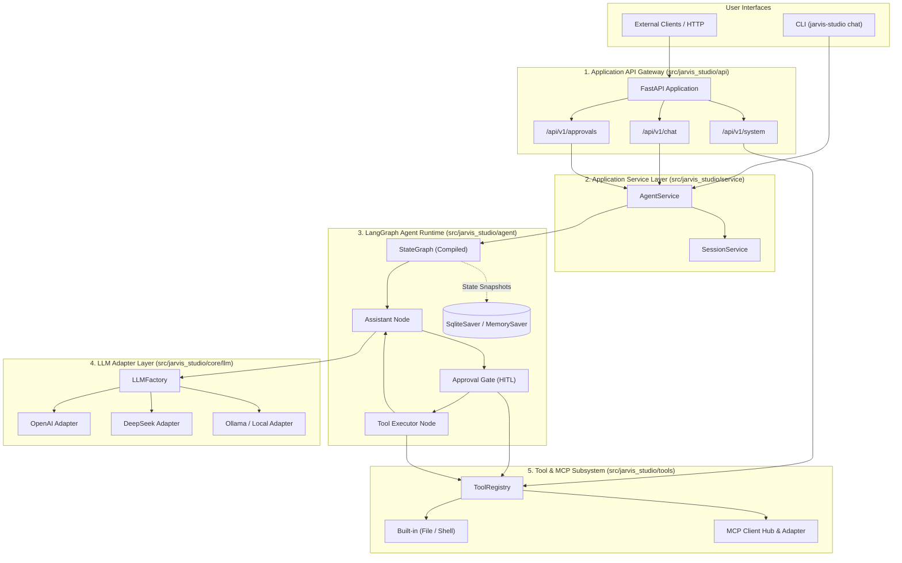

# System Architecture Specification

## 1. Executive Summary & Positioning

**Jarvis Studio** is a personal AI Operating Assistant designed for daily engineering, file management, and system task execution.

Unlike previous exploratory iterations:
- **Jarvis Agent**: Custom Python runtime built to study the internal mechanics of the ReAct agent loop. *(Archived)*
- **Jarvis Agent Plus**: LangChain framework abstraction study. *(Separate project)*
- **Jarvis Agent Pro**: LangGraph graph-based orchestration study. *(Separate project)*

**Jarvis Studio** does not reinvent the agent runtime. Instead, it leverages production-ready frameworks (**LangGraph**, **LangChain**, and **MCP**) to deliver reliability, safety, modularity, and personal extensibility.

---

## 2. Layered Architecture Blueprint

The system follows a strict 5-tier architecture to decouple the presentation, orchestration, state machine, and tool execution layers:

---

## 3. Layer Responsibilities & Contracts

### 3.1 Application API Gateway (`src/jarvis_studio/api`)
- **Technology**: FastAPI 0.115+, Pydantic 2.8+
- **Responsibility**: Exposes HTTP REST and SSE endpoints, validates request payloads, enforces CORS, handles HTTP exceptions, and maps internal execution results to standard responses (`ChatResponse`, `SystemStatusResponse`).
- **Boundary Rule**: The API layer **never** touches LangGraph nodes or checkpointers directly. It communicates exclusively via `AgentService` and `SessionService`.

### 3.2 Application Service Layer (`src/jarvis_studio/service`)
- **Components**: `AgentService`, `SessionService`
- **Responsibility**: Translates user requests into LangGraph invocations, manages `thread_id` correlation, inspects state snapshots for interrupts, and coordinates `Command(resume=...)` calls when approvals are submitted.
- **Boundary Rule**: Decouples the web framework from the agent graph, allowing the same agent logic to be consumed by the FastAPI web server, developer CLI, or automated test runners.

### 3.3 LangGraph Agent Runtime (`src/jarvis_studio/agent`)
- **Technology**: LangGraph 1.2+, `langgraph-checkpoint-sqlite`
- **Components**:
  - `AgentState`: TypedDict containing message history, execution context, and approval metadata.
  - `assistant`: Invokes the LLM bound with registered tools.
  - `approval_gate`: Evaluates whether pending tool calls require confirmation, calling `interrupt()` if dangerous.
  - `tools`: Safe tool execution node that handles execution, user rejections, and argument modifications.
  - `Checkpointer`: Persists every graph step to SQLite (`data/jarvis_studio.db`) or in-memory for testing.

### 3.4 LLM Adapter Layer (`src/jarvis_studio/core/llm`)
- **Component**: `LLMFactory`
- **Responsibility**: Instantiates `BaseChatModel` implementations based on configuration.
- **Zero Lock-in**: Seamlessly routes between OpenAI, DeepSeek (OpenAI-compatible), local Ollama, Anthropic Claude, and Google Gemini without changing agent graph code.

### 3.5 Tool & MCP Subsystem (`src/jarvis_studio/tools`)
- **Components**: `ToolRegistry`, built-in file and shell tools, `MCPClientManager`, `MCPToolAdapter`.
- **Responsibility**: Maintains tool inventory, tags safety levels (`RiskLevel.SAFE`, `RiskLevel.HIGH`), enforces approval flags, and dynamically converts MCP tool specifications into LangChain `BaseTool` instances.

---

## 4. Cross-Cutting Concerns

### 4.1 Observability & Tracing (`src/jarvis_studio/core/observability`)
- Every execution is tagged with:
  - `session_id`: Identifies the conversation thread.
  - `run_id`: Identifies the specific execution run.
- `timed_step` context manager logs entry, exit, duration in milliseconds, and status for all nodes and tool calls.
- `loguru` provides colorized console logging and rotating file logs (`logs/jarvis_studio.log`).

### 4.2 Configuration Management (`src/jarvis_studio/config`)
- Hierarchical configuration powered by `pydantic-settings`.
- Priority order: Environment variables (`.env`) > `config/settings.yaml` > Hardcoded defaults.
