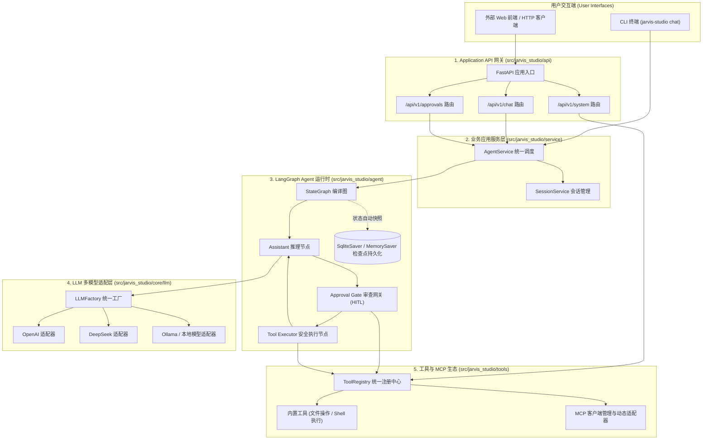

# 系统架构规范 (System Architecture Specification)

## 1. 定位与设计原则

**Jarvis Studio** 是一款面向个人日常软件工程、文件处理与系统任务执行的**个人生产级 AI 操作系统助理**。

与前三代探索型项目不同：
- **Jarvis Agent**：自研纯 Python Agent Runtime，旨在学习与探究 ReAct 循环、内存与工具调用的底层机制。*(已归档)*
- **Jarvis Agent Plus**：学习 LangChain 框架抽象与工具绑定的独立实验项目。*(独立项目)*
- **Jarvis Agent Pro**：学习基于 LangGraph 图编排的独立实验项目。*(独立项目)*

**Jarvis Studio 不再为了学习而重复造 Runtime**，而是全面采用官方成熟稳定的生产级框架（**LangGraph**、**LangChain** 与 **Model Context Protocol**），强调工程可靠性、系统安全边界、可替换模型生态与长期个人可维护性。

---

## 2. 5 层解耦架构蓝图

系统严格遵守分层隔离原则，解耦展示层、API 传输层、编排服务层、图状态机与底层工具生态：

---

## 3. 分层职责与边界约束

### 3.1 Application API 网关 (`src/jarvis_studio/api`)
- **技术选型**：FastAPI 0.115+，Pydantic 2.8+
- **核心职责**：暴露 HTTP REST 与流式输出接口、严格校验请求/响应 Pydantic Payload、配置 CORS、转换内部领域异常为标准 HTTP 状态码。
- **边界红线**：**API 层绝不允许直接操作 LangGraph 图节点或 Checkpointer**。所有智能体执行与恢复请求必须统一委托给 `AgentService`。

### 3.2 业务应用服务层 (`src/jarvis_studio/service`)
- **核心组件**：`AgentService`、`SessionService`
- **核心职责**：将外部请求转换为图状态调用、管理会话 Thread 生命周期、捕获并识别图的中断信号 (`interrupt`)，并在人工审批通过后构造 `Command(resume=...)` 恢复执行。
- **解耦价值**：该层彻底隔离了网络协议与智能体核心，使得 CLI 终端、Web API 或自动化测试套件能够以完全相同的代码路径调用底层智能体。

### 3.3 LangGraph Agent 运行时 (`src/jarvis_studio/agent`)
- **技术选型**：LangGraph 1.2+、`langgraph-checkpoint-sqlite`
- **核心组件**：
  - `AgentState`：强类型状态字典，通过 `add_messages` 归约器安全累加对话记录。
  - `assistant`：大模型推理节点，结合绑定的系统 Prompt 与工具列表生成响应。
  - `approval_gate`：安全网关节点，在发现高危工具调用时自动触发 `interrupt()` 中断。
  - `tools`：安全执行节点，按审批结果分流执行工具、应用修改参数或注入拒绝提示。
  - `Checkpointer`：基于 SQLite（`data/jarvis_studio.db`）或内存自动对每一步图状态进行检查点落盘。

### 3.4 LLM 多模型适配层 (`src/jarvis_studio/core/llm`)
- **核心组件**：`LLMFactory`、`ProviderSpec`
- **核心职责**：根据统一配置实例化对应的 LangChain `BaseChatModel`。
- **零硬编码**：全面适配 OpenAI、DeepSeek（兼容 OpenAI 协议）、本地 Ollama 及自定义端点。业务代码中不出现具体模型名称硬编码。

### 3.5 工具与 MCP 子系统 (`src/jarvis_studio/tools`)
- **核心组件**：`ToolRegistry`、内置文件/Shell 工具、`MCPClientManager`、`MCPToolAdapter`。
- **核心职责**：统一维护工具字典，强制标注三级安全分级（`SAFE`、`MEDIUM`、`HIGH`），并动态将外部 MCP Server 的 JSON Schema 映射为 LangChain 强类型工具。

---

## 4. 横切基础设施

### 4.1 全链路可观察性 (`src/jarvis_studio/core/observability`)
- 全局使用 Python `contextvars` 注入并在全链路流转 `session_id` 与 `run_id`。
- 提供 `timed_step` 上下文管理器，自动采集并打印各个节点与工具执行的毫秒级耗时及状态。
- 基于 `loguru` 提供彩色控制台输出与自动滚动日志文件（`logs/jarvis_studio.log`）。

### 4.2 配置管理体系 (`src/jarvis_studio/config`)
- 基于 `pydantic-settings` 实现分级加载。
- 优先级：`.env` 环境变量 > `config/settings.yaml` YAML 配置 > 默认缺省值。
