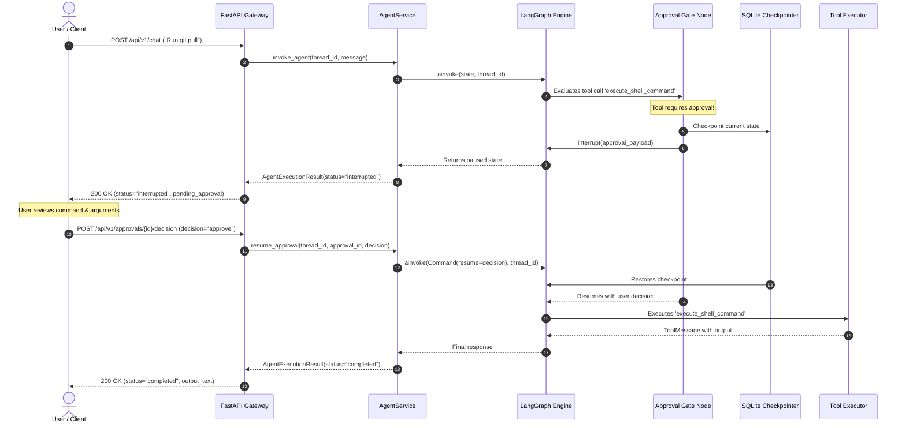

# Human-in-the-Loop (HITL) Specification

## 1. Motivation & Philosophy

Jarvis Studio operates with direct execution privileges over local files, the terminal shell, and connected external services (MCP). Autonomous execution of destructive commands poses unacceptable risks of data loss, unintended system changes, or security breaches.

**Core Principle**:
> High-risk operations must never execute without explicit, informed human confirmation.

---

## 2. Risk Classification Matrix

Tools registered in Jarvis Studio are assigned a safety rating:

| Risk Level | Description | Examples | Execution Policy |
| :--- | :--- | :--- | :--- |
| **SAFE** | Read-only operations without side effects | `read_file`, `list_directory`, `web_search` | Automated execution |
| **MEDIUM** | Non-destructive writes or ephemeral modifications | Creating temporary scratch files | Policy-dependent (configurable) |
| **HIGH** | File deletion, system mutation, shell execution, external API write | `execute_shell_command`, `write_file`, `delete_file`, `git_push` | **HITL Required (Mandatory Interrupt)** |

---

## 3. LangGraph Interrupt & Resume Mechanism

Jarvis Studio uses LangGraph's native `interrupt()` function rather than relying on brittle polling or blocking threads:



---

## 4. Rejection & Argument Modification Protocol

### 4.1 Safe Rejection Handling
Modern LLM APIs (OpenAI, Anthropic, DeepSeek) strictly enforce that every `tool_call_id` emitted in an assistant message must be followed by a matching `ToolMessage`.

If the user selects **REJECT**:
- The tool is **not** executed.
- `create_tool_executor_node` emits a synthesized `ToolMessage`:
  ```python
  ToolMessage(
      content=f"Operation cancelled: User rejected execution of '{tool_name}'. Reason: {decision_reason}",
      tool_call_id=call_id,
      name=tool_name,
  )
  ```
- The graph transitions back to `assistant`. The LLM receives the rejection notice and adjusts its plan without throwing API protocol errors.

### 4.2 Argument Modification
If the user selects **MODIFY**:
- The user provides updated parameters in `modified_arguments` (e.g. changing `git push --force` to `git push origin feature/dev`).
- The tool executor uses `modified_arguments` instead of the original parameters.

---

## 5. REST API Contract

### List Pending Approvals
- **Endpoint**: `GET /api/v1/approvals`
- **Response**:
```json
[
  {
    "id": "appr_7c8d9e1a",
    "thread_id": "sess_4f8b21c0",
    "run_id": "run_9a12b3c4",
    "tool_name": "execute_shell_command",
    "arguments": {
      "command": "git push origin main"
    },
    "risk_level": "HIGH",
    "status": "PENDING",
    "description": "Action 'execute_shell_command' requires confirmation",
    "created_at": 1727950000.0
  }
]
```

### Submit Decision & Resume
- **Endpoint**: `POST /api/v1/approvals/{approval_id}/decision`
- **Request Payload**:
```json
{
  "thread_id": "sess_4f8b21c0",
  "decision": "approve",
  "reason": "Verified commit history",
  "modified_arguments": null
}
```
- **Response**:
```json
{
  "thread_id": "sess_4f8b21c0",
  "run_id": "run_9a12b3c4",
  "status": "completed",
  "output_text": "Git push completed successfully: Everything up-to-date.",
  "pending_approval": null,
  "error": null
}
```
