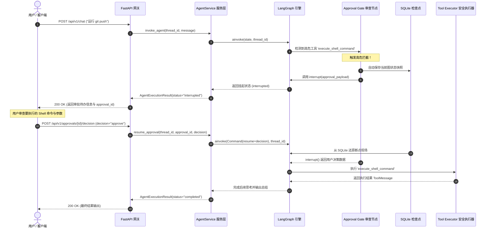

# Human-in-the-Loop (HITL) 人机协同规范

## 1. 设计初衷与安全哲学

Jarvis Studio 具备直接操作本地文件系统、执行系统终端命令以及调用外部 MCP 服务的强大权限。完全无约束的自主执行存在文件损坏、误删代码、未授权推送或执行破坏性系统命令的极高风险。

**核心准则**：
> **涉及高风险、不可逆或具有破坏性的操作，绝对不允许未经用户明确确认而自主执行。**

---

## 2. 工具风险分类矩阵 (Risk Classification Matrix)

Jarvis Studio 中的每个工具都强制赋予明确的风险等级：

| 风险等级 | 说明 | 典型示例 | 执行策略 |
| :--- | :--- | :--- | :--- |
| **SAFE (安全)** | 只读操作，零副作用，不改变任何系统状态 | `read_file`, `list_directory`, `web_search` | **自主自动执行** |
| **MEDIUM (中度)** | 产生临时或非破坏性写入，影响可控可逆 | 创建临时分析文件、记录 scratch 笔记 | 根据配置决定是否确认 |
| **HIGH (高危)** | 文件写入覆盖、文件删除、终端命令执行、外部服务变更 | `execute_shell_command`, `write_file`, `delete_file`, `git_push` | **强制中断确认 (Mandatory HITL)** |

---

## 3. LangGraph 原生中断与恢复时序

Jarvis Studio 采用 LangGraph 原生 `interrupt()` 协议，彻底告别了传统阻塞线程或长轮询的脆弱实现：



---

## 4. 拒绝执行与参数修改协议

### 4.1 协议合规的拒绝处理 (Safe Rejection Handling)
现代大模型 API（OpenAI、DeepSeek、Anthropic 等）严格要求：**Assistant 消息中生成的每一个 `tool_call_id`，在后续的消息序列中必须有对应的 `ToolMessage` 予以闭环**，否则接口直接报错崩溃。

当用户选择 **拒绝 (Reject)** 时：
- 系统**绝对不会**调用真实系统工具。
- `create_tool_executor_node` 会自动生成一条合规的合意回复：
  ```python
  ToolMessage(
      content=f"操作已取消：用户拒绝执行工具 '{tool_name}'。拒绝原因：{decision_reason}",
      tool_call_id=call_id,
      name=tool_name,
  )
  ```
- 大模型收到此通知后，获知操作已被用户拒绝，从而能够合规地自我调整计划或向用户寻求其他方案。

### 4.2 人工参数修改 (Argument Modification)
当用户选择 **修改 (Modify)** 时：
- 用户可以在审查载荷中提供 `modified_arguments`（例如将 `git push origin main --force` 修改为 `git push origin feature/dev`）。
- 执行节点会用人工订正后的参数替换大模型最初的入参执行，兼顾效率与安全。

---

## 5. REST API 接口契约

### 查询当前挂起的审批待办
- **请求方法与路径**: `GET /api/v1/approvals`
- **响应示例**:
```json
[
  {
    "id": "appr_7c8d9e1a",
    "thread_id": "sess_4f8b21c0",
    "run_id": "run_9a12b3c4",
    "tool_name": "execute_shell_command",
    "arguments": {
      "command": "git push origin main"
    },
    "risk_level": "HIGH",
    "status": "PENDING",
    "description": "执行危险工具 'execute_shell_command' 需要人工确认",
    "created_at": 1727950000.0
  }
]
```

### 提交审查决策并唤醒执行
- **请求方法与路径**: `POST /api/v1/approvals/{approval_id}/decision`
- **请求载荷**:
```json
{
  "thread_id": "sess_4f8b21c0",
  "decision": "approve", // 可选: "approve" (批准), "reject" (拒绝), "modify" (修改参数)
  "reason": "已人工确认提交记录无误",
  "modified_arguments": null
}
```
- **响应示例**:
```json
{
  "thread_id": "sess_4f8b21c0",
  "run_id": "run_9a12b3c4",
  "status": "completed",
  "output_text": "Git 推送成功：Everything up-to-date.",
  "pending_approval": null,
  "error": null
}
```
