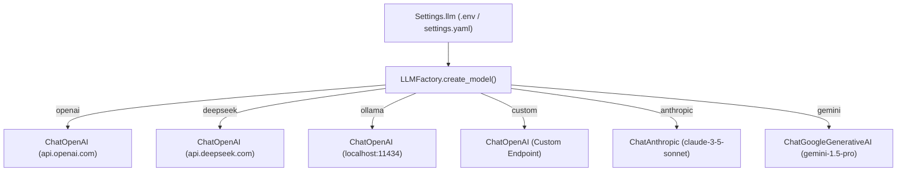

# LLM Adapter Layer Specification

## 1. Design Philosophy

In accordance with Principle 4 (*Swappable Models*), Jarvis Studio enforces strict protocol neutrality:
- **No Hardcoded Providers**: Model names and provider-specific parameters are never embedded directly in agent reasoning or prompt logic.
- **Unified Interface**: All LLMs are wrapped in standard LangChain `BaseChatModel` abstractions.
- **Runtime Swappability**: Switching models or providers requires only an environment variable or configuration change.

---

## 2. Architecture & Factory Pattern

The `LLMFactory` (`src/jarvis_studio/core/llm/factory.py`) serves as the single point of instantiation for all language models:



---

## 3. Supported Providers & Configuration

### 3.1 OpenAI
- **Provider Enum**: `openai`
- **Default Model**: `gpt-4o-mini`
- **Required Env**: `OPENAI_API_KEY`
- **Optional Env**: `OPENAI_BASE_URL` (Defaults to `https://api.openai.com/v1`)

### 3.2 DeepSeek
- **Provider Enum**: `deepseek`
- **Default Model**: `deepseek-chat`
- **Endpoint**: Uses `ChatOpenAI` pointed to `https://api.deepseek.com/v1`
- **Required Env**: `DEEPSEEK_API_KEY`
- **Optional Env**: `DEEPSEEK_BASE_URL`, `DEEPSEEK_MODEL_NAME`

### 3.3 Ollama / Local Models
- **Provider Enum**: `ollama`
- **Default Model**: `llama3.1:8b`
- **Endpoint**: Local OpenAI-compatible API at `http://localhost:11434/v1`
- **API Key**: Automatically populated with dummy key (`ollama`) as required by the client SDK.
- **Required Env**: `OLLAMA_BASE_URL`, `OLLAMA_MODEL_NAME`

### 3.4 Custom OpenAI-Compatible Endpoints
- **Provider Enum**: `custom`
- **Use Cases**: vLLM, SGLang, FastChat, OpenRouter, Groq.
- **Config**: Configurable via `OPENAI_BASE_URL`, `DEFAULT_MODEL_NAME`, and `OPENAI_API_KEY`.

### 3.5 Anthropic Claude & Google Gemini
- **Status**: Implemented via dynamic imports. Requires optional dependencies (`langchain-anthropic`, `langchain-google-genai`).
- **Graceful Degradation**: If configured without the corresponding optional dependency installed, raises a clear `ConfigurationError` explaining how to install the package via `uv add`.

---

## 4. Provider Selection & Override

The active model can be selected globally via `.env`:

```bash
# Switch to DeepSeek
DEFAULT_LLM_PROVIDER=deepseek
DEEPSEEK_API_KEY=sk-xxxx

# Or switch to local Ollama
DEFAULT_LLM_PROVIDER=ollama
OLLAMA_MODEL_NAME=qwen2.5:14b
```
