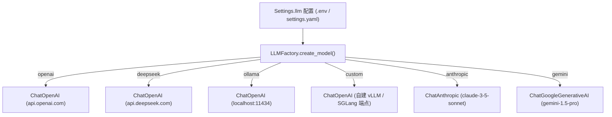

# LLM 多模型适配层设计规范 (LLM Adapter Layer)

## 1. 核心设计原则

根据**原则 4（可替换模型）**，Jarvis Studio 严格禁止模型与厂商绑死：
- **零硬编码**：图逻辑、节点实现与 Prompt 中绝不硬编码模型名称。
- **统一接口**：无论对接公有云 API 还是本地大模型，统一抽象为 LangChain `BaseChatModel`。
- **热插拔切换**：仅通过修改环境变量或 YAML 配置，即可完成模型底座的无缝切换。

---

## 2. 工厂架构设计 (Factory Pattern)

`LLMFactory` (`src/jarvis_studio/core/llm/factory.py`) 是整个系统创建语言模型实例的唯一入口：



---

## 3. 支持的供应商与配置规范

### 3.1 OpenAI
- **供应商枚举**: `openai`
- **默认模型**: `gpt-4o-mini`
- **必填环境变量**: `OPENAI_API_KEY`
- **可选环境变量**: `OPENAI_BASE_URL` (默认为官方 `https://api.openai.com/v1`)

### 3.2 DeepSeek
- **供应商枚举**: `deepseek`
- **默认模型**: `deepseek-chat`
- **适配原理**: 基于 `ChatOpenAI` 指向 DeepSeek OpenAI 兼容接口 `https://api.deepseek.com/v1`。
- **必填环境变量**: `DEEPSEEK_API_KEY`
- **可选环境变量**: `DEEPSEEK_BASE_URL`, `DEEPSEEK_MODEL_NAME`

### 3.3 Ollama / 本地私有化模型
- **供应商枚举**: `ollama`
- **默认模型**: `llama3.1:8b`
- **适配原理**: 自动连接本地 `http://localhost:11434/v1`，客户端自动填充占位 Key。
- **必填环境变量**: `OLLAMA_BASE_URL`, `OLLAMA_MODEL_NAME`

### 3.4 自定义 OpenAI 兼容端点 (Custom Endpoints)
- **供应商枚举**: `custom`
- **适用场景**: 自建 vLLM、SGLang、FastChat、OpenRouter 或企业私有网关。
- **配置项**: 配合 `OPENAI_BASE_URL` 与 `DEFAULT_MODEL_NAME` 自由组合。

### 3.5 Anthropic Claude 与 Google Gemini
- **当前状态**: 已完成封装代码；采用可选动态依赖导入。
- **优雅降级**: 若用户在未安装对应 SDK 的情况下切换至对应枚举，工厂会抛出友好的 `ConfigurationError`，提示通过 `uv add` 安装相应扩展包。

---

## 4. 模型切换操作示例

切换模型只需修改 `.env` 文件，无需重启修改代码：

```bash
# 切换为 DeepSeek 大模型
DEFAULT_LLM_PROVIDER=deepseek
DEEPSEEK_API_KEY=sk-xxxx

# 或者一键切换为本地离线 Ollama
DEFAULT_LLM_PROVIDER=ollama
OLLAMA_MODEL_NAME=qwen2.5:14b
```
