# Tool System & Safety Matrix Specification

## 1. Design Overview

In Jarvis Studio, tools are the primary mechanism for extending agent capabilities (Principle 5: *Tool First*). Rather than attempting to handle complex domain interactions through monolithic system prompts, capabilities are encapsulated into modular, typed, and testable tools.

Tools are managed centrally by the `ToolRegistry` and assigned explicit safety metadata before being bound to the LLM.

---

## 2. Tool Safety Contract

Every tool in Jarvis Studio is annotated with safety metadata via `tag_tool_safety`:

```python
class RiskLevel(str, Enum):
    SAFE = "SAFE"        # Read-only operations, zero state mutation
    MEDIUM = "MEDIUM"    # Ephemeral or reversible state changes
    HIGH = "HIGH"        # Destructive modifications, shell commands, network mutations

class ToolMetadata(BaseModel):
    name: str
    description: str
    risk_level: RiskLevel = RiskLevel.SAFE
    requires_approval: bool = False
    category: str = "general"
    tags: list[str] = []
```

### Safety Policy Enforcement
- Any tool flagged with `requires_approval=True` or `RiskLevel.HIGH` will trigger a graph interruption at the `approval_gate` node.
- Unrecognized or dynamically loaded tools without safety tags default to requiring human confirmation.

---

## 3. Built-in Tools Inventory

### 3.1 Filesystem Tools (`src/jarvis_studio/tools/builtin/file_tools.py`)

#### `read_file`
- **Category**: `filesystem`
- **Risk Level**: `SAFE` (Autonomous execution)
- **Parameters**:
  - `file_path` (str, required): Relative to workspace or absolute path.
  - `max_chars` (int, default: 20000): Maximum character limit to protect LLM context windows.
- **Path Resolution**: Resolved against `settings.storage.workspace_root` to enforce workspace boundaries.

#### `write_file`
- **Category**: `filesystem`
- **Risk Level**: `HIGH` (**HITL Approval Required**)
- **Parameters**:
  - `file_path` (str, required): Target destination path.
  - `content` (str, required): Content to write.
  - `overwrite` (bool, default: True): Whether to overwrite existing files.

#### `list_directory`
- **Category**: `filesystem`
- **Risk Level**: `SAFE` (Autonomous execution)
- **Parameters**:
  - `directory_path` (str, default: "."): Relative or absolute directory path.
- **Output**: Formatted list of entries with types (`[DIR]` or `[FILE]`) and file sizes in bytes.

---

### 3.2 System & Terminal Tools (`src/jarvis_studio/tools/builtin/shell_tools.py`)

#### `execute_shell_command`
- **Category**: `system`
- **Risk Level**: `HIGH` (**HITL Approval Required**)
- **Parameters**:
  - `command` (str, required): Command string to execute.
  - `cwd` (str, default: "."): Working directory within workspace.
  - `timeout_seconds` (int, default: 60): Command timeout threshold.
  - `max_output_chars` (int, default: 15000): Maximum character limit for combined stdout/stderr.
- **Platform Handling**: Automatically selects PowerShell on Windows and `/bin/bash` on Linux/macOS.

---

## 4. Model Context Protocol (MCP) Bridge

Jarvis Studio treats MCP as a first-class integration layer (Principle 6: *MCP First-Class*).

### 4.1 Schema Translation Architecture
External MCP servers expose tools using JSON Schema schemas. The `jarvis_studio.tools.mcp` module provides dynamic runtime translation into LangChain `BaseTool` models:

```mermaid
flowchart LR
    MCP_SRV["External MCP Server"] -->|JSON Schema Tools| MCP_CLIENT["MCPClientManager"]
    MCP_CLIENT -->|Tool Definition| ADAPTER["MCPToolAdapter"]
    ADAPTER -->|create_dynamic_args_schema| PYDANTIC["Dynamic Pydantic Model"]
    PYDANTIC --> LANGCHAIN_TOOL["LangChain BaseTool"]
    LANGCHAIN_TOOL --> REGISTRY["ToolRegistry"]
    REGISTRY --> AGENT["LangGraph StateGraph"]
```



### 4.2 Dynamic Type Mapping
The `create_dynamic_args_schema` function inspects MCP parameter types (`string`, `integer`, `number`, `boolean`, `array`, `object`) and generates a strongly-typed Pydantic model at runtime, ensuring complete compatibility with LangChain tool binding and function calling.
