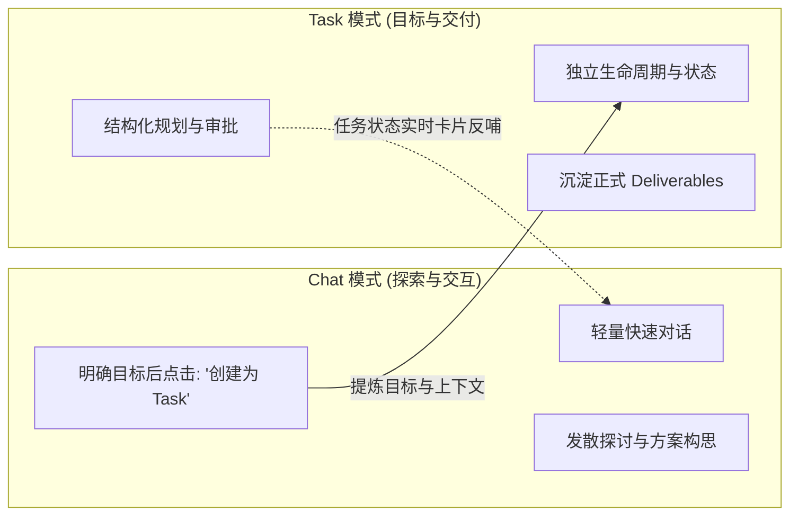
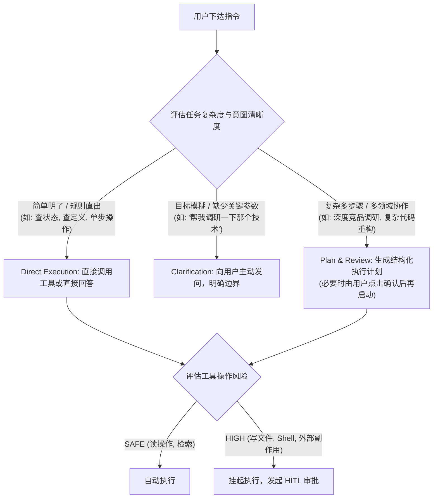
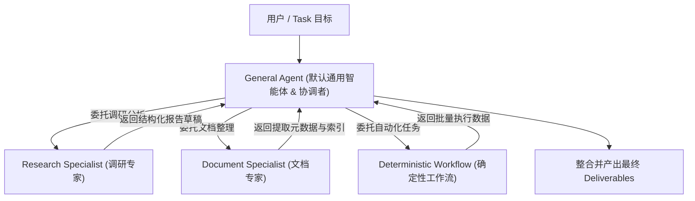

# AgentStudio 产品需求文档 (PRD v1.0)
## Personal AI Agent Workspace

> **产品代号**：AgentStudio  
> **产品副标题**：Personal AI Agent Workspace  
> **品牌理念**：Create · Orchestrate · Execute · Deliver  
> **文档版本**：v1.0 (Design Freeze)  
> **技术负责人 & 产品架构师**：AgentStudio Architecture Team  

---

## 1. 产品定位与核心价值

### 1.1 产品定义
> **AgentStudio is a personal AI Agent workspace where users can create, configure, orchestrate, and manage AI agents to accomplish real-world tasks, with full observability and user control.**

AgentStudio 是面向个人开发者、技术研究员和专业知识工作者的通用、可扩展、可观测的 **个人 AI Agent 工作空间**。

### 1.2 明确“不是什么”
- **不是简单的 LLM Chat UI**：Chat 只是交互方式之一，工作空间的核心是独立的目标完成与成果交付。
- **不是 Prompt 管理器**：不局限于静态模板拼接，强调动态工具调度与多步骤任务推进。
- **不是单纯的 Agent 开发框架**：提供开箱即用的端到端产品体验，无需用户编写代码即可运行与管理 Agent。
- **不是只展示思考过程的可视化 Demo**：一切可观测性服务于用户对真实任务的理解与控制，拒绝任何虚构思考动画。
- **不是以 Agent 数量为噱头的 Multi-Agent 炒作平台**：坚持渐进复杂度，绝不在简单任务上强行引入多 Agent 乱序对话。

### 1.3 核心价值主张
用户提出目标，AgentStudio 能够：
1. **理解与规划**：根据复杂度智能决断是否展示计划、何时直接执行、何时发起澄清；
2. **编排与协同**：调度默认通用 Agent 或委托专业 Agent，安全调用受控工具集与 MCP 扩展；
3. **闭环交付**：将执行过程沉淀为带版本和溯源的可用交付成果（如深度报告、代码、结构化数据）；
4. **全权掌控**：用户在任何时刻均可观察真实事件流、暂停、干预审批、修改参数或安全终止。

---

## 2. 目标用户画像

1. **软件工程师与技术负责人**：需要 Agent 协助进行技术方案调研、开源库对比评测、复杂脚本编写与跨系统 MCP 自动化操作，要求执行严格受控、不破坏工作区。
2. **研究员与行业分析师**：需要 Agent 在海量本地文献、技术白皮书和网络数据中进行深度检索、交叉核对，并直接输出结构清晰的 Markdown/HTML/PDF 深度调研报告。
3. **高级知识工作者 / 独立创造者**：需要统一的工作空间来组织个人长效记忆、维护本地私有知识库，并通过配置专业 Agent 处理重复性、多步骤的文档和信息流。

---

## 3. 核心设计原则

1. **Task Completion First (任务完成优先)**：以真实生产环境中的端到端任务闭环作为衡量标准，而非追求交互轮次或展示效果。
2. **Deliverable-centric (交付物为中心)**：任务的核心价值在于最终产出的可用成果（报告、代码、文件、结构化数据），而非淹没在漫长的对话流中。
3. **Bounded Autonomy (有界自主)**：Agent 拥有自主规划和工具组合权，但严禁擅自扩大权限、严禁越过工作区文件边界、高危副作用必须人工审批。
4. **User Control (用户全权受控)**：用户始终拥有最高决策权，执行状态与 Runtime 保持强一致，支持随时暂停、修改指令、恢复或取消。
5. **Observable by Design (原生可观测)**：仅呈现真实的执行事件（状态变迁、工具 I/O、Agent 交接、Token 成本），坚决杜绝伪造思考过程。
6. **Engineering Reliability (工程级高可靠)**：基于 WAL 单活排他锁、原子 CAS 租约和启动协调恢复，保障进程崩溃不撕裂数据、网络断连不泄露孤儿进程。
7. **Progressive Complexity (渐进式复杂度)**：简单任务直出直执，中等任务调用工具，复杂模糊任务才触发计划确认与专业 Agent 协作。

---

## 4. 第一阶段三大核心使用场景

| 场景代号 | 场景名称 | 用户痛点 | AgentStudio 解决方案 | 核心涉及能力 |
| :---: | :--- | :--- | :--- | :--- |
| **S1** | **Research & Analysis<br>(技术调研与方案分析)** *(MVP 首选)* | 调研耗时漫长，信息来源杂乱，缺乏多维度对比，手工撰写报告繁琐易漏。 | 用户输入调研目标，Agent 制定检索规划，调用搜索与知识库检索，专业研究 Agent 综合分析，最终生成带引用的标准化 Markdown/HTML 深度调研报告。 | Planning, Web/RAG Search, Specialist Agent, Markdown 交付物渲染与导出 |
| **S2** | **Knowledge & Documents<br>(文档分析与知识整理)** | 本地资料分散格式不一，传统搜索无法理解语义，无法基于私有知识形成连贯总结。 | 结合 sqlite-vec 增量索引与本地切块，Agent 跨文件抽取核心结论、整理术语表、生成知识摘要并归档为个人交付物。 | Vector Search (sqlite-vec), File Sandboxing, Chunking, Document Specialist |
| **S3** | **General Task Automation<br>(多步任务与受控自动化)** | 多步骤操作繁琐，涉及命令行与外部 API 时人工操作易出错，全自动执行又有破坏风险。 | 用户定义自动化流水线或多步工具组合，高危步骤触发 HITL 弹窗审批，支持参数微调后安全恢复，执行结果持久化沉淀。 | Shell Process Engine, MCP Stdio/SSE, HITL CAS 租约, 状态断点续跑 |

---

## 5. 交互模式：Hybrid (Chat + Task 并列协同)

AgentStudio 采用 **Chat + Task 并列双模交互**，彻底解决“纯对话易丢失目标”与“纯任务交互成本高”的对立。



### 5.1 Chat 模式职责
- **即时交互**：用于轻量咨询、发散讨论、日常指令下发。
- **任务孵化器**：用户可在对话过程中通过工具栏按钮或指令将某条意图转化为独立 Task，系统自动提取历史相关上下文填入 Task 初始描述。
- **关联可观测**：在 Chat 窗口中以浮动卡片展示当前关联 Task 的执行进度，点击可平滑跳转到任务详情页。

### 5.2 Task 模式职责
- **独立实体**：具备独立的目标、生命周期（`agent_tasks`）、执行历史（`agent_runs`）和产出成果。
- **脱离 Chat 独立存在**：用户可在任务中心直接“新建任务”，指定目标、绑定的专业 Agent 和截止要求，无需先开 Chat 对话。
- **交付物归宿**：任务产生的一切报告、生成文件、结构化结果均沉淀在 Task Detail 中。

---

## 6. 核心领域对象模型

系统必须严格分离并联动三大领域对象：**Session**、**Task**、**Run**。

```
Session (会话空间, 1:N)
   │
   └── Task (用户目标, 1:N)
          │
          └── Run (单次物理执行, 1:N)
                 ├── Events (真实事件流: tool, status, token)
                 ├── Approvals (HITL 审批节点)
                 └── Deliverables (正式交付物)
```

1. **Session (会话空间)**：
   - 用户与系统的持续交互上下文，维护消息历史（`chat_messages`）。
   - 一个 Session 可关联多个 Task（1:N），也可不关联任何 Task。
2. **Task (任务目标)**：
   - 用户期望达成的明确业务目标，对应持久化表 `agent_tasks`。
   - 包含：`task_id`, `title`, `query`, `status` (10态), `assigned_agent_id`, `created_at`, `completed_at`。
   - 一个 Task 可以经历多次执行（1:N Runs）。
3. **Run (物理执行轮次)**：
   - Task 的单次实际执行过程，对应持久化表 `agent_runs`。
   - 包含：`run_id`, `task_id`, `run_seq`, `status` (7态), `trigger_type` (initial / hitl_resume / recovery_resume), `checkpoint_id`, `duration_ms`。
   - **关键原则**：用户每次审批恢复（HITL Resume）或重试，均**递增 `run_seq` 并创建新的 Run**，彻底杜绝历史执行数据被覆盖。

---

## 7. 任务执行策略与渐进式复杂度

Agent 必须具备自适应策略，根据输入特征选择最优执行路径，坚决杜绝“为了形式主义而让每个简单问答都生成甘特图”：



- **计划确认 (Plan Confirmation)**：面向任务逻辑，确认“要做哪些步骤、各由谁负责”，可选择性跳过。
- **操作审批 (Operation Approval)**：面向安全底线，拦截高危工具执行，不可跳过。

---

## 8. 有界自主与用户控制能力

### 8.1 自主权边界 (Bounded Autonomy)
Agent 在被授权范围内具备充分自主规划能力，但受以下硬性技术屏障约束：
1. **工具权限边界**：仅能调用当前已授权给该 Agent 的工具，严禁自行扩展工具集。
2. **环境隔离边界**：文件操作严格受限于 `workspace_root`，路径逃逸直接抛出安全异常。
3. **外部安装边界**：严禁未经用户批准自行下载并配置新的 MCP 服务或外部可执行程序。
4. **副作用边界**：任何触及外部环境持久化变更的操作（覆盖关键文件、执行系统 Shell、网络写操作）必须申请审批。

### 8.2 用户控制权矩阵
| 控制动作 | 触发时机 | Runtime 行为与数据流 | 状态变迁 |
| :--- | :--- | :--- | :--- |
| **追加指令 (Amend)** | 任务运行中或完成后 | 向当前 Task 追加补充说明，触发新 Run 进行增量迭代。 | `COMPLETED` → `RUNNING` (Run+1) |
| **暂停执行 (Pause)** | 任务运行中 | 通知事件循环中断图步进，捕获当前状态快照至 SQLite。 | `RUNNING` → `INTERRUPTED` |
| **审批决策 (Resolve)** | 遇到敏感操作拦截 | 提交 Approve / Modify (修改实参) / Reject (附拒绝理由)。 | `WAITING_APPROVAL` → `RUNNING` (新 Run 唤醒) |
| **取消任务 (Cancel)** | 任何非终态阶段 | 终止对应 `asyncio.Task`，向子进程树发送终止信号，收敛 Outcome 为 `UNKNOWN`。 | `RUNNING` → `CANCELLED` / `UNKNOWN` |
| **重新执行 (Re-run)** | 任务完成后或失败后 | 基于当前 Task 重新启动全新 Run，可选择继承或清空上下文。 | 任意终态 → `RUNNING` (Run+1) |

---

## 9. 智能体体系与协作机制 (Hybrid Agent Architecture)

采用 **General Agent + Specialist Agents + Workflows** 的三位一体架构：



### 9.1 通用智能体 (General Agent)
- 系统默认 Agent，具备意图理解、全局工具调度与结果综合能力。
- 负责充当用户的第一交互界面与总协调者。

### 9.2 内置专业智能体 (Specialist Agents)
1. **Research Specialist (调研专家)**：专注网络检索、多源交叉核验、技术对比分析，配备 `search_knowledge_base`, `web_search` 工具，输出深度报告。
2. **Document Specialist (知识文档专家)**：专注复杂文档解析、结构化知识抽取与摘要整理，配备文件解析与向量检索工具。
3. **Automation Specialist (自动化执行专家)**：专注命令行批处理、代码运行与 MCP 交互，配备 Shell 与文件写入工具（受 HITL 强管控）。

### 9.3 协作与交接契约 (Handover Protocol)
- **拒绝 Context 无限膨胀**：禁止所有 Agent 共享单一巨型上下文。
- **结构化交接**：通用 Agent 向专业 Agent 发起委托时，通过标准结构传递上下文：
  ```json
  {
    "task_id": "task_abc123",
    "delegated_to": "specialist_research",
    "sub_goal": "调研 sqlite-vec 与 pgvector 在单机场景的性能差异",
    "required_output_schema": "markdown_report",
    "context_brief": "用户正在选型嵌入式向量数据库，重视单机零运维与内存占用。"
  }
  ```
- 专业 Agent 完成后，将结构化产物返回给通用 Agent，由通用 Agent 统一向用户交付。

---

## 10. 分层记忆体系 (Tiered Memory)

```
┌────────────────────────────────────────────────────────┐
│ Global Memory (全局长期记忆: 个人习惯、代码偏好、硬件配置) │
└──────────────────────────┬─────────────────────────────┘
                           │
┌──────────────────────────┴─────────────────────────────┐
│ Agent Memory (专业智能体记忆: 调研方法论、特定领域专业知识)   │
└──────────────────────────┬─────────────────────────────┘
                           │
┌──────────────────────────┴─────────────────────────────┐
│ Task Context (任务级临时上下文: 仅当前 Task 活跃期间有效)  │
└────────────────────────────────────────────────────────┘
```

1. **Global Memory**：全局持久化（`ltm_memories`），记录用户全局偏好（如“优先使用 Python 3.12”、“代码一律添加类型注解”）。每次任务启动时由 RouteGuard 自动注入。
2. **Agent Memory**：特定专业 Agent 的专属沉淀，记录该 Agent 在特定领域的经验准则。
3. **Task Context**：当前任务运行时状态（LangGraph AgentState），任务结束后自动销毁。
4. **任务后提炼 (Post-Task Distillation)**：任务完成后，系统提供一键“提炼关键记忆”能力，由用户勾选确认后沉淀至 Global 或 Agent Memory，避免无用上下文污染永久库。

---

## 11. 交付物管理体系 (Deliverable-Centric System)

交付成果是 AgentStudio 的第一核心产出物。

### 11.1 交付物模型定义 (`agent_deliverables`)
```sql
CREATE TABLE IF NOT EXISTS agent_deliverables (
    deliverable_id    TEXT PRIMARY KEY,
    task_id           TEXT NOT NULL,
    run_id            TEXT NOT NULL,
    title             TEXT NOT NULL,
    deliverable_type  TEXT NOT NULL, -- 'markdown_report', 'code_patch', 'file', 'data_table', 'json'
    file_path         TEXT,          -- 工作区相对存储路径
    mime_type         TEXT NOT NULL, -- 'text/markdown', 'text/html', 'application/json', etc.
    summary           TEXT,
    content_preview   TEXT,          -- 前 2000 字符文本预览
    metadata_json     TEXT,          -- 来源引用、token消耗、生成Agent等
    created_at        REAL NOT NULL,
    FOREIGN KEY (task_id) REFERENCES agent_tasks(task_id) ON DELETE CASCADE,
    FOREIGN KEY (run_id) REFERENCES agent_runs(run_id) ON DELETE CASCADE
);
```

### 11.2 交付物形态与渲染支持
- **Markdown / HTML 深度报告**：原生支持富文本解析、代码高亮、Mermaid 图表渲染与一键导出 PDF/HTML。
- **文件与代码**：展示 Diff 视图、文件树路径、一键复制与本地打开。
- **结构化数据**：支持表格数据实时分页浏览与导出 CSV/JSON。
- **简单任务产出**：若任务无需生成文件，则以标准格式化 `Result Summary` 交付，不强制伪造冗余文件。

---

## 12. 原生可观测性体系 (Observable by Design)

严格区分“业务可观测（用户关注）”与“底层链路追踪（开发者诊断）”：

### 12.1 面向用户的业务级可观测性 (Task Timeline)
在 Task Detail 页面展示直观的执行时间线：
- **阶段流转**：规划中 → 检索中 → 专业 Agent 分析中 → 交付物生成中。
- **工具调用卡片**：调用了什么工具、输入实参、执行耗时、输出关键摘要。
- **HITL 审批节点**：明确标出何处触发了人工干预、用户是批准还是修改了参数。
- **资源与耗时消耗**：总执行时长、总 Token 消耗量、调用模型预估成本。

### 12.2 面向开发者的底层技术级 Trace (Advanced Traces)
- 下沉为 Task 详情内的子标签页“技术诊断”。
- 提供 TTFT (首字耗时)、TTFA (首 Token 耗时)、TTLT (总耗时)、Raw Event JSON、Fast-path 命中状态。

---

## 13. MVP 功能范围界定 (Scope Definition)

### 13.1 MVP 核心范围 (In-Scope for MVP)
- **P0（基础可用与可靠性底座）**：
  1. 封装 Task & Run 独立 REST API（增删查改、按 Session 过滤）。
  2. 实现 Deliverable 领域模型、数据库表及文件落盘服务。
  3. 解耦 `AgentService` 中 Chat Session 与 Task 的 1:1 强绑定。
  4. 移除 `core/thinking/engine.py` 伪思考硬编码，替换为真实事件流。
- **P1（端到端体验闭环）**：
  1. 全新 SPA 前端架构：Dashboard、Chat、Task Center、Task Detail、Knowledge、Tools & MCP。
  2. 落地首个完备 Vertical Slice：**Research & Analysis 场景**（自然语言任务立项 → 智能规划 → 检索工具执行 → 专业调研撰写 → 产出 Markdown/HTML 深度报告 Deliverable → 用户浏览与下载）。
  3. Task 详情页提供完整的任务状态控制（Pause / Resume / Cancel）与真实 Timeline。
  4. HITL 审批界面支持操作修改参数（Modify）并可靠恢复执行。
- **P2（功能增强与扩展）**：
  1. 自定义 Agent 配置界面（Prompt、模型选择、工具勾选）。
  2. 交付物一键导出为独立文件。
  3. 品牌平滑迁移至 AgentStudio。

### 13.2 非 MVP 范围 (Out-of-Scope for MVP)
- 多租户与远程团队协作权限体系（保持单机单用户本地优先）。
- 分布式云端 Agent 调度网络。
- 自动化的外部 SaaS Webhook 接入。
- Docker 容器级安全沙箱（沿用已验证的 `resolve_safe_path` 进程树隔离）。

---

## 14. 核心功能验收标准 (Acceptance Criteria)

| 需求编号 | 功能项 | 为什么需要 | 用户如何使用 | 系统需要提供什么能力 | 验证标准 |
| :---: | :--- | :--- | :--- | :--- | :--- |
| **AC-01** | **独立 Task 创建与查询** | 目标需要独立于漫谈式 Chat 拥有持久化生命周期。 | 用户在 Task Center 点击“新建任务”，输入目标并提交；或在 Chat 中点击“转化为任务”。 | 提供 `POST /api/v1/tasks` 接口，自动在 `agent_tasks` 生成记录，启动首个 Run。 | 能够脱离 Chat 独立触发任务执行，在列表页刷新后状态持久可见。 |
| **AC-02** | **Deliverables 交付物生成与渲染** | 用户需要的是可用成果，而不是对话气泡中的零碎回复。 | 任务完成后，Task Detail 突出展示“交付成果”选项卡，直接预览报告并提供下载。 | 建立 `agent_deliverables` 表；提供存储与读取 API；前端适配 Markdown/HTML 渲染。 | 任务执行完毕后，工作区生成实体文件，UI 成功渲染出结构化报告，支持复制/导出。 |
| **AC-03** | **真实现场可观测性** | 消除黑盒焦虑与虚假思考文本，让用户信任 Agent。 | 用户在 Task Detail 实时查看 Agent 正在调用哪个工具、哪一步耗费多长时间。 | 后端 SSE 实时推送真实 `on_tool_start`, `on_tool_end`, `status_change` 事件，前端时间线动态追加。 | 运行时无硬编码伪文本；工具输入输出即时可见；耗时计算与数据库 Trace 毫秒级吻合。 |
| **AC-04** | **用户实时安全干预 (HITL)** | 防止 Agent 执行危险指令，赋予用户最终裁决权。 | 当 Agent 试图执行写文件或 Shell 时，界面弹出审批卡片，用户可批准、拒绝或改参。 | CAS 租约原子防重放；提交决策后通过 `Command(resume=...)` 创建新 Run 继续执行。 | 改参后工具使用新参数执行；拒绝后 Agent 正确收到拒绝提示并给出解释；断连重启后审批不丢失。 |
| **AC-05** | **任务随时取消与资源清理** | 避免死循环或错误任务持续消耗 Token 与本地系统资源。 | 用户在任务页面点击“取消任务”。 | 终止关联 `asyncio.Task`，通过 JobObject/killpg 回收可能拉起的子进程，标记状态为 `CANCELLED`。 | 进程树 0 残留；Task 状态变为 `CANCELLED` 或 `UNKNOWN`；后续请求不报锁竞争。 |
