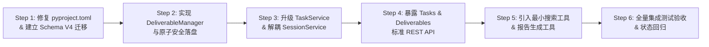

# Sprint 2A 实施方案与就绪审查规范 (Sprint 2A Implementation Plan)
## Task Domain Decoupling, Deliverables Pipeline & Research Readiness

> **文档代号**：`SPRINT_2A_IMPLEMENTATION_PLAN`  
> **实施版本**：Sprint 2A (Execution Baseline)  
> **前置依赖**：Sprint 1C 已冻结，五份架构设计已定稿，测试 213 项全绿  
> **核心目标**：解耦 Session/Task/Run、建立 Schema V4 与 Deliverables 管线、补齐最小搜索能力、暴露 REST API  
> **输出路径**：`docs/roadmap/SPRINT_2A_IMPLEMENTATION_PLAN.md`

---

## 1. 编码实施前必须解决的关键问题清单 (Pre-flight Checklist)

在敲下第一行业务代码前，必须在架构和配置上彻底消除以下 4 个阻塞隐患：

```
[Pre-flight 检查清单]
 [x] 1. 测试运行路径隐患: 修复 pyproject.toml 中的 pythonpath = [".", "src"]
 [x] 2. 数据库级联误杀风险: 确立 Schema V4 中 agent_tasks.session_id 为 NULLABLE
 [x] 3. 搜索能力真实性结论: 明确当前无内置 web_search，制定最小适配方案
 [x] 4. 交付物安全防线: 严格将 Deliverable 落盘收敛于 workspace/deliverables/{task_id}/
```

### 1.1 阻碍点 1：`pyproject.toml` 测试路径配置修复
- **现状**：`pyproject.toml` 中的 `pythonpath = ["src"]` 缺少根目录 `.`，导致测试 `tests/test_phase2_shutdown.py` 中 `from tests.test_mcp import ...` 在直接运行 `uv run pytest` 时因找不到 `tests` 模块而抛出 `ModuleNotFoundError`。
- **解决行动**：Sprint 2A 第一步更新 `pyproject.toml` 为 `pythonpath = [".", "src"]`，确保本地与 CI/CD 环境下 213 项测试 100% 直接通过。

### 1.2 阻碍点 2：数据库级联误杀风险彻底解除
- **现状**：现有 `agent_tasks` 外键对 `chat_sessions` 设置了 `ON DELETE CASCADE`。
- **解决行动**：在 Schema V4 中将外键行为严格更新为 `ON DELETE SET NULL`，并在 `SessionService.delete_session` 中移除 `DELETE FROM agent_tasks`，改为 `UPDATE agent_tasks SET session_id = NULL`。

### 1.3 阻碍点 3：调研切片（Research Slice）的真实工具能力定性
- **代码核查实情**：经全面检索，**当前代码库内仅有 `search_knowledge_base` (本地 RAG)、`read_file`、`write_file`、`execute_shell_command`，完全不存在任何开箱即用的内置网络搜索工具（Web Search Tool）**！
- **应对方案**：
  1. **首选支撑（本地深度调研）**：利用工作区现有文档与代码结合 `sqlite-vec`，已具备 100% 本地文档深度调研与报告生成能力；
  2. **最小新增（外部网络检索）**：在 Sprint 2A 补齐一个极其轻量且可靠的通用搜索接口 `search_web`（支持免 Key 的 DuckDuckGo 适配器或标准 Tavily 接口，并在网络受限时优雅降级为本地 RAG 检索），不让网络搜索成为阻碍 Research 切片落地的卡点。

---

## 2. Sprint 2A 详细实施步骤与代码工程分解



---

### Step 1：工程配置修复与数据库 Schema V4 迁移落地
- **目标**：实现数据库从 V3 到 V4 的原子无损升级。
- **修改文件**：
  - `pyproject.toml`：修改 `pythonpath = [".", "src"]`；
  - `src/jarvis_studio/core/persistence/migrations.py`：
    - `APP_SCHEMA_VERSION = 4`；
    - 编写 `_APP_V4_STATEMENTS`：创建 `agent_tasks_v4`（`session_id` NULLABLE，外键 `ON DELETE SET NULL`），复制旧表数据，原子重命名替换；
    - 创建 `agent_deliverables` 表；
    - 创建 `agent_events` 表。
- **测试保障**：编写 `tests/test_persistence_v4_migration.py`，验证从空库初始化、从 V3 迁移到 V4、重复执行幂等性以及数据无损性。

---

### Step 2：实现交付物管理服务 (`DeliverableManager`)
- **目标**：建立交付物从校验、安全落盘、元数据入库到流式下载的完整服务。
- **新建文件**：`src/jarvis_studio/service/deliverable_manager.py`
- **核心能力**：
  ```python
  class DeliverableManager:
      def create_deliverable(
          self,
          task_id: str,
          run_id: str,
          title: str,
          deliverable_type: DeliverableType,
          content: str | bytes,
          mime_type: str = "text/markdown; charset=utf-8",
          metadata: dict[str, Any] | None = None,
      ) -> DeliverableRecord:
          """原子写入临时文件，哈希校验，原子移动到 workspace/deliverables/{task_id}/run_{seq}/，入库元数据"""
  ```
- **安全保障**：
  - 调用 `resolve_safe_path` 验证落盘路径严格位于 `workspace/deliverables/{task_id}/`；
  - 单文件限制 20MB；
  - 临时文件 `.tmp` 写入，刷盘后原子 `os.replace`，异常自动清理碎片；
  - 提供 `get_deliverable_file_path` 严格防止路径遍历。

---

### Step 3：升级 `TaskService` 并彻底解耦 `SessionService`
- **目标**：将 `TaskCoordinator` 升级为具备独立业务能力的 `TaskService`，剥离 `SessionService` 对任务的干预。
- **修改文件**：
  - `src/jarvis_studio/service/task_service.py`（重构/演进现有的 `core/tasks/coordinator.py` 与 `service/task_coordinator.py`）：
    - `create_task(query, session_id=None, initiator="user", assigned_agent="general_agent")`；
    - `list_tasks(session_id=None, status=None, limit=50)`；
    - `get_task(task_id)`；
    - `delete_task(task_id)`：原子级联清理 Run、Deliverable 元数据及物理文件。
  - `src/jarvis_studio/service/session_service.py`：
    - `delete_session` 改写：不再执行 `DELETE FROM agent_tasks`，改为 `UPDATE agent_tasks SET session_id = NULL WHERE session_id = ?`；
    - 彻底保留任务资产。

---

### Step 4：新增 API 网关路由 (`routes/tasks.py` & `deliverables.py`)
- **目标**：对外暴露符合 REST 规范的 Task 与 Deliverable 接口。
- **新建文件**：
  - `src/jarvis_studio/api/routes/tasks.py`：
    - `POST /api/v1/tasks`：独立创建任务，自动触发 Run #1；
    - `GET /api/v1/tasks`：查询任务列表（支持 `session_id` 过滤或查询全部独立任务）；
    - `GET /api/v1/tasks/{task_id}`：获取任务详情、当前 Run 状态与交付物摘要；
    - `POST /api/v1/tasks/{task_id}/cancel`：主动取消任务；
    - `DELETE /api/v1/tasks/{task_id}`：安全删除任务与关联文件。
  - `src/jarvis_studio/api/routes/deliverables.py`：
    - `GET /api/v1/deliverables/{deliverable_id}`：获取元数据与 2000 字符文本预览；
    - `GET /api/v1/deliverables/{deliverable_id}/download`：安全流式下载物理文件（带正确的 Content-Type 与 Content-Disposition）；
    - `GET /api/v1/tasks/{task_id}/deliverables`：获取指定任务的所有交付物列表。
- **注册**：在 `src/jarvis_studio/api/app.py` 中挂载新路由。

---

### Step 5：调研垂直切片工具就绪（最小搜索与报告生成工具）
- **目标**：为首个垂直切片（Research & Analysis）打通工具链。
- **新建/修改文件**：
  - `src/jarvis_studio/tools/builtin/search_tools.py`：
    - 实现 `search_web(query, top_k=5)`：轻量网络检索工具，支持 DuckDuckGo / Tavily 或无网时自动降级到 `search_knowledge_base`；
    - 严格返回包含 `title`, `url`, `snippet` 的结构化来源，供模型在撰写报告时准确引用，杜绝幻觉伪造文献；
  - `src/jarvis_studio/tools/builtin/report_tools.py`：
    - 实现 `publish_research_report(task_id, run_id, title, markdown_content, citations)`：直接与 `DeliverableManager` 联动，将最终生成的报告落盘为 `.md` 交付物。
- **注册**：注册入 `ToolRegistry` 并标记安全级别为 SAFE（检索）和 HIGH（发布落盘需受控）。

---

### Step 6：集成测试套件与端到端闭环验证
- **新建测试文件**：
  - `tests/test_sprint2a_task_service.py`：测试独立建任务、从会话建任务、删会话保留任务、删任务清理物理文件；
  - `tests/test_sprint2a_deliverables_api.py`：测试交付物落盘、防路径穿越校验、流式下载、超大文件阻断；
  - `tests/test_sprint2a_tasks_api.py`：测试 Task REST API 全量状态流转。
- **回归要求**：原有 213 项测试 + 新增测试，全量 100% 通过。

---

## 3. 验收标准与交付物契约 (Acceptance Criteria)

| 验收编号 | 验收项 | 验证命令 / 测试用例 | 预期结果 |
| :---: | :--- | :--- | :--- |
| **AC-2A-1** | **全量测试基线全绿** | `uv run pytest` | 修复 pythonpath 后，原有全部 213 项用例直接全绿通过，无导入错误。 |
| **AC-2A-2** | **Schema V4 迁移幂等与防丢失** | `tests/test_sprint2a_task_service.py` | 成功完成 V3->V4 迁移，旧任务数据 100% 保留，重复运行迁移无报错。 |
| **AC-2A-3** | **独立 Task 增删查改** | `POST /api/v1/tasks` (不传 session_id) | 任务创建成功，`session_id` 为 null，返回唯一 `task_id`，状态为 `CREATED` 或 `RUNNING`。 |
| **AC-2A-4** | **删除 Session 保留 Task** | `DELETE /api/v1/sessions/{id}` | 对应 session 被删，其消息被清空，但其关联的 Task 依旧完好存在于 `agent_tasks` 中，`session_id` 被更新为 NULL。 |
| **AC-2A-5** | **Deliverables 安全落盘与流式下载** | `GET /api/v1/deliverables/{id}/download` | 成功下载文件；传入伪造路径或越界路径一律返回 403/404，绝不泄露服务器文件。 |
| **AC-2A-6** | **删除 Task 物理清理** | `DELETE /api/v1/tasks/{id}` | 数据库记录删除，工作区对应 `deliverables/{task_id}/` 物理目录被彻底物理清理。 |
