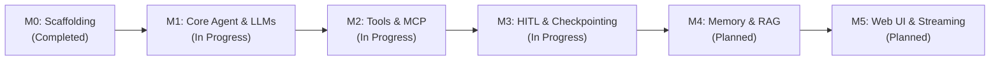

# Jarvis Studio - Engineering Roadmap

This document outlines the product evolution and engineering milestones of **Jarvis Studio**.

Status Legend:
- `[x] Completed`: Implemented, tested, and active in the codebase.
- `[~] In Progress`: Core design or partial implementation complete; active development underway.
- `[ ] Planned`: Formally scheduled for subsequent engineering phases.

---

## Milestone Overview

---

### Milestone 0: Architecture Baseline & Scaffolding
*Goal: Establish the 5-tier decoupled architecture, dependency baseline, and automated testing foundation.*

- [x] Establish architectural blueprint and layered design (`docs/architecture/system-architecture.md`).
- [x] Configure Python 3.12 virtual environment managed with `uv`.
- [x] Pin official dependencies: `langgraph (1.2+)`, `langchain (1.4+)`, `fastapi (0.115+)`, `mcp (2.3+)`, `pydantic (2.13+)`.
- [x] Design directory structure separating Application, Service, Agent, Tools, and Core.
- [x] Implement unified configuration system with `.env`, `settings.yaml`, and Pydantic models.
- [x] Set up automated testing framework (`pytest`, `pytest-asyncio`).

---

### Milestone 1: Multi-Provider LLM Engine & Core Runtime
*Goal: Ensure seamless model swappability without hardcoded dependencies, and build the foundational StateGraph.*

- [x] Implement `LLMFactory` supporting:
  - [x] OpenAI (`gpt-4o`, `gpt-4o-mini`)
  - [x] DeepSeek (`deepseek-chat` via OpenAI-compatible endpoint)
  - [x] Local Ollama (`llama3.1`, `qwen2.5`)
  - [x] Custom OpenAI-compatible endpoints (vLLM, SGLang)
- [~] Extended Provider Support:
  - [~] Anthropic Claude (adapter implemented; pending live API key validation)
  - [~] Google Gemini (adapter implemented; pending live API key validation)
- [x] Construct `AgentState` schema with `messages` reducer and execution metadata.
- [x] Implement core graph nodes (`assistant`, `approval_gate`, `tools`, `router`).
- [x] Automated test coverage for pure conversation and tool-calling loops.

---

### Milestone 2: Tool Subsystem & MCP Client Integration
*Goal: Provide essential daily engineering tools and a standardized MCP bridge for external capabilities.*

- [x] Implement `ToolRegistry` with `RiskLevel` safety matrix.
- [x] Built-in filesystem tools:
  - [x] `read_file` (Safe, context-capped)
  - [x] `write_file` (High Risk, HITL-protected)
  - [x] `list_directory` (Safe)
- [x] Built-in terminal tool:
  - [x] `execute_shell_command` (High Risk, timeout-guarded, HITL-protected)
- [x] Dynamic MCP JSON-to-Pydantic schema converter (`MCPToolAdapter`, `create_dynamic_args_schema`).
- [~] Model Context Protocol (MCP) Client Hub:
  - [x] Configuration loading from `config/mcp_servers.json`
  - [ ] Live stdio sub-process lifecycle manager
  - [ ] Live SSE transport client
  - [ ] Automated discovery of workspace MCP servers

---

### Milestone 3: Human-in-the-Loop (HITL) & Persistent Checkpointing
*Goal: Enforce strict safety boundaries for dangerous operations with durable state persistence.*

- [x] SQLite-backed LangGraph checkpointer (`SqliteSaver` pointing to `data/jarvis_studio.db`).
- [x] Memory-backed checkpointer (`MemorySaver`) for isolated unit testing.
- [x] LangGraph native `interrupt()` pause mechanism inside `approval_gate`.
- [x] Approval state machine (`PENDING`, `APPROVED`, `REJECTED`, `MODIFIED`).
- [x] Resumption protocol via `Command(resume=decision)`.
- [x] Safe rejection handling emitting valid `ToolMessage` instances to preserve LLM API contracts.
- [x] REST API endpoints (`GET /api/v1/approvals`, `POST /api/v1/approvals/{id}/decision`).
- [ ] Configurable approval timeout rules and auto-expiration.

---

### Milestone 4: Personal Memory & Local Knowledge Base (RAG)
*Goal: Provide long-term personalized context, preference adaptation, and semantic document retrieval.*

- [x] Checkpoint-level conversation history persistence per thread.
- [ ] Long-Term Memory (LTM):
  - [ ] User preferences, coding conventions, and environment context.
  - [ ] Semantic profile extraction from conversations.
- [ ] Local RAG Knowledge Base:
  - [ ] Embedding pipeline integration.
  - [ ] Local vector storage utilizing `sqlite-vec`.
  - [ ] Workspace document ingestion (markdown notes, codebases).
  - [ ] Agent retrieval and citation tools.

---

### Milestone 5: Application Gateway, Streaming & User Interface
*Goal: Deliver a polished, full-stack personal AI assistant for daily desktop and web operation.*

- [x] FastAPI REST API gateway (`/system`, `/chat`, `/approvals`).
- [x] Interactive Developer CLI (`jarvis-studio info`, `serve`, `chat`).
- [ ] Server-Sent Events (SSE) token and step streaming endpoint.
- [ ] Bidirectional WebSocket control protocol.
- [ ] Web UI frontend (Next.js / Tailwind CSS):
  - [ ] Conversational chat interface with Markdown and code highlighting.
  - [ ] Interactive HITL Approval Review Modal (command inspect, diff view, approve/reject/modify buttons).
  - [ ] Tool registry catalog & MCP server connection toggles.
- [ ] Deployment and packaging:
  - [ ] Containerization (Dockerfile + Docker Compose).
  - [ ] Background service daemon script for Windows / macOS.
